# Mappa Mercati Privati

_Intelligence sulle aziende non quotate, dalla tesi alla short list._

**Manifest:** valid (schema + runtime contract) · **Functional test:** passed (13 checks passed)

## Description given to the app builder (Italian)

Mi serve Mappa Mercati Privati, una piattaforma di intelligence su aziende non quotate per fondi, banche d'affari e corporate development. L'analista definisce una tesi di ricerca, per esempio aziende italiane di software verticale per la logistica tra 5 e 50 milioni di fatturato. Un agente cerca sul web con ricerche mirate, visita i siti delle aziende, legge news e comunicati, ed estrae per ciascuna attività, prodotti, clienti citati, dimensione del team, sede, round di finanziamento e segnali di crescita come nuove assunzioni o aperture. I dati vengono indicizzati in un motore di ricerca con filtri e raccolti in una base di conoscenza su cui l'analista può fare domande in chat. I dati di bilancio e le informazioni del registro imprese vengono da un fornitore a pagamento via API, che il cliente collega con la propria licenza. Per ogni azienda l'agente produce una scheda standard secondo un template, e per la tesi una mappa competitiva con long list e short list. Ogni settimana segnala le novità sulle aziende seguite. Ogni team vede solo le proprie tesi. Abbonamento annuale per utente.

## Features not expressible today (spec.extensions)

- **search_engine**: Dedicated faceted search index with filters over companies (sector, size, HQ, funding): today companies are searchable and filterable through the table and the chat tool.
- **provider_host**: The egress host and API path of the chosen registry/financials provider must be replaced with the real one before publishing.

## Screenshots (interpretive runtime, no data)

### home-anon
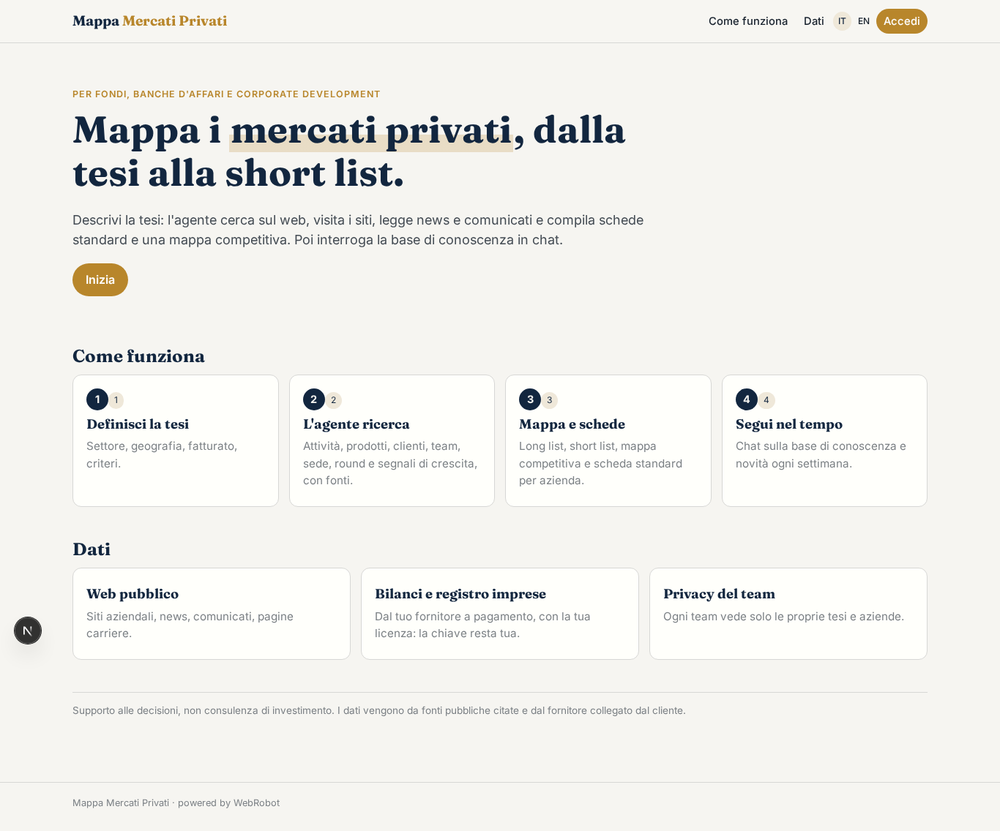

### home-mobile
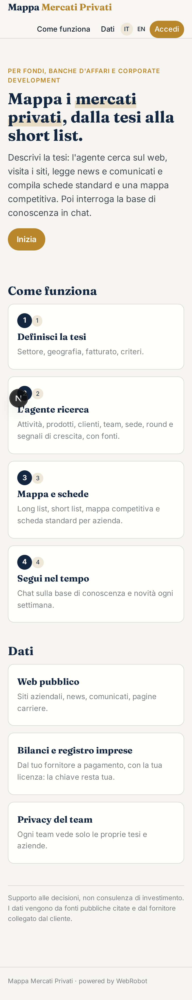

### home
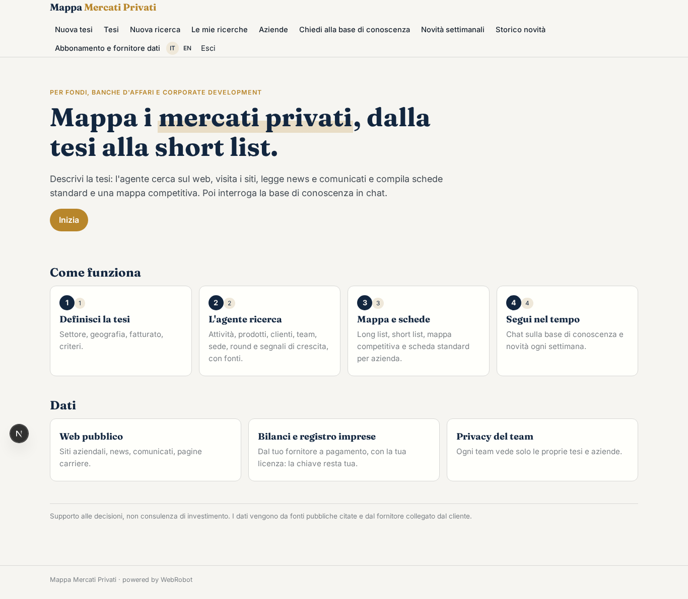

### theses_form
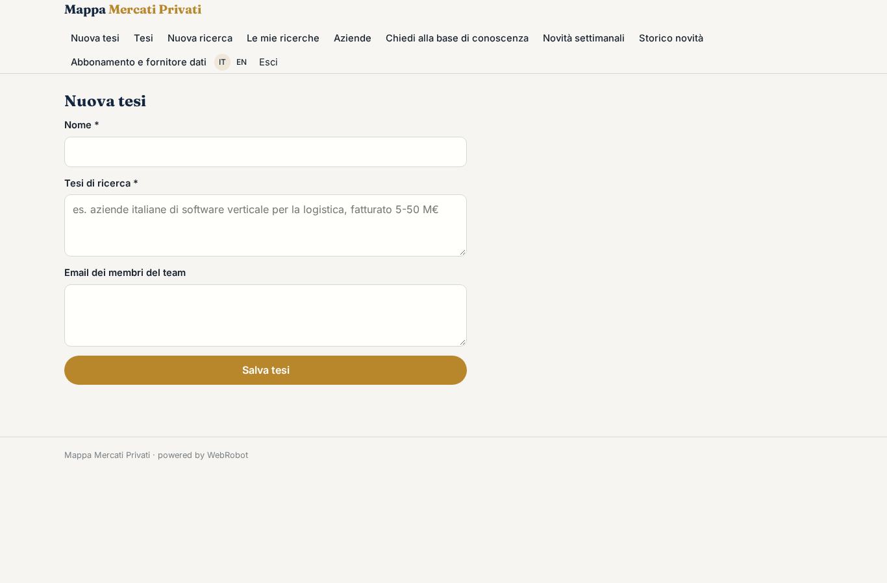

### theses
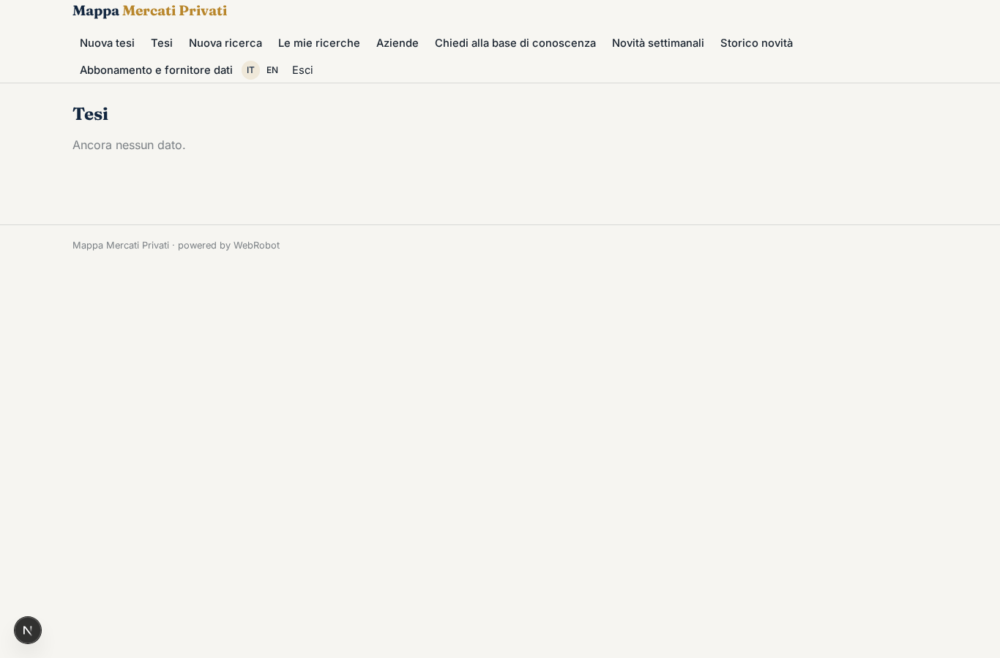

### new_research
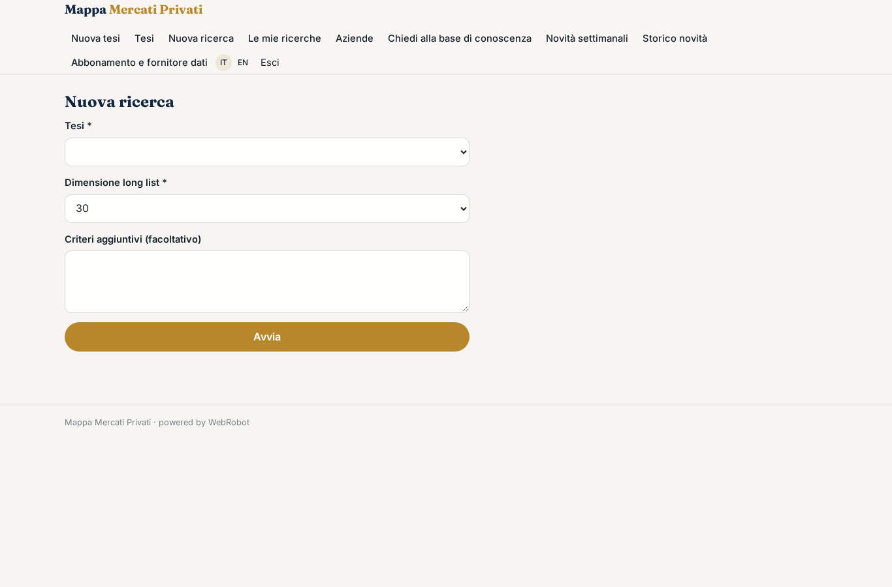

### research

### companies
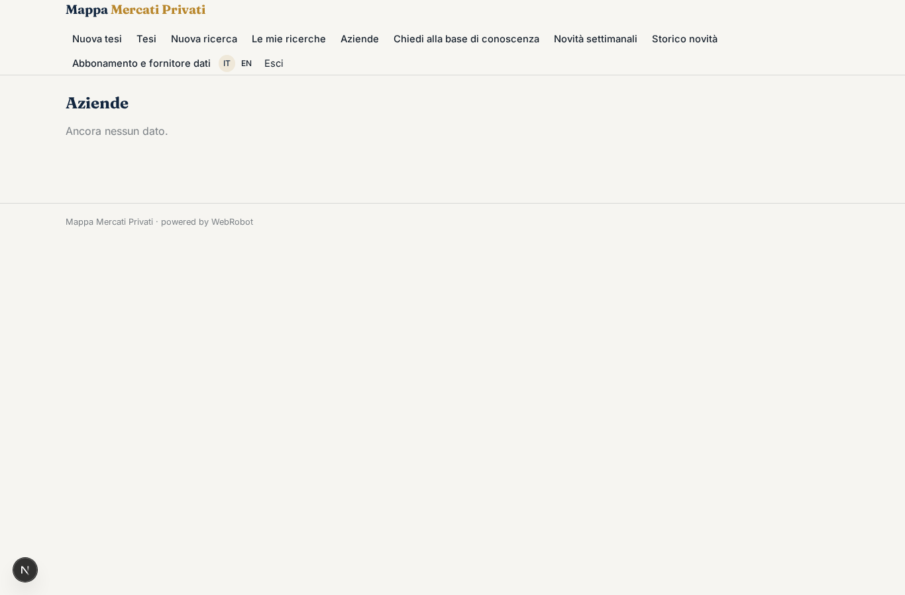

### chat
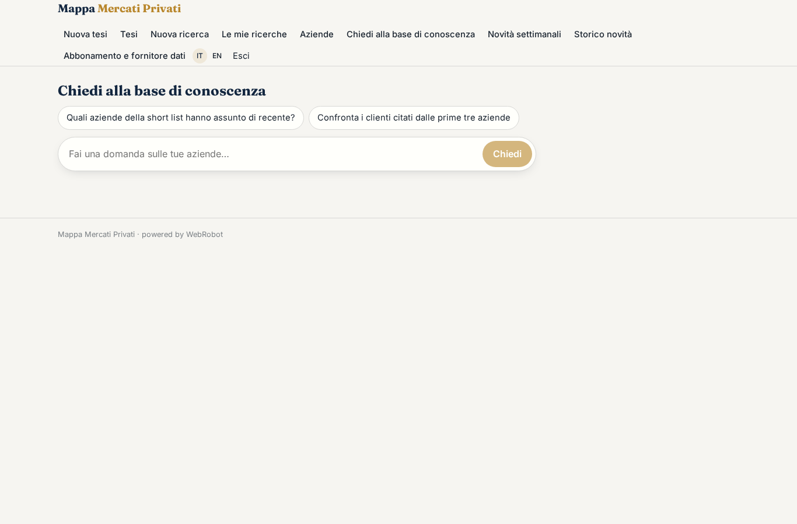

### watches
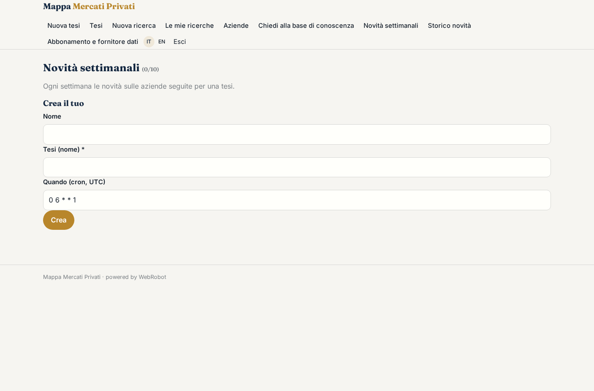

### updates
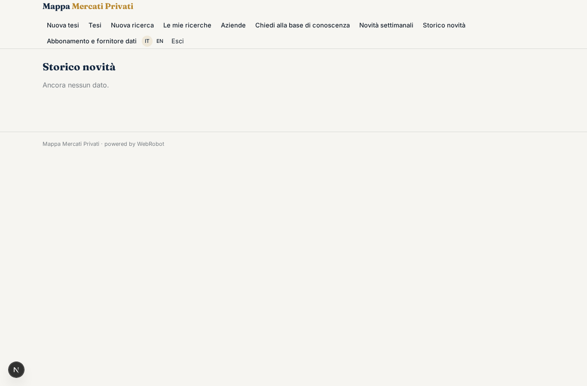

### account
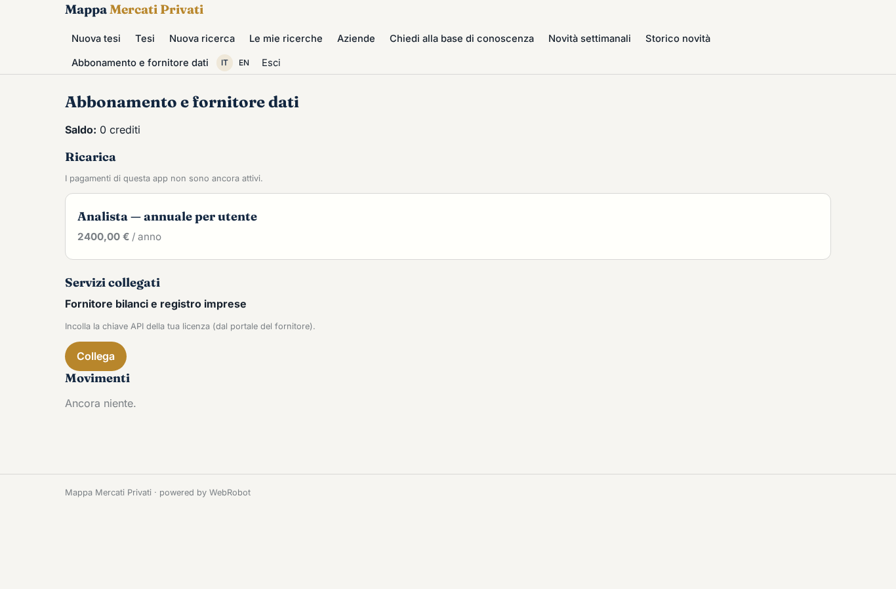
