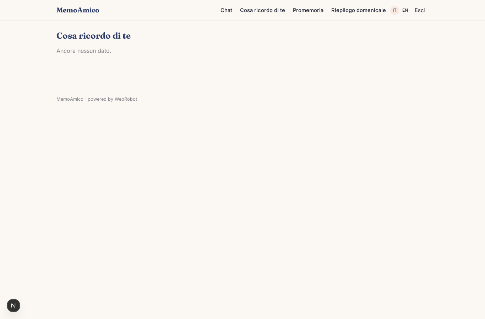
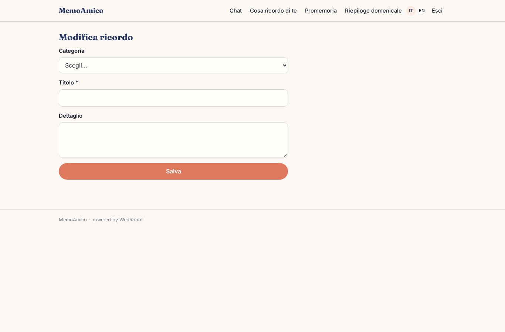
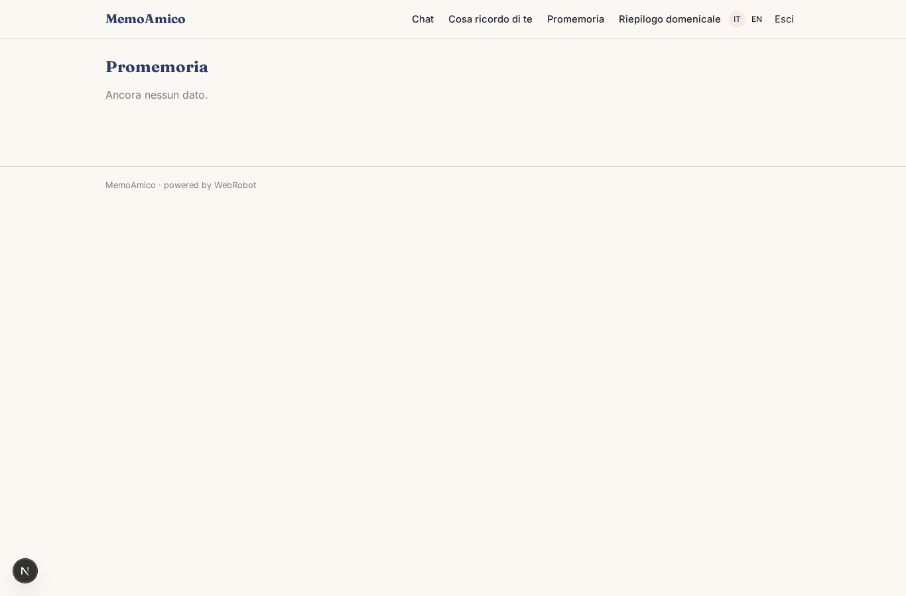
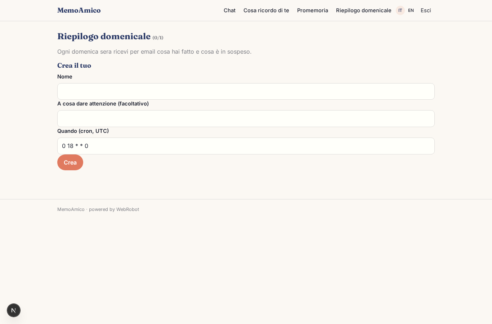
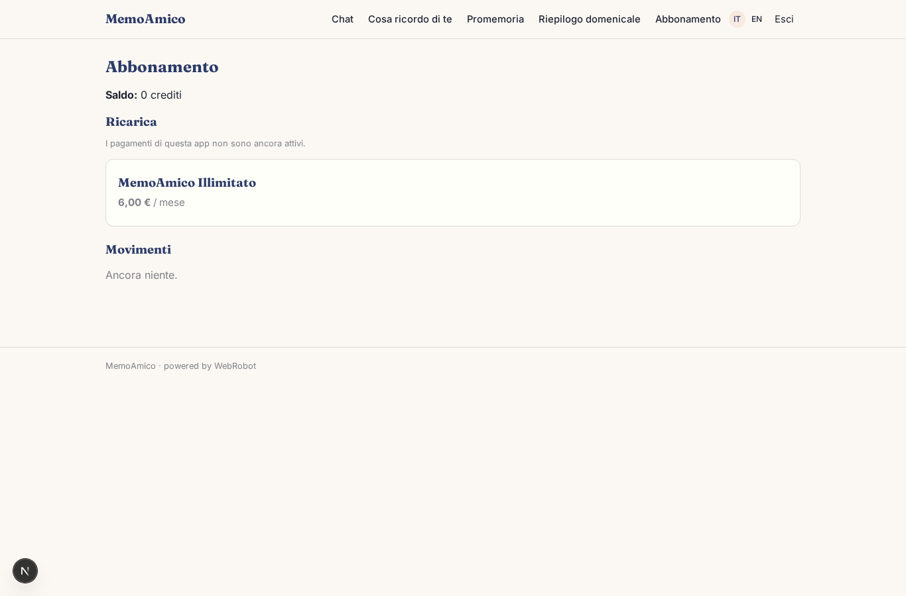

# MemoAmico

_L'assistente personale che si ricorda di te._

**Manifest:** valid (schema + runtime contract) · **Functional test:** passed (10 checks passed)

## Description given to the app builder (Italian)

MemoAmico è un assistente personale con memoria a lungo termine. L'utente si registra e chatta in linguaggio naturale: racconta impegni, persone importanti, abitudini, obiettivi. L'agente ricorda quello che gli viene detto tra una conversazione e l'altra, costruisce un profilo privato (compleanni, preferenze, progetti in corso) e lo usa per rispondere in modo personale. Quando l'utente scrive "ricordami di chiamare mia madre giovedì alle 18" o "ogni lunedì chiedimi come va la dieta", l'agente crea un promemoria ricorrente e al momento giusto manda una notifica push sul telefono; finché l'app mobile non esiste, va bene un'email. Ogni domenica sera arriva un riepilogo della settimana con le cose fatte e quelle in sospeso. L'utente può vedere e cancellare in qualunque momento ciò che l'assistente ricorda di lui. I dati sono strettamente personali: nessun altro, admin compreso, legge le conversazioni. Piano gratuito con un limite di messaggi e abbonamento mensile per uso illimitato. Lingua italiana e inglese.

## Features not expressible today (spec.extensions)

- **push_notifications**: Push notifications on the phone are not available yet: reminders are sent by email on the due day (exact hour not supported).
- **delete_memory**: Deleting single memories from the Memories page needs a row-delete action not yet available in table views; for now the user edits records and asks the assistant to forget.
- **admin_privacy**: Admins of the app can technically read user-owned records; strict exclusion of admins from conversations and memories is not expressible in the manifest.

## Screenshots (interpretive runtime, no data)

### home-anon

### home-mobile

### home

### chat

### memories

### edit_memory

### reminders

### recap

### account

