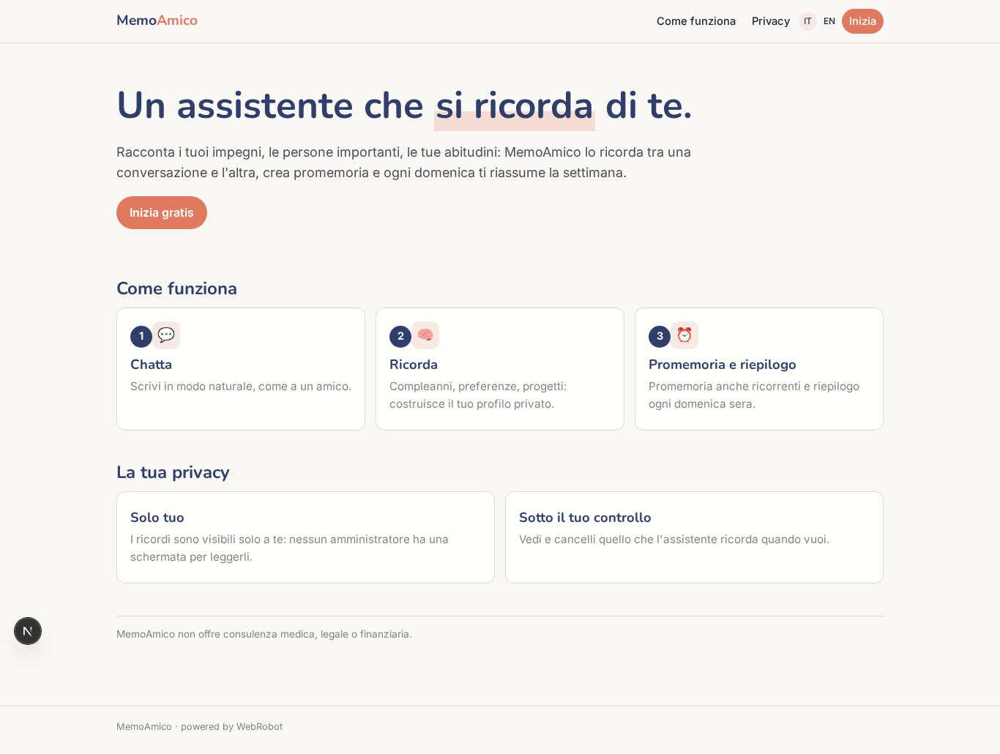
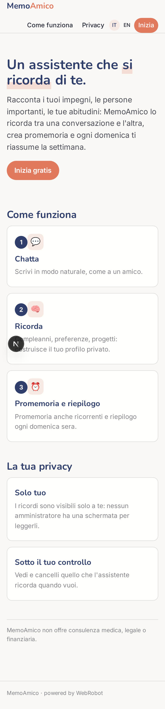
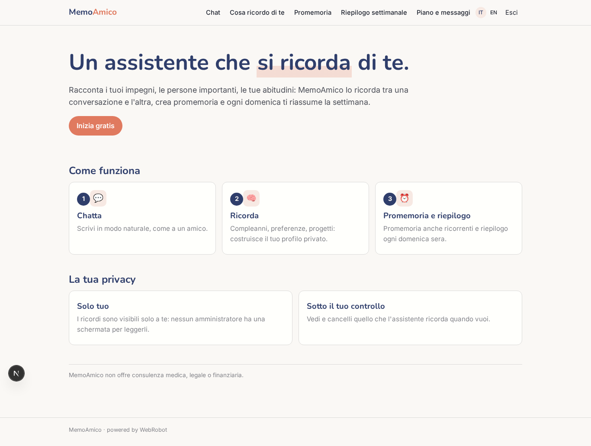
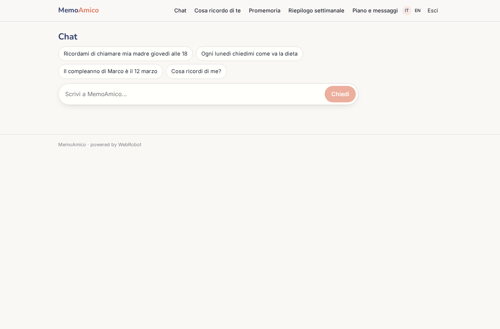
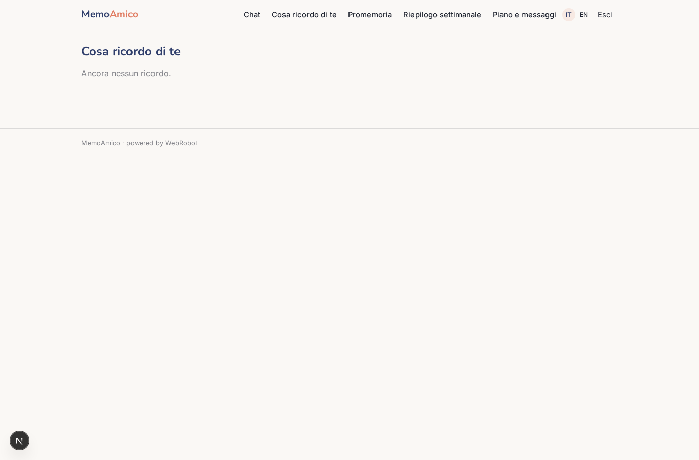
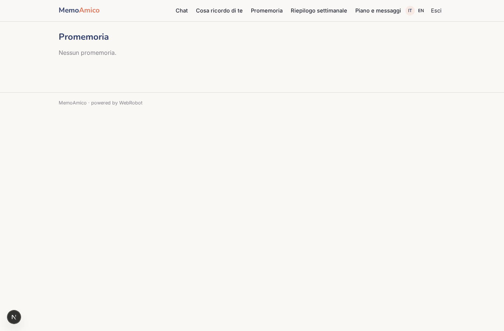
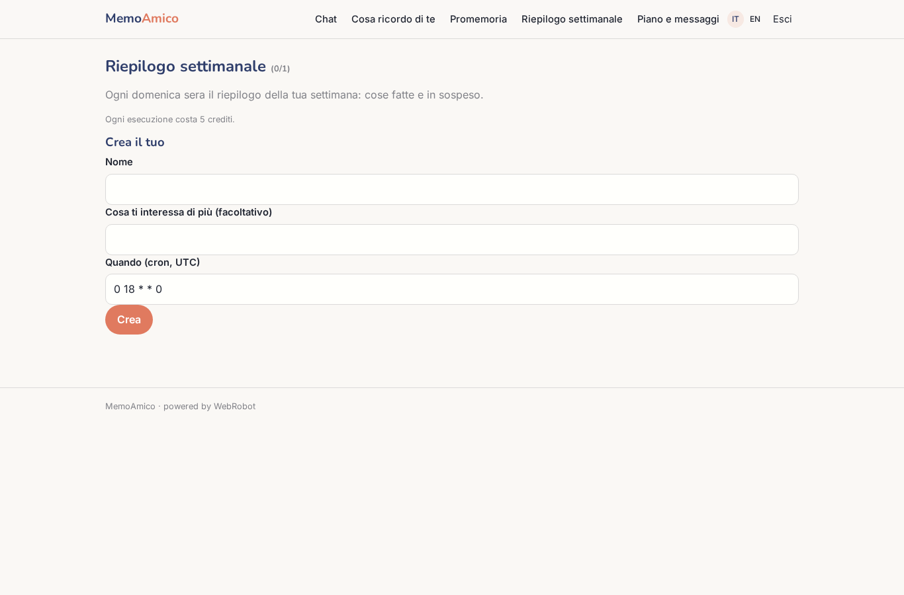
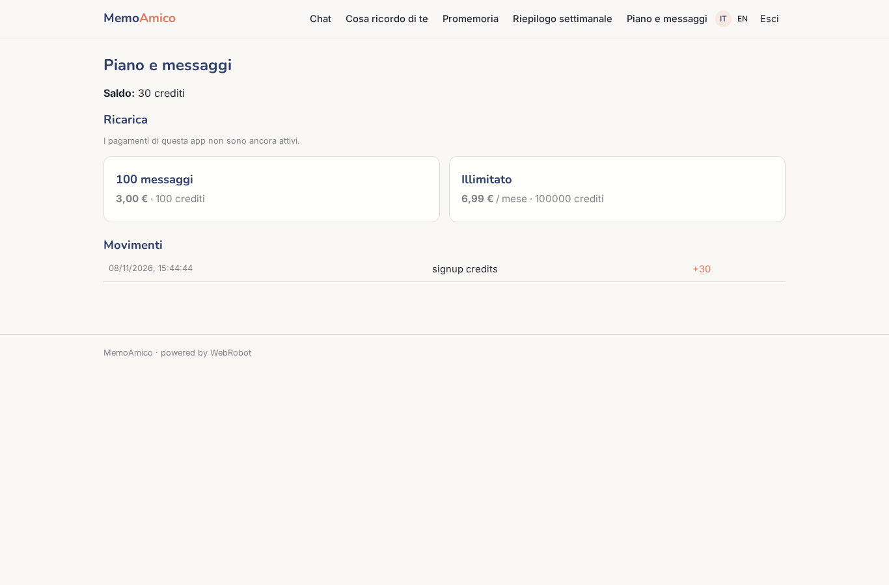

# MemoAmico

_L'assistente personale che si ricorda di te._

**Stato manifest:** valido (validatore Python + contratto runtime)

## Descrizione data all'app builder

MemoAmico è un assistente personale con memoria a lungo termine. L'utente si registra e chatta in linguaggio naturale: racconta impegni, persone importanti, abitudini, obiettivi. L'agente ricorda quello che gli viene detto tra una conversazione e l'altra, costruisce un profilo privato (compleanni, preferenze, progetti in corso) e lo usa per rispondere in modo personale. Quando l'utente scrive "ricordami di chiamare mia madre giovedì alle 18" o "ogni lunedì chiedimi come va la dieta", l'agente crea un promemoria ricorrente e al momento giusto manda una notifica push sul telefono; finché l'app mobile non esiste, va bene un'email. Ogni domenica sera arriva un riepilogo della settimana con le cose fatte e quelle in sospeso. L'utente può vedere e cancellare in qualunque momento ciò che l'assistente ricorda di lui. I dati sono strettamente personali: nessun altro, admin compreso, legge le conversazioni. Piano gratuito con un limite di messaggi e abbonamento mensile per uso illimitato. Lingua italiana e inglese.

## Funzioni non esprimibili oggi (spec.extensions)

- **reminder_delivery**: Delivering reminders at the due time (email now, push on the phone later) is not available yet: notifications are not supported. Reminders are stored and shown in the Reminders page; the agent says so honestly. The weekly recap is likewise shown in the app, not emailed.
- **memory_delete_ui**: A per-row delete button on the Memory page may need runtime support for deleting records; until then the user asks the assistant or an owner-scoped delete action is needed.
- **admin_privacy**: No admin role or admin view is declared, so no screen exposes conversations. Platform-level run records exist as built-ins and must be restricted to their owner by the runtime.

## Screenshot (runtime interpretativo)

### home-anon

### home-mobile

### home

### chat

### memory

### reminders

### recap

### account

