# Mentore Interno

_Il coach AI privato per la crescita di ogni dipendente._

**Manifest:** valid (schema + runtime contract) · **Functional test:** passed (21 checks passed)

## Description given to the app builder (Italian)

Vorrei Mentore Interno, un coach AI per i dipendenti di un'azienda. L'HR è admin: carica l'elenco dei dipendenti, il modello di competenze aziendale e i percorsi di crescita, e invita le persone. Il dipendente accede, compila un breve profilo con ruolo, obiettivi professionali, difficoltà attuali e preferenze di orario, e da lì ha una chat privata con un coach che lo aiuta su feedback, gestione del tempo, preparazione di una riunione difficile, crescita verso un nuovo ruolo, usando i contenuti formativi preparati da noi. Per ciascun dipendente un agente costruisce un piano di sviluppo trimestrale e ogni settimana manda un check-in via email con un esercizio e una domanda di riflessione. Il manager vede solo gli obiettivi condivisi dal dipendente, mai le conversazioni. L'HR vede solo statistiche aggregate e anonime: partecipazione, temi più frequenti, competenze su cui si lavora. Ruoli, reparti e responsabili devono arrivare in automatico dal sistema HR aziendale. Abbonamento mensile per dipendente attivo, interfaccia in italiano, inglese e spagnolo.

## Features not expressible today (spec.extensions)

- **hr_system_sync**: Roles, departments and managers arrive automatically only if the company HR system can POST to the app webhook /api/hooks/hr_sync (email, name, role, department, manager_email); direct connectors to HR suites via OAuth are not available yet. Until then HR uploads the employee CSV on /admin/data.
- **manager_autofill**: The manager email in shared goals is typed by the employee; automatic pre-fill from the HR directory is not available yet.
- **per_seat_company_billing**: Billing per active employee is modelled as one monthly subscription per user; a single company invoice by number of active seats is not available yet.

## Screenshots (interpretive runtime, no data)

### home-anon
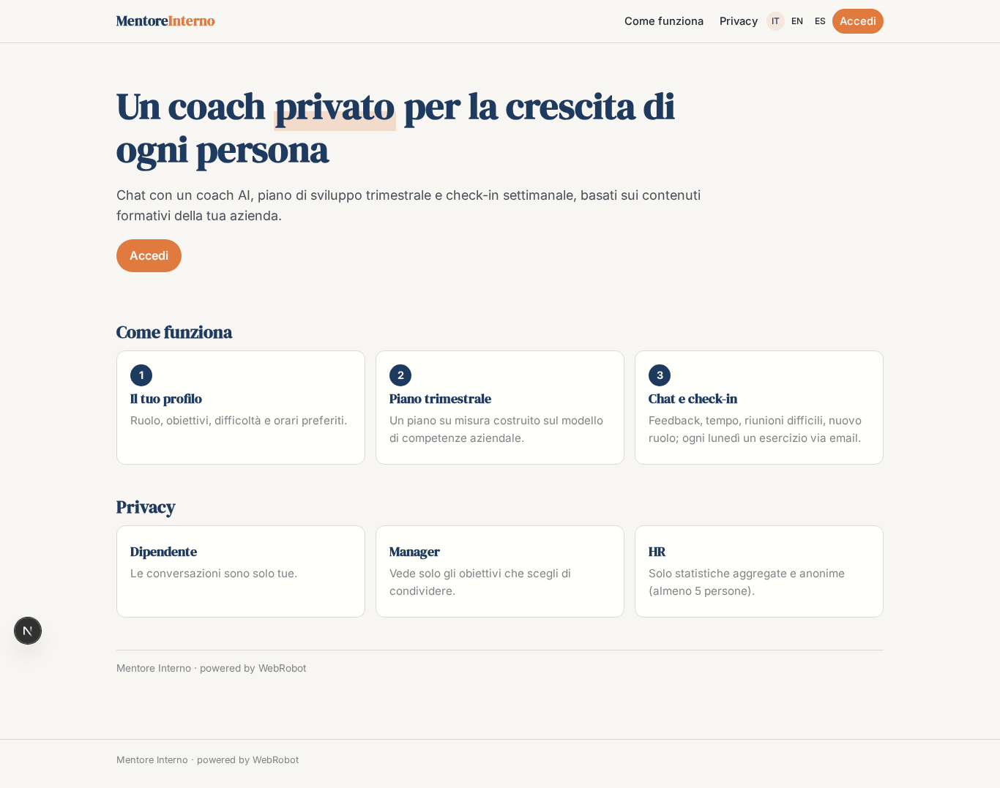

### home-mobile
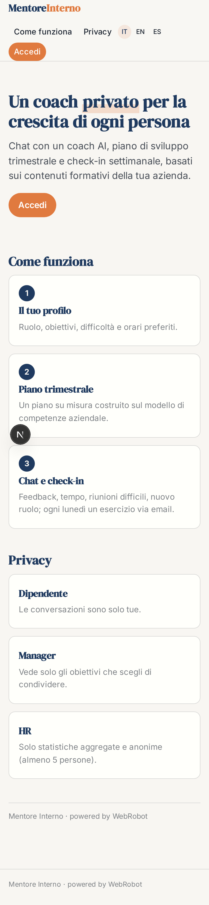

### home
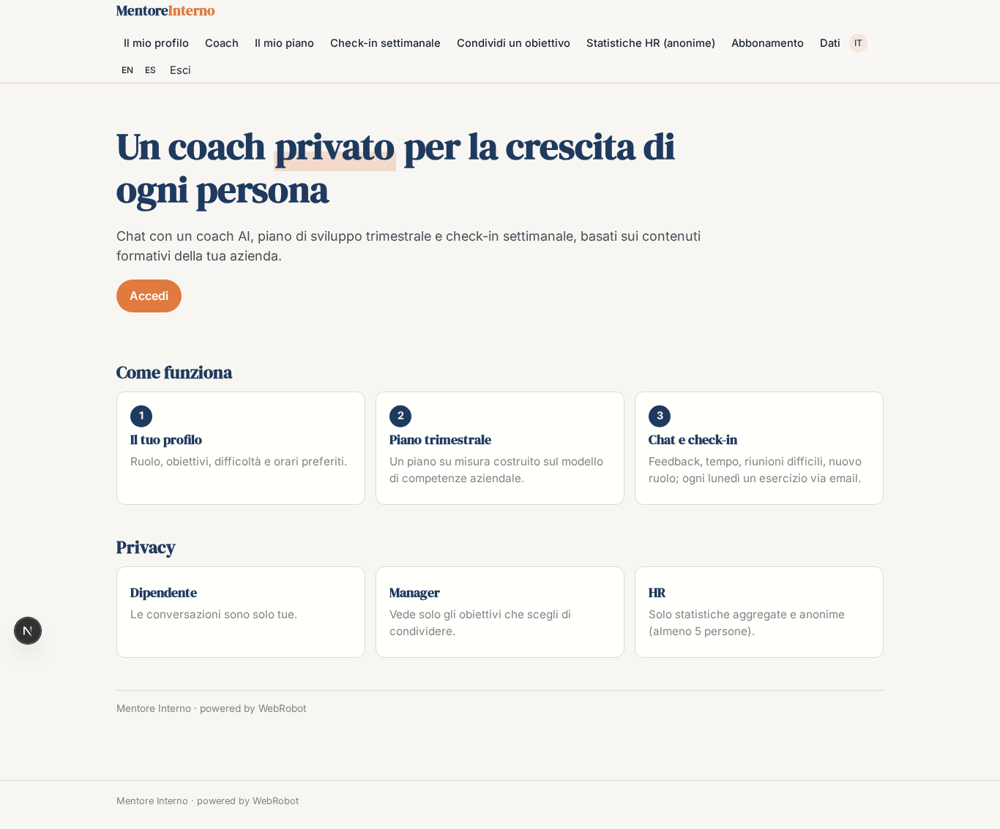

### profile
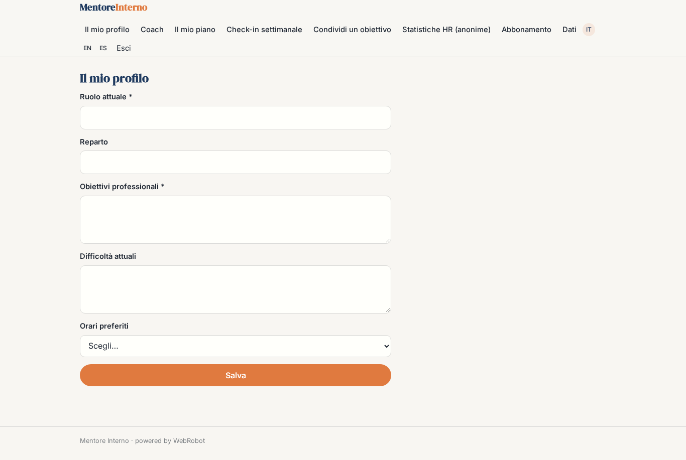

### coach
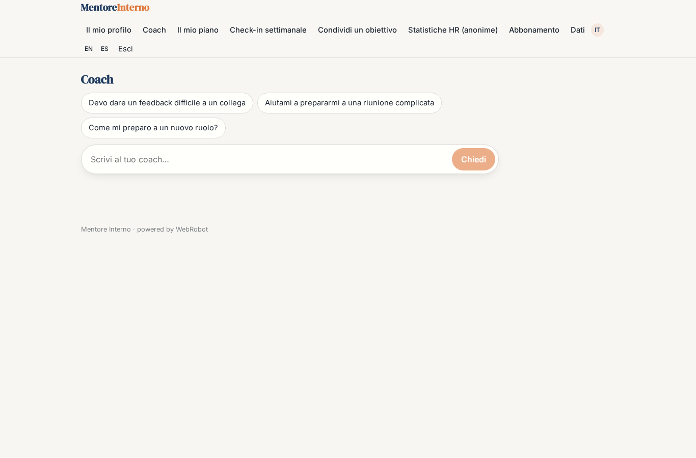

### plan
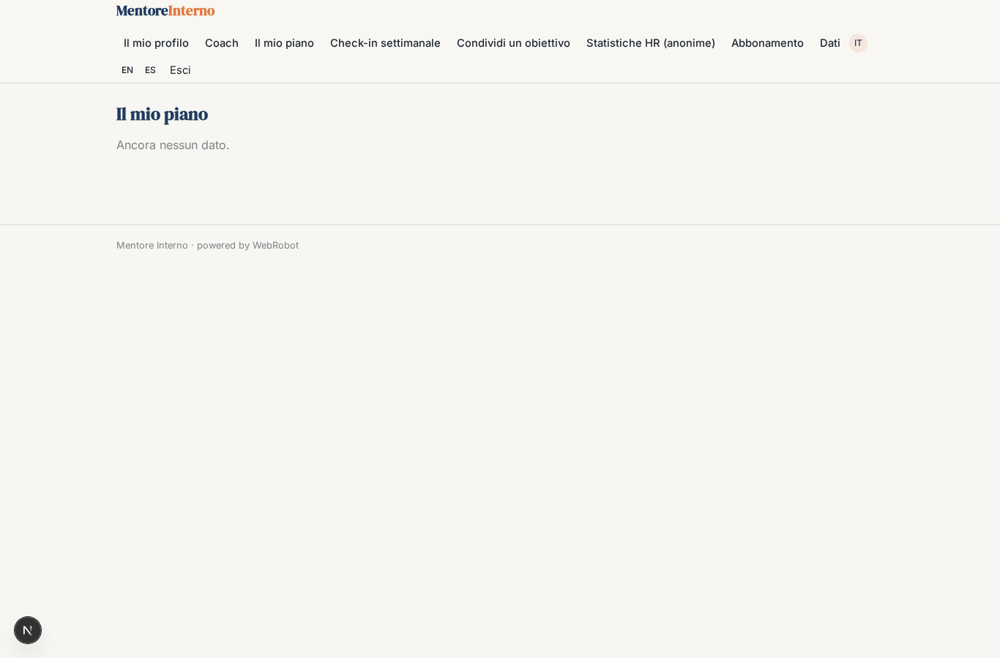

### checkin_settings
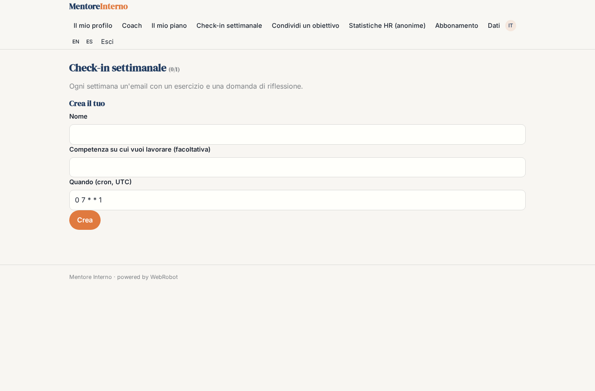

### share_goal
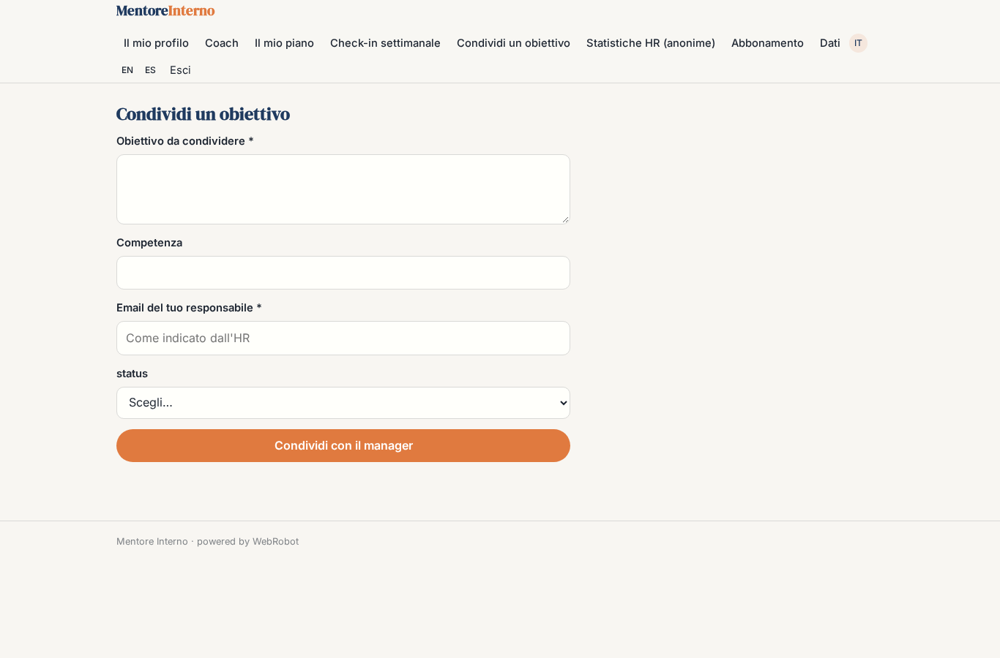

### team_goals
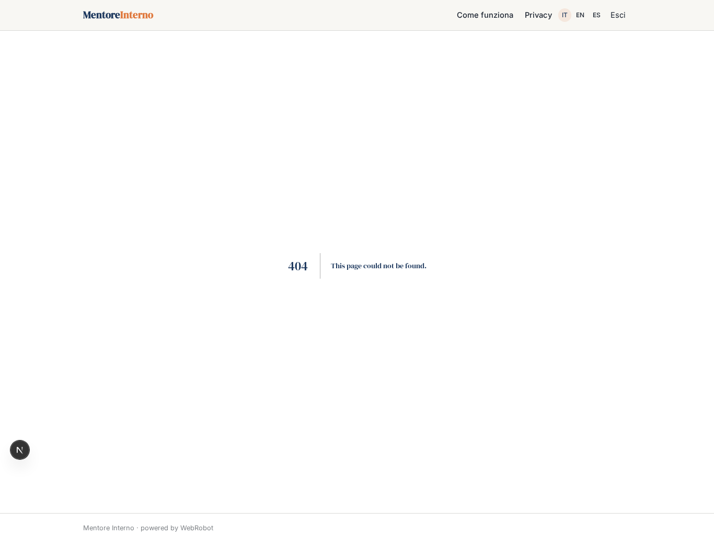

### hr_stats
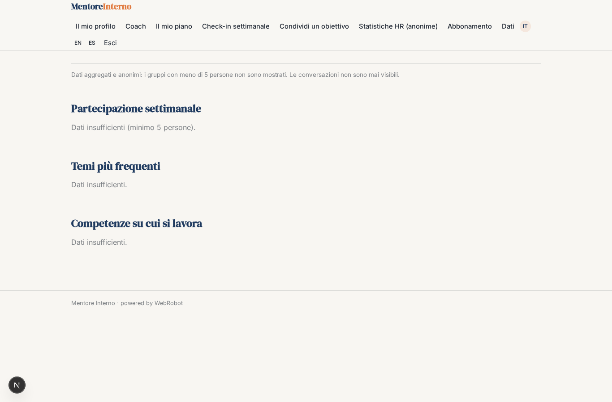

### account
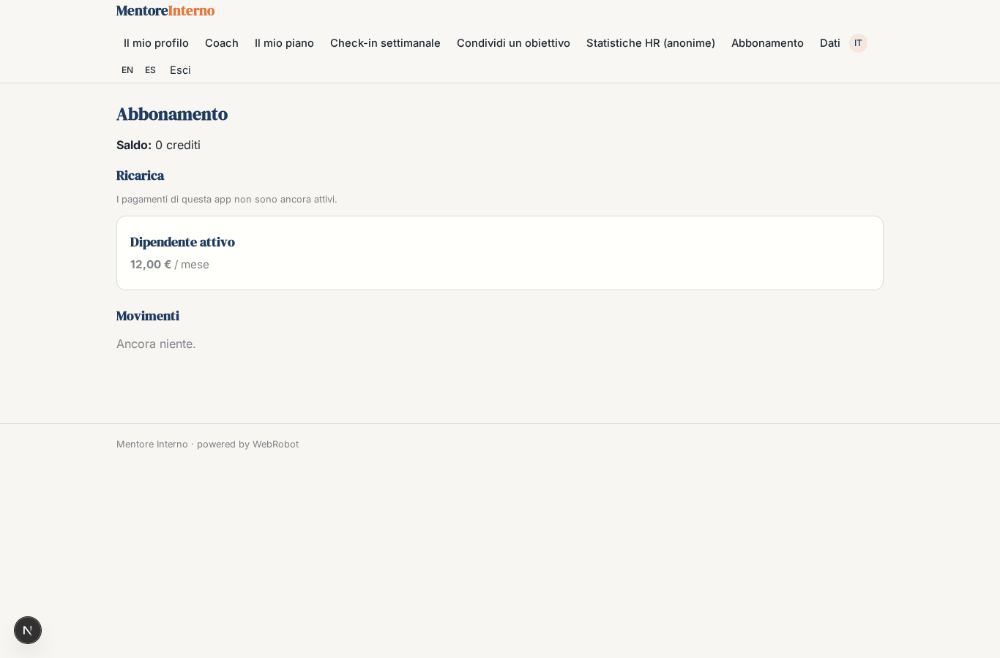
