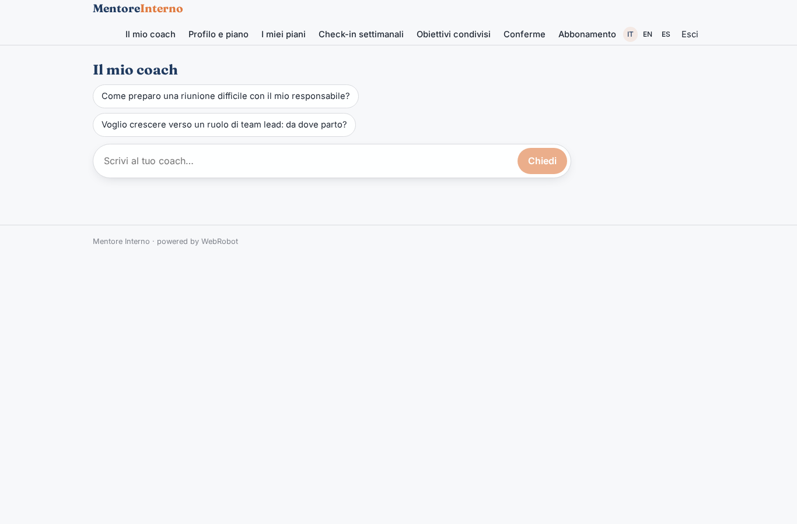
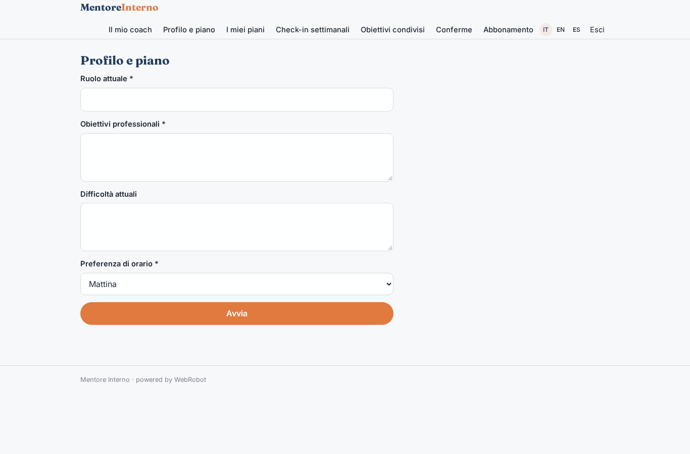
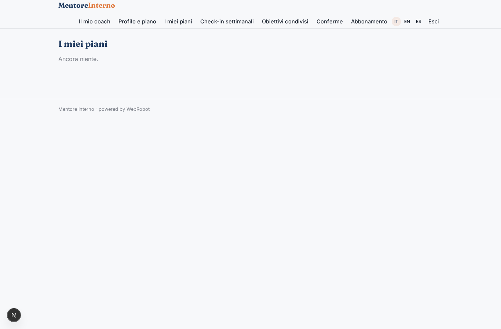
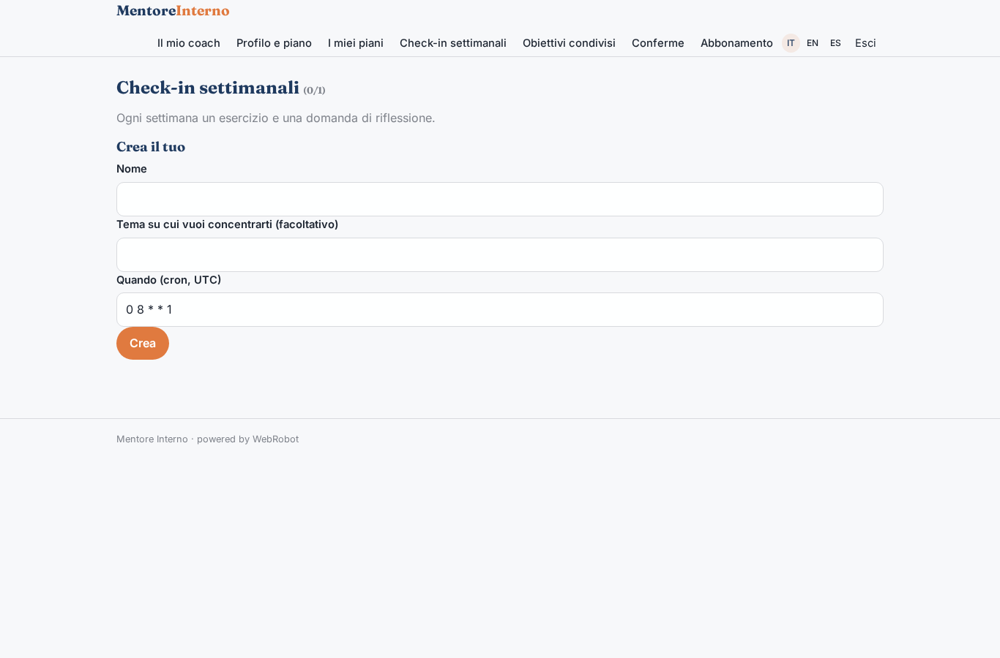
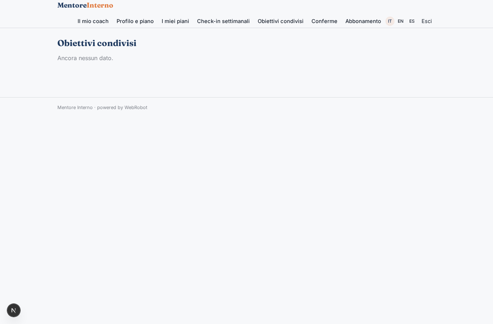
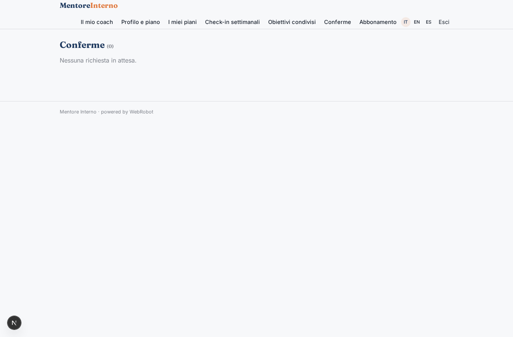
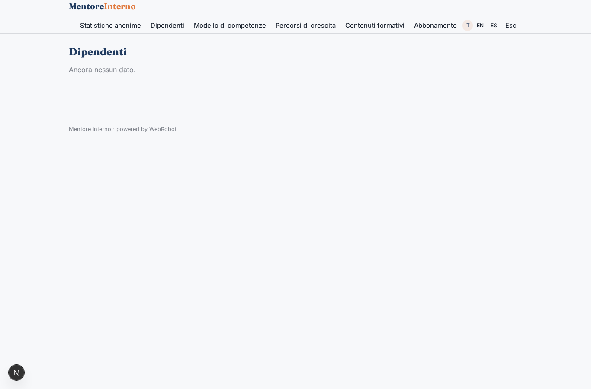
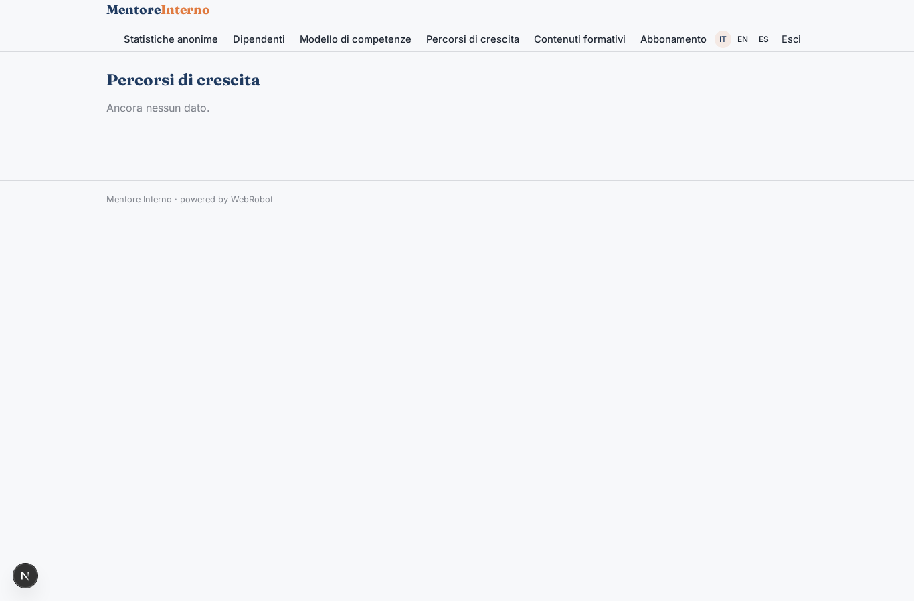
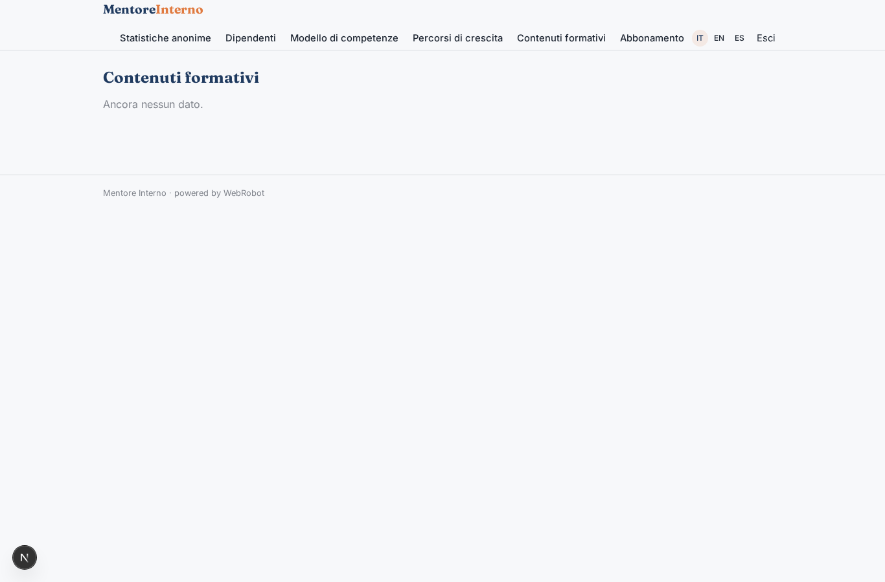
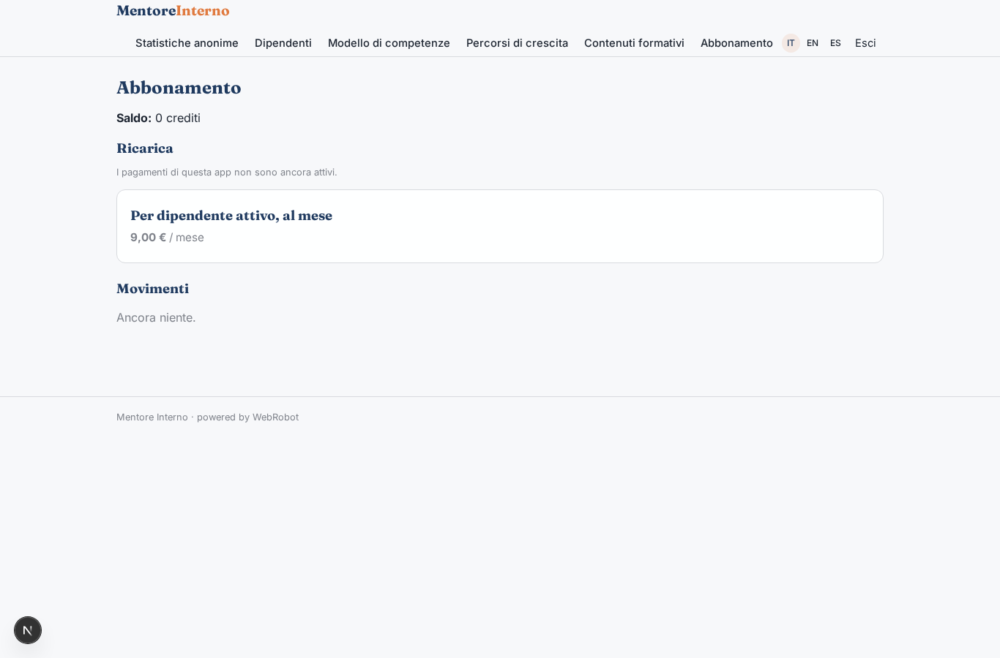

# Mentore Interno

_Il coach AI privato per la crescita di ogni dipendente._

**Stato manifest:** valido (validatore Python + contratto runtime)

## Descrizione data all'app builder

Vorrei Mentore Interno, un coach AI per i dipendenti di un'azienda. L'HR è admin: carica l'elenco dei dipendenti, il modello di competenze aziendale e i percorsi di crescita, e invita le persone. Il dipendente accede, compila un breve profilo con ruolo, obiettivi professionali, difficoltà attuali e preferenze di orario, e da lì ha una chat privata con un coach che lo aiuta su feedback, gestione del tempo, preparazione di una riunione difficile, crescita verso un nuovo ruolo, usando i contenuti formativi preparati da noi. Per ciascun dipendente un agente costruisce un piano di sviluppo trimestrale e ogni settimana manda un check-in via email con un esercizio e una domanda di riflessione. Il manager vede solo gli obiettivi condivisi dal dipendente, mai le conversazioni. L'HR vede solo statistiche aggregate e anonime: partecipazione, temi più frequenti, competenze su cui si lavora. Ruoli, reparti e responsabili devono arrivare in automatico dal sistema HR aziendale. Abbonamento mensile per dipendente attivo, interfaccia in italiano, inglese e spagnolo.

## Funzioni non esprimibili oggi (spec.extensions)

- **hr_sync**: Roles, departments and managers coming automatically from the company HR system need a connector with the company's credentials (not available yet). For now HR enters or pastes the roster in the employees collection (no file upload yet).
- **email_checkin**: The weekly check-in by email needs notifications (not available yet). For now the check-in appears in the app under Weekly check-ins; the email delivery is to be added later.
- **manager_view**: Manager access to the shared goals of their reports (matched through employees.manager_email) needs cross-user read of shared_goals limited to that manager's reports; the manager role is derived from the roster, but the cross-user view must be implemented by the runtime. Conversations are never exposed.
- **hr_aggregates**: Anonymous aggregates (participation, frequent themes, competencies) must be computed by a privacy-preserving job over user records, with small groups suppressed (e.g. fewer than 5 people), and written to hr_stats; per-user records are never readable by HR.
- **per_active_employee_billing**: The subscription is per active employee: the runtime must count active users each month; the plan here is a per-user monthly price.

## Screenshot (runtime interpretativo)

### home-anon

### home-mobile

### home

### coach_chat

### profile_plan

### plans

### checkins

### my_shared_goals

### approvals

### hr_stats_view

### hr_employees

### hr_competencies

### hr_paths

### hr_training

### account

