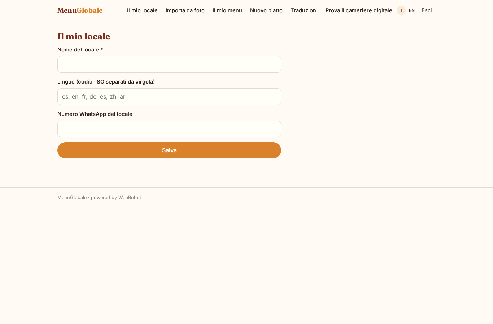
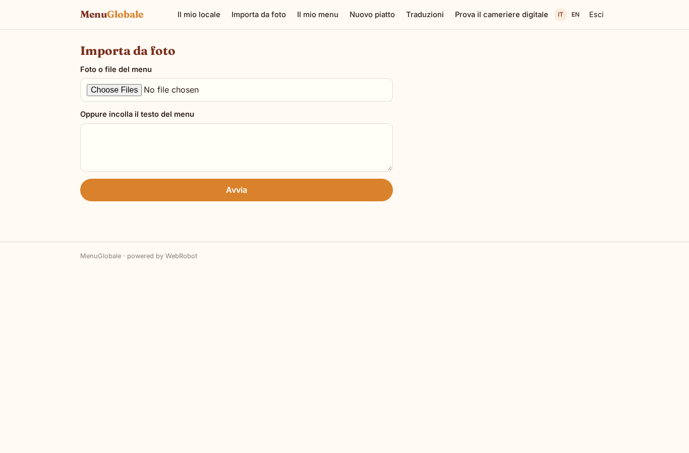
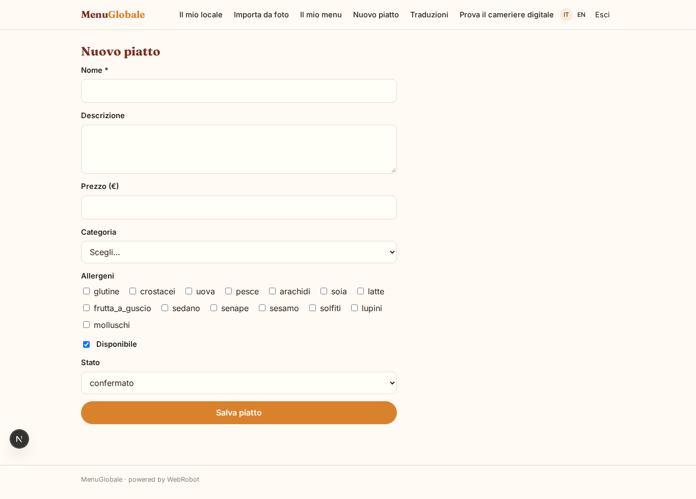
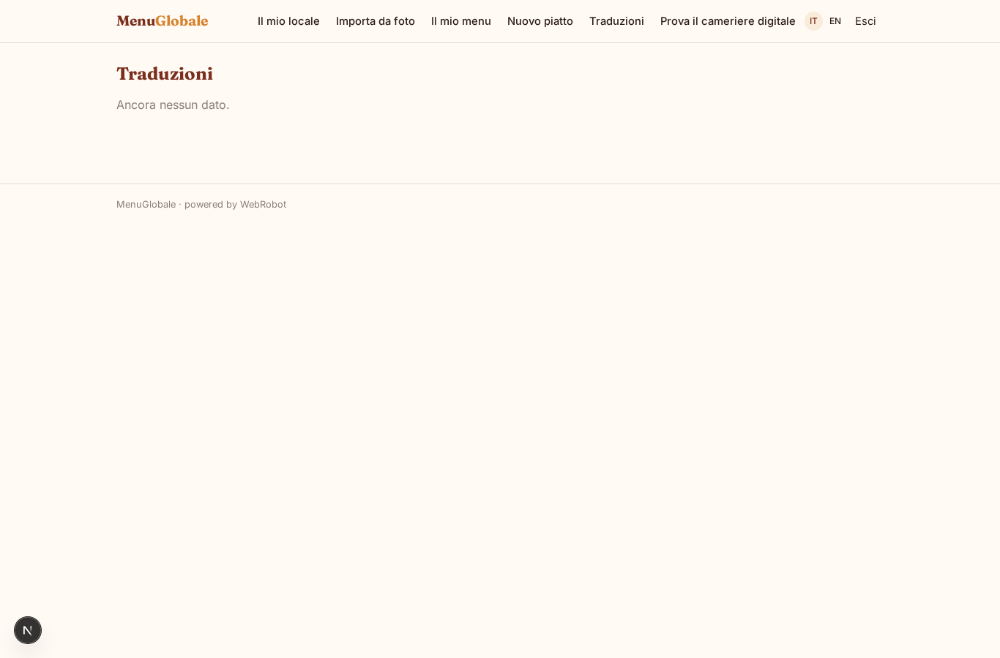

# MenuGlobale

_Il menu del tuo locale in oltre cento lingue, con allergeni._

**Manifest:** valid (schema + runtime contract) · **Functional test:** passed (13 checks passed)

## Description given to the app builder (Italian)

MenuGlobale permette a bar e ristoranti di offrire il menu digitale tradotto in oltre cento lingue, con allergeni, via WhatsApp e pagina web. Il ristoratore inserisce i piatti con nome, descrizione, prezzo, categoria e allergeni, oppure carica una foto del menu cartaceo da cui un agente ricava le voci da controllare. L'agente traduce ogni piatto nelle lingue richieste mantenendo coerenti i nomi tipici e segnala gli allergeni con icone. Il menu e raggiunto dal cliente del locale inquadrando un QR code al tavolo: si apre una pagina pubblica nella lingua del telefono, oppure il cliente scrive su WhatsApp al numero del locale e un agente gli manda il menu e risponde a domande come "cosa avete senza glutine?". Il ristoratore aggiorna prezzi e disponibilita in qualunque momento e le modifiche sono subito online. Ogni locale vede e gestisce solo il proprio menu. Abbonamento mensile a basso costo per locale. Interfaccia di gestione in italiano, menu per il cliente in oltre cento lingue.

## Features not expressible today (spec.extensions)

- **public_menu_qr**: Pagina pubblica del menu per locale raggiungibile da QR code (senza login) nella lingua del telefono: oggi i dati dei locali sono privati per utente e i visitatori anonimi non possono leggerli; serve una vista pubblica per-locale.
- **whatsapp_channel**: Agente su WhatsApp al numero del locale: canale non disponibile ancora (solo web, telefono, Telegram, email). L'assistente è pronto come anteprima in chat.

## Screenshots (interpretive runtime, no data)

### home-anon

### home-mobile

### home

### setup

### import

### dishes

### add_dish

### translations_view

### preview

### account

