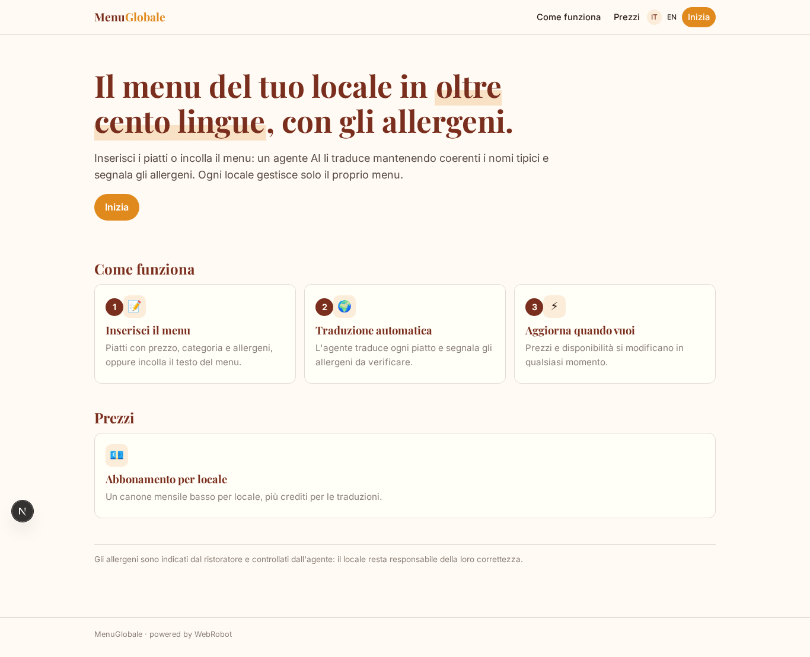
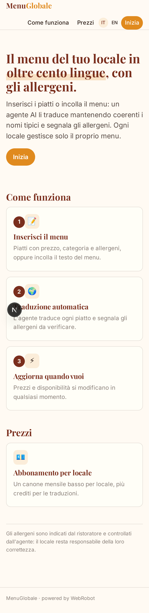
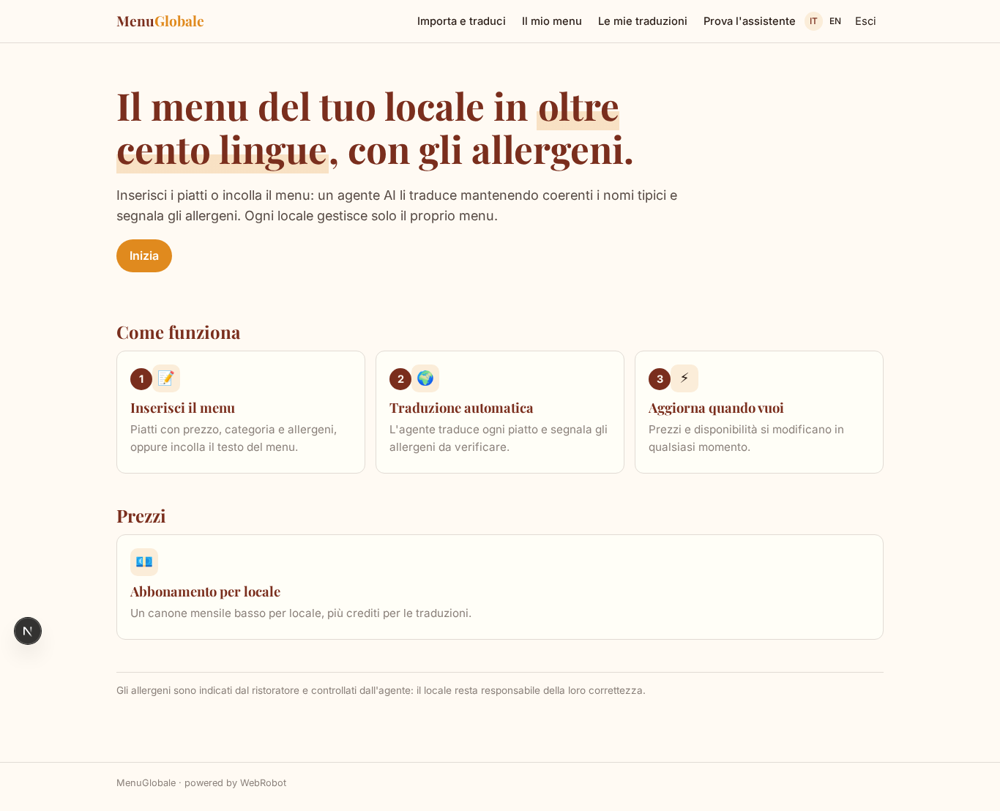
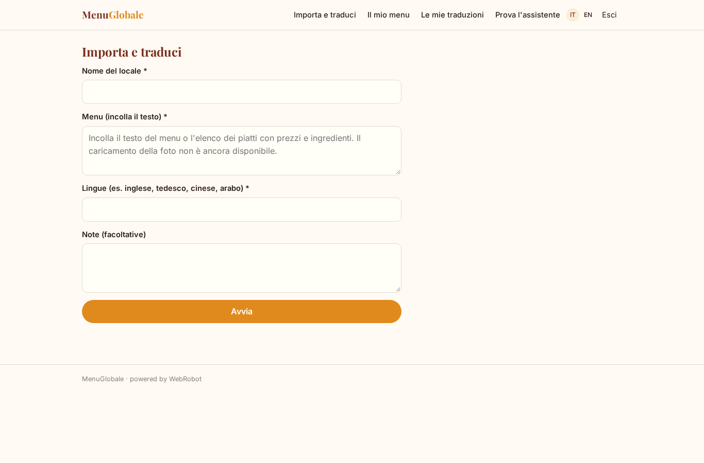
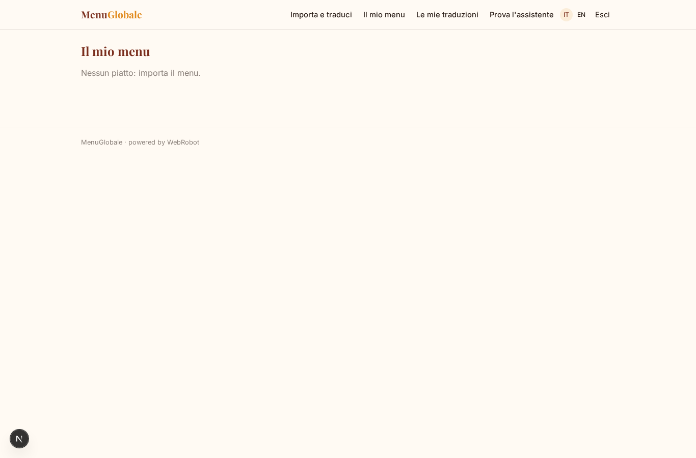
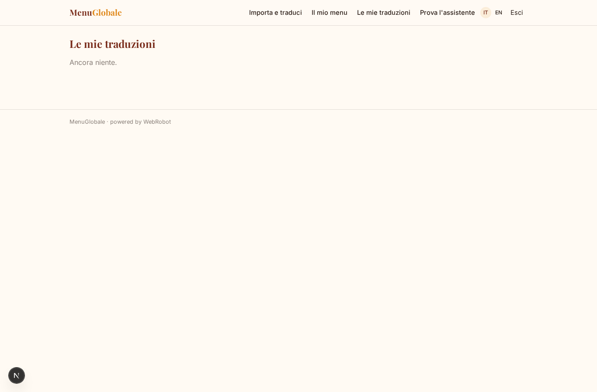
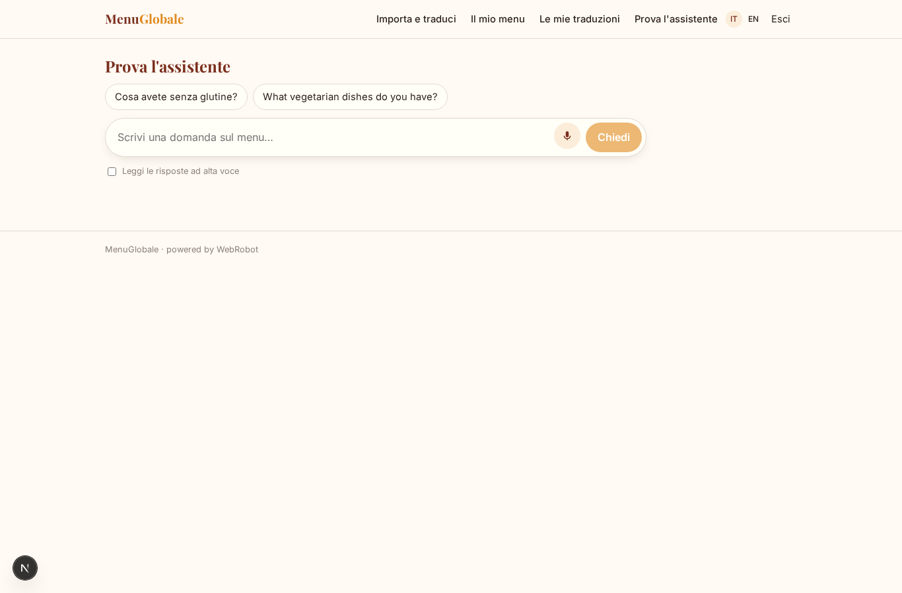
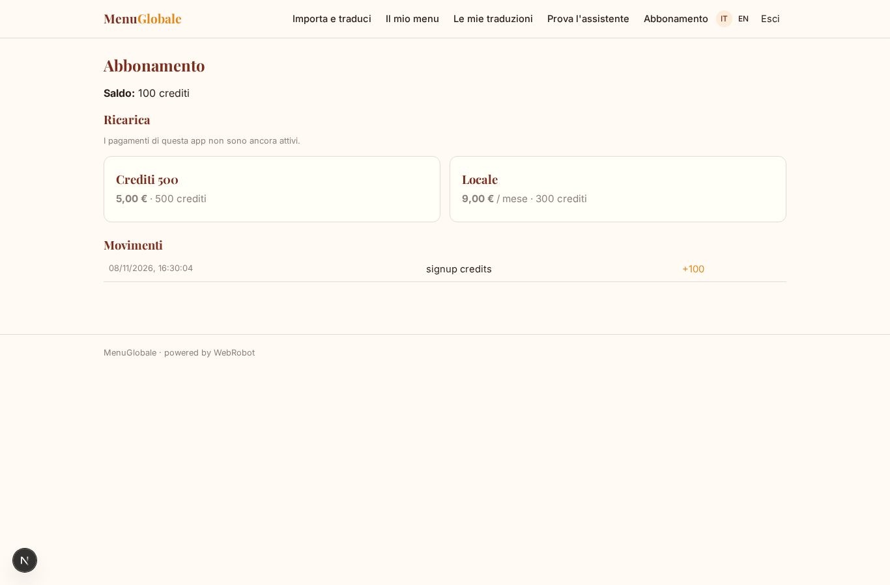

# MenuGlobale

_Il tuo menu in oltre cento lingue, con allergeni, via QR e WhatsApp._

**Manifest status:** valid (schema validator + runtime contract)

## Description given to the app builder (Italian)

MenuGlobale permette a bar e ristoranti di offrire il menu digitale tradotto in oltre cento lingue, con allergeni, via WhatsApp e pagina web. Il ristoratore inserisce i piatti con nome, descrizione, prezzo, categoria e allergeni, oppure carica una foto del menu cartaceo da cui un agente ricava le voci da controllare. L'agente traduce ogni piatto nelle lingue richieste mantenendo coerenti i nomi tipici e segnala gli allergeni con icone. Il menu e raggiunto dal cliente del locale inquadrando un QR code al tavolo: si apre una pagina pubblica nella lingua del telefono, oppure il cliente scrive su WhatsApp al numero del locale e un agente gli manda il menu e risponde a domande come "cosa avete senza glutine?". Il ristoratore aggiorna prezzi e disponibilita in qualunque momento e le modifiche sono subito online. Ogni locale vede e gestisce solo il proprio menu. Abbonamento mensile a basso costo per locale. Interfaccia di gestione in italiano, menu per il cliente in oltre cento lingue.

## Features not expressible today (spec.extensions)

- **public_menu_qr**: Public per-venue menu page opened by the table QR code, in the phone language: needs anonymous reads of one venue's records by a public slug, not available yet.
- **whatsapp_channel**: WhatsApp number per venue answering customers with the assistant: needs per-venue WhatsApp credentials, not available yet. Only web chat (owner test) is included.
- **menu_photo_upload**: Upload of a photo of the paper menu: file upload is not available yet; the owner pastes the text for now.

## Screenshots (interpretive runtime)

### home-anon

### home-mobile

### home

### new

### dishes_list

### history

### ask

### account

