# MenuParlante

_Il menu digitale che parla la lingua dei tuoi clienti._

**Stato manifest:** valido (validatore Python + contratto runtime)

## Descrizione data all'app builder

Mi serve MenuParlante, un menu digitale per ristoranti. Il ristoratore inserisce i piatti con nome, descrizione, prezzo, categoria, allergeni, ingredienti e foto, e indica gli abbinamenti consigliati. Un agente traduce automaticamente tutto il menu in inglese, tedesco, francese, spagnolo e cinese, mantenendo i nomi tipici con una spiegazione. Il ristorante stampa un QR code per ogni tavolo; il cliente lo inquadra e, senza registrarsi, vede il menu nella sua lingua, filtra per allergie o preferenze (vegetariano, senza glutine) e può chattare con un cameriere virtuale che consiglia piatti e vini in base ai gusti e risponde sugli ingredienti senza inventare nulla che non sia nel menu. Il ristoratore può segnare un piatto come esaurito e cambia subito per tutti. A fine settimana riceve per email un riepilogo dei piatti più visti e delle domande più frequenti. Abbonamento mensile per locale; il personale vede solo il proprio ristorante.

## Funzioni non esprimibili oggi (spec.extensions)

- **qr_codes**: Printable QR code per table pointing to /v/menu?r=<restaurant code>&t=<table>: the manifest cannot generate QR images yet; for now the owner builds them from that link.
- **photo_upload**: File upload is not available: photos are given as a link.
- **email_digest**: Notifications are not available: the weekly summary is saved in the app (Weekly summary view), not sent by email.
- **menu_analytics**: Counting dish views and guest questions is not available to anonymous visitors yet: the digest cannot report real figures until the runtime logs them.
- **restaurant_isolation**: Dishes are in one shared collection (so guests can read them without login) keyed by restaurant code. Restricting editing to the staff of the owning restaurant, picking the restaurant from the QR parameter, and the interactive allergy/vegetarian/gluten-free and language switch filters need runtime support.

## Screenshot (runtime interpretativo)

### home-anon
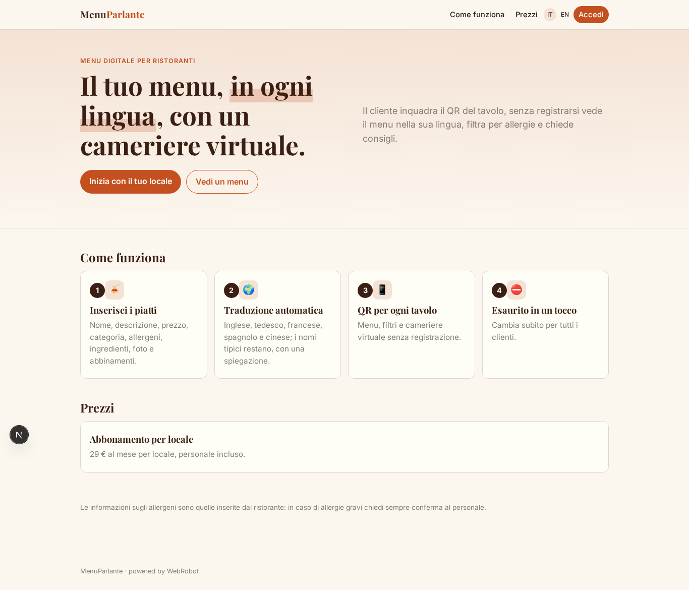

### home-mobile
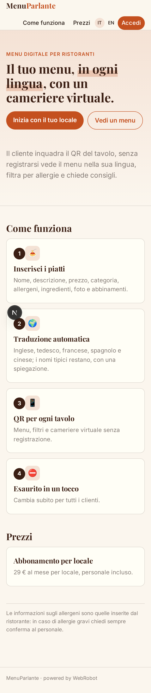

### home
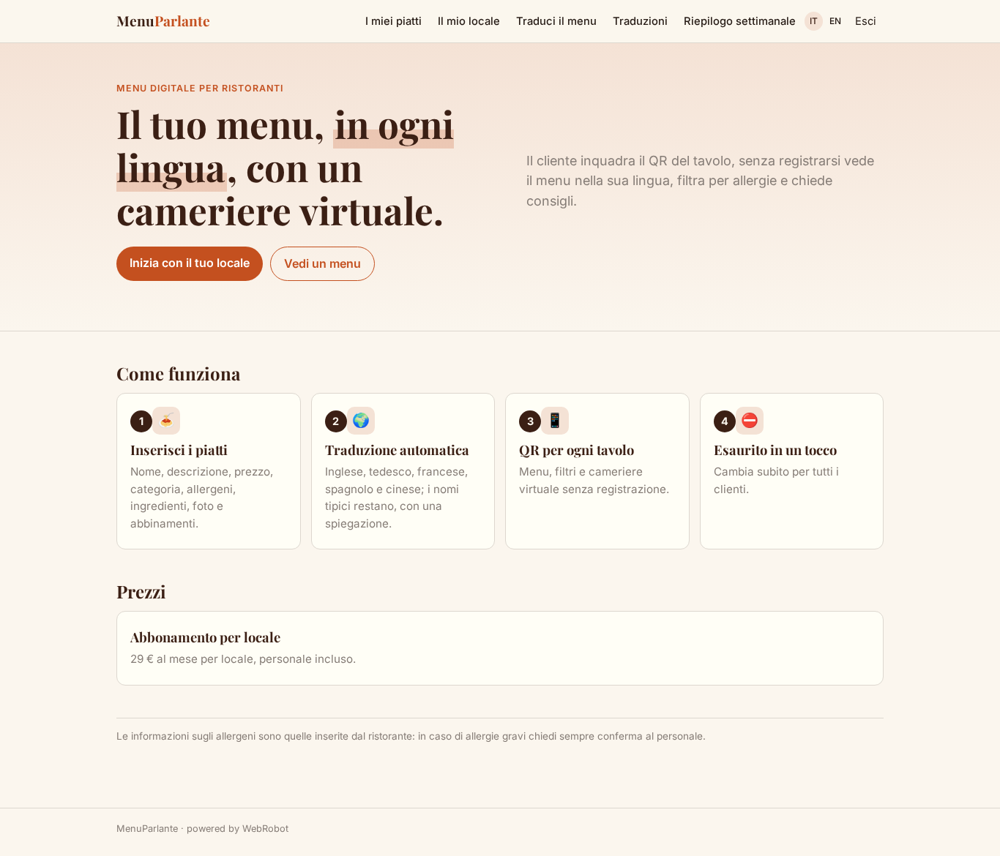

### menu
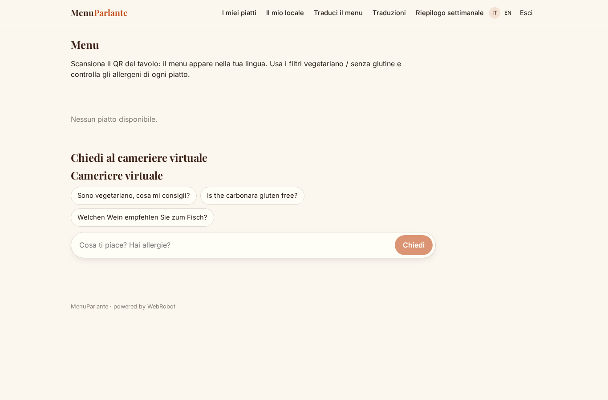

### waiter_chat
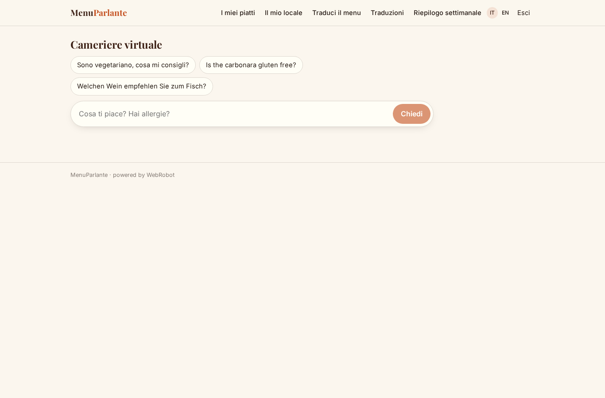

### dish_list
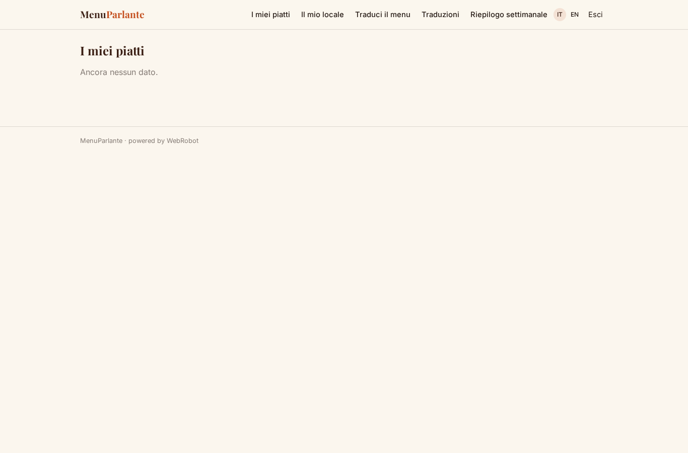

### restaurant
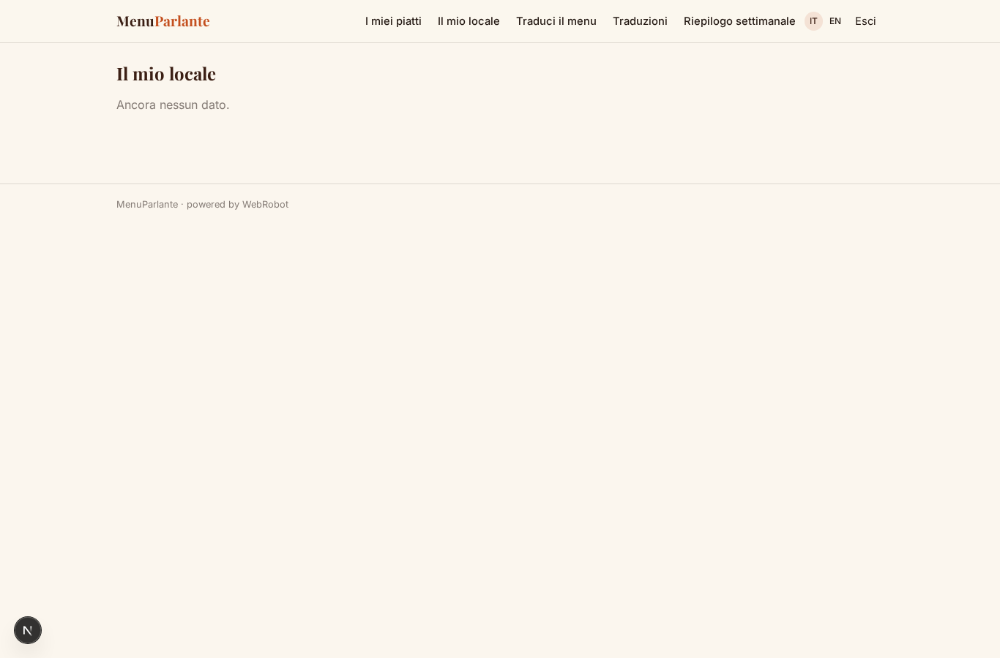

### translate
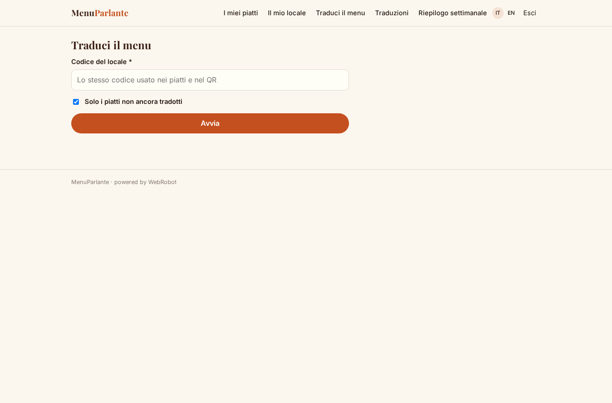

### runs
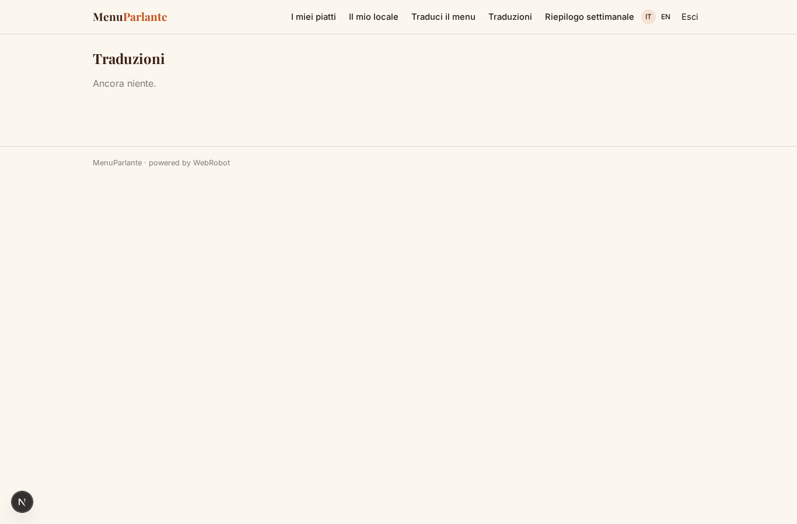

### digests
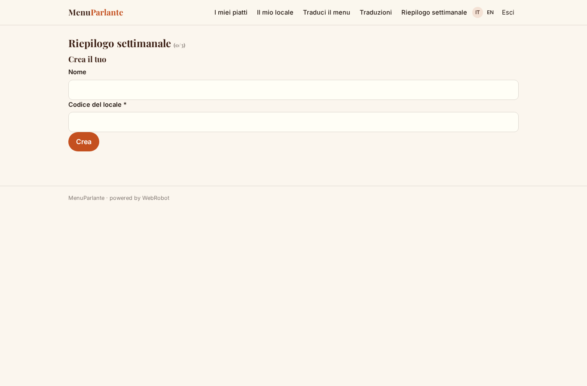

### account
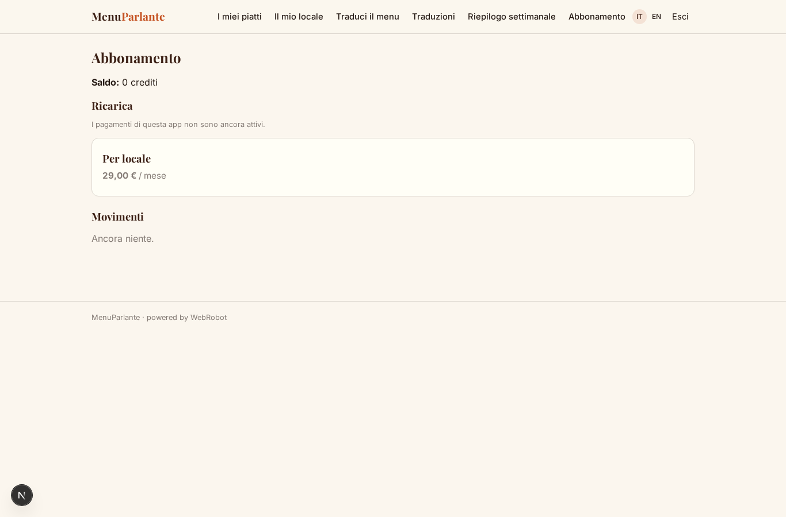

