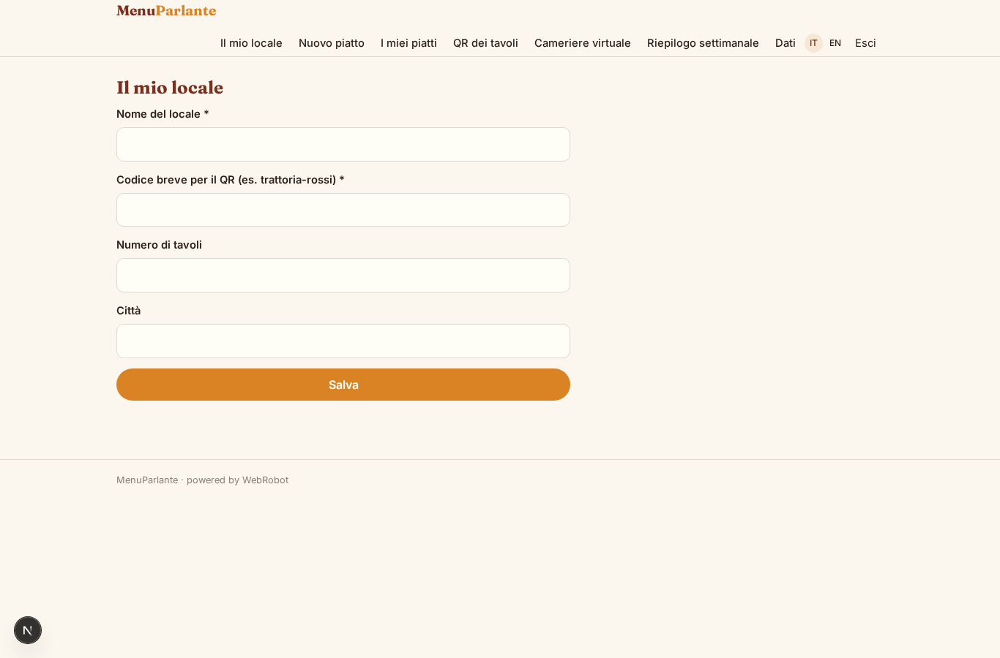
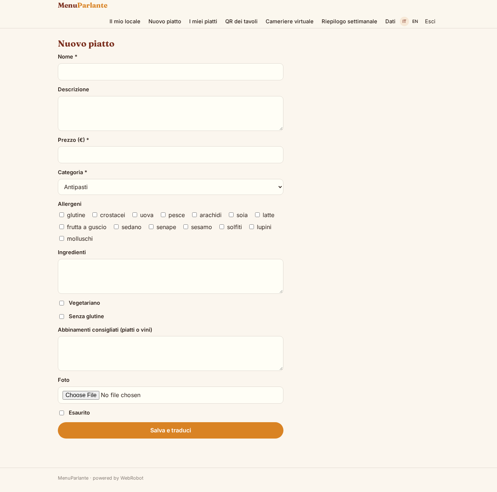
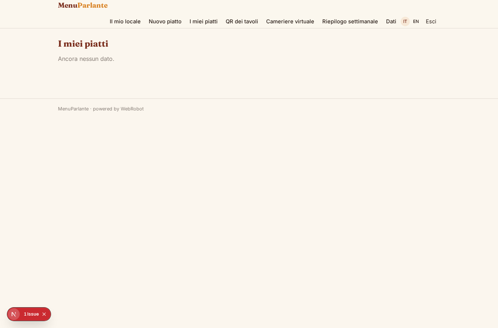
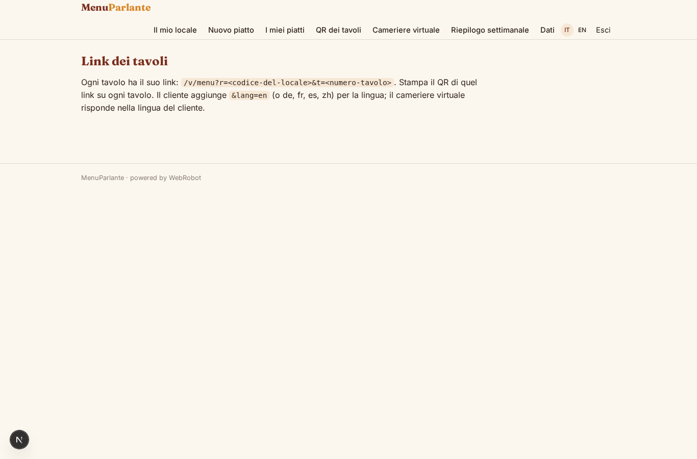
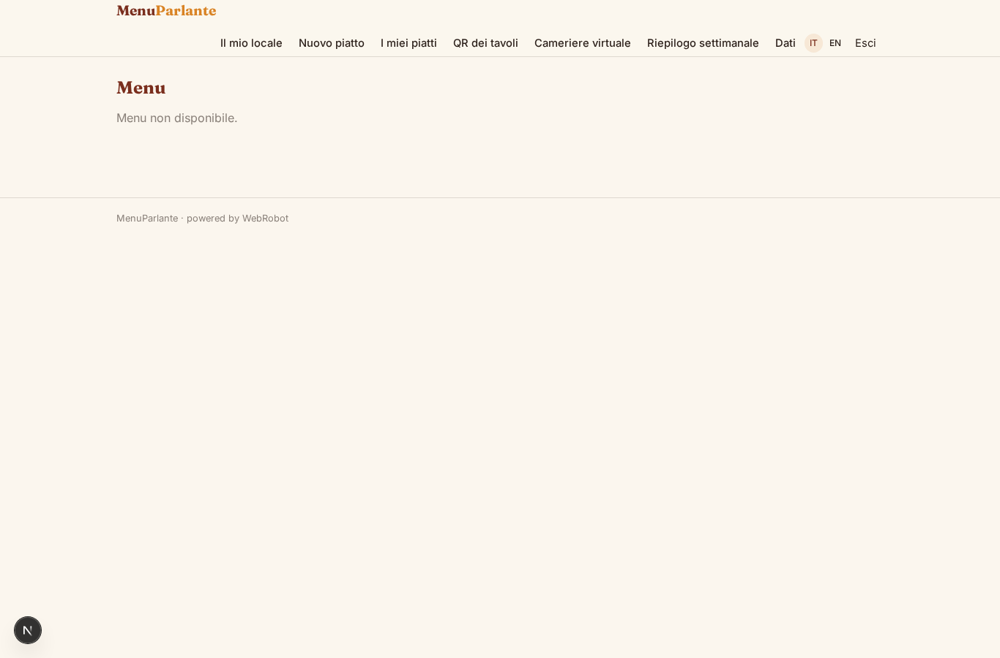
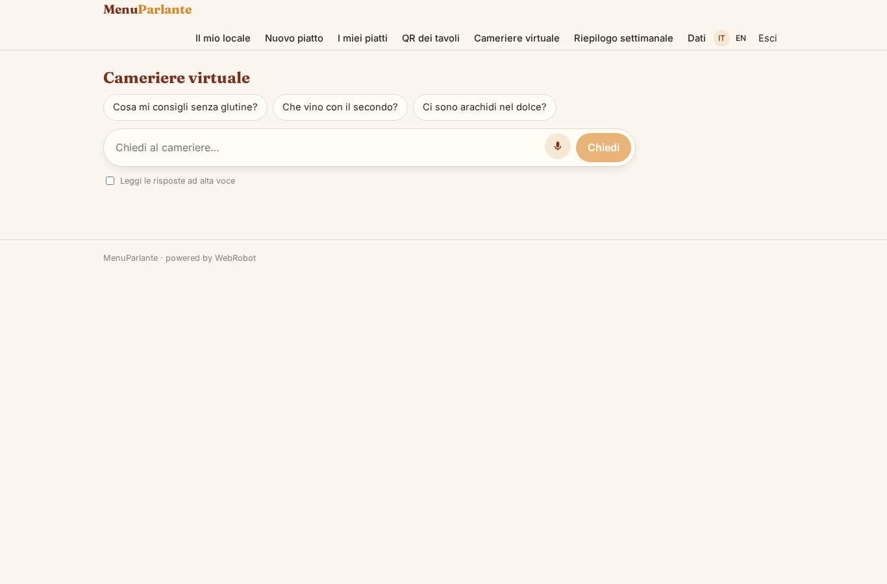
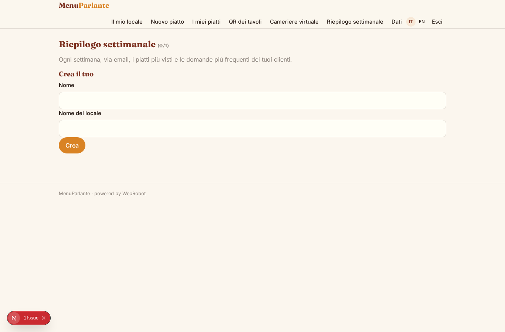

# MenuParlante

_Il menu digitale che parla la lingua dei tuoi clienti._

**Manifest:** valid (schema + runtime contract) · **Functional test:** passed (14 checks passed)

## Description given to the app builder (Italian)

Mi serve MenuParlante, un menu digitale per ristoranti. Il ristoratore inserisce i piatti con nome, descrizione, prezzo, categoria, allergeni, ingredienti e foto, e indica gli abbinamenti consigliati. Un agente traduce automaticamente tutto il menu in inglese, tedesco, francese, spagnolo e cinese, mantenendo i nomi tipici con una spiegazione. Il ristorante stampa un QR code per ogni tavolo; il cliente lo inquadra e, senza registrarsi, vede il menu nella sua lingua, filtra per allergie o preferenze (vegetariano, senza glutine) e può chattare con un cameriere virtuale che consiglia piatti e vini in base ai gusti e risponde sugli ingredienti senza inventare nulla che non sia nel menu. Il ristoratore può segnare un piatto come esaurito e cambia subito per tutti. A fine settimana riceve per email un riepilogo dei piatti più visti e delle domande più frequenti. Abbonamento mensile per locale; il personale vede solo il proprio ristorante.

## Features not expressible today (spec.extensions)

- **qr_codes**: Generating and printing a QR image per table is not available: the app shows the table links to turn into QR codes.
- **menu_stats_capture**: Recording anonymous dish views and guest questions into menu_stats needs a collector (webhook) the manifest cannot create; until then the weekly summary will report no data.
- **guest_filters**: Interactive allergy/vegetarian/gluten-free filter chips on the public menu are not available yet; the cards show the flags and the waiter chat filters by diet.
- **instant_sold_out**: Sold-out changes are republished by the translator agent within moments, not strictly instantly.

## Screenshots (interpretive runtime, no data)

### home-anon

### home-mobile

### home

### restaurant

### dish_form

### dishes

### tables

### menu

### waiter_chat

### summary

### account

