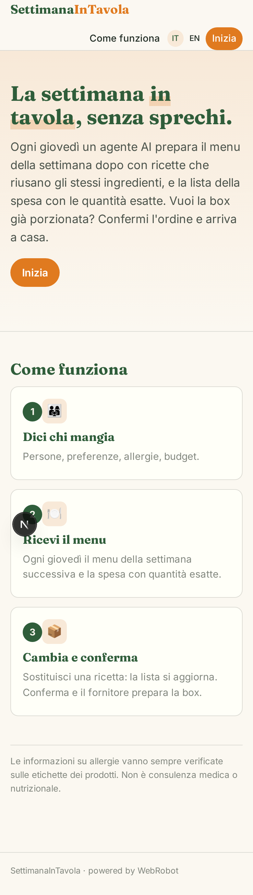
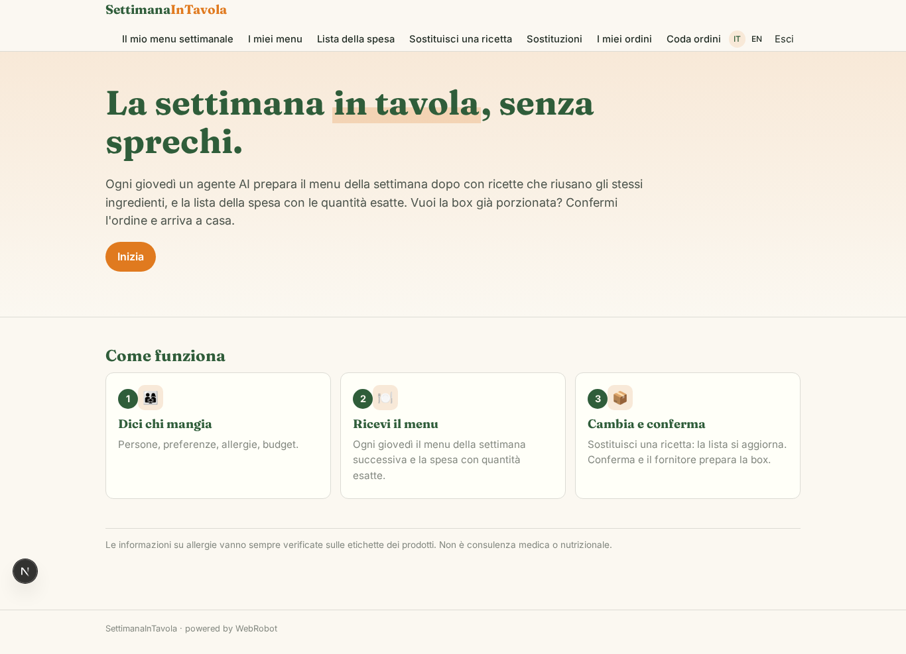
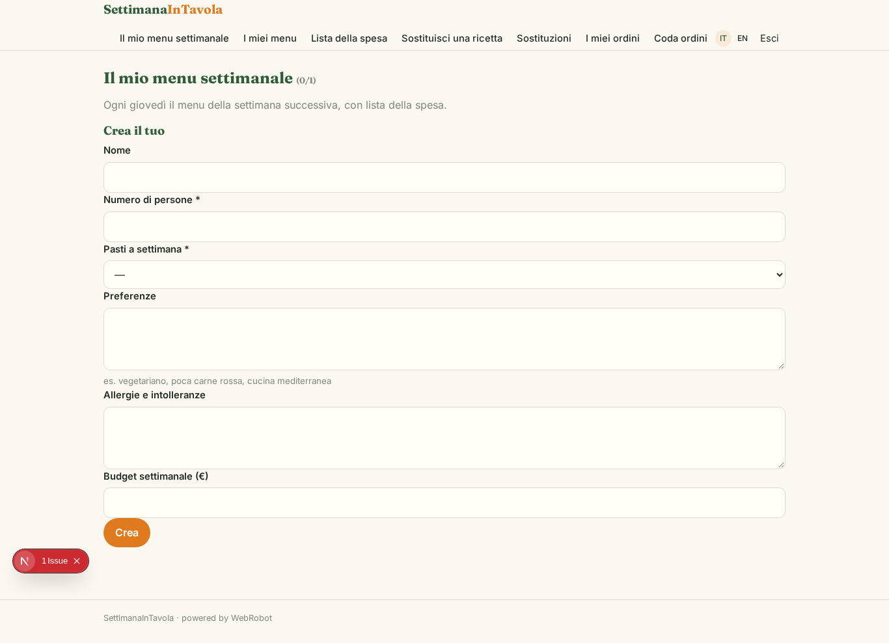
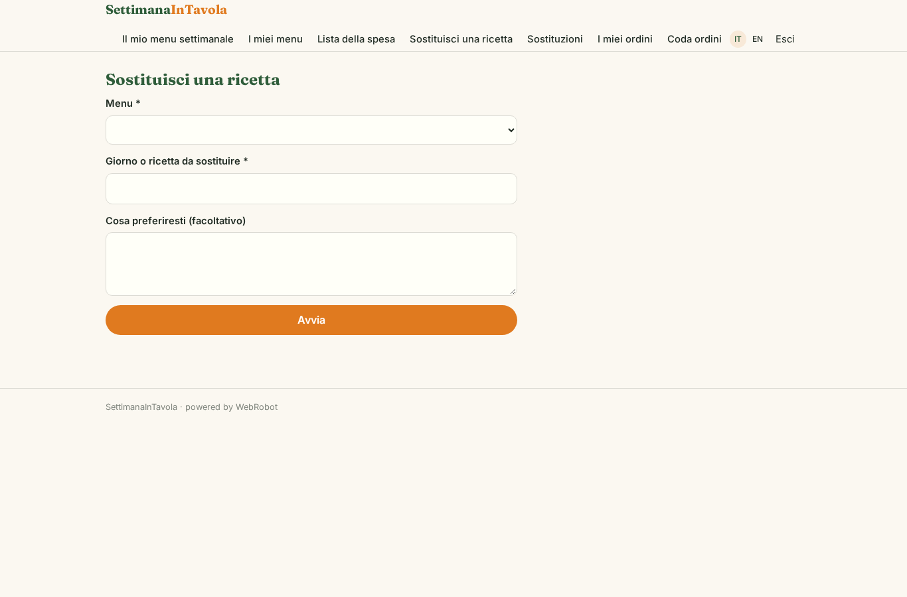
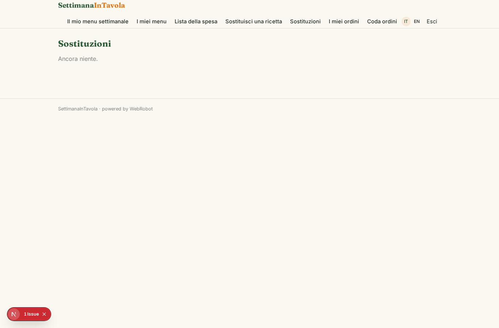
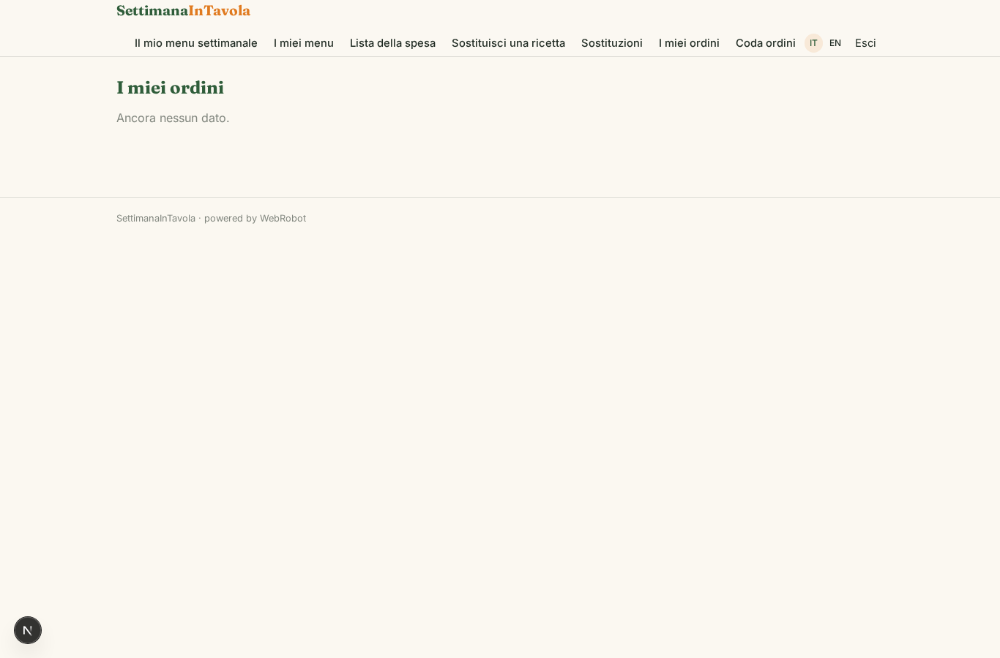
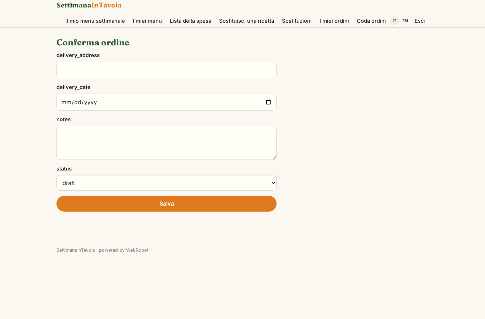
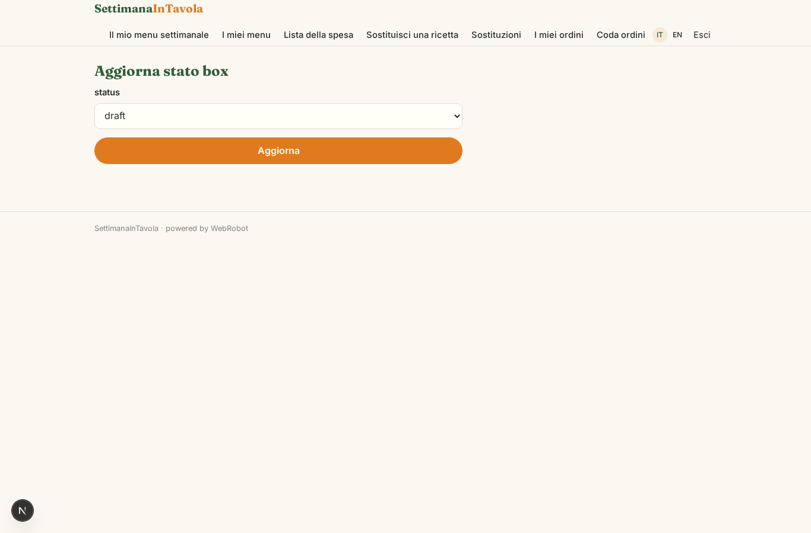
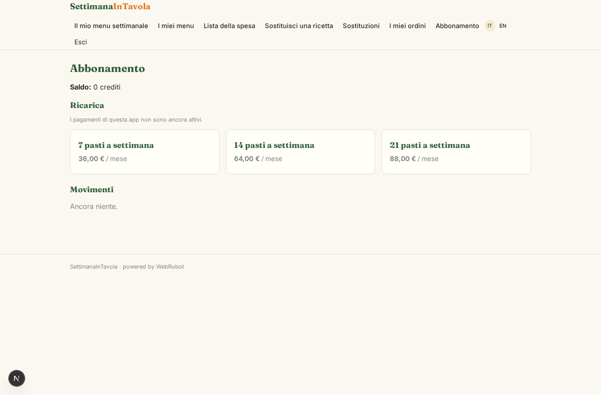

# SettimanaInTavola

_Il menu della settimana che non spreca nulla, con la spesa già pronta._

**Manifest:** valid (schema + runtime contract) · **Functional test:** 1 failure(s) (17 checks passed)

## Description given to the app builder (Italian)

Ci serve SettimanaInTavola, un pianificatore di pasti contro lo spreco. L'utente indica numero di persone, preferenze, allergie e budget. Ogni giovedì un agente propone il menu della settimana successiva con ricette che riusano gli stessi ingredienti per evitare avanzi, e genera la lista della spesa con le quantità esatte. L'utente può sostituire una ricetta e la lista si aggiorna. Il fornitore partner riceve gli ordini confermati in una coda e prepara le box con gli ingredienti porzionati per la consegna. Ogni utente vede solo i propri menu e ordini. Abbonamento settimanale per numero di pasti.

## Functional test: what did not pass

- **run started and report ready** (view swap): required menu (options from collection:menus) has no option

## Features not expressible today (spec.extensions)

- **weekly_billing**: Weekly billing interval is not available yet: plans are monthly (4 weeks) per number of meals. Box ingredient cost and delivery fees to the supplier are not handled by the app.

## Screenshots (interpretive runtime, no data)

### home-anon

### home-mobile

### home

### setup

### menus_view

### list_view

### swap

### swaps

### orders_view

### confirm_order

### queue

### queue_work

### account

