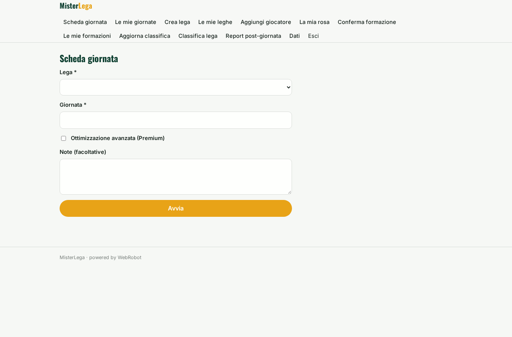
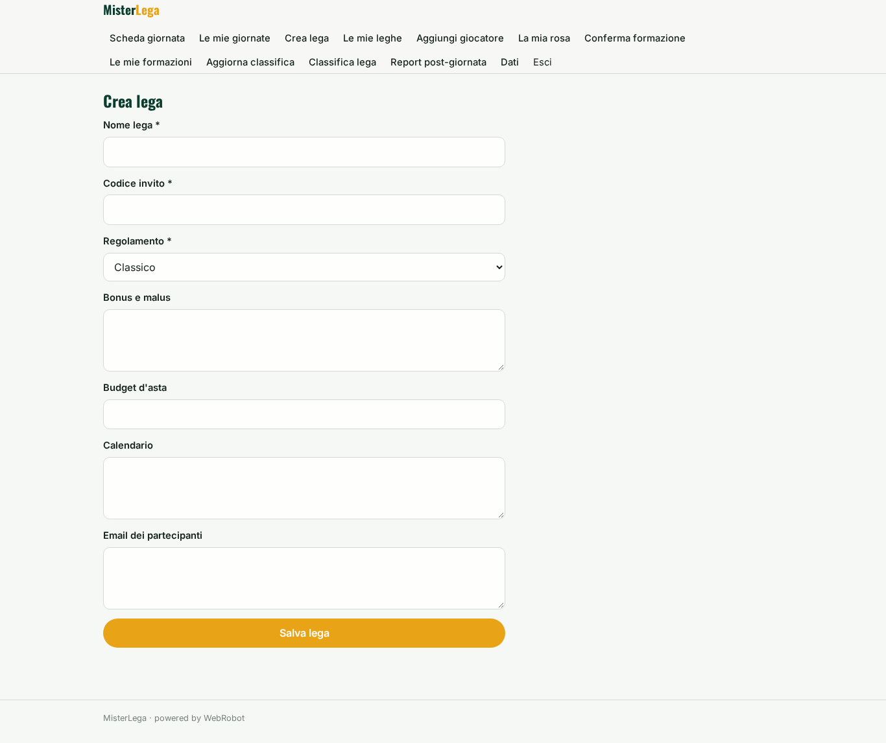
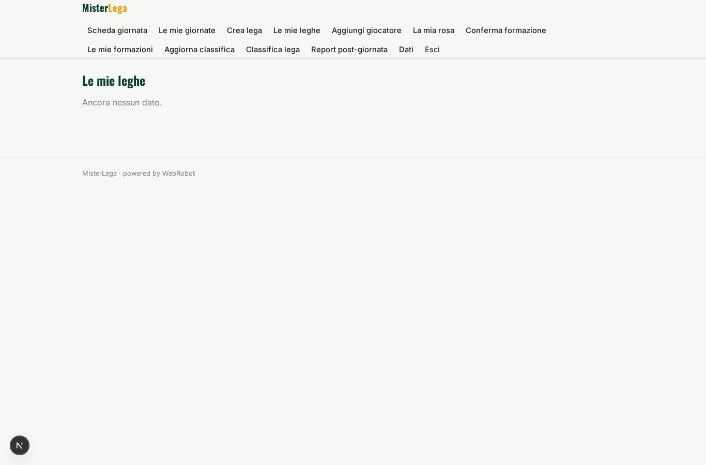
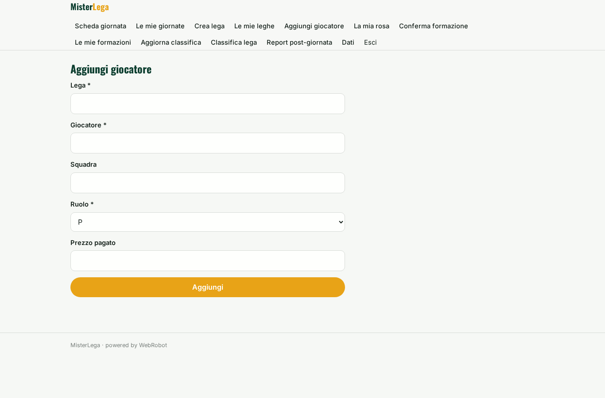
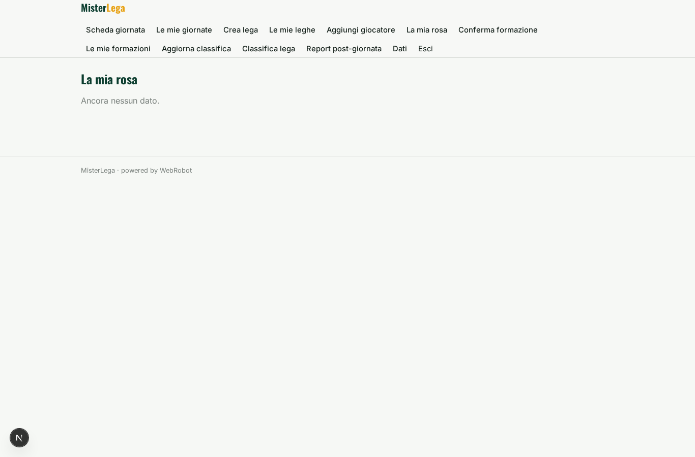
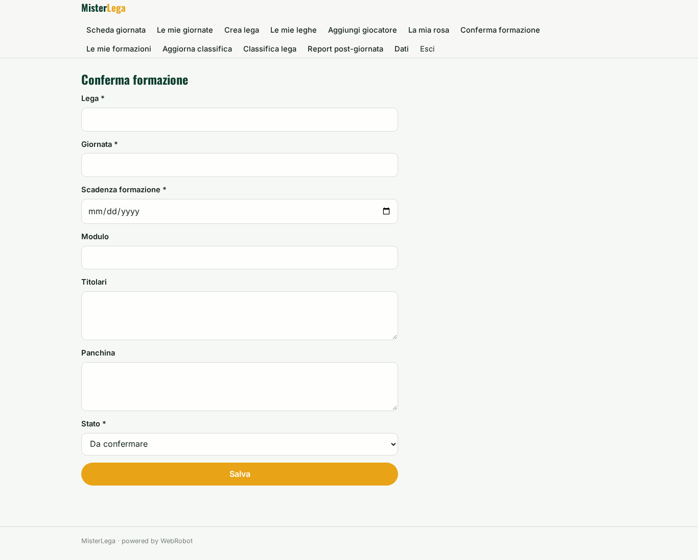
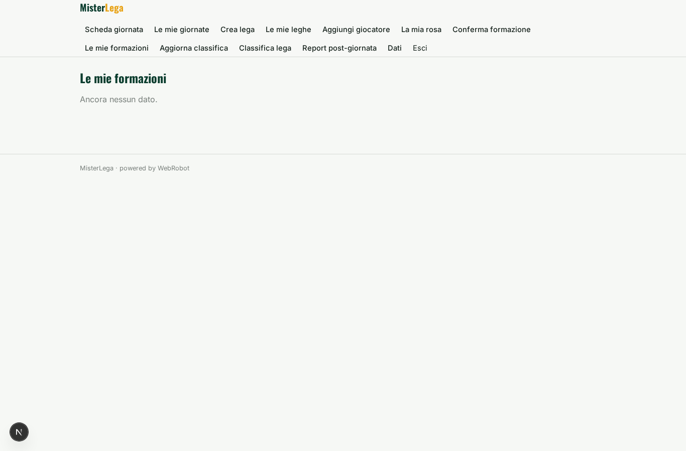
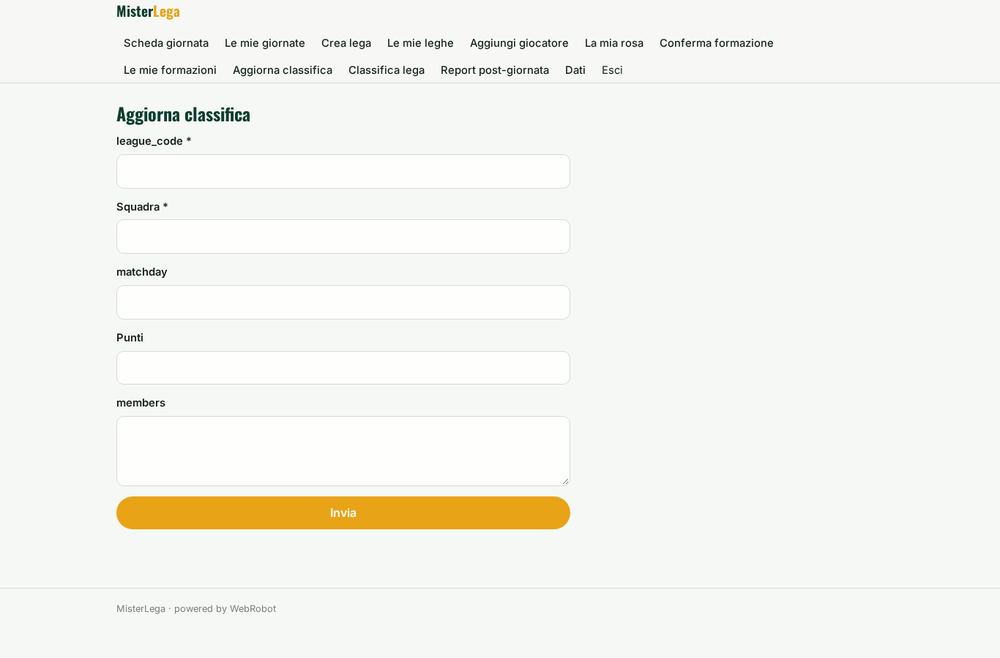
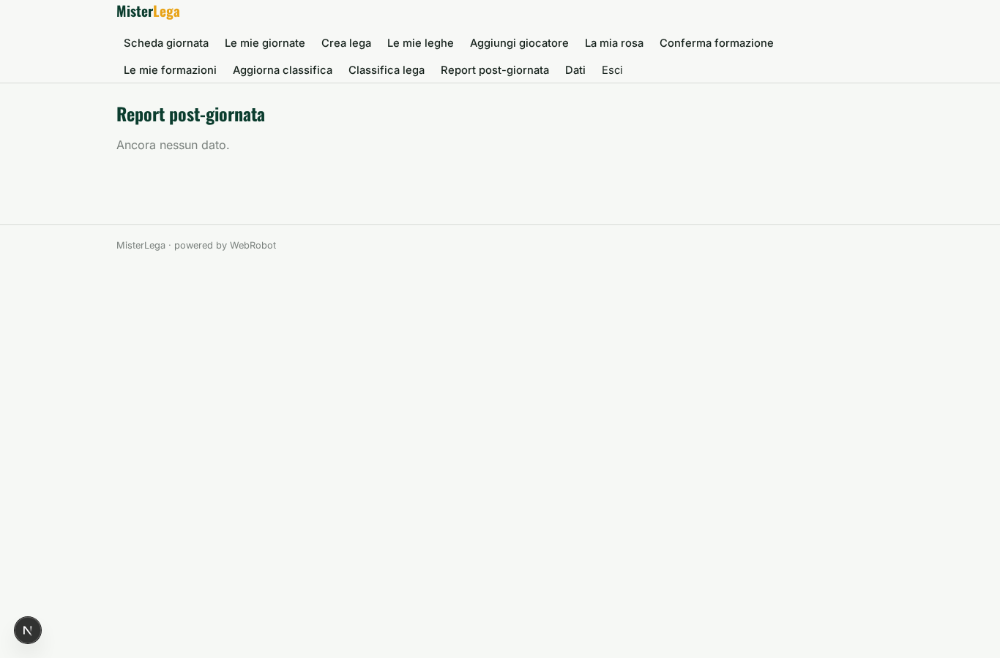
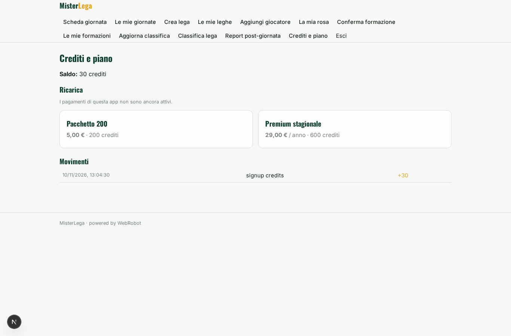

# MisterLega

_Il tuo assistente per schierare la formazione del fantacalcio._

**Manifest:** valid (schema + runtime contract) · **Functional test:** passed (19 checks passed)

## Description given to the app builder (Italian)

Voglio un'app di fantacalcio chiamata MisterLega, con un assistente che aiuta a schierare la formazione. Ogni utente si iscrive, crea o entra in una lega con un codice invito; l'amministratore della lega imposta regolamento (classico o mantra), bonus e malus, budget d'asta e calendario. Ogni partecipante inserisce la propria rosa: giocatori, ruoli, prezzo pagato. Prima di ogni giornata un agente raccoglie statistiche pubbliche (probabili formazioni, infortuni, squalifiche, calendario, rendimento recente) da fonti consultabili nel rispetto dei termini d'uso, oppure dai dati sportivi a licenza se la lega li acquista. Un secondo agente calcola un punteggio atteso per ogni giocatore e propone la formazione ottimale con modulo, titolari e panchina, spiegando le scelte in modo semplice; suggerisce anche scambi e acquisti allo svincolo. L'utente vede una scheda giornata con i consigli e decide lui; nessuna formazione viene inviata da sola. Alert via email e notifica sull'app mobile due ore prima della scadenza se la formazione non è stata confermata. Dopo la giornata, report con i voti e confronto tra consiglio e scelta fatta. Ognuno vede la propria rosa, la classifica è comune alla lega. Base gratuita, abbonamento stagionale premium con le ottimizzazioni avanzate. Italiano.

## Features not expressible today (spec.extensions)

- **join_by_code**: Ingresso in una lega con codice invito: oggi l'amministratore aggiunge le email dei partecipanti alla lega; l'auto-iscrizione tramite codice non è ancora disponibile.
- **push_mobile**: Notifica push sull'app mobile non disponibile: l'alert è solo via email, inviato il giorno della scadenza alle 8 UTC e non due ore prima.
- **alert_only_unconfirmed**: Il promemoria di scadenza parte per ogni formazione con data di scadenza, anche se già confermata: i trigger a data non filtrano per stato.
- **licensed_data**: Integrazione dei dati sportivi a licenza acquistati dalla lega: richiede l'host API del fornitore e una chiave org; da configurare quando il fornitore è scelto.

## Screenshots (interpretive runtime, no data)

### home-anon

### home-mobile

### home

### new_run

### history

### league_form

### leagues_list

### roster_form

### roster_list

### lineup_form

### lineups_list

### standings_form

### standings_list

### reviews_list

### account

