# MisterLega

_L'assistente che ti aiuta a schierare la formazione. Decidi sempre tu._

**Stato manifest:** valido (validatore Python + contratto runtime)

## Descrizione data all'app builder

Voglio un'app di fantacalcio chiamata MisterLega, con un assistente che aiuta a schierare la formazione. Ogni utente si iscrive, crea o entra in una lega con un codice invito; l'amministratore della lega imposta regolamento (classico o mantra), bonus e malus, budget d'asta e calendario. Ogni partecipante inserisce la propria rosa: giocatori, ruoli, prezzo pagato. Prima di ogni giornata un agente raccoglie statistiche pubbliche (probabili formazioni, infortuni, squalifiche, calendario, rendimento recente) da fonti consultabili nel rispetto dei termini d'uso, oppure dai dati sportivi a licenza se la lega li acquista. Un secondo agente calcola un punteggio atteso per ogni giocatore e propone la formazione ottimale con modulo, titolari e panchina, spiegando le scelte in modo semplice; suggerisce anche scambi e acquisti allo svincolo. L'utente vede una scheda giornata con i consigli e decide lui; nessuna formazione viene inviata da sola. Alert via email e notifica sull'app mobile due ore prima della scadenza se la formazione non è stata confermata. Dopo la giornata, report con i voti e confronto tra consiglio e scelta fatta. Ognuno vede la propria rosa, la classifica è comune alla lega. Base gratuita, abbonamento stagionale premium con le ottimizzazioni avanzate. Italiano.

## Funzioni non esprimibili oggi (spec.extensions)

- **email_push_alerts**: Alert via email e notifica push sull'app mobile due ore prima della scadenza se la formazione non è confermata: non disponibile ancora (le notifiche non sono supportate). Per ora l'utente trova le formazioni da confermare nella vista Conferma formazione.
- **licensed_sports_data**: Feed sportivo a licenza acquistato dalla lega: richiede credenziali per lega e un connettore dedicato; per ora solo fonti pubbliche.
- **league_record_forms**: Inserimento di leghe, rose e formazioni tramite l'assistente in chat; maschere di modifica dedicate e unione con codice invito verificato dal runtime non sono ancora disponibili.
- **league_matchday_schedule**: Lo scout gira ogni venerdì; le giornate infrasettimanali e le scadenze per lega richiedono una pianificazione dedicata.

## Screenshot (runtime interpretativo)

### home-anon
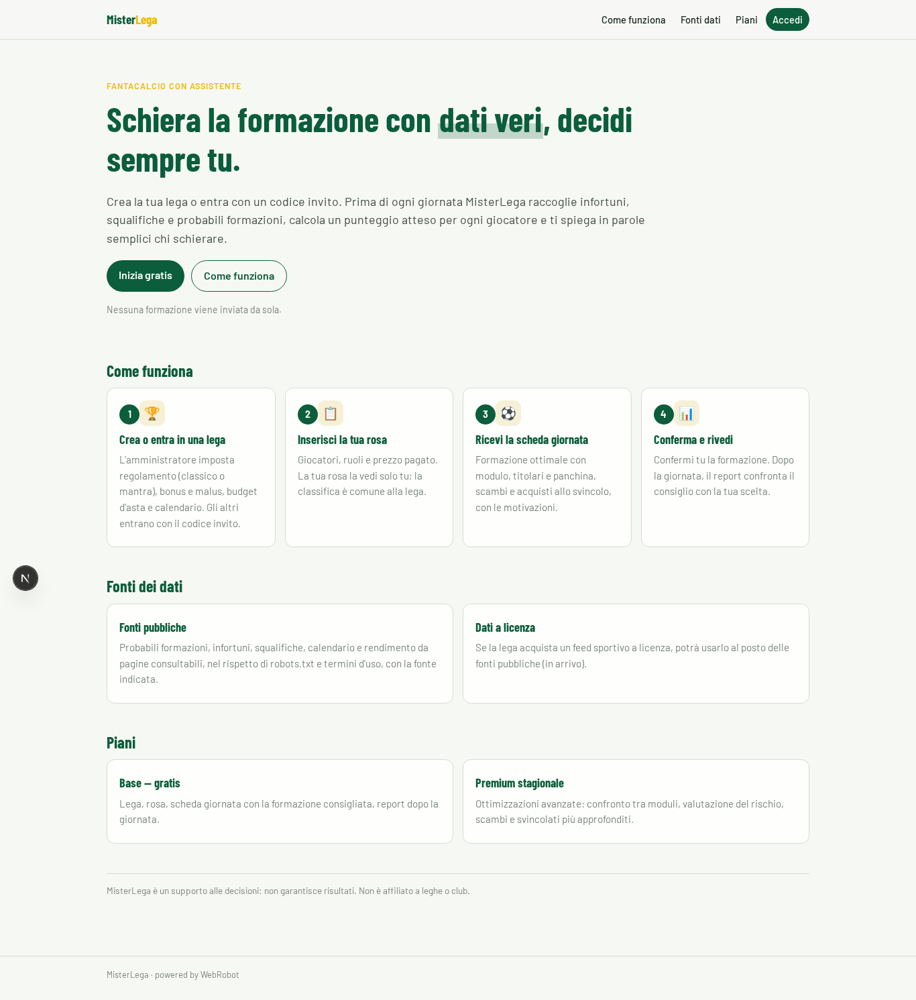

### home-mobile
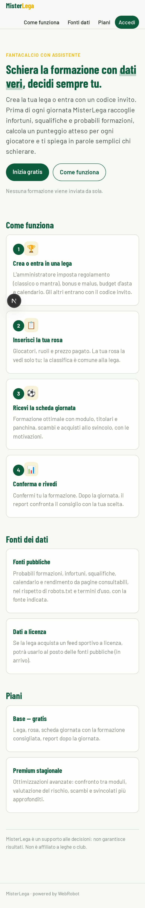

### home
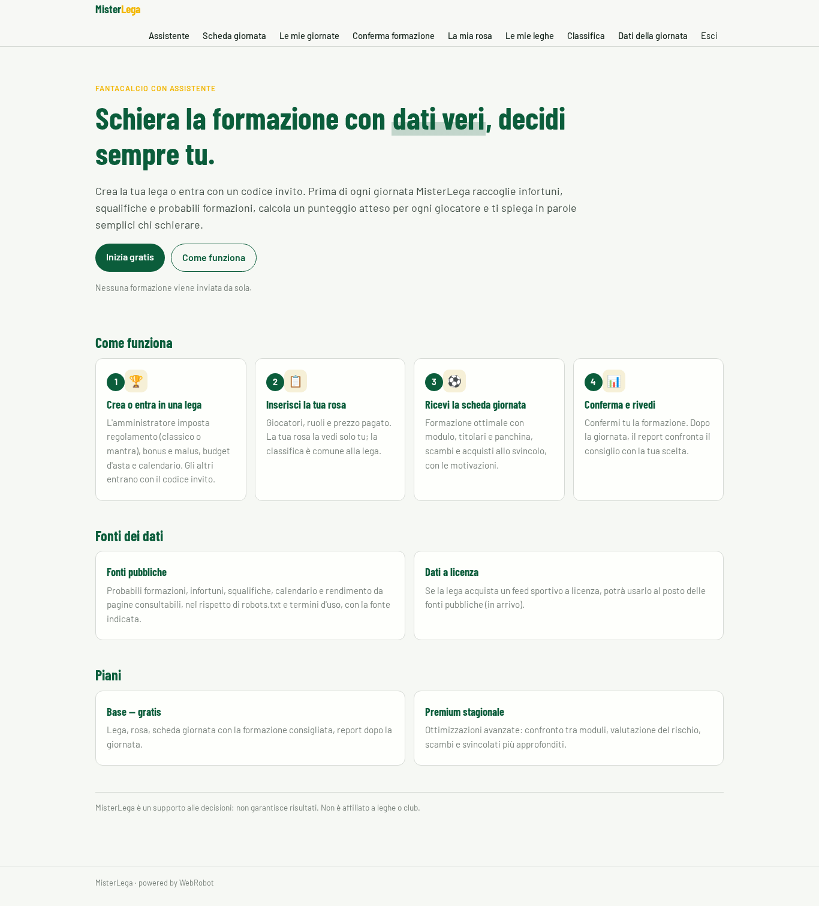

### assistant_chat
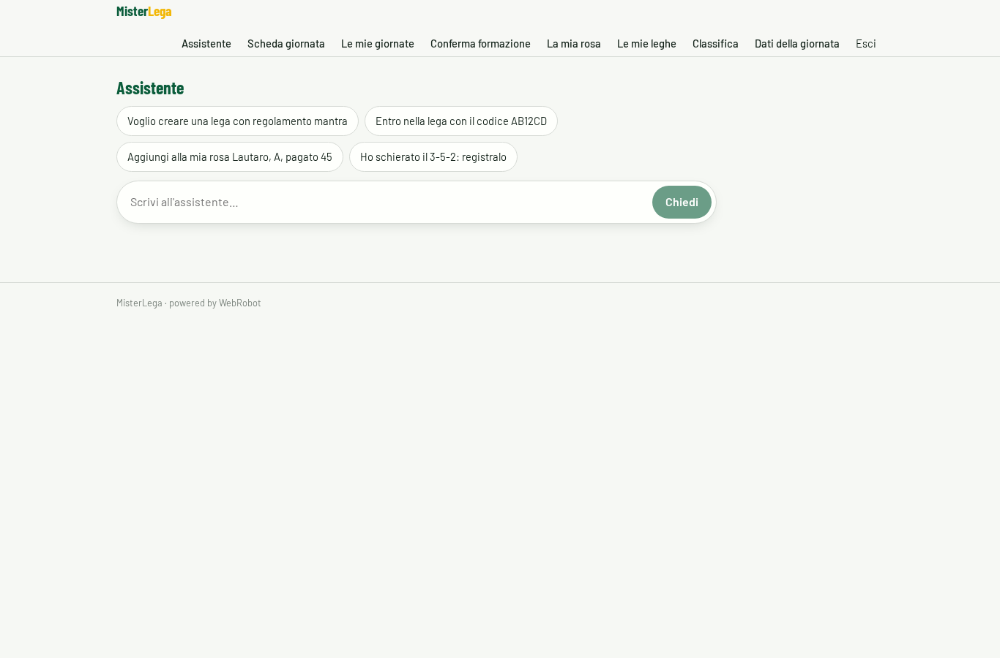

### new_matchday
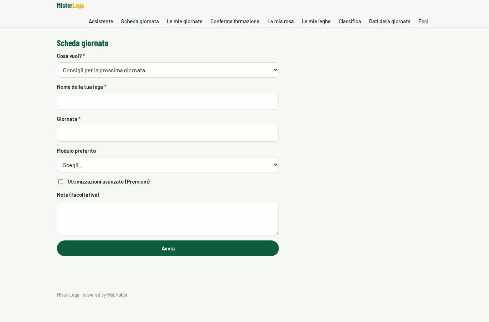

### matchdays
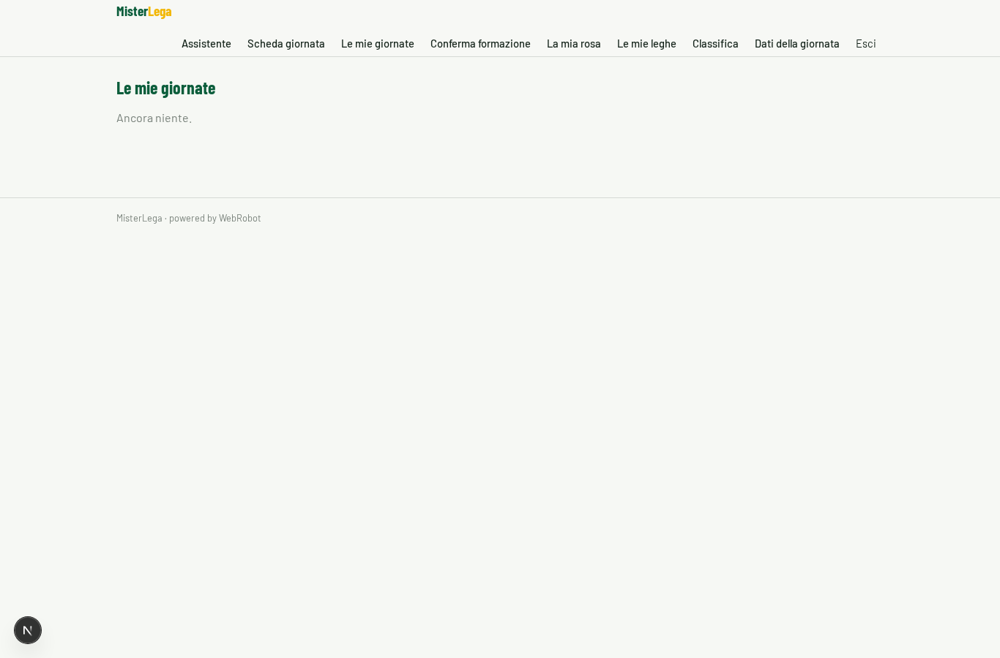

### confirmations
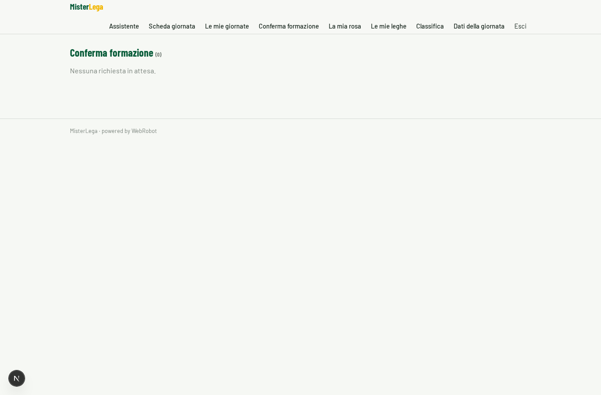

### my_roster
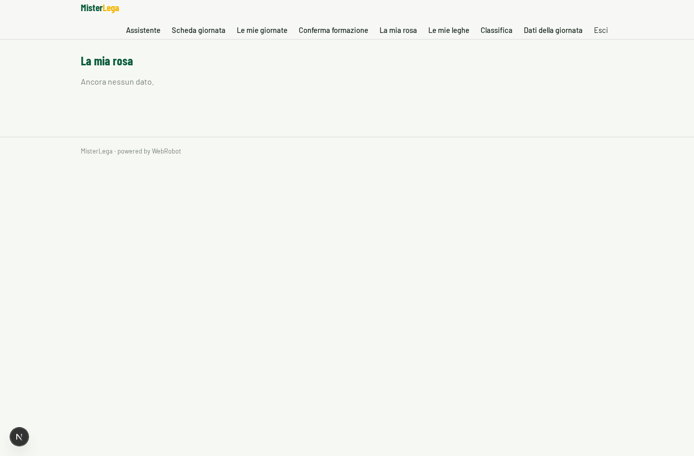

### leagues_list
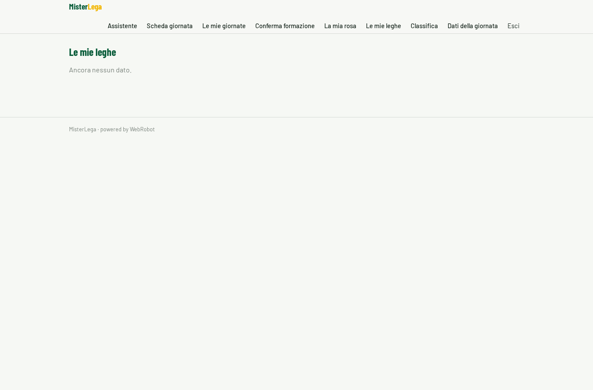

### league_standings
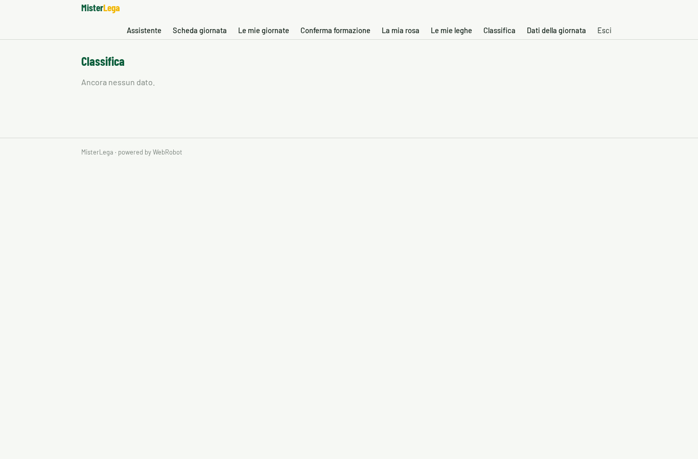

### public_stats
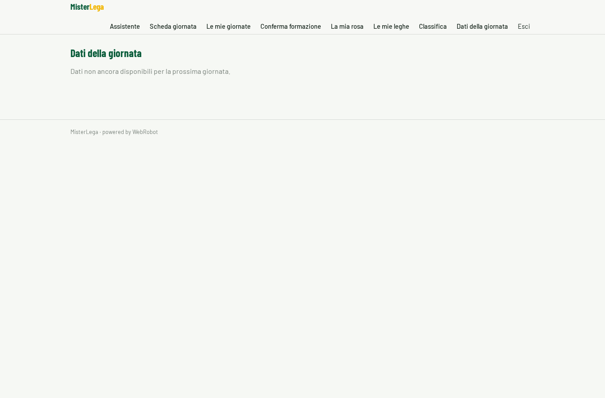

### account
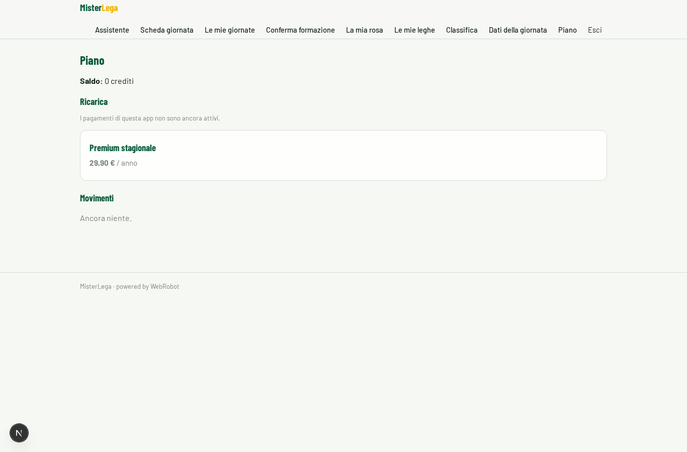

