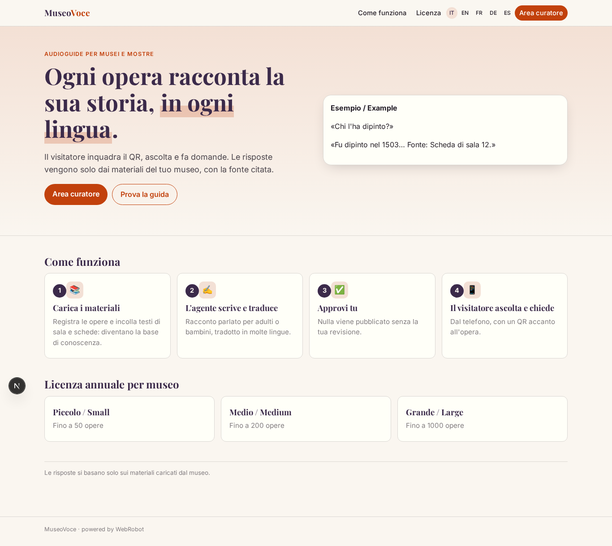
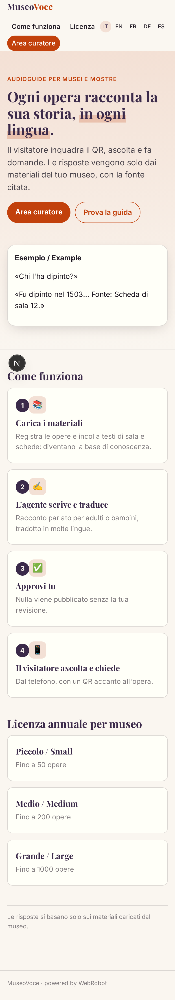
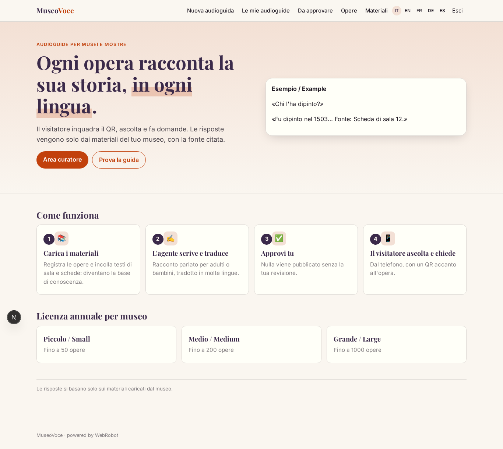
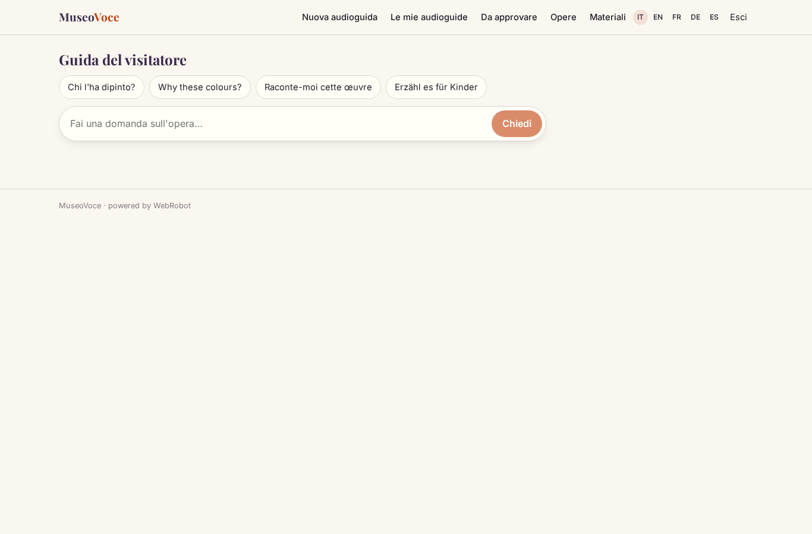
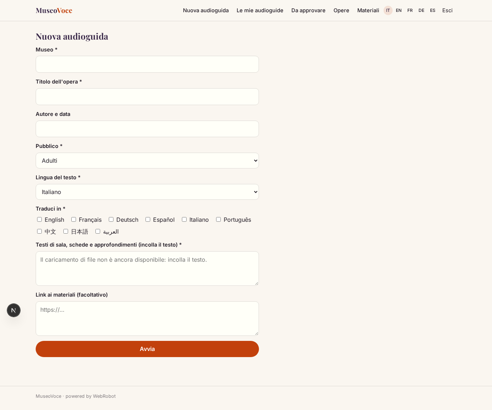
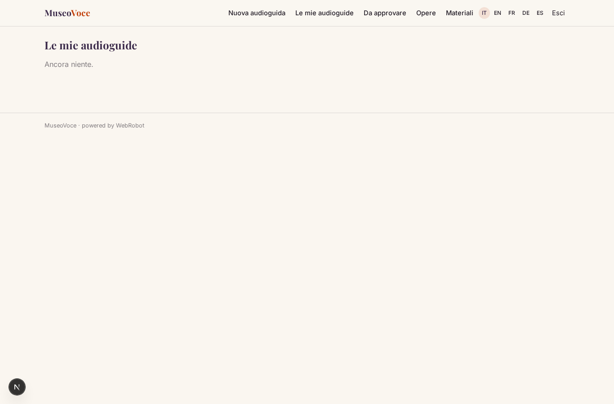
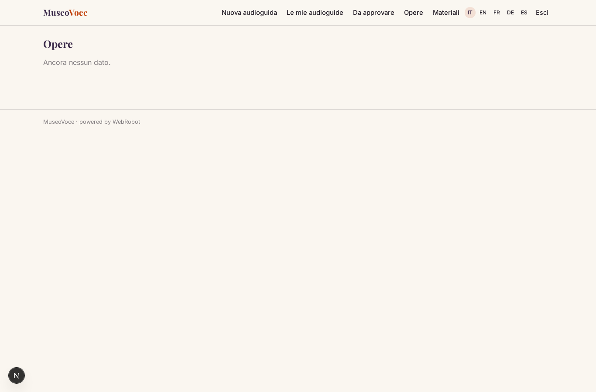
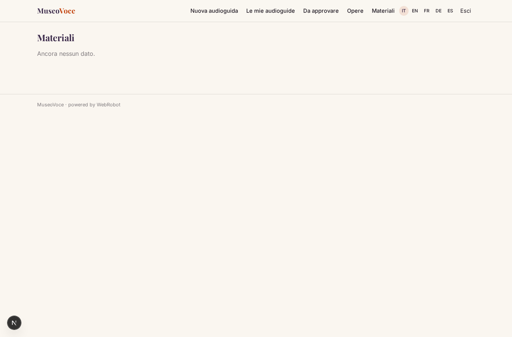
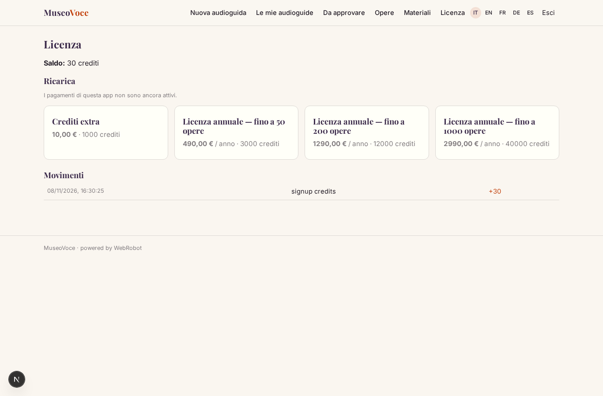

# MuseoVoce

_Audioguide multilingua che rispondono solo con i materiali del tuo museo._

**Manifest status:** valid (schema validator + runtime contract)

## Description given to the app builder (Italian)

MuseoVoce crea audioguide multilingua per musei, siti archeologici e mostre. Il curatore registra le opere della collezione e per ciascuna carica i testi di sala, le schede e i materiali di approfondimento del museo, che vengono indicizzati come base di conoscenza. Un agente genera per ogni opera un racconto parlato nella lingua scelta e lo traduce in molte lingue, adattando il tono a pubblico adulto o bambini. Il visitatore, dal proprio telefono inquadrando un QR code accanto all'opera, apre una chat vocale: ascolta la spiegazione e puo fare domande a voce ("chi l'ha dipinto?", "perche questi colori?") ricevendo risposte basate solo sui materiali del museo, con citazione della fonte. Il curatore rivede e approva i testi prima della pubblicazione e vede quali opere e quali domande sono piu ascoltate. Ogni museo gestisce la propria collezione e i propri contenuti. Licenza annuale per museo, con quota per numero di opere. Interfaccia e audio in italiano, inglese, francese, tedesco, spagnolo e altre lingue.

## Features not expressible today (spec.extensions)

- **voice_io**: Speech-to-text for visitor questions and text-to-speech audio playback in each language are not available yet: the chat is text for now.
- **file_upload**: Uploading PDFs and files is not available yet: the curator pastes text or links.
- **qr_codes**: QR code generation per work (link /v/visit?work=<id>) and per-museum catalogue filtering are not available yet.
- **analytics**: Most-listened works and most-asked questions need visitor events written by the guide, which anonymous agents cannot do yet.
- **work_quota**: Enforcing the number of works allowed by the license plan is not available yet.

## Screenshots (interpretive runtime)

### home-anon

### home-mobile

### home

### visit

### new_guide

### guides_history

### approvals

### works

### materials_view

### account

