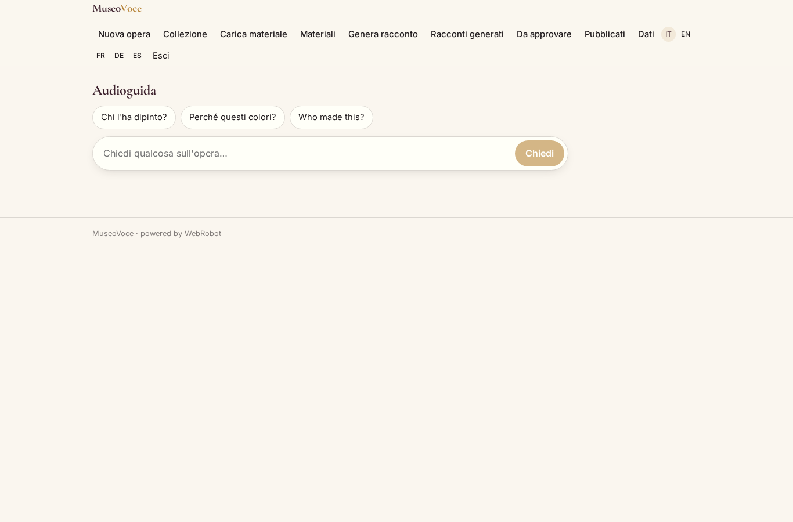
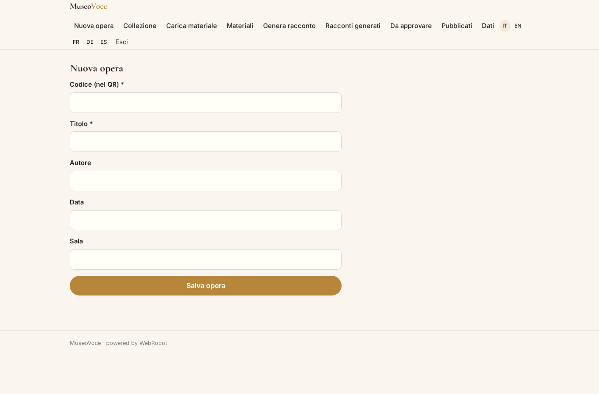
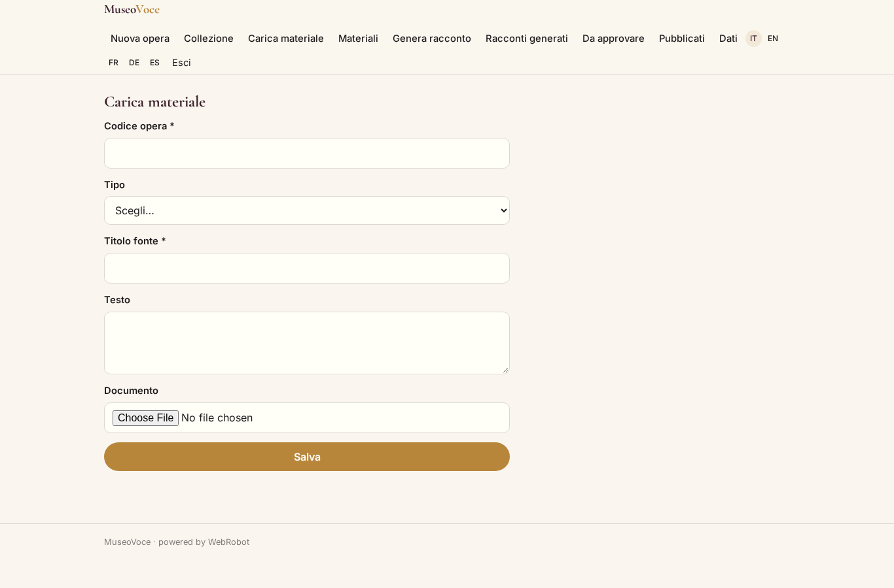
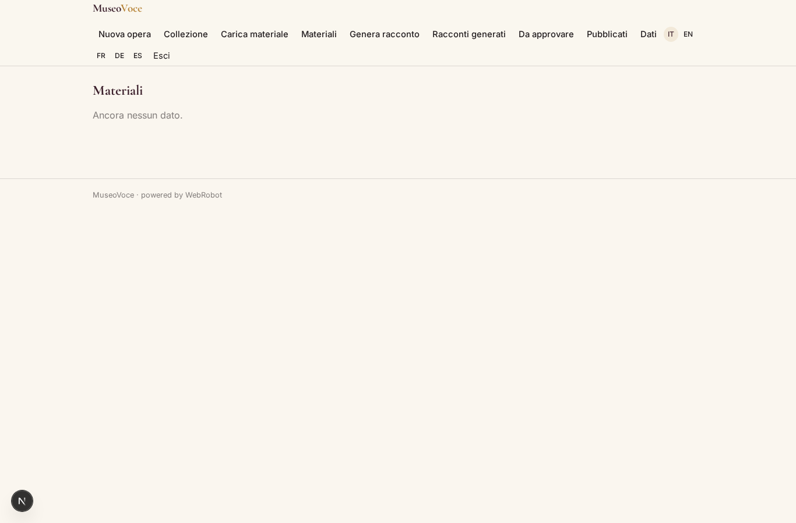
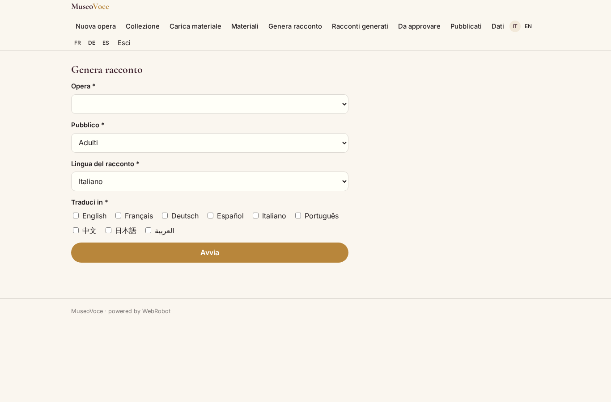
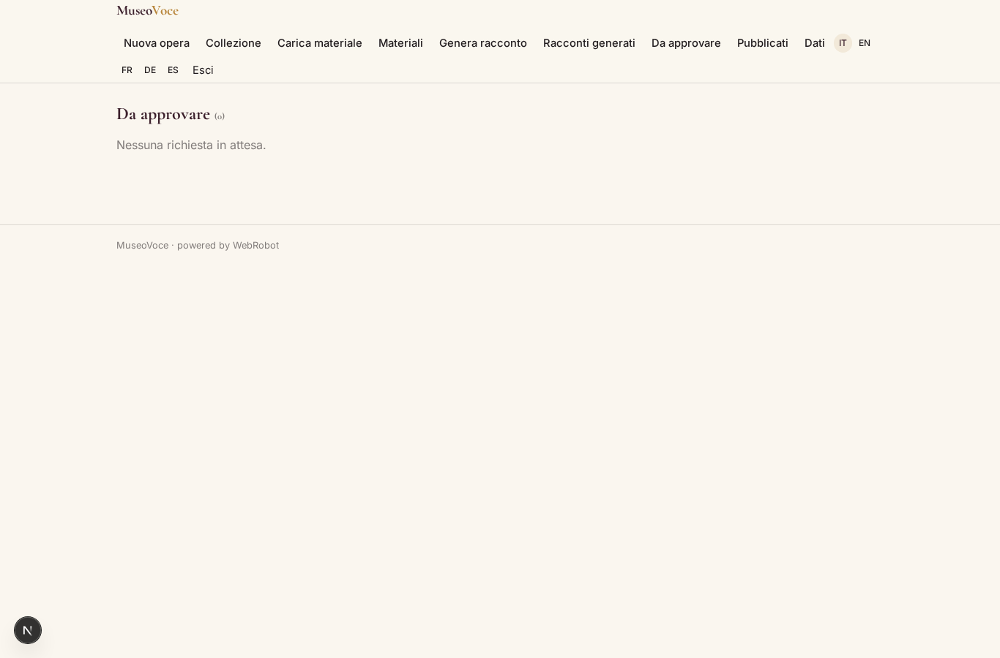
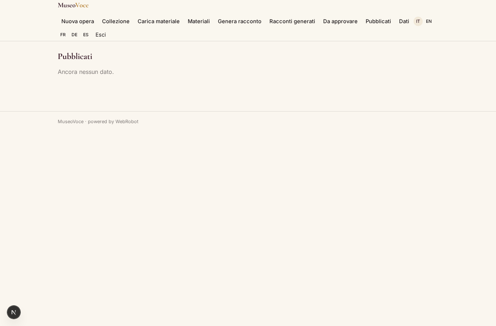
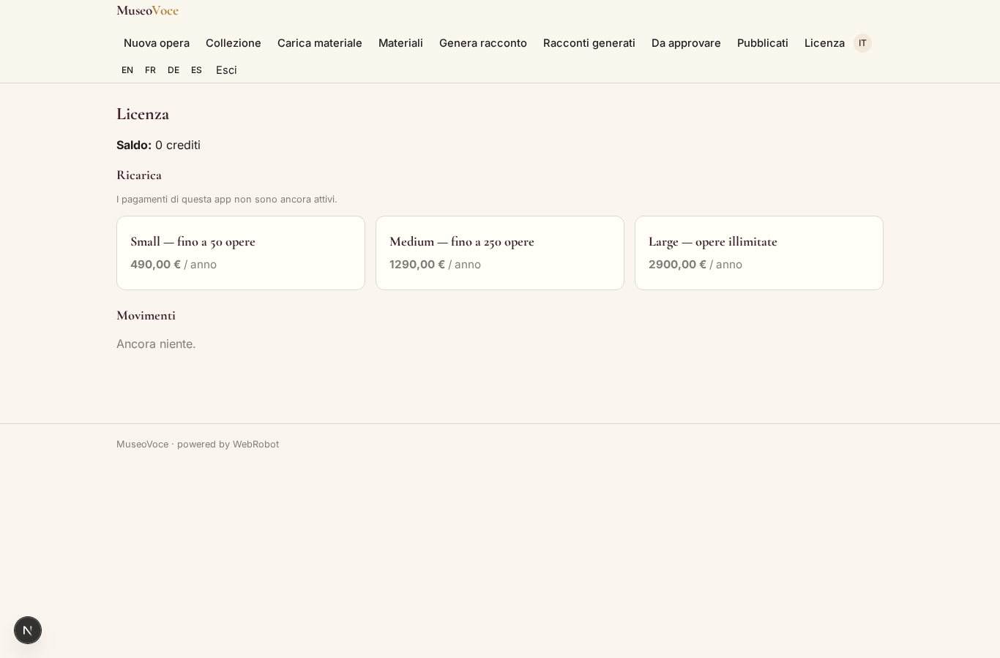

# MuseoVoce

_Audioguide multilingua che rispondono solo con i materiali del tuo museo._

**Manifest:** valid (schema + runtime contract) · **Functional test:** passed (17 checks passed)

## Description given to the app builder (Italian)

MuseoVoce crea audioguide multilingua per musei, siti archeologici e mostre. Il curatore registra le opere della collezione e per ciascuna carica i testi di sala, le schede e i materiali di approfondimento del museo, che vengono indicizzati come base di conoscenza. Un agente genera per ogni opera un racconto parlato nella lingua scelta e lo traduce in molte lingue, adattando il tono a pubblico adulto o bambini. Il visitatore, dal proprio telefono inquadrando un QR code accanto all'opera, apre una chat vocale: ascolta la spiegazione e puo fare domande a voce ("chi l'ha dipinto?", "perche questi colori?") ricevendo risposte basate solo sui materiali del museo, con citazione della fonte. Il curatore rivede e approva i testi prima della pubblicazione e vede quali opere e quali domande sono piu ascoltate. Ogni museo gestisce la propria collezione e i propri contenuti. Licenza annuale per museo, con quota per numero di opere. Interfaccia e audio in italiano, inglese, francese, tedesco, spagnolo e altre lingue.

## Features not expressible today (spec.extensions)

- **voice_io**: Speech-to-text and text-to-speech for the visitor's voice chat (browser or TTS service) are not yet available as manifest features; the chat is text-based for now.
- **usage_analytics**: Most-listened works and most-asked questions need logging of visitor chats/plays into a per-museum collection; anonymous agents cannot write records yet. Not available.
- **qr_codes**: QR codes pointing to /v/listen?page=<work code> must be generated and printed by the museum; no QR generator in the manifest.
- **museum_scoping**: Published guides sit in one shared catalogue with a museum field; strict per-museum separation of visitor lookups needs the QR link to carry the museum and code.

## Screenshots (interpretive runtime, no data)

### home-anon

### home-mobile

### home

### listen

### artworks_form

### artworks

### material_form

### materials

### new_story

### history

### review

### published

### account

