# MuseoInCloud

_Il gestionale web per musei piccoli e medi, fondazioni e siti culturali._

**Manifest:** valid (schema + runtime contract) · **Functional test:** passed (40 checks passed)

## Description given to the app builder (Italian)

Vorrei MuseoInCloud, un gestionale web per musei piccoli e medi, fondazioni e siti culturali. Ogni museo è un tenant separato con il proprio staff: direttore, biglietteria, responsabile didattica, comunicazione. Funzioni principali: anagrafica visitatori e CRM (dati di contatto, consenso marketing, storico visite, membership), calendario di mostre, eventi e laboratori con capienza per fascia oraria, biglietteria online con tipologie (intero, ridotto, scuole, gruppi) e pagamento con carta, emissione del biglietto con QR code da validare all'ingresso. Le scuole compilano un modulo di prenotazione per visite didattiche (istituto, classe, numero alunni, data preferita, laboratorio scelto) e il responsabile didattica conferma o propone un'altra data. Un agente prepara la newsletter mensile con mostre ed eventi in programma, segmentando i destinatari per interessi; la comunicazione la approva prima dell'invio. Un altro agente ogni lunedì produce un report con visitatori, incassi per tipologia, tasso di riempimento degli eventi e confronto con l'anno precedente. Alert email quando un evento è quasi esaurito. Ogni museo vede solo i propri dati. Abbonamento mensile per museo più una piccola commissione sui biglietti venduti online. Italiano e inglese.

## Functional test: what did not pass

- **trigger has its effect** (trigger school_new): email to role:education: no such recipient in the test (role nobody holds or empty field) _(warning)_
- **saved record shown where its collection is read** (view tickets_table): a record was saved in tickets (by admin-data, admin-data, user) but the page does not show it (as admin) _(warning)_

## Features not expressible today (spec.extensions)

- **ticket_qr**: Ticket PDF/QR code emission and validation at the entrance (scan app) are not available yet; tickets are saved as records with status paid/validated and validated manually by the ticket office.
- **card_payment**: Card payment of tickets at checkout through the museum's own Stripe Connect account is configured by the owner in the studio; the ticket form currently registers the order, the 2% commission is set via transactionFeePct.
- **newsletter_send**: Sending the approved newsletter to segmented lists (email campaigns, unsubscribe) is not available yet; the approved draft and segment counts are delivered to the communications team who sends it with their mailing tool.
- **tenancy**: Each museum is a separate app instance/tenant with its own staff, roles and data; deploy one per museum.

## Screenshots (interpretive runtime, no data)

### home-anon
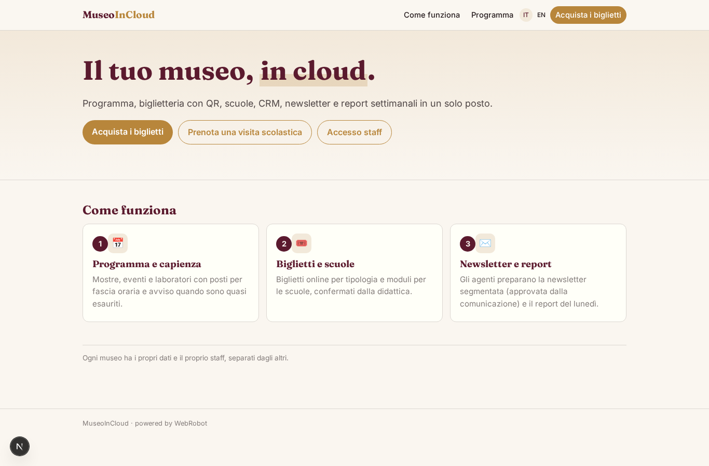

### home-mobile
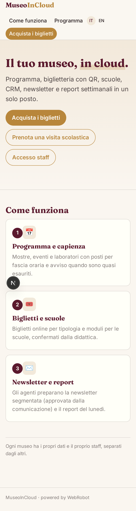

### home
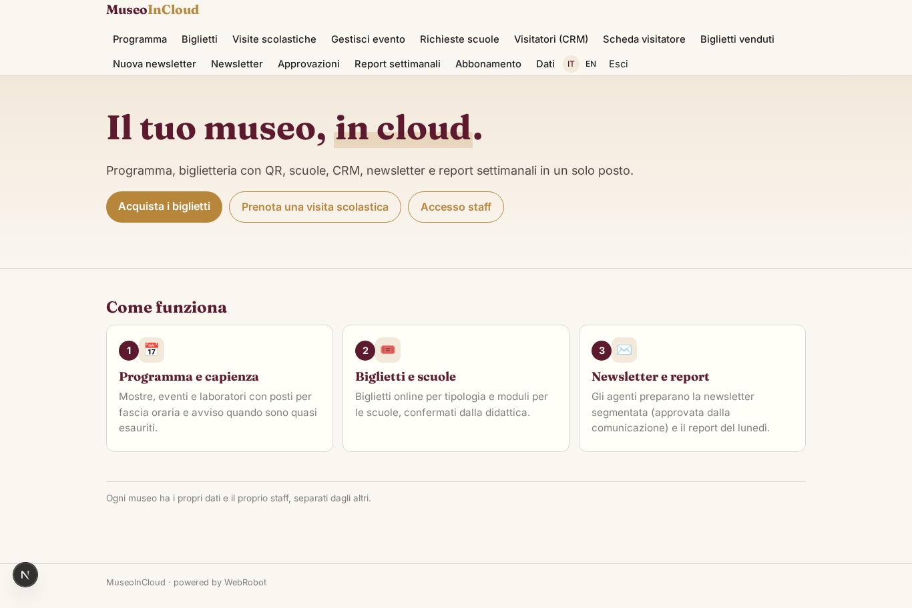

### calendar
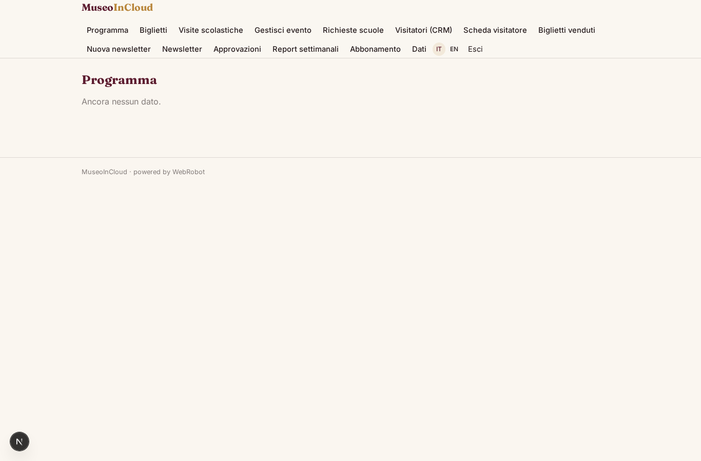

### buy_ticket
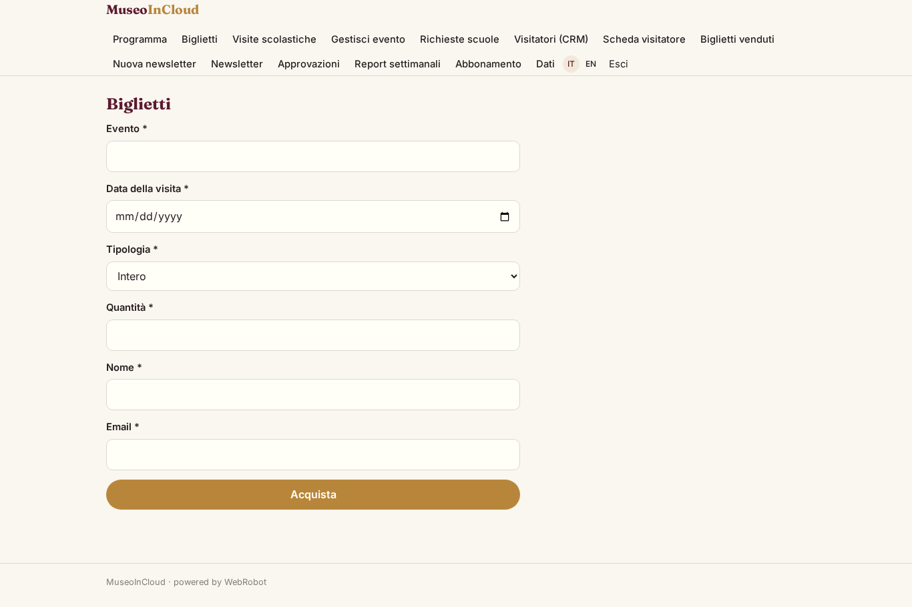

### school_booking
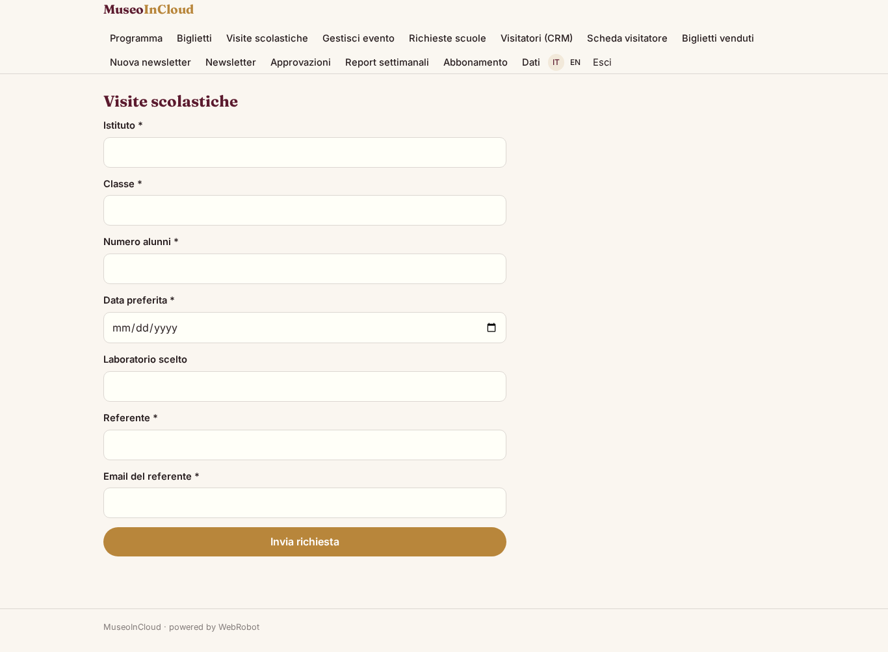

### event_edit
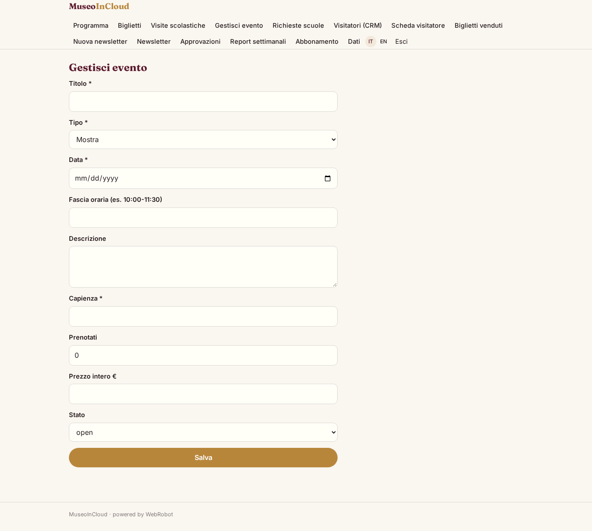

### school_requests

### school_review
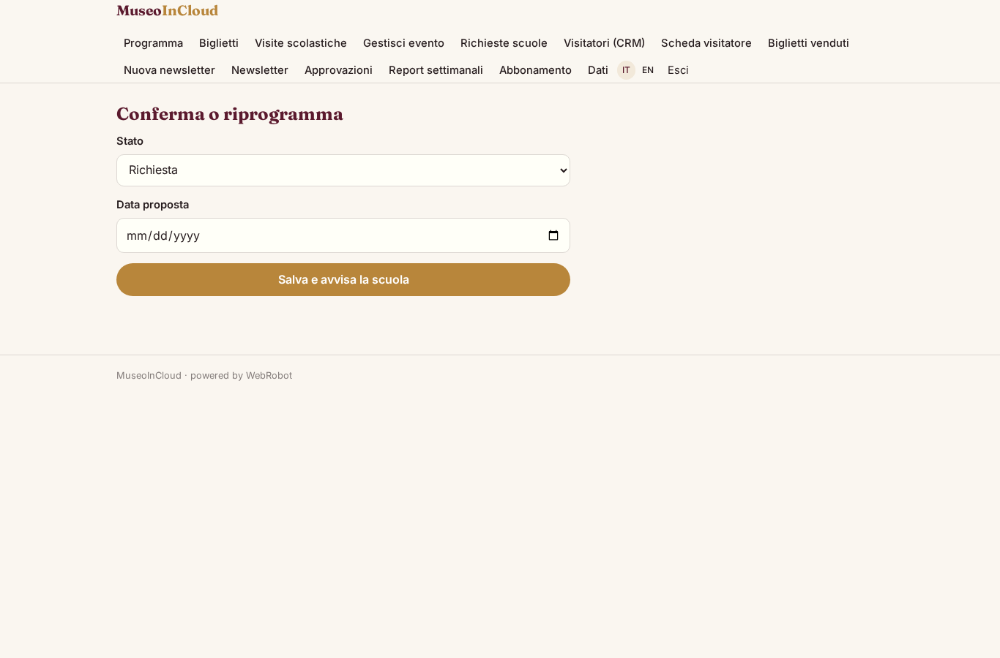

### visitors_table

### visitor_edit
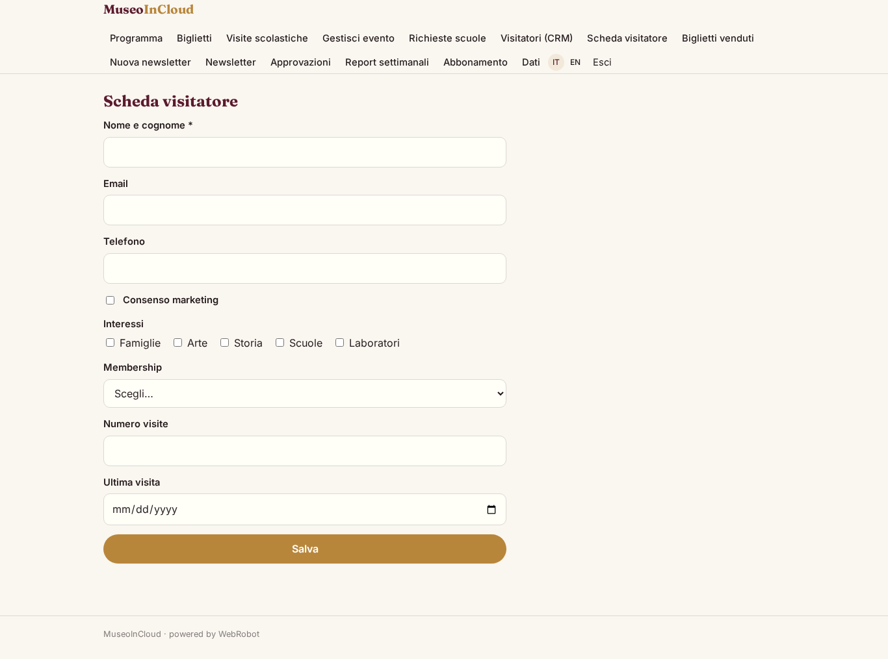

### tickets_table
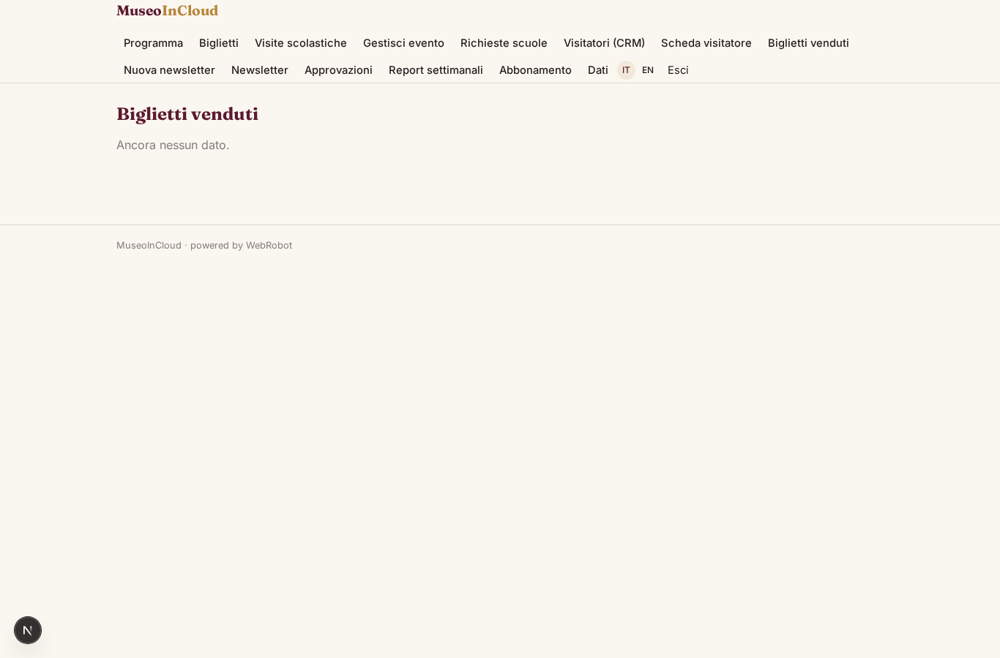

### new_newsletter
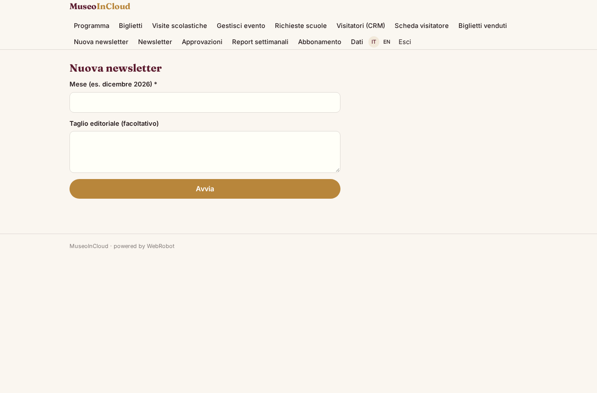

### newsletters_list
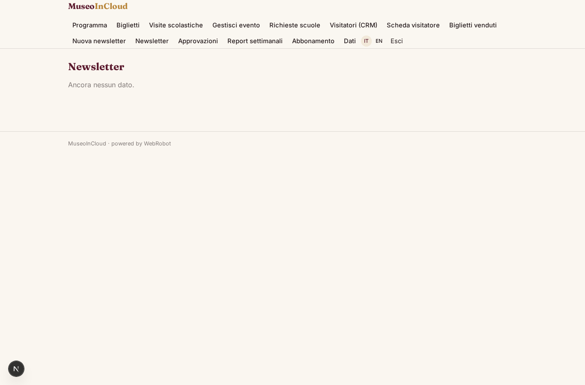

### decisions

### reports
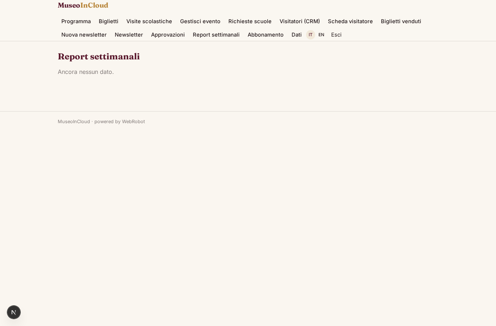

### account
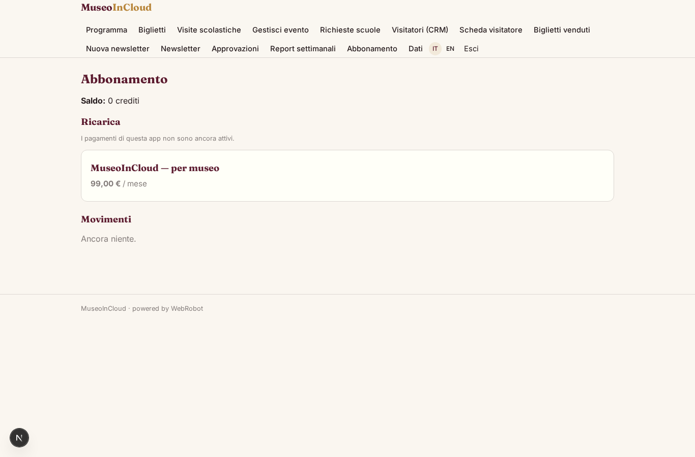
