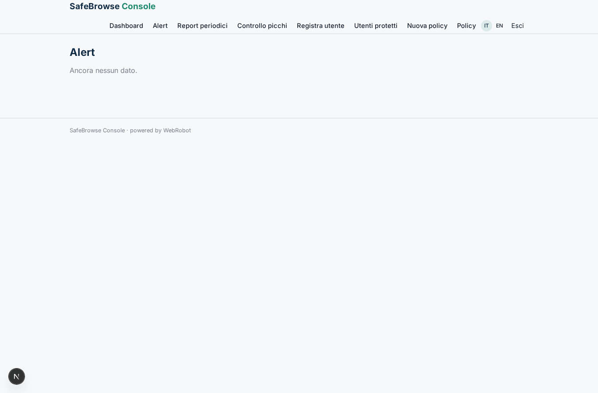
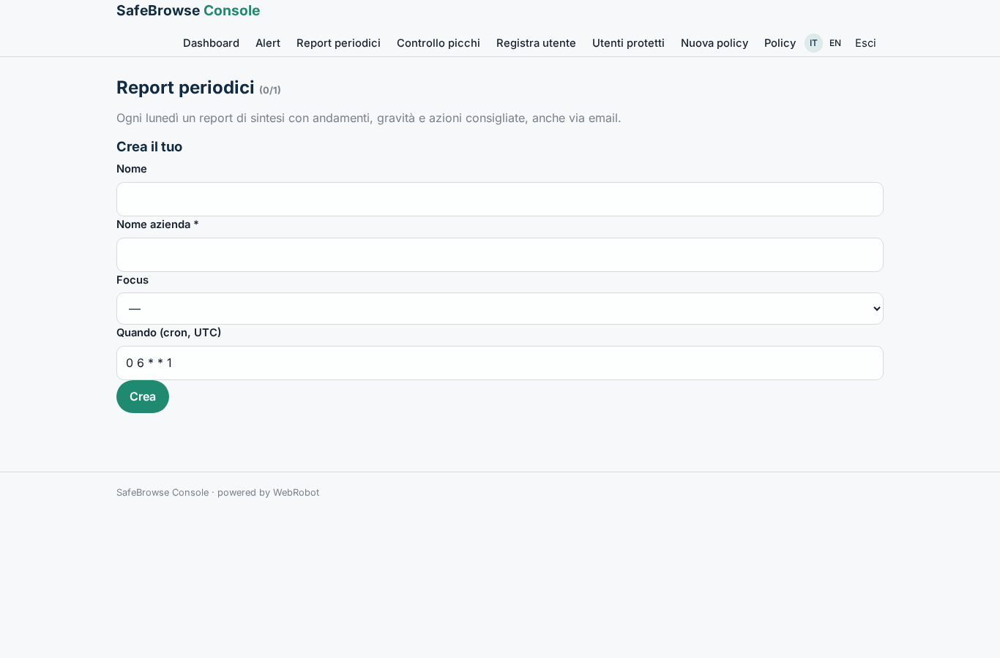
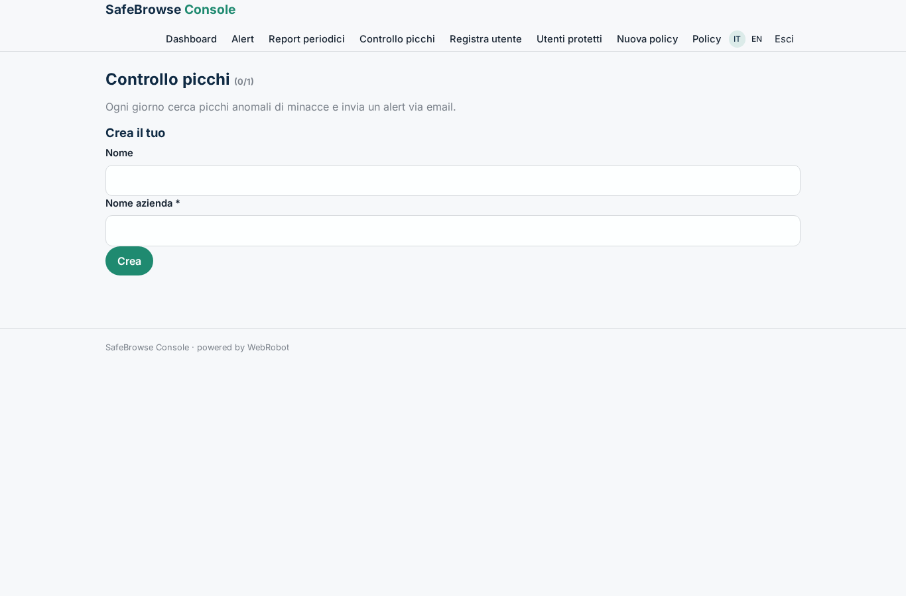
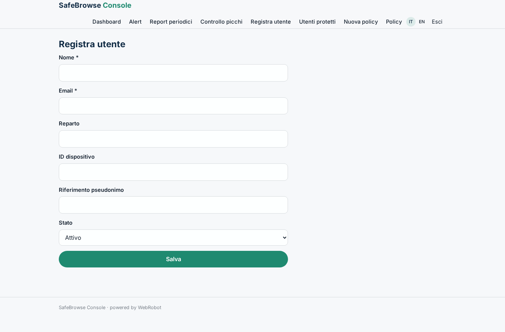
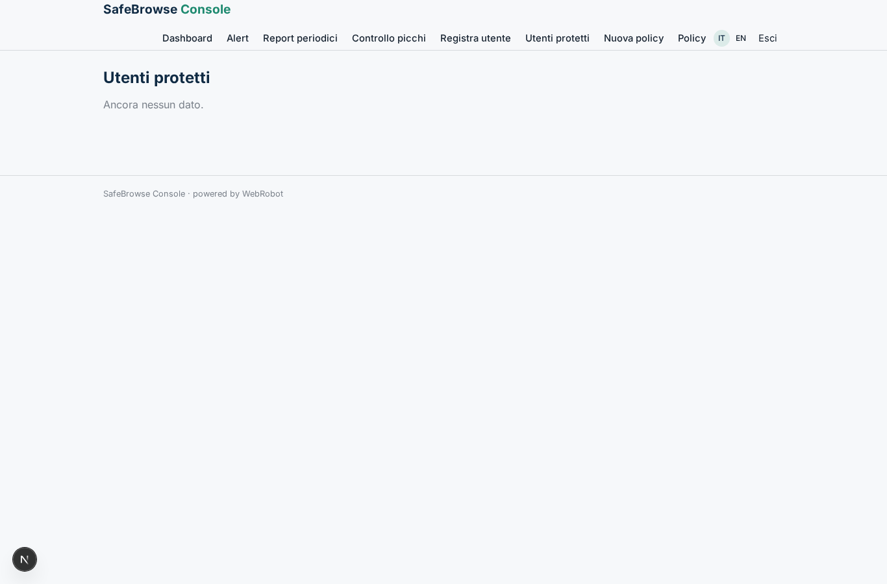
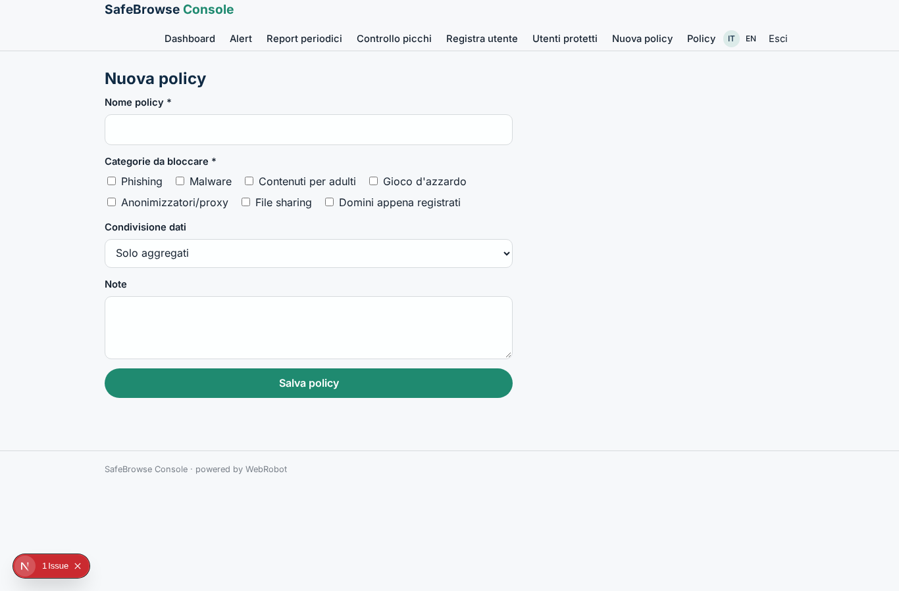
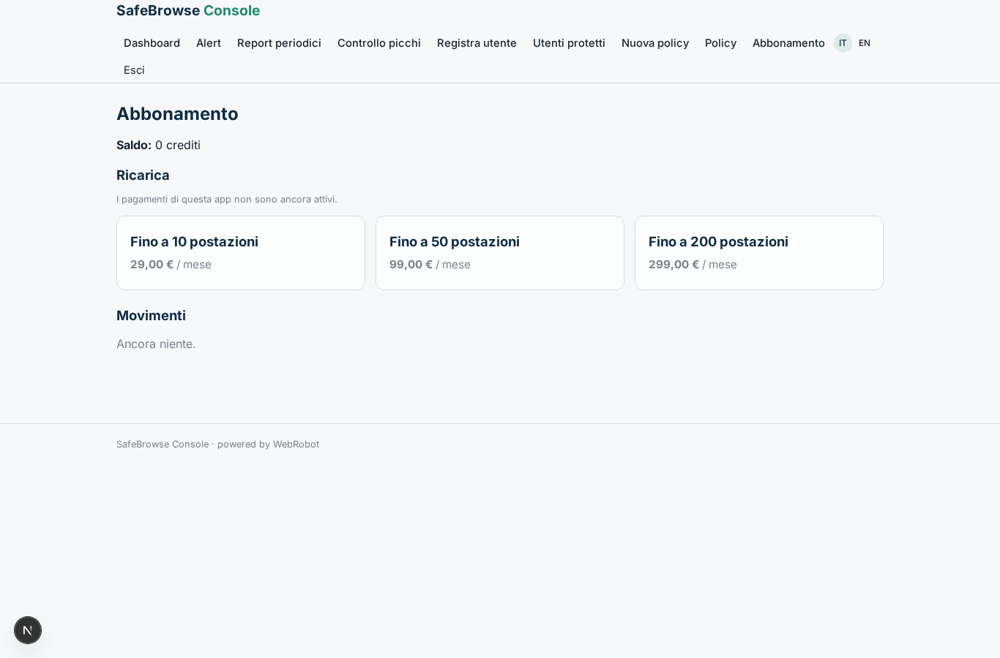

# SafeBrowse Console

_Console di gestione e report per la protezione della navigazione web._

**Manifest:** valid (schema + runtime contract) · **Functional test:** passed (15 checks passed)

## Description given to the app builder (Italian)

Descrivo solo lo strato software di gestione e reportistica di un servizio di protezione della navigazione web; l'estensione del browser e la protezione sull'endpoint sono un prodotto a parte, qui c'e la console per l'amministratore. L'IT manager dell'azienda registra gli utenti e le policy (categorie di siti da bloccare, regole sulla condivisione dei dati) tramite moduli. I dispositivi protetti inviano alla console, via webhook, eventi gia anonimizzati sulle minacce intercettate durante la navigazione. Un agente aggrega gli eventi, individua gli andamenti (siti rischiosi piu frequenti, utenti piu esposti), li ordina per gravita e produce un report leggibile con le azioni consigliate. L'admin vede una dashboard con le minacce bloccate nel tempo e per utente, riceve un alert via email quando compare un picco anomalo e un report periodico di sintesi. Ogni azienda vede solo i propri dati, in forma aggregata e nel rispetto della privacy dei dipendenti. Abbonamento mensile per numero di postazioni protette. In italiano e inglese.

## Features not expressible today (spec.extensions)

- **webhook_tenant**: The webhook /api/hooks/threat_event writes events into one company's records: attributing each device's events to the right company (per-company hook secret or device registry lookup) needs custom handling not expressible in the manifest.
- **seat_billing**: Plans are seat tiers; billing per exact number of protected seats (metered) is not available, and the seat limit is enforced on registered users only.

## Screenshots (interpretive runtime, no data)

### home-anon

### home-mobile

### home

### dashboard

### alerts_list

### reports

### spike_watch

### add_user

### users_list

### add_policy

### policies_list

### account

