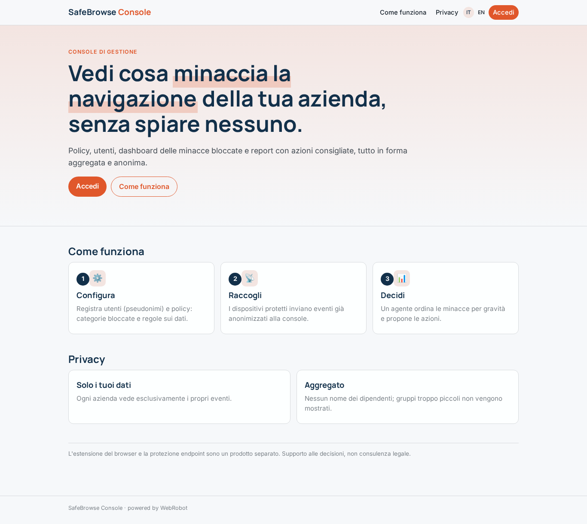
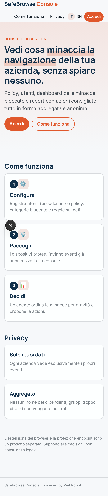
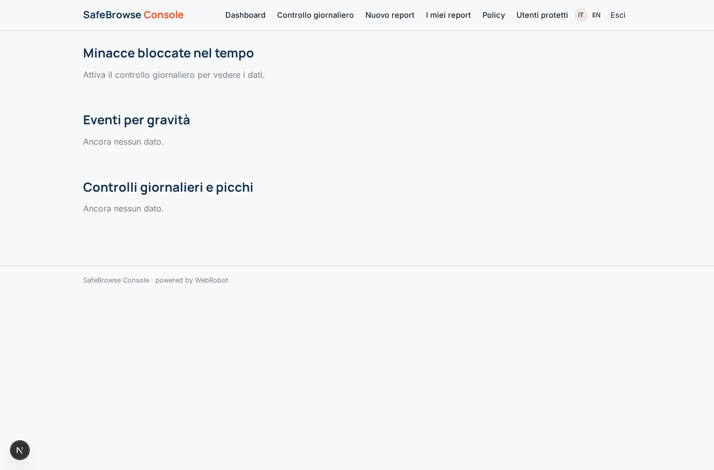
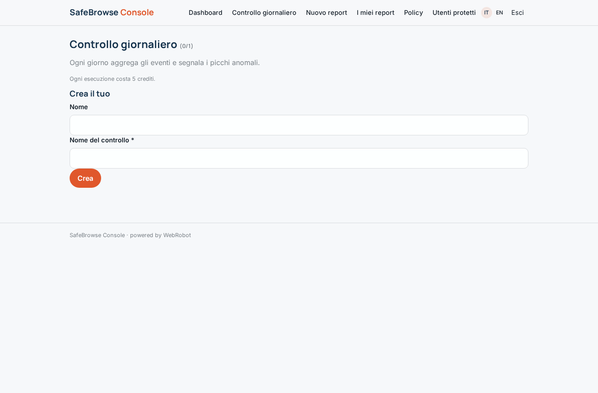
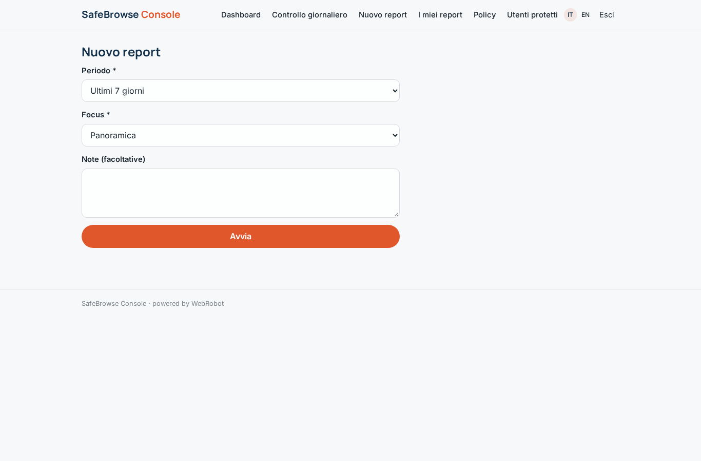
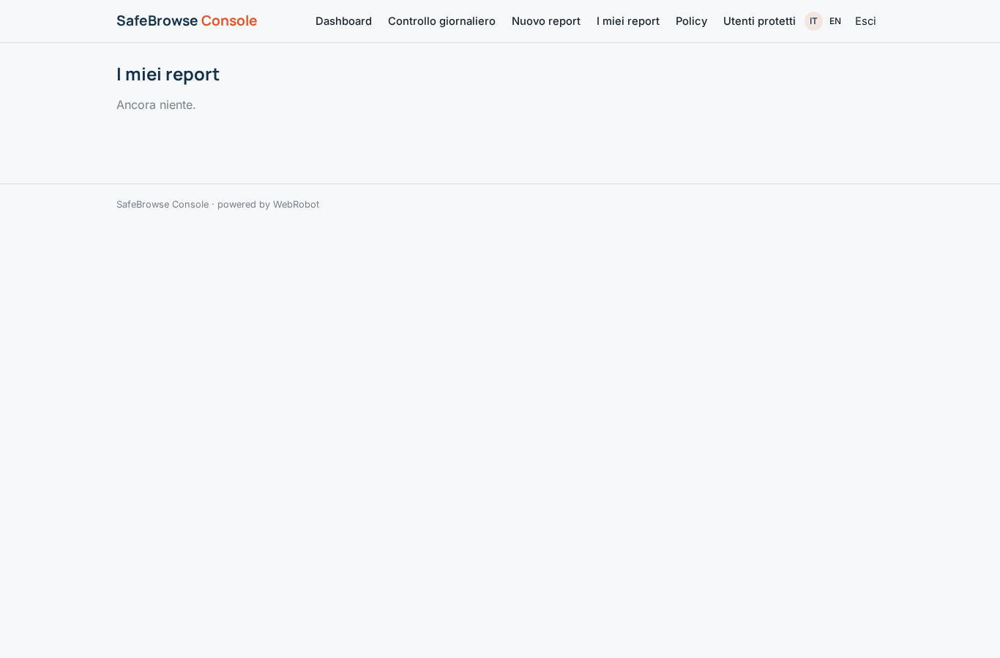
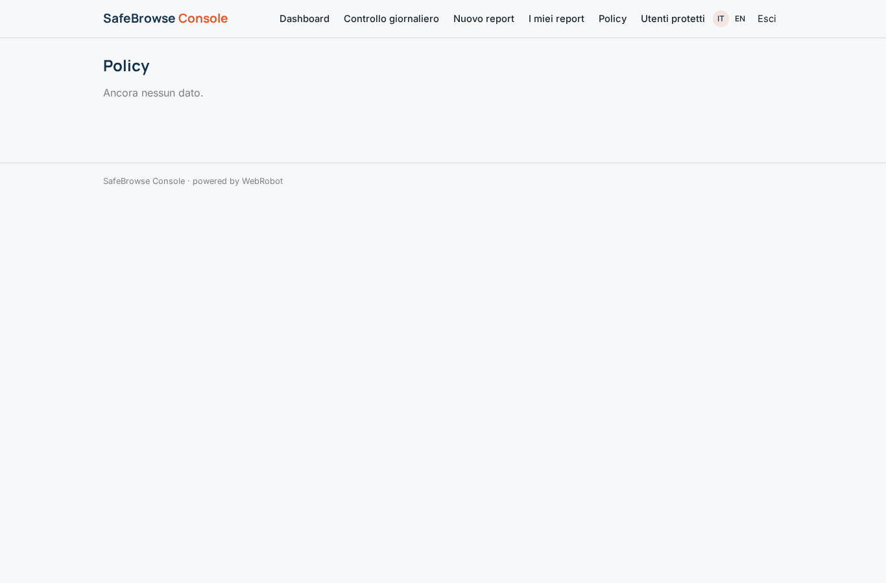
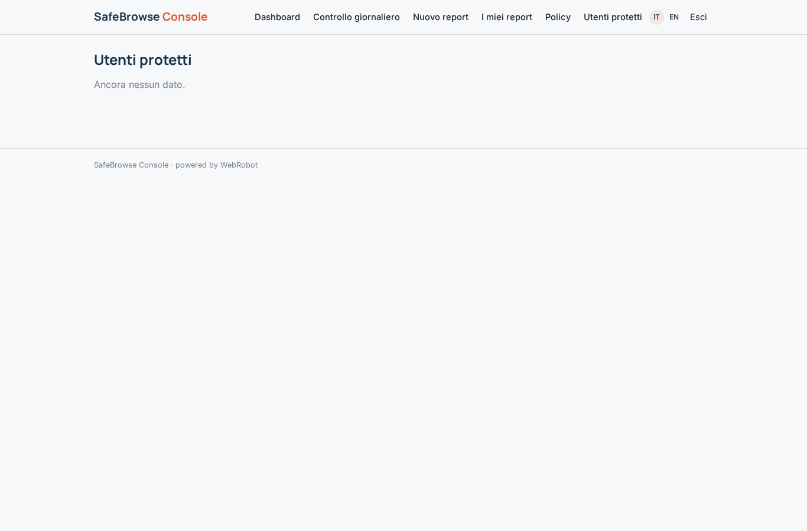
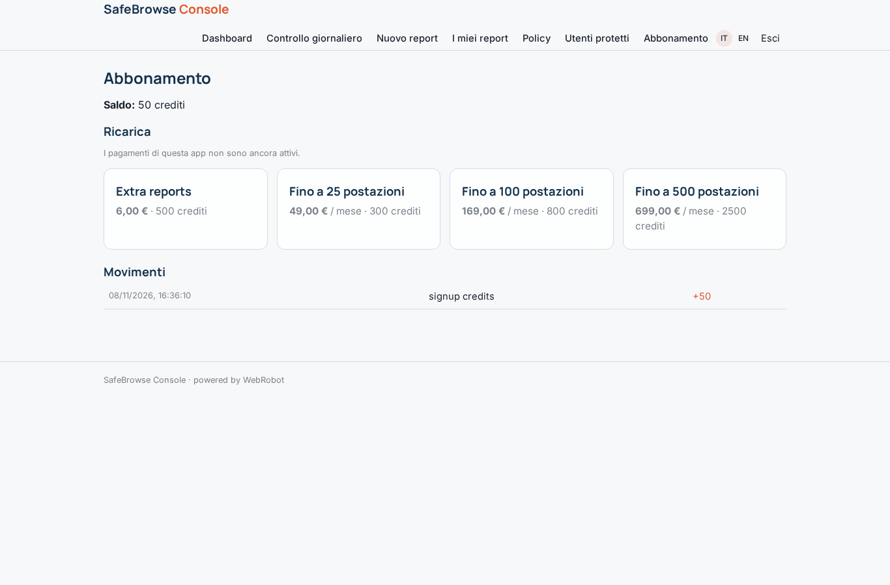

# SafeBrowse Console

_La console per l'IT manager: minacce web bloccate, andamenti e azioni consigliate._

**Manifest status:** valid (schema validator + runtime contract)

## Description given to the app builder (Italian)

Descrivo solo lo strato software di gestione e reportistica di un servizio di protezione della navigazione web; l'estensione del browser e la protezione sull'endpoint sono un prodotto a parte, qui c'e la console per l'amministratore. L'IT manager dell'azienda registra gli utenti e le policy (categorie di siti da bloccare, regole sulla condivisione dei dati) tramite moduli. I dispositivi protetti inviano alla console, via webhook, eventi gia anonimizzati sulle minacce intercettate durante la navigazione. Un agente aggrega gli eventi, individua gli andamenti (siti rischiosi piu frequenti, utenti piu esposti), li ordina per gravita e produce un report leggibile con le azioni consigliate. L'admin vede una dashboard con le minacce bloccate nel tempo e per utente, riceve un alert via email quando compare un picco anomalo e un report periodico di sintesi. Ogni azienda vede solo i propri dati, in forma aggregata e nel rispetto della privacy dei dipendenti. Abbonamento mensile per numero di postazioni protette. In italiano e inglese.

## Features not expressible today (spec.extensions)

- **email_alerts**: Email alert on anomalous spikes and periodic summary email are not available yet; anomalies are shown on the dashboard and in the daily checks list. Add email notifications when supported.
- **per_seat_pricing**: Subscription is per number of protected seats; per-seat quantity billing is not expressible, so seat tiers are offered as plans. Seat count enforcement against protected_users is not automatic.
- **webhook_tenant_routing**: The webhook must identify the company of each event (e.g. per-company token) and write it into that company's threat_events; per-tenant hook secrets are not expressible in the manifest and need runtime support.
- **exact_aggregations**: Charts over raw events use the daily_checks aggregates written by the daily agent; server-side group-by over threat_events is not available.

## Screenshots (interpretive runtime)

### home-anon

### home-mobile

### home

### dashboard

### watches

### new

### reports

### policies_view

### users_view

### account

