# NormaVigile

_La normativa finanziaria, leggibile e monitorata._

**Manifest:** valid (schema + runtime contract) · **Functional test:** passed (22 checks passed)

## Description given to the app builder (Italian)

Voglio costruire NormaVigile, un servizio per uffici compliance di banche, SIM e fintech che rende la normativa finanziaria leggibile e monitorata. L'admin del cliente registra la propria azienda e definisce un perimetro: tipo di intermediario, temi di interesse (antiriciclaggio, credito, ICT, trasparenza) e le autorità da seguire. Ogni notte un agente scarica le novità da EUR-Lex, Gazzetta Ufficiale, Banca d'Italia, EBA ed ESMA, salva ogni atto con le sue versioni e calcola il diff rispetto alla versione precedente, articolo per articolo. Un secondo agente classifica le modifiche per tema e impatto e indicizza tutto in un archivio ricercabile full text. Gli utenti compliance hanno una chat in cui fanno domande sulla normativa e ricevono risposte con citazione puntuale dell'articolo e del link ufficiale. Ogni lunedì arriva via email un report con le novità rilevanti per il loro perimetro, e un alert immediato quando cambia un atto marcato come critico. Ogni azienda vede solo i propri perimetri e le proprie note. Abbonamento mensile per numero di utenti, interfaccia in italiano e inglese.

## Features not expressible today (spec.extensions)

- **seat_limit**: Enforcing the maximum number of users per plan (5/15/50) on the emails listed in members is not available yet; plans are priced per seat tier.
- **team_email_delivery**: Weekly reports and critical alerts are emailed to the owner of each watch (the user who created it); delivery to every member of the perimeter is not available yet. Alerts are sent after the nightly update, not in real time.

## Screenshots (interpretive runtime, no data)

### home-anon

### home-mobile

### home

### assistant
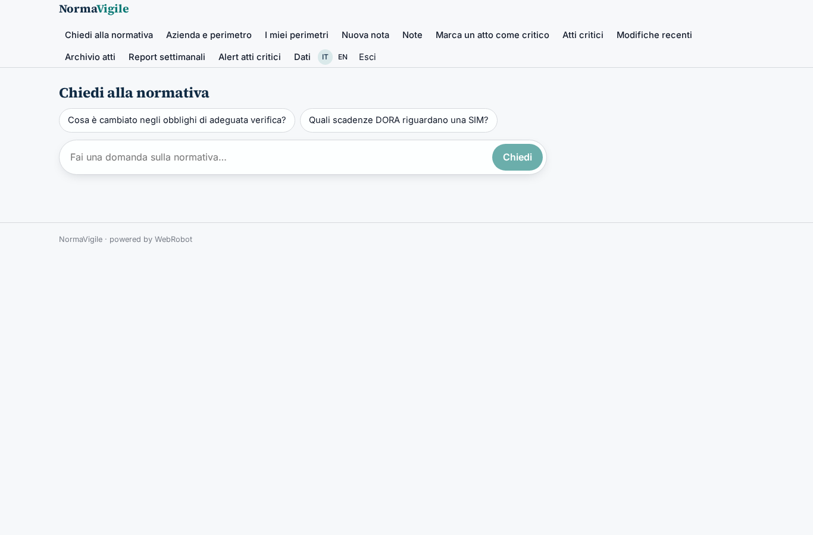

### perimeter_form
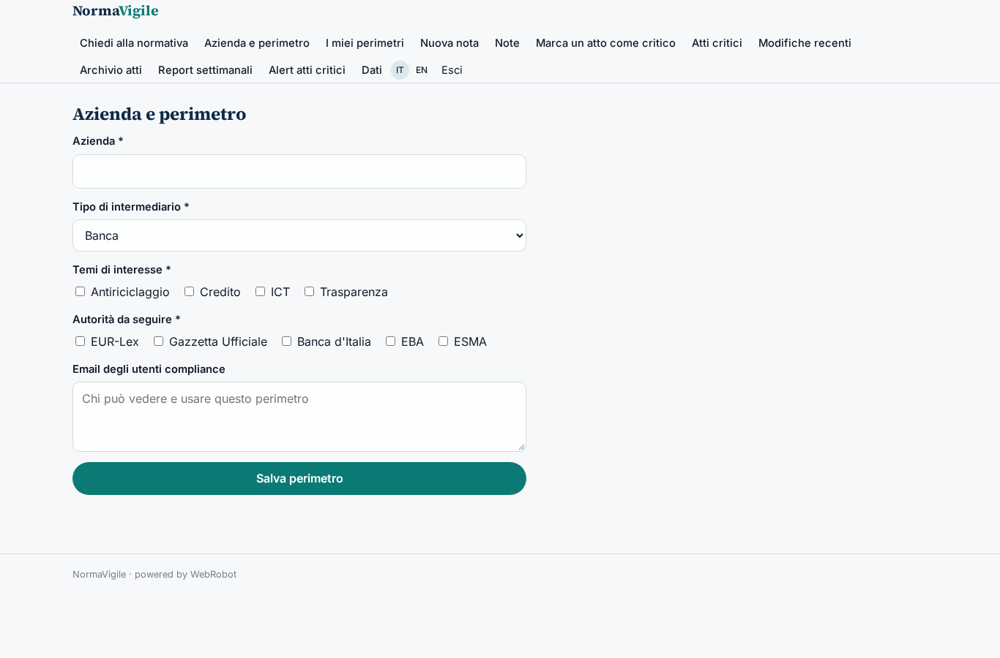

### perimeter_list
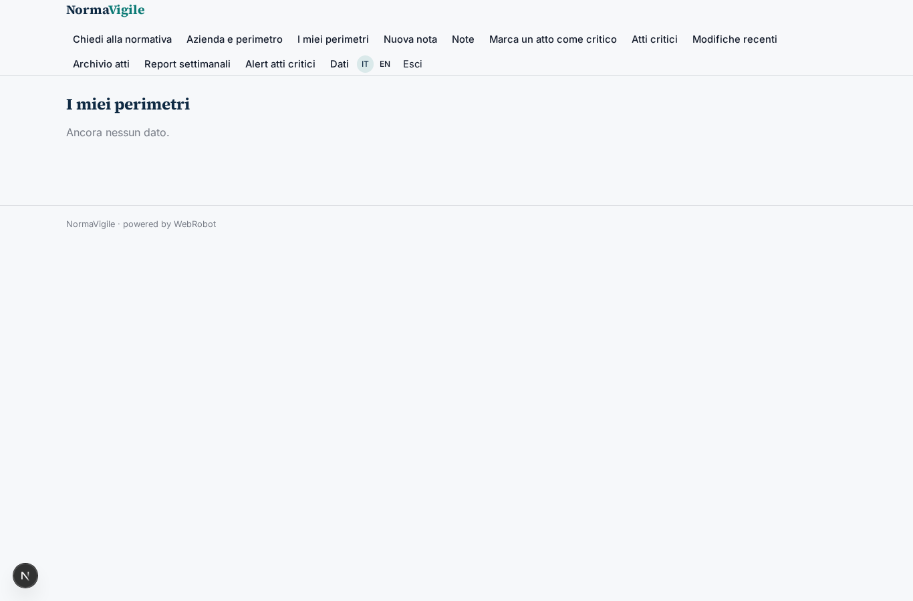

### note_form
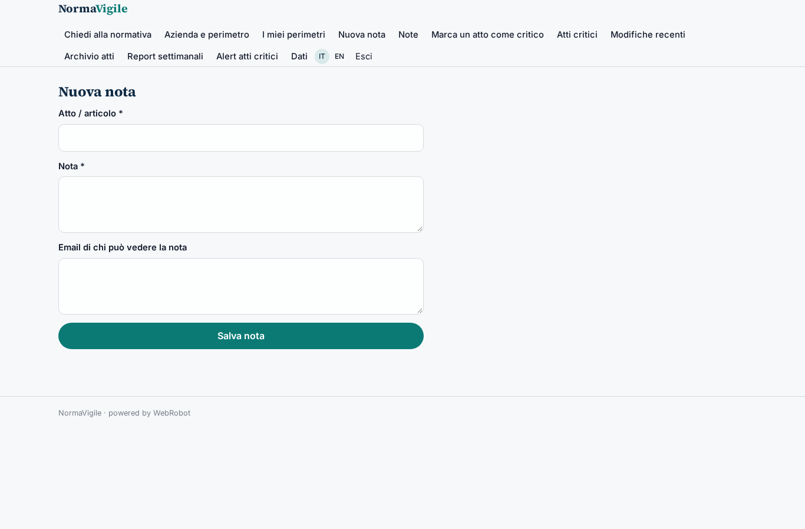

### notes_list
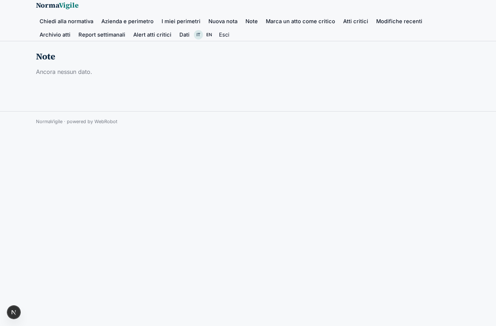

### critical_form
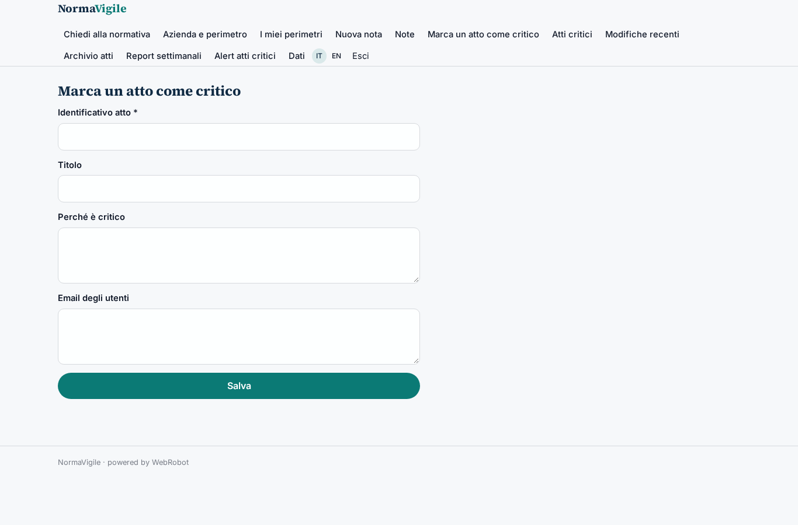

### critical_list
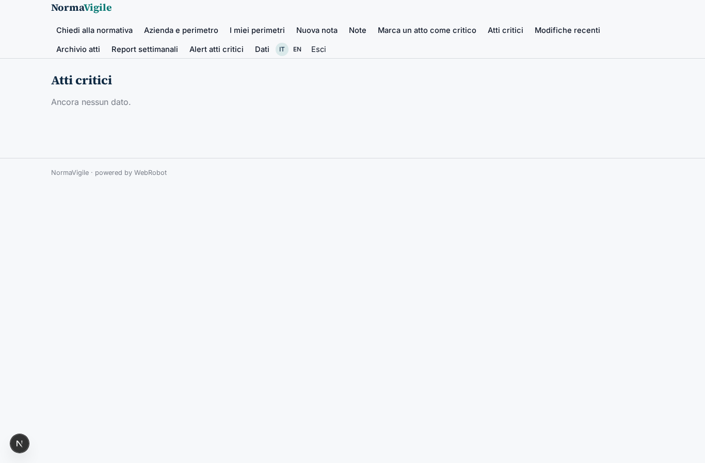

### changes
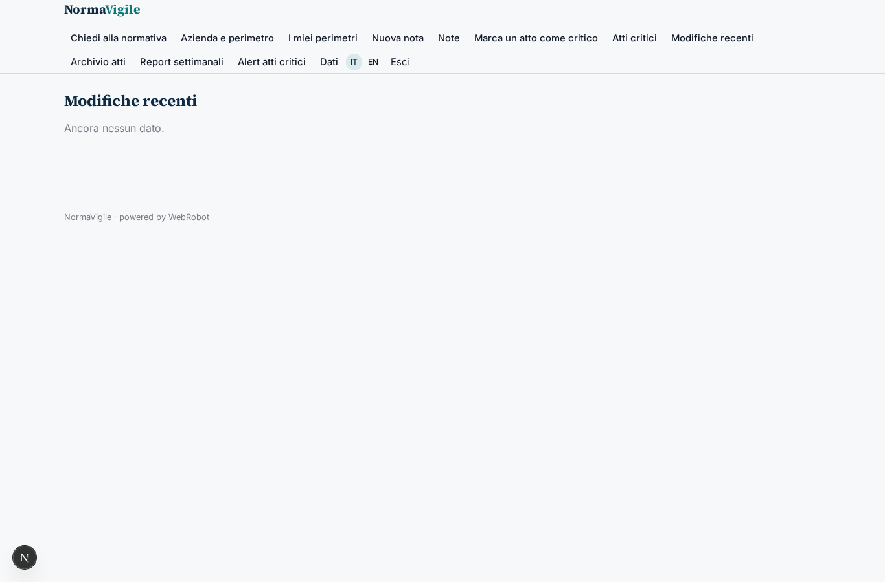

### acts

### watches
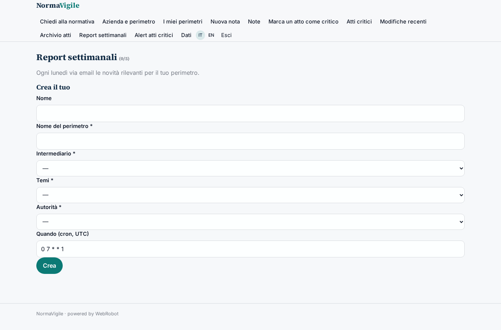

### alerts
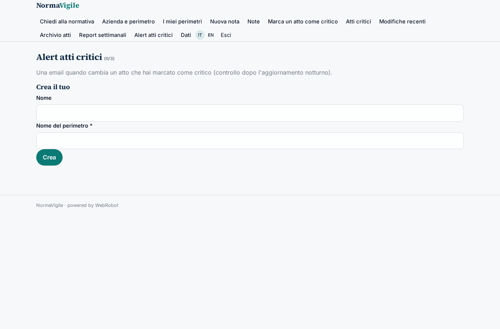

### account
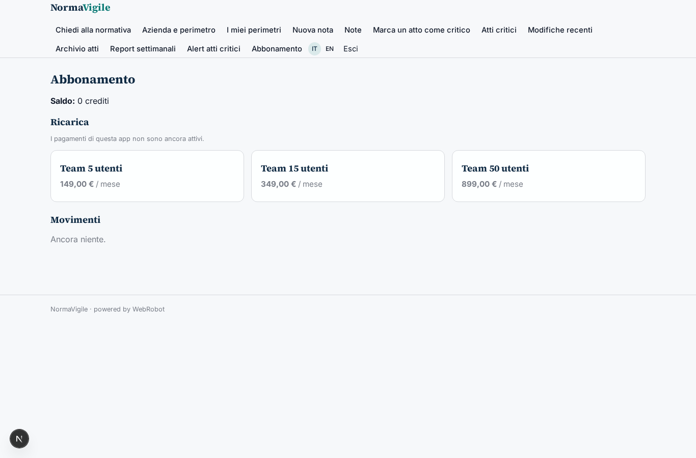
