# NormaVigile

_La normativa finanziaria, leggibile e monitorata._

**Stato manifest:** valido (validatore Python + contratto runtime)

## Descrizione data all'app builder

Voglio costruire NormaVigile, un servizio per uffici compliance di banche, SIM e fintech che rende la normativa finanziaria leggibile e monitorata. L'admin del cliente registra la propria azienda e definisce un perimetro: tipo di intermediario, temi di interesse (antiriciclaggio, credito, ICT, trasparenza) e le autorità da seguire. Ogni notte un agente scarica le novità da EUR-Lex, Gazzetta Ufficiale, Banca d'Italia, EBA ed ESMA, salva ogni atto con le sue versioni e calcola il diff rispetto alla versione precedente, articolo per articolo. Un secondo agente classifica le modifiche per tema e impatto e indicizza tutto in un archivio ricercabile full text. Gli utenti compliance hanno una chat in cui fanno domande sulla normativa e ricevono risposte con citazione puntuale dell'articolo e del link ufficiale. Ogni lunedì arriva via email un report con le novità rilevanti per il loro perimetro, e un alert immediato quando cambia un atto marcato come critico. Ogni azienda vede solo i propri perimetri e le proprie note. Abbonamento mensile per numero di utenti, interfaccia in italiano e inglese.

## Funzioni non esprimibili oggi (spec.extensions)

- **email_notifications**: Not available yet: the Monday digest and the immediate critical-act alert are shown in the app (digests and alerts views) but cannot be sent by email until notifications exist.
- **company_tenancy**: Not available yet: there is no company/seat concept. Company profile, notes and critical marks are per user and shared with colleagues through per-record invitations (viewer/editor); user seats per plan are tiers, not enforced per-seat billing.
- **per_customer_critical_alert**: Alerts on critical acts are produced by a daily per-user watch instance (cheap) rather than an instant event, since app-wide data is shared and critical marks are private to each company.

## Screenshot (runtime interpretativo)

### home-anon
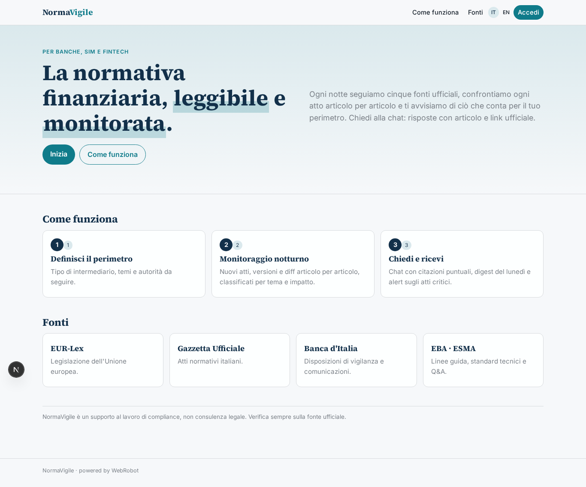

### home-mobile
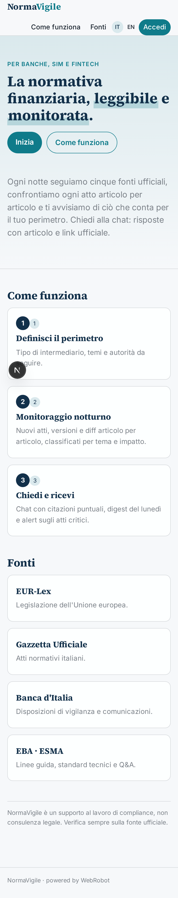

### home
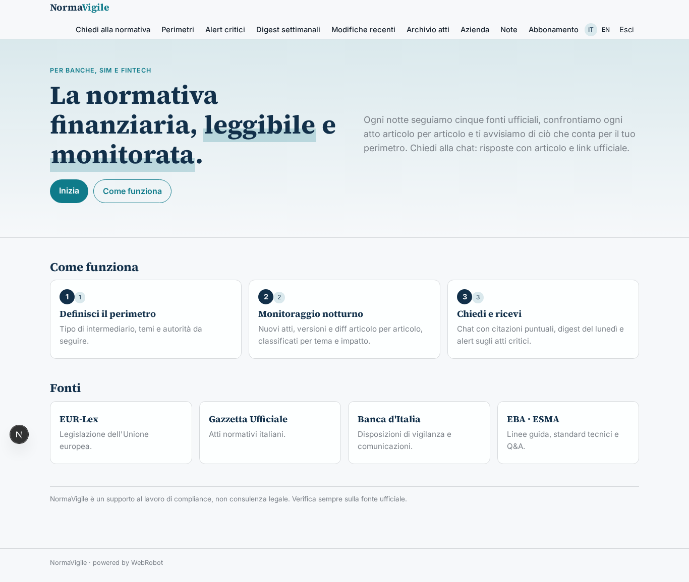

### assistant_chat
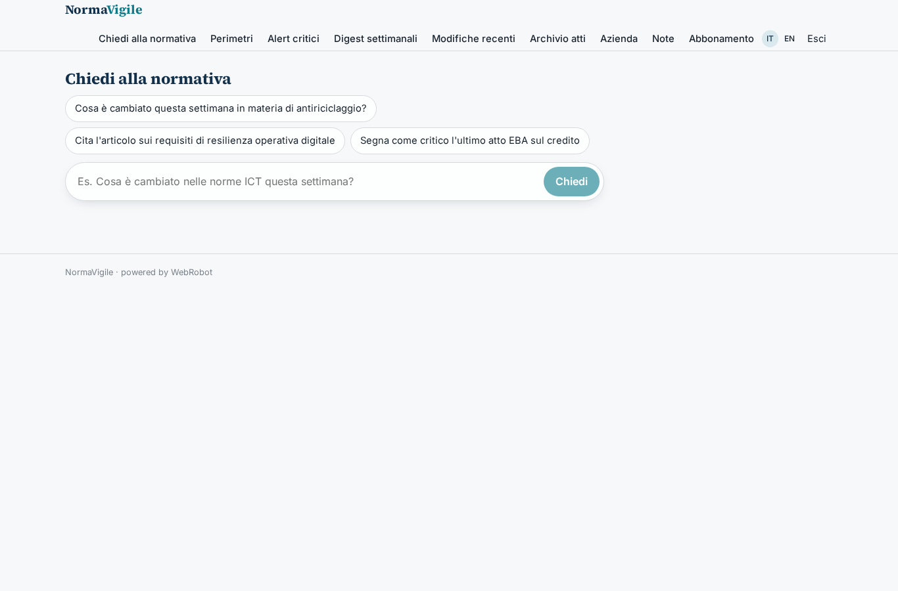

### perimeters
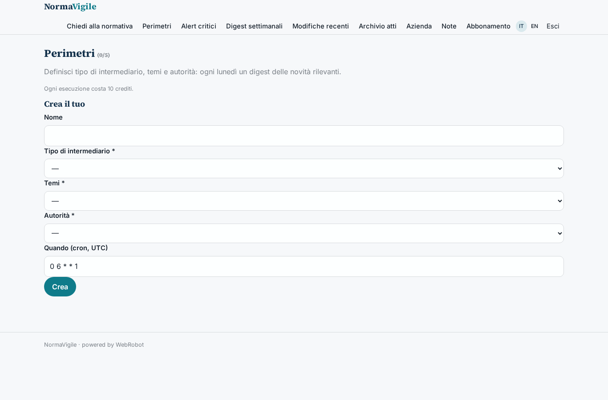

### critical
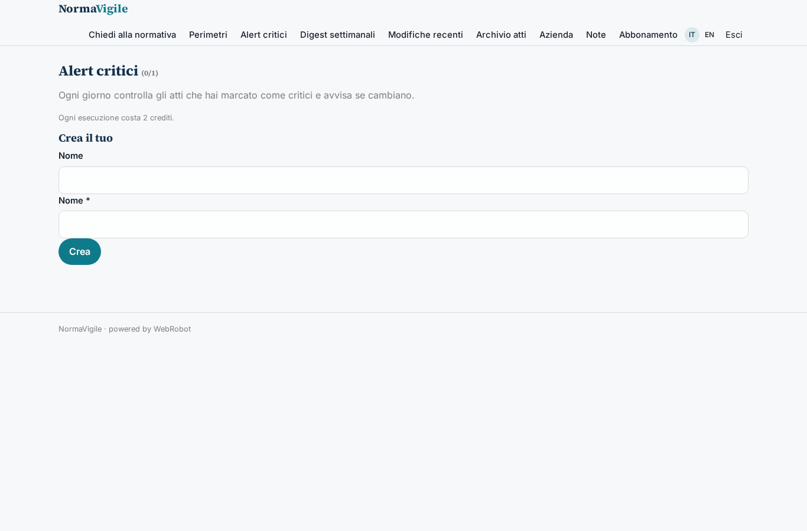

### digests
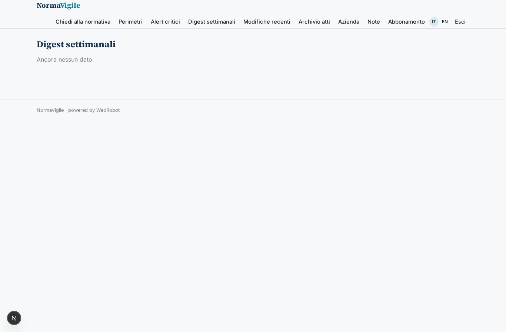

### changes_feed
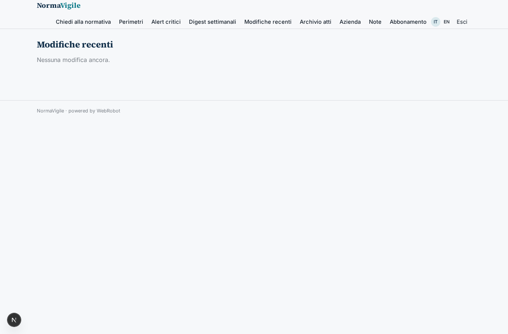

### acts_archive

### company_view
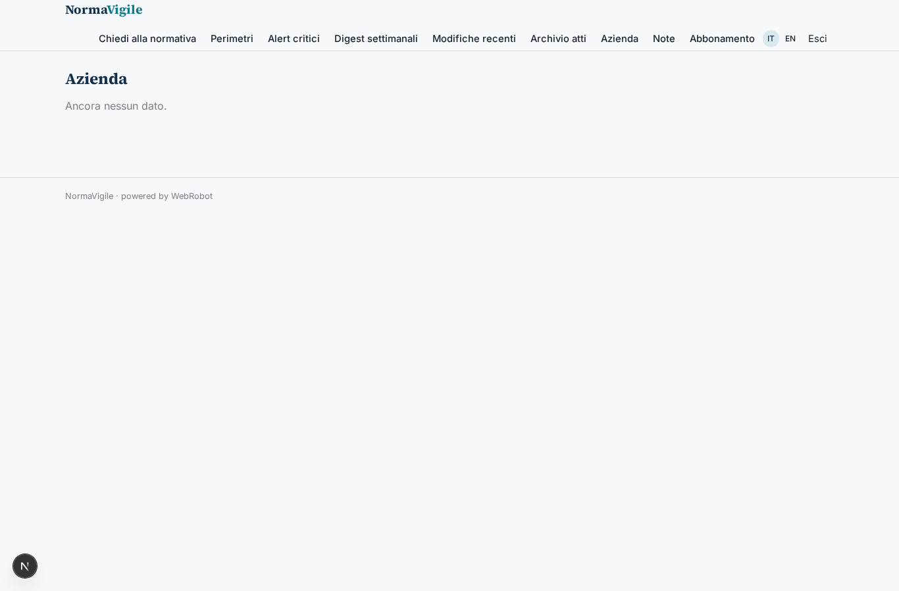

### notes_view
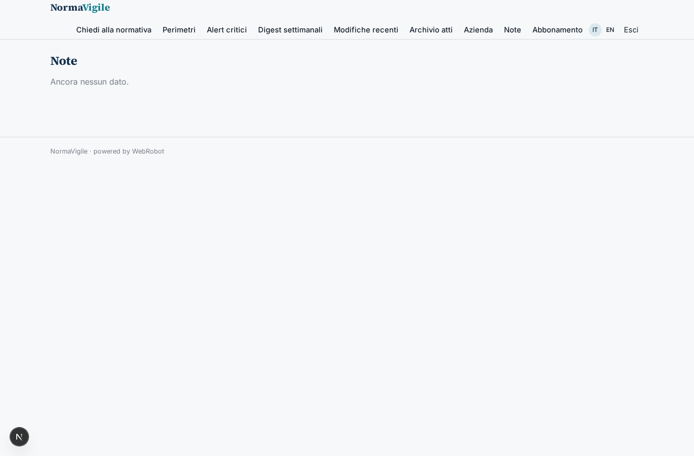

### account
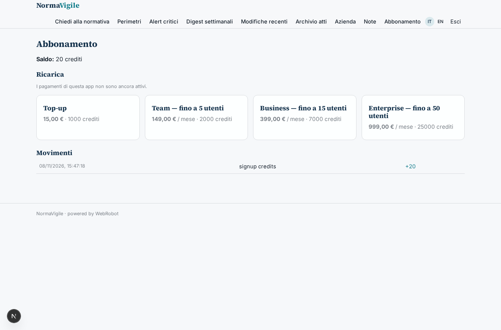

