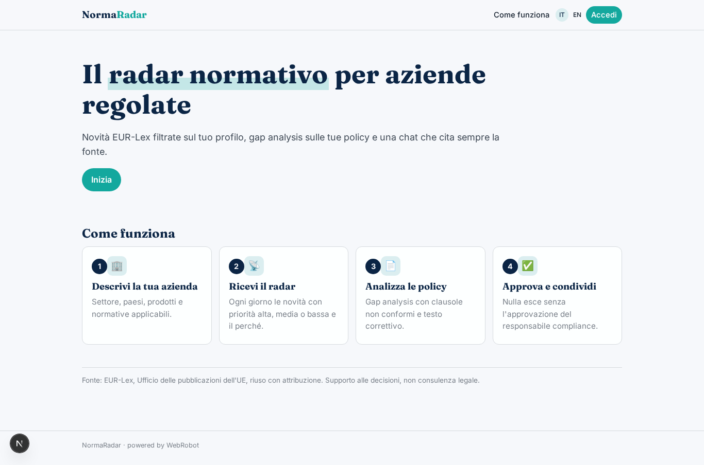
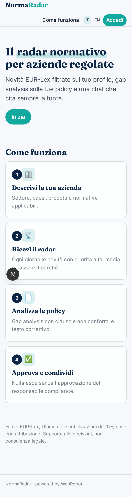
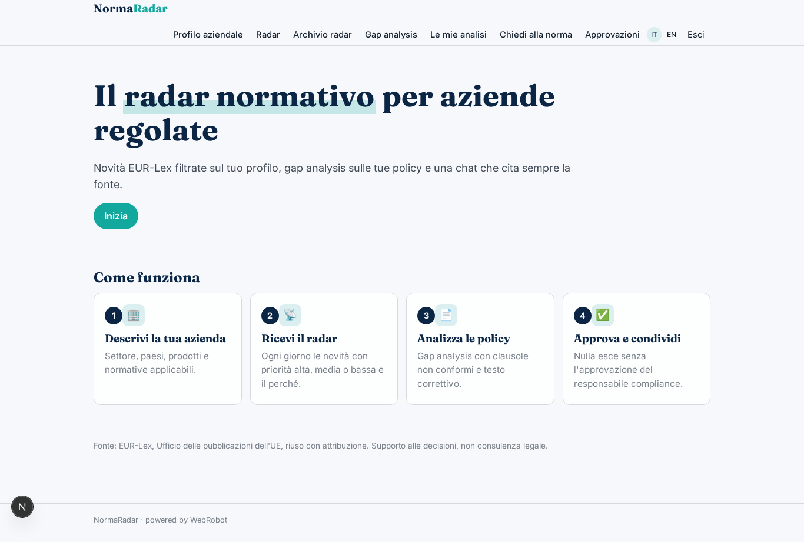
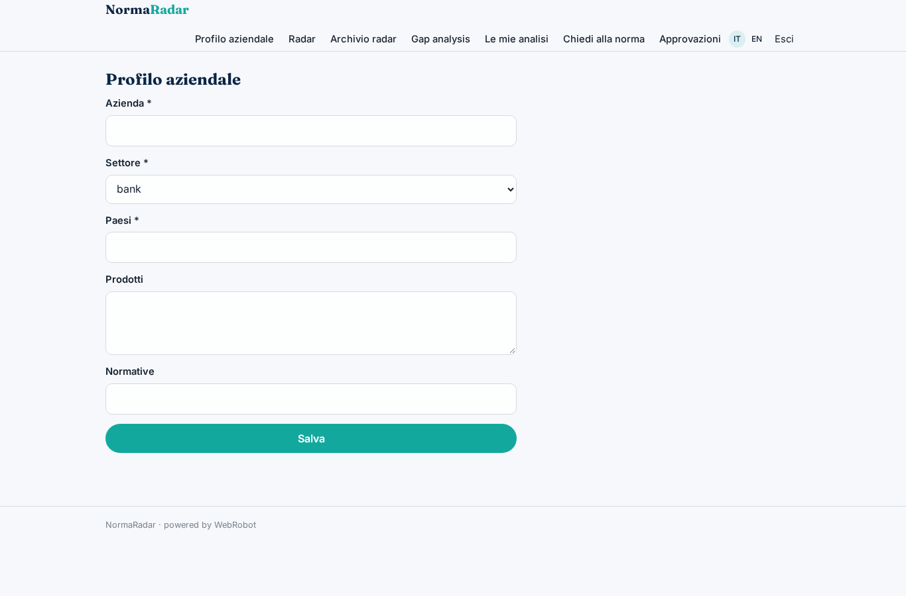
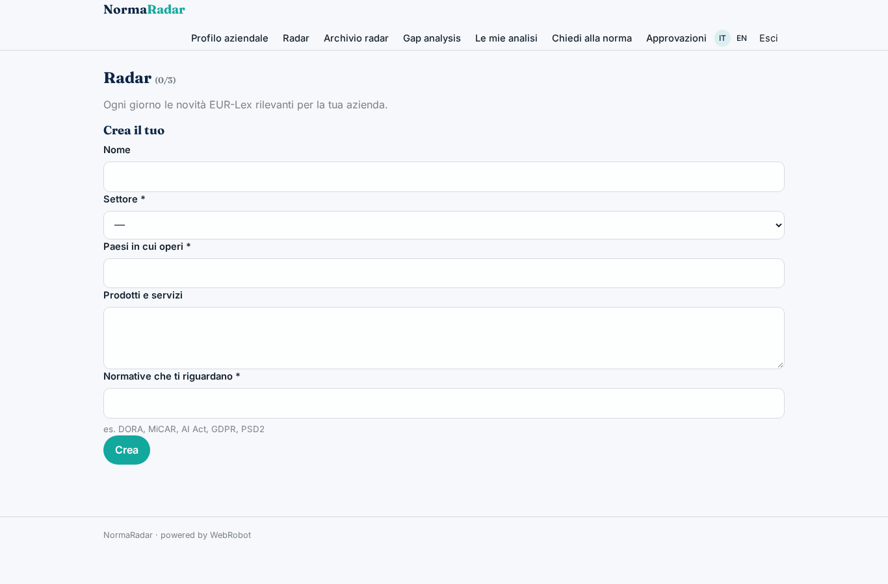
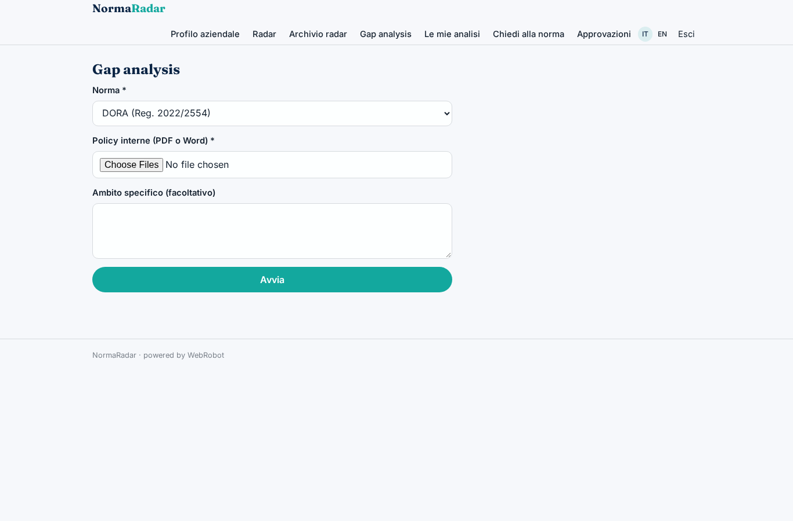
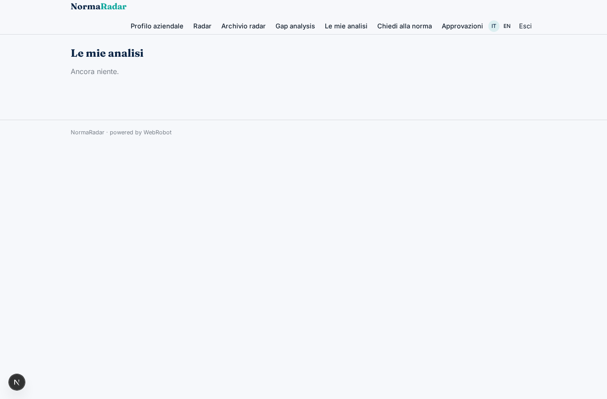
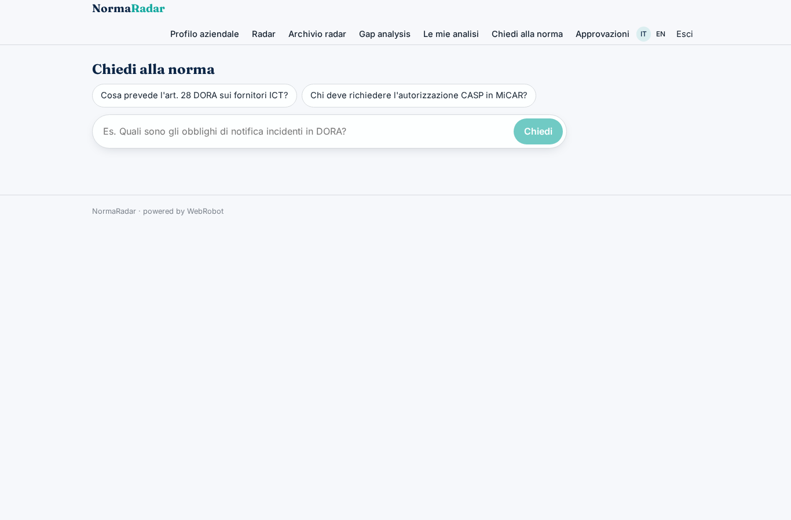
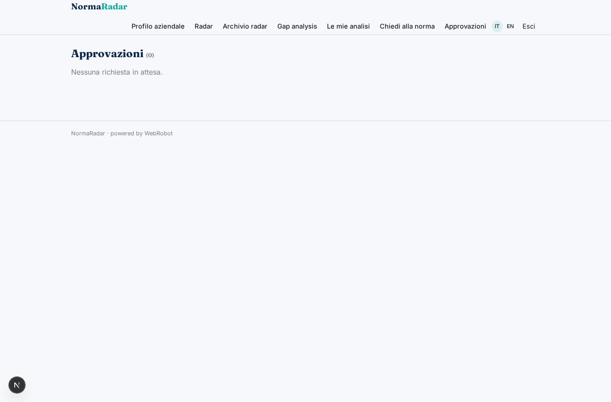
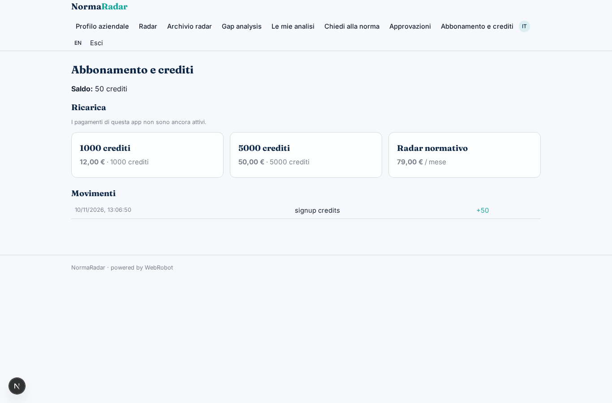

# NormaRadar

_Il radar normativo europeo, su misura per la tua azienda._

**Manifest:** valid (schema + runtime contract) · **Functional test:** passed (13 checks passed)

## Description given to the app builder (Italian)

Voglio un'app di monitoraggio normativo per aziende regolate (banche, fintech, assicurazioni, crypto). L'azienda descrive il suo profilo: settore, paesi in cui opera, prodotti, normative che la riguardano (es. DORA, MiCAR, AI Act, GDPR, PSD2). Ogni giorno un agente controlla le novità normative europee su EUR-Lex (ha feed RSS e un'API pubblica, il riuso è libero con attribuzione) e manda un radar con le novità rilevanti per quell'azienda, con priorità alta/media/bassa e il perché. L'utente può caricare le sue policy interne (PDF o Word): un agente fa la gap analysis tra una norma scelta e le policy, indica le clausole non conformi e propone il testo correttivo. C'è anche una chat per fare domande sulle norme: risponde solo citando la fonte (articolo e documento) e dice 'non lo so' se non trova la fonte. Ogni output va approvato da un responsabile compliance prima di essere condiviso. Nome: NormaRadar. Lingue italiano e inglese. Abbonamento mensile per il radar, crediti per gap analysis e chat.

## Features not expressible today (spec.extensions)

- **chat_approval**: The chat answers are interactive and are not put through the approval step; only radar and gap analysis reports require compliance approval before sharing.
- **share_channel**: Sharing an approved output with colleagues is by exporting or printing the report; no in-app team sharing yet.

## Screenshots (interpretive runtime, no data)

### home-anon

### home-mobile

### home

### profile

### watches

### radar_feed

### new_gap

### gaps

### chat

### approvals

### account

