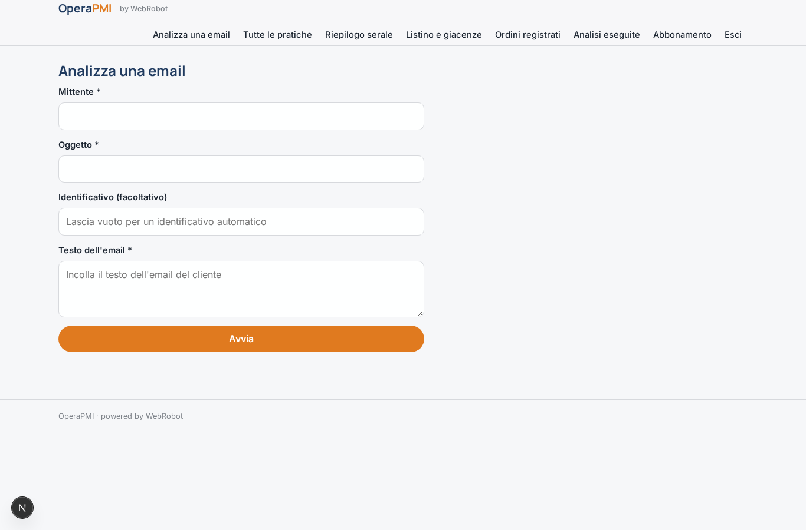
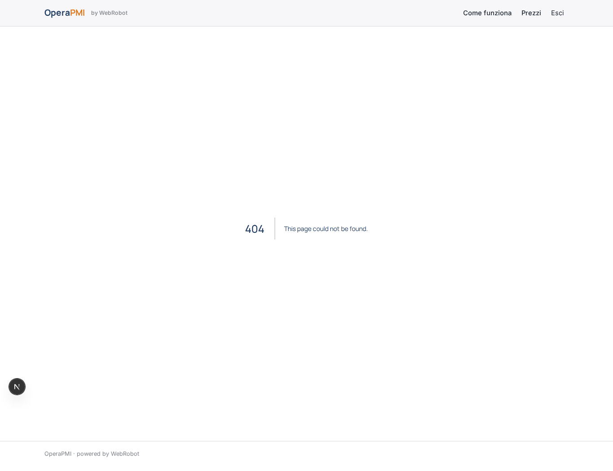
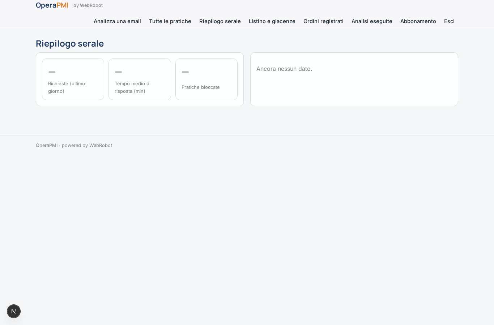
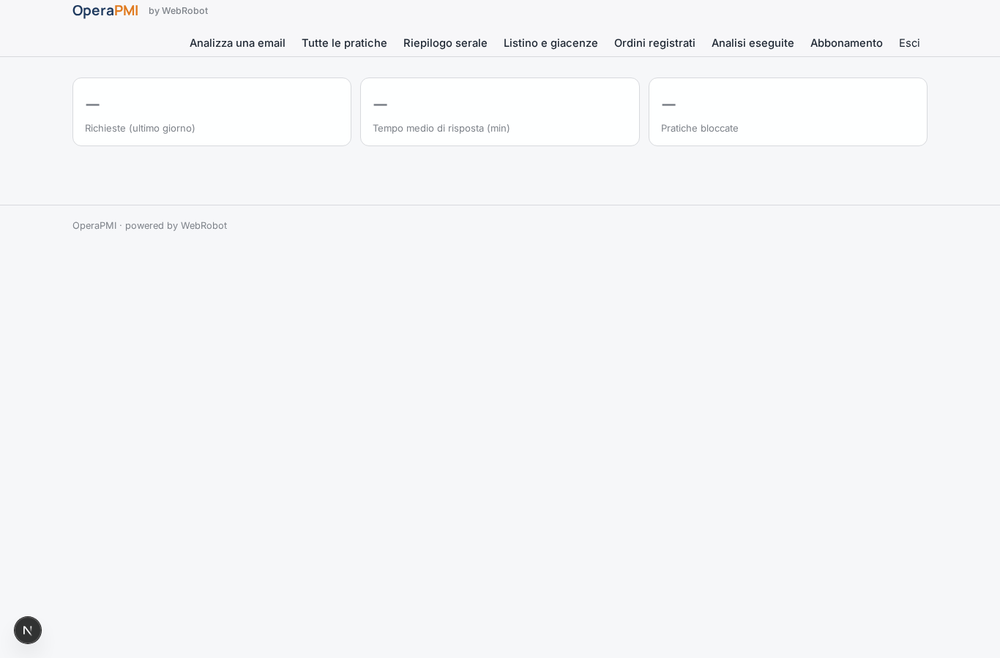
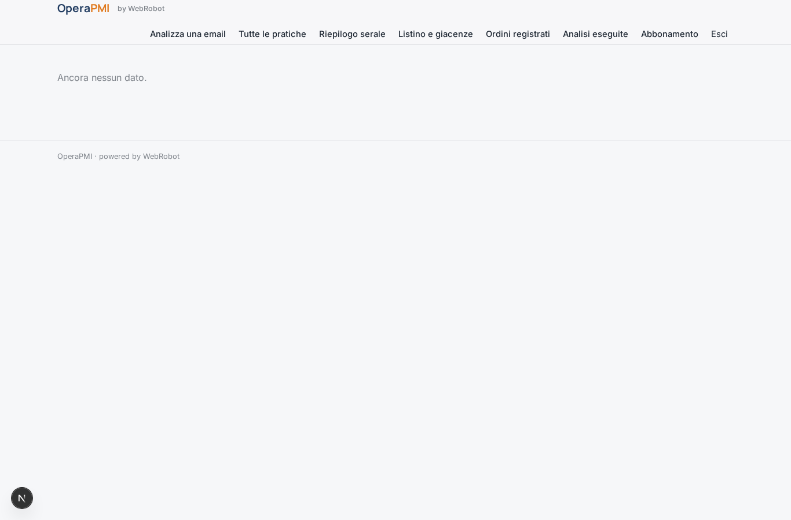
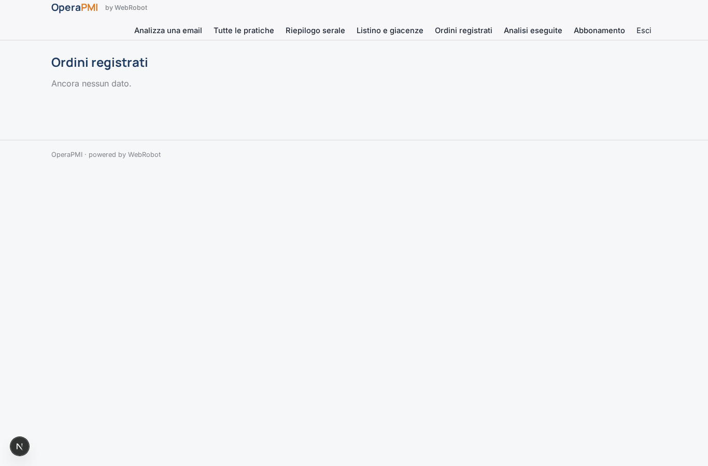
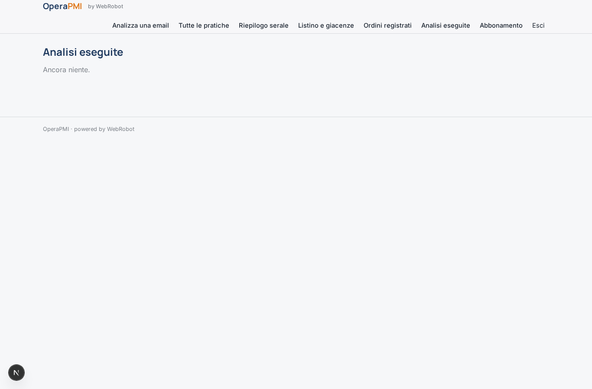
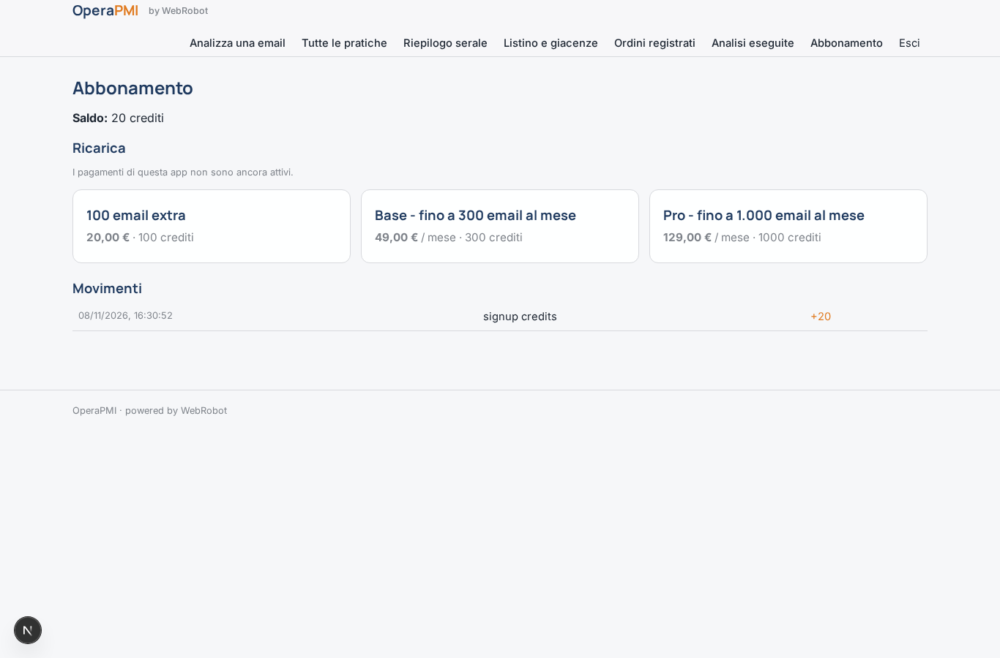

# OperaPMI

_Gli agenti lavorano sulle email di ordini e offerte, tu approvi._

**Manifest status:** valid (schema validator + runtime contract)

## Description given to the app builder (Italian)

OperaPMI mette agenti al lavoro sui processi operativi ripetitivi di una piccola impresa manifatturiera o commerciale. L'admin collega la casella email aziendale degli ordini e, se possibile, il gestionale (ERP o software di magazzino) tramite accesso autorizzato. Quando arriva un'email da un cliente con una richiesta d'offerta, un ordine o un sollecito, l'agente la legge, capisce di cosa si tratta, estrae articoli, quantità e date, controlla disponibilità e listino nel gestionale e prepara la risposta: un'offerta, una conferma d'ordine o un aggiornamento sullo stato della consegna. La bozza finisce in una coda dove l'impiegato responsabile la approva, la modifica o la rifiuta; solo dopo l'approvazione l'email parte e l'ordine viene inserito nel gestionale. Ogni sera il titolare riceve un riepilogo delle richieste gestite, dei tempi di risposta e delle pratiche bloccate. Gli impiegati vedono la coda del proprio reparto, il titolare tutto. Abbonamento mensile in base al volume di email gestite. In italiano.

## Features not expressible today (spec.extensions)

- **mailbox_connector**: Collegamento diretto alla casella email aziendale (lettura) con accesso autorizzato: non disponibile. Per ora le email arrivano con inoltro verso il webhook dell'app o incollate a mano.
- **email_send_after_approval**: Invio automatico dell'email dopo l'approvazione e notifiche non ancora disponibili: la bozza approvata va inviata dall'impiegato.
- **erp_connector**: Lettura di listino/disponibilità e inserimento ordini nel gestionale (ERP o magazzino) richiedono le credenziali dell'azienda: per ora il listino si carica nella collezione listino e gli ordini sono registrati in ordini.
- **nightly_email_digest**: Il riepilogo serale è consultabile nella vista Riepilogo; l'invio via email al titolare non è ancora disponibile.
- **department_filter**: Le code sono separate per ruolo di reparto (vendite, magazzino); altri reparti si aggiungono come nuovi ruoli.

## Screenshots (interpretive runtime)

### home-anon

### home-mobile

### home

### nuova

### coda_vendite

### coda_magazzino

### da_approvare

### tutte

### riepilogo

### riepilogo_kpi

### riepilogo_elenco

### listino_vista

### ordini_vista

### storico

### account

