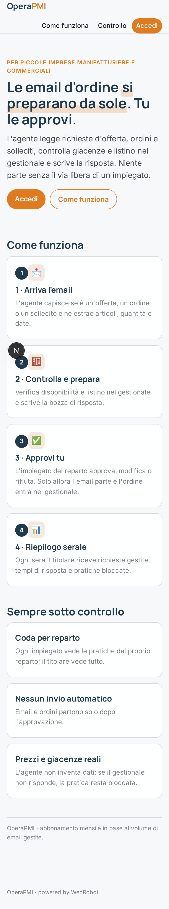
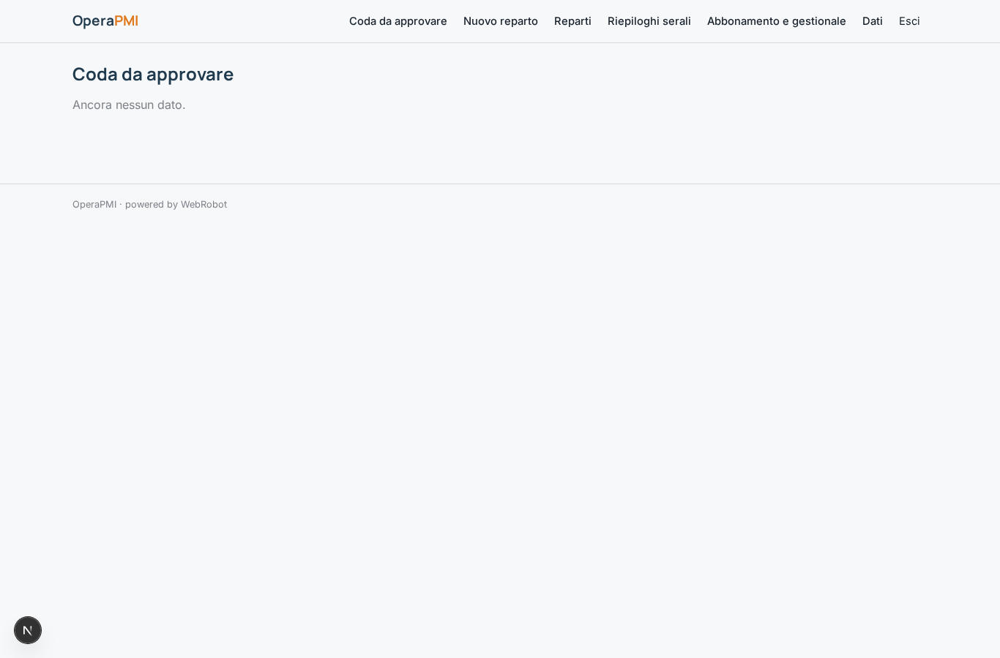
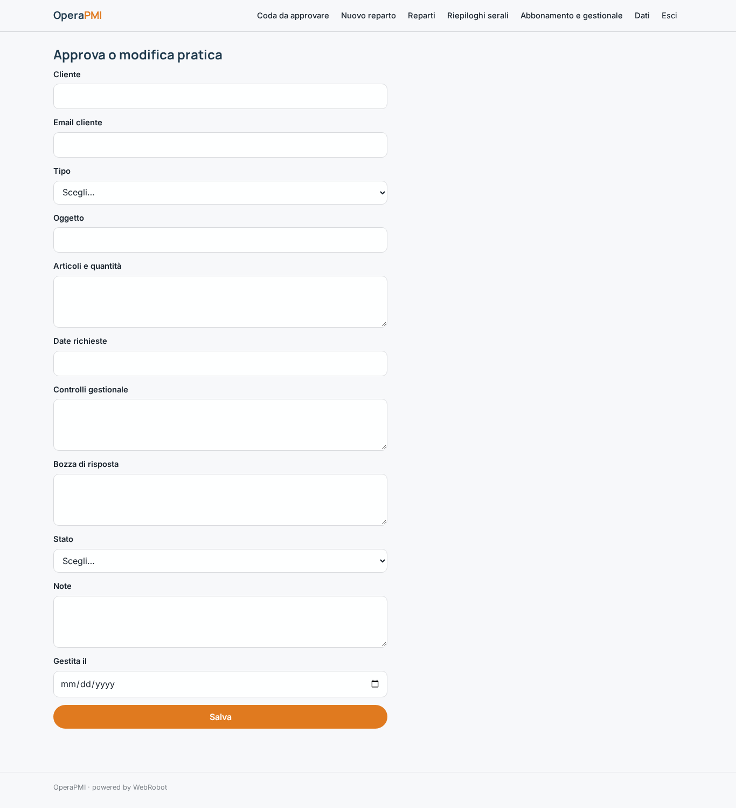
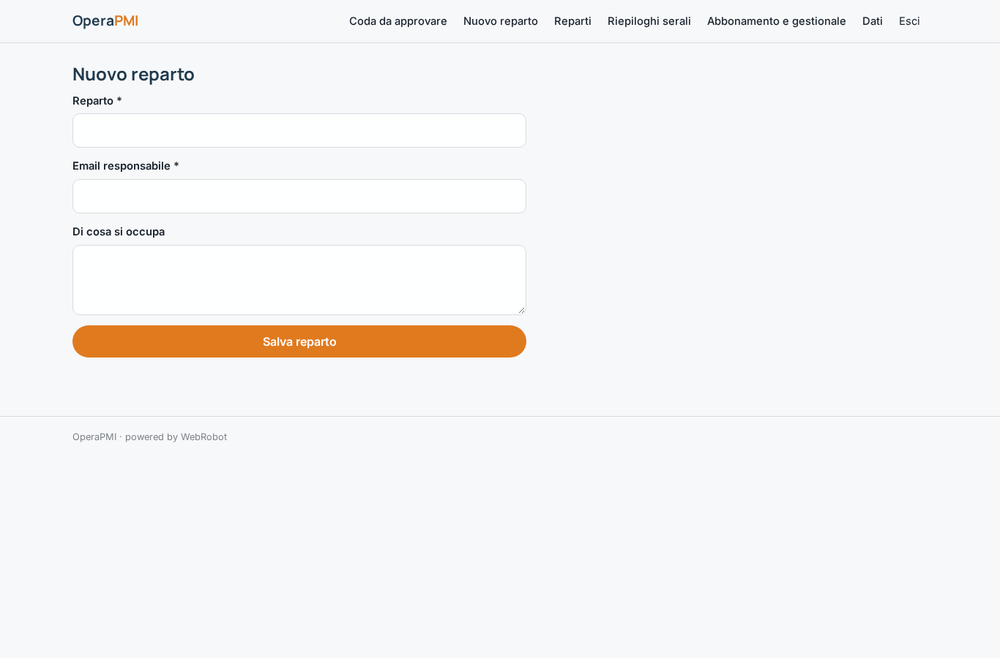
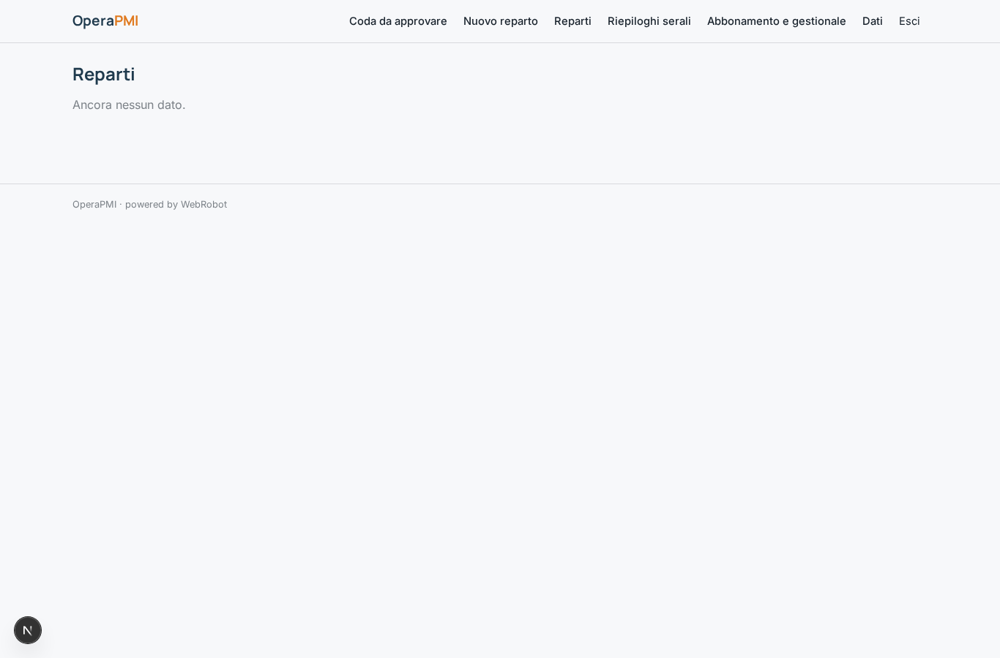
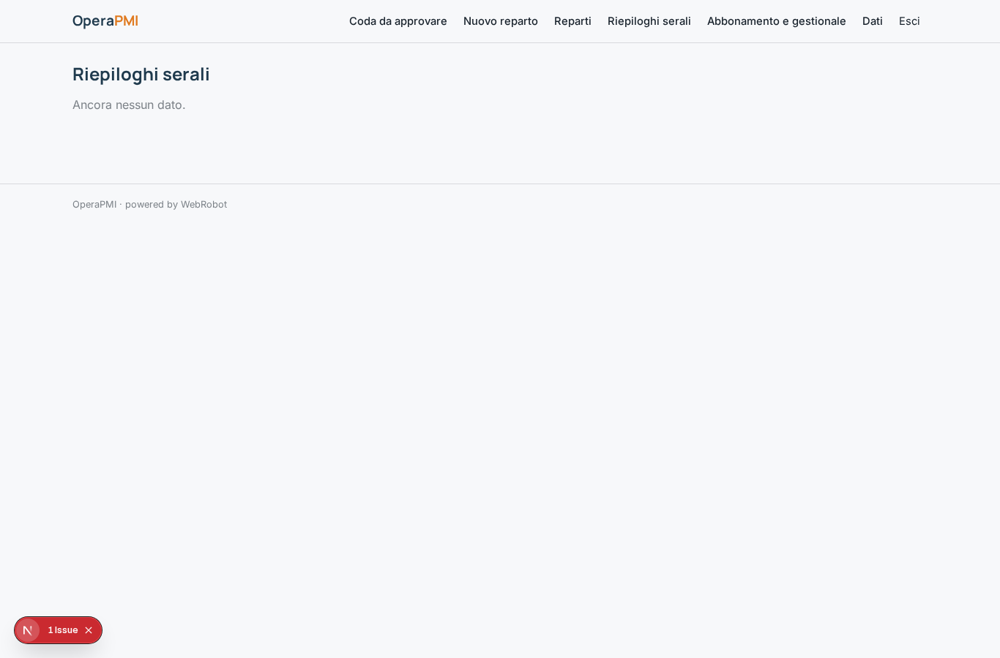
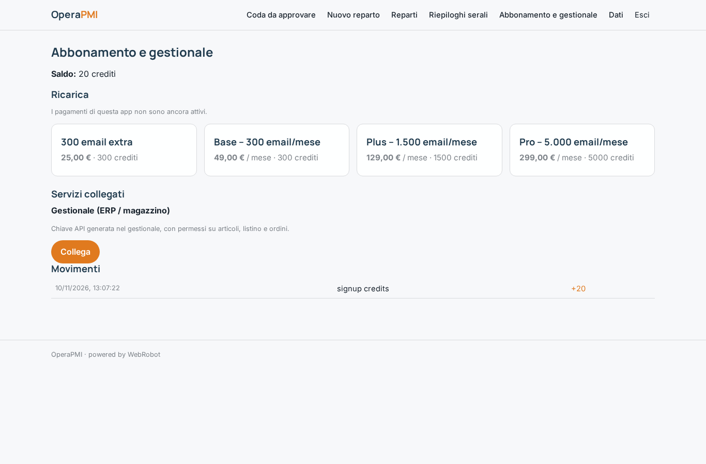

# OperaPMI

_Agenti che gestiscono email d'ordine, offerte e solleciti. Tu approvi, loro eseguono._

**Manifest:** valid (schema + runtime contract) · **Functional test:** passed (17 checks passed)

## Description given to the app builder (Italian)

OperaPMI mette agenti al lavoro sui processi operativi ripetitivi di una piccola impresa manifatturiera o commerciale. L'admin collega la casella email aziendale degli ordini e, se possibile, il gestionale (ERP o software di magazzino) tramite accesso autorizzato. Quando arriva un'email da un cliente con una richiesta d'offerta, un ordine o un sollecito, l'agente la legge, capisce di cosa si tratta, estrae articoli, quantità e date, controlla disponibilità e listino nel gestionale e prepara la risposta: un'offerta, una conferma d'ordine o un aggiornamento sullo stato della consegna. La bozza finisce in una coda dove l'impiegato responsabile la approva, la modifica o la rifiuta; solo dopo l'approvazione l'email parte e l'ordine viene inserito nel gestionale. Ogni sera il titolare riceve un riepilogo delle richieste gestite, dei tempi di risposta e delle pratiche bloccate. Gli impiegati vedono la coda del proprio reparto, il titolare tutto. Abbonamento mensile in base al volume di email gestite. In italiano.

## Functional test: what did not pass

- **saved record shown where its collection is read** (view riepiloghi_view): a record was saved in riepiloghi (by admin-data, admin-data) but the page does not show it (as admin) _(warning)_

## Features not expressible today (spec.extensions)

- **mailbox_connection**: Il collegamento della casella email aziendale esistente tramite accesso autorizzato (OAuth Google/Microsoft) non è ancora disponibile: oggi si usa l'indirizzo email del canale e si inoltrano gli ordini a quell'indirizzo.
- **erp_oauth**: Gestionali che richiedono OAuth invece di una chiave API non sono ancora supportati; l'host e gli endpoint dell'ERP vanno adattati al software dell'azienda.

## Screenshots (interpretive runtime, no data)

### home-anon

### home-mobile

### home

### coda

### modifica

### reparti_gestione

### reparti_elenco

### riepiloghi_view

### account

