# OrdinaPronto

_Gli ordini dei negozianti, dalla chat all'ERP, con l'approvazione del tuo agente di vendita._

**Manifest:** valid (schema + runtime contract) · **Functional test:** passed (34 checks passed)

## Description given to the app builder (Italian)

Voglio costruire OrdinaPronto, un gestionale con assistente AI per distributori all'ingrosso (food, ferramenta, cosmetica). I ruoli sono tre: il distributore admin che carica il catalogo, gli agenti di vendita interni e i clienti negozianti. Il catalogo arriva dal gestionale ERP del distributore tramite connettore sincronizzato ogni notte, oppure da upload Excel con codice articolo, descrizione, unità di vendita, prezzo per fascia cliente, giacenza e minimo d'ordine. Il negoziante scrive in chat in modo libero, anche incollando un messaggio WhatsApp o un elenco fotografato ("10 cartoni acqua naturale, 3 detersivo come la volta scorsa"); un agente riconosce gli articoli, li abbina al catalogo, propone alternative se mancano e compone una bozza d'ordine in una tabella modificabile. Un secondo agente controlla prezzi di listino e fido residuo e segnala anomalie. L'agente di vendita vede la coda delle bozze, le approva o corregge, e solo dopo l'approvazione l'ordine viene scritto nell'ERP e il cliente riceve una email di conferma. Ogni negoziante vede solo i propri ordini e storico; l'agente vede i clienti assegnati; l'admin tutto, più una dashboard con ordinato per settimana. Abbonamento mensile del distributore per numero di clienti attivi. Italiano e francese.

## Functional test: what did not pass

- **saved record shown where its collection is read** (view all_orders): a record was saved in orders (by customer, admin) but the page does not show it (as admin) _(warning)_

## Features not expressible today (spec.extensions)

- **erp_connector**: Nightly ERP sync is exposed as a webhook (POST /api/hooks/erp_catalog_sync, one article per call) and approved orders are readable by the ERP at the token-protected /api/erp/orders; a push of the order into a specific ERP API needs its host and key, to be added once the ERP is known.
- **active_customers_metering**: The plan tiers match the number of active customers, but automatic enforcement or metering of the active-customer count is not available yet; the distributor chooses the tier.

## Screenshots (interpretive runtime, no data)

### home-anon

### home-mobile

### home

### chat
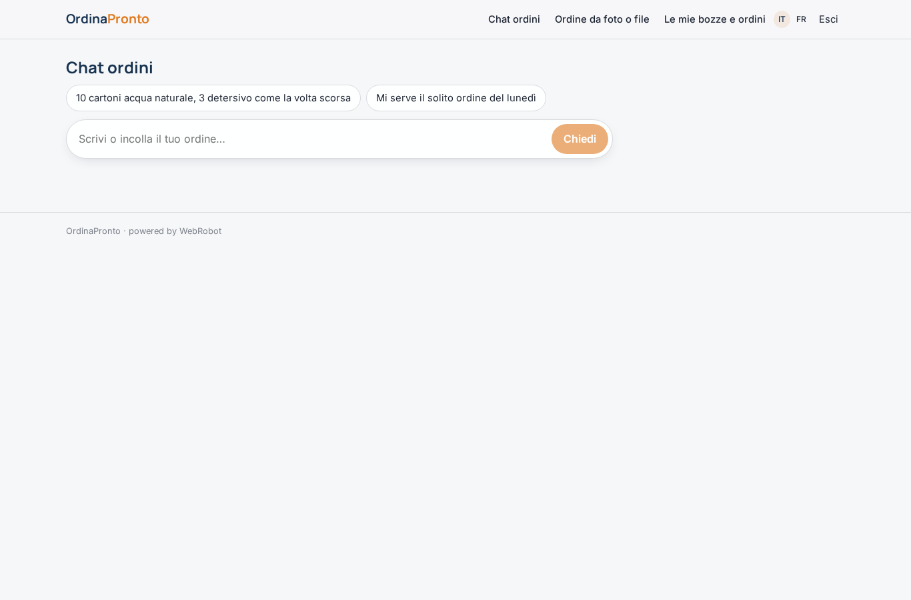

### photo_order
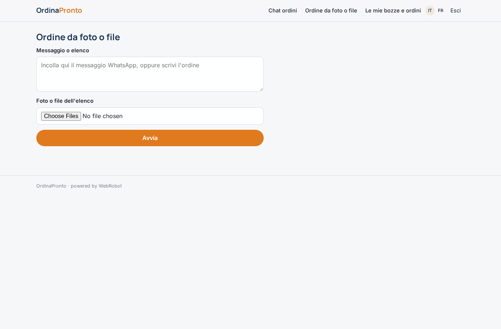

### run_history
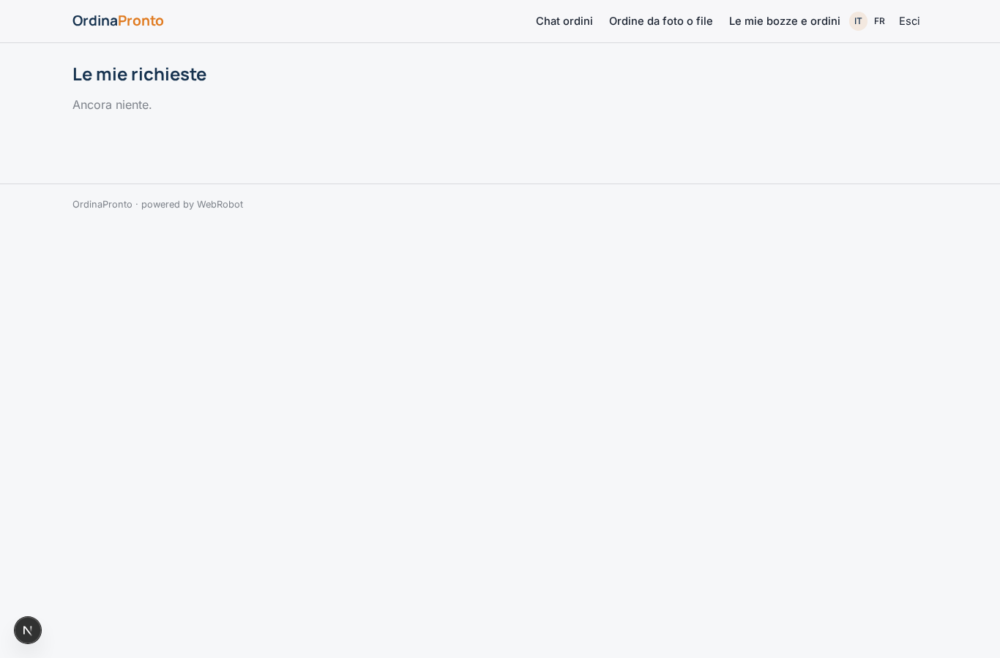

### my_drafts
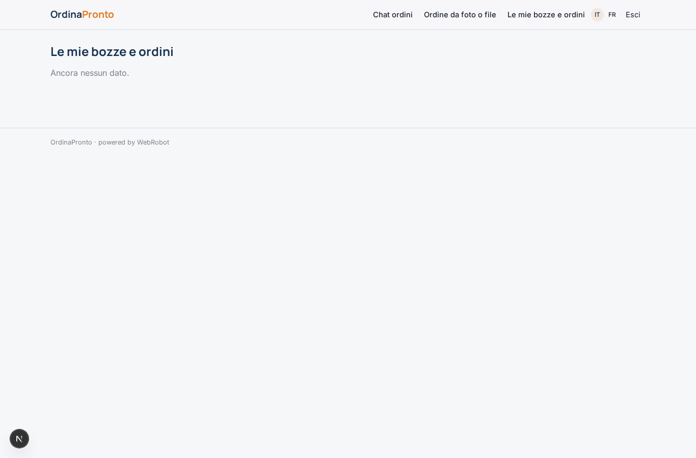

### edit_order
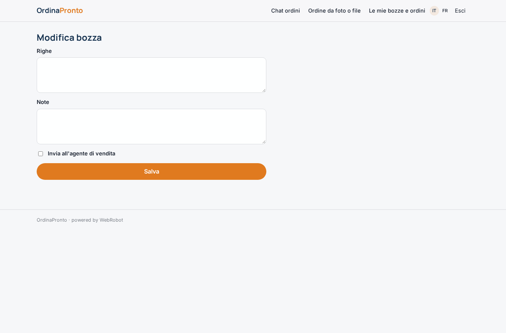

### queue
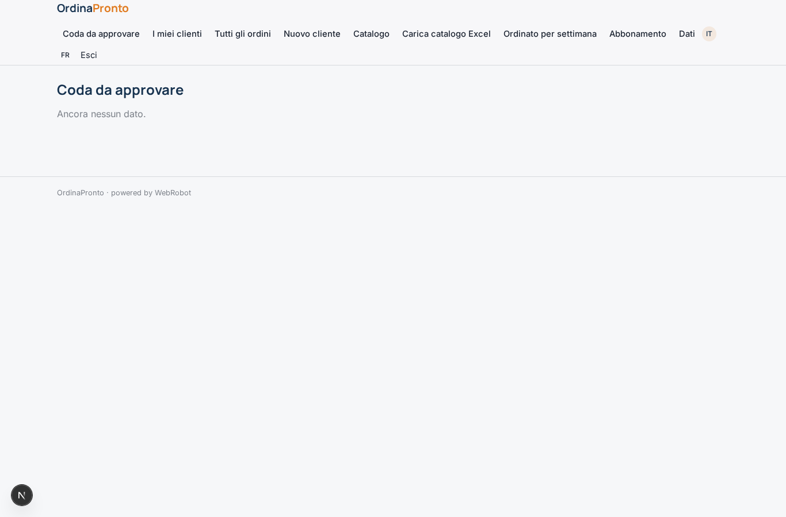

### review_order
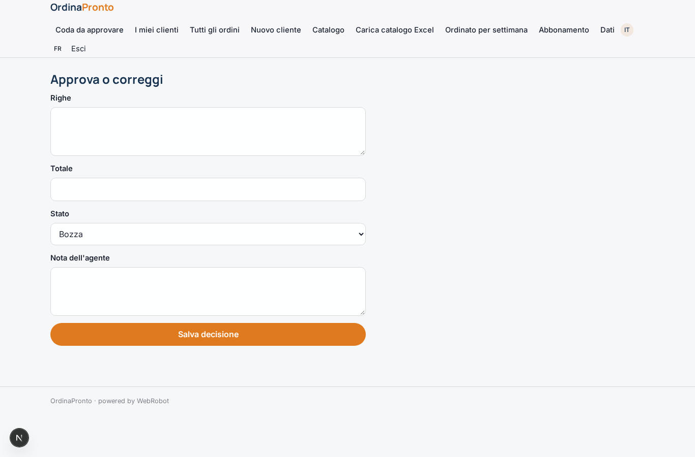

### my_customers

### all_orders
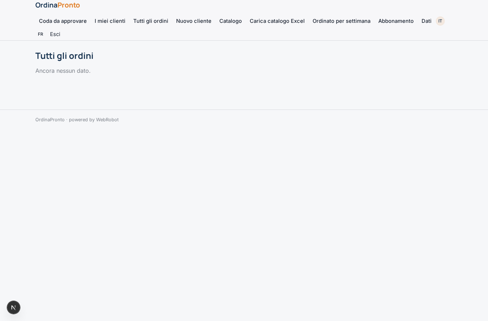

### new_customer
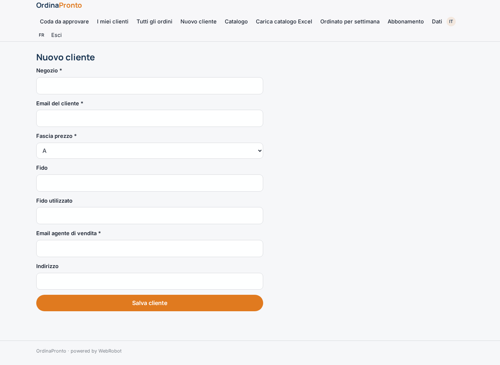

### catalog

### catalog_upload
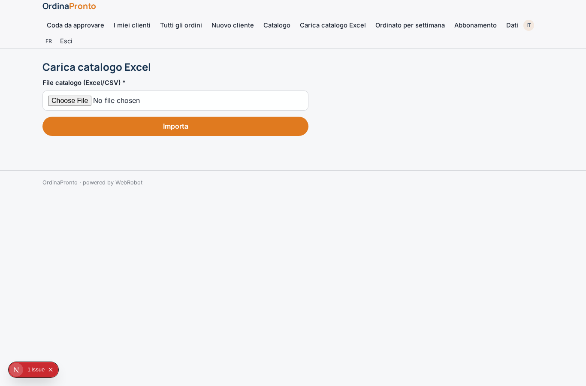

### sales_dashboard
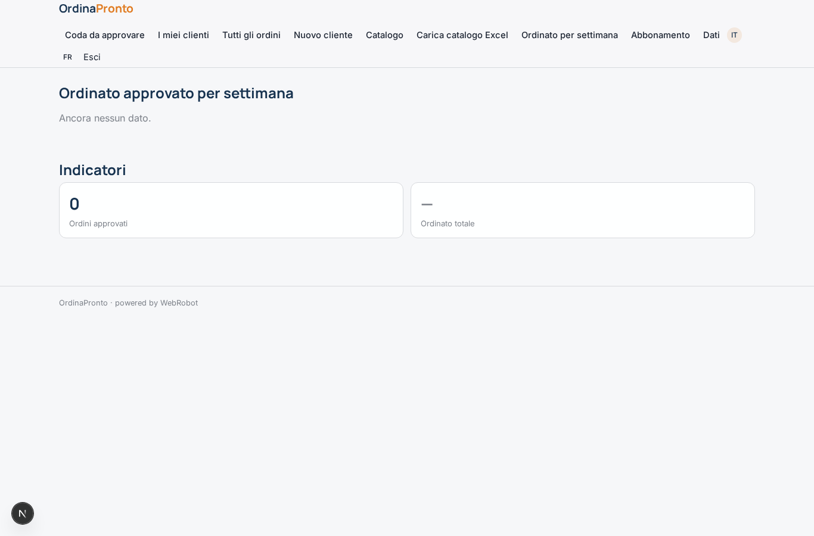

### account
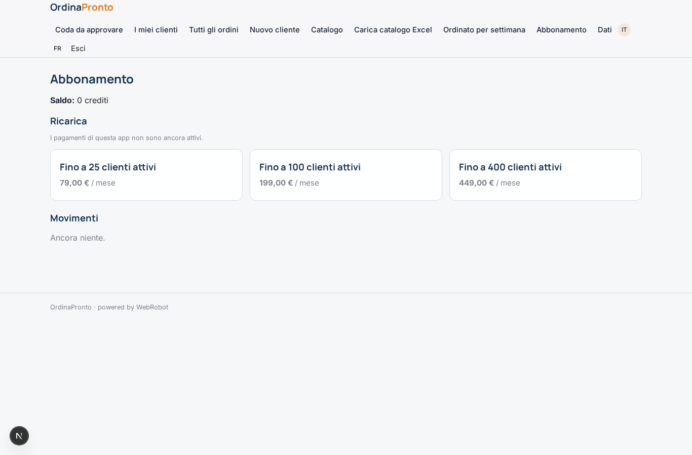
