# OspitaDiffuso

_Una rete di alloggi diffusi nei borghi, gestita come un unico hotel._

**Manifest status:** valid (schema validator + runtime contract)

## Description given to the app builder (Italian)

Per OspitaDiffuso descrivo solo lo strato software: la gestione fisica delle case, le pulizie e l'accoglienza sul posto le fanno i partner locali. È una piattaforma per una rete di alloggi diffusi in piccoli borghi gestiti come un unico hotel. Ruoli: ospite, proprietario dell'alloggio, gestore locale e admin di rete. Il proprietario registra l'immobile con foto, posti letto, servizi, regole e calendario di disponibilità; il gestore locale approva l'inserimento dopo un sopralluogo. L'ospite cerca per borgo e date, vede gli alloggi su mappa, prenota e paga con carta; riceve email con le istruzioni di arrivo e un codice di accesso. Un agente concierge in chat risponde alle domande dell'ospite usando le informazioni dell'alloggio e del territorio (orari, ristoranti, eventi da fonti pubbliche comunali) e propone esperienze locali. Un secondo agente suggerisce al proprietario il prezzo per notte in base a stagionalità ed eventi, ma il prezzo lo conferma sempre il proprietario. Il gestore riceve le attività del giorno (check-in, pulizie, segnalazioni). Il proprietario vede solo i propri immobili e gli incassi, l'admin dashboard di occupazione. Commissione sulle prenotazioni. Italiano, inglese, tedesco.

## Features not expressible today (spec.extensions)

- **booking_checkout**: Booking by dates with availability check and card payment per stay (Stripe Connect to the owner, network commission) is not expressible yet.
- **arrival_email**: Email with arrival instructions and access code: notifications are not available yet; for now the code appears in the guest's booking record and the concierge.
- **map_view**: Map of the stays is not available; the search shows cards by village.
- **photo_upload**: Photo upload is not available; owners paste links.
- **cross_user_views**: Owner and local manager read bookings via per-record viewer invitations; a derived per-property visibility and daily task digest may need runtime support.
- **manager_task_issues**: Guest issue reports reaching managers as tasks: a report form is still to be added.

## Screenshots (interpretive runtime)

### home-anon
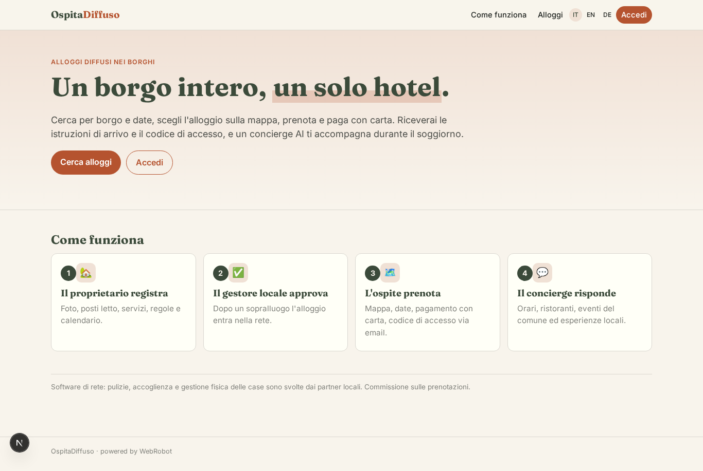

### home-mobile
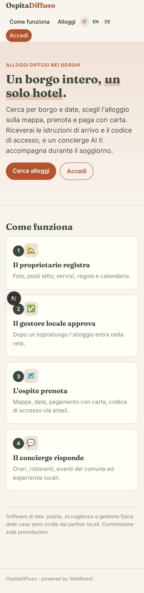

### home
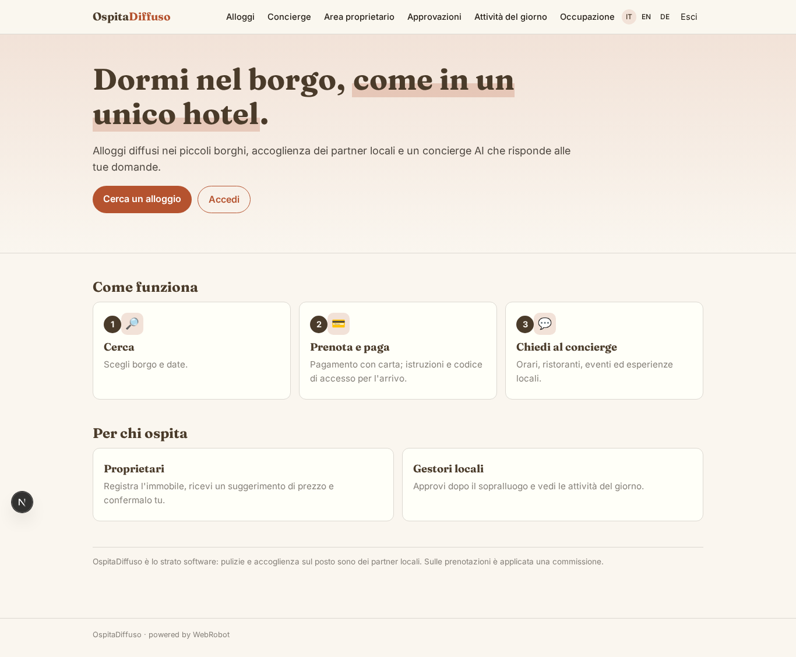

### search
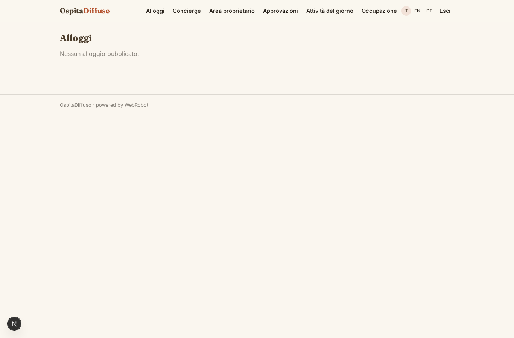

### concierge_chat
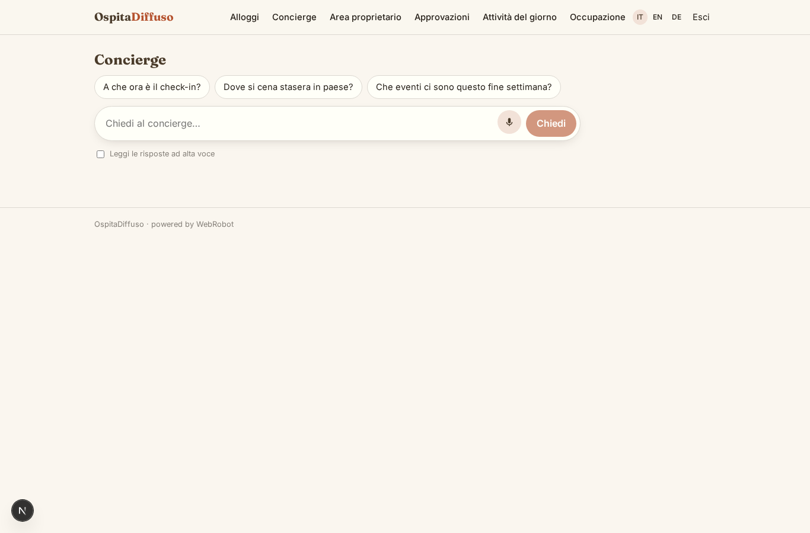

### my_bookings
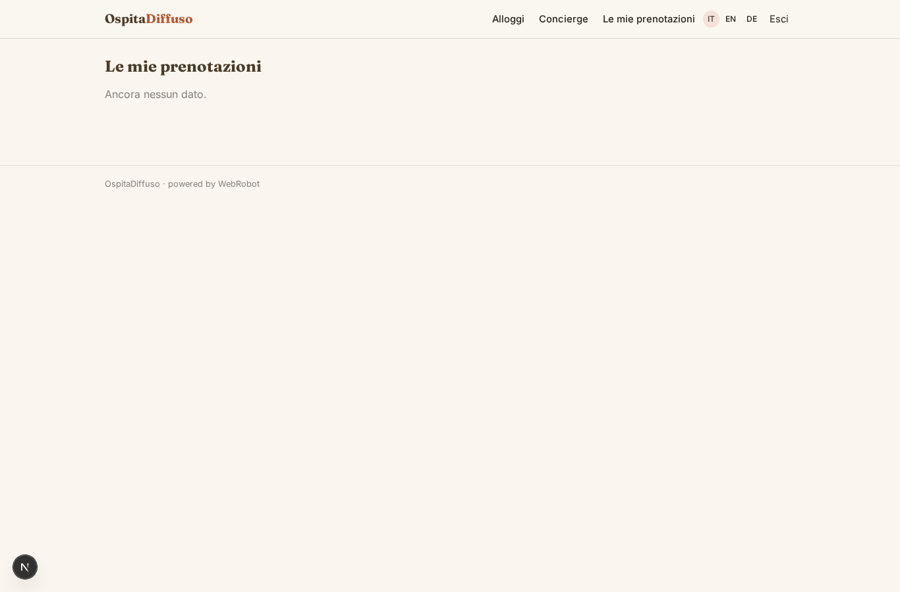

### owner_area
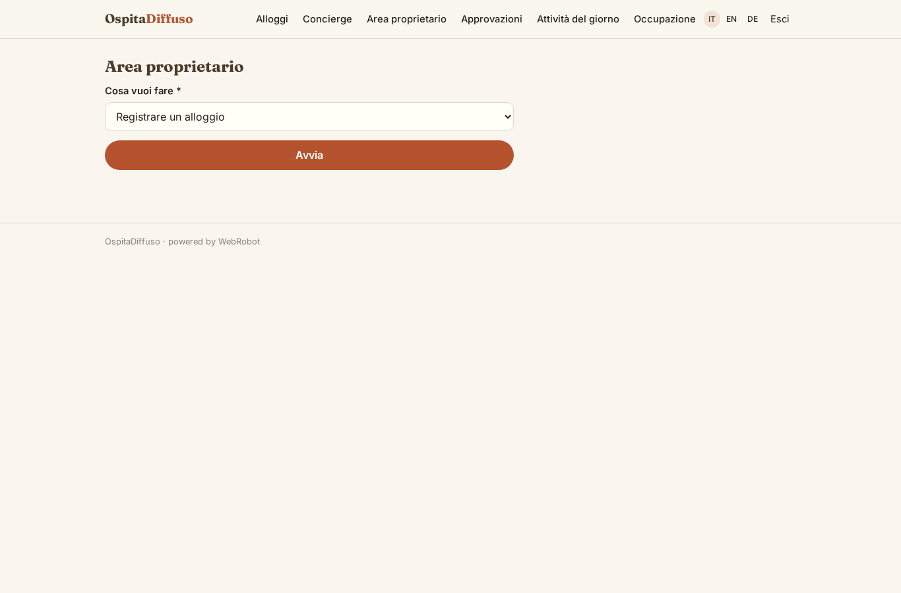

### owner_history

### my_properties
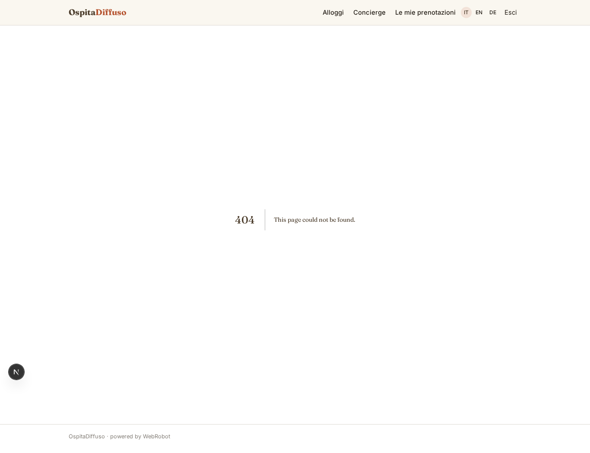

### earnings
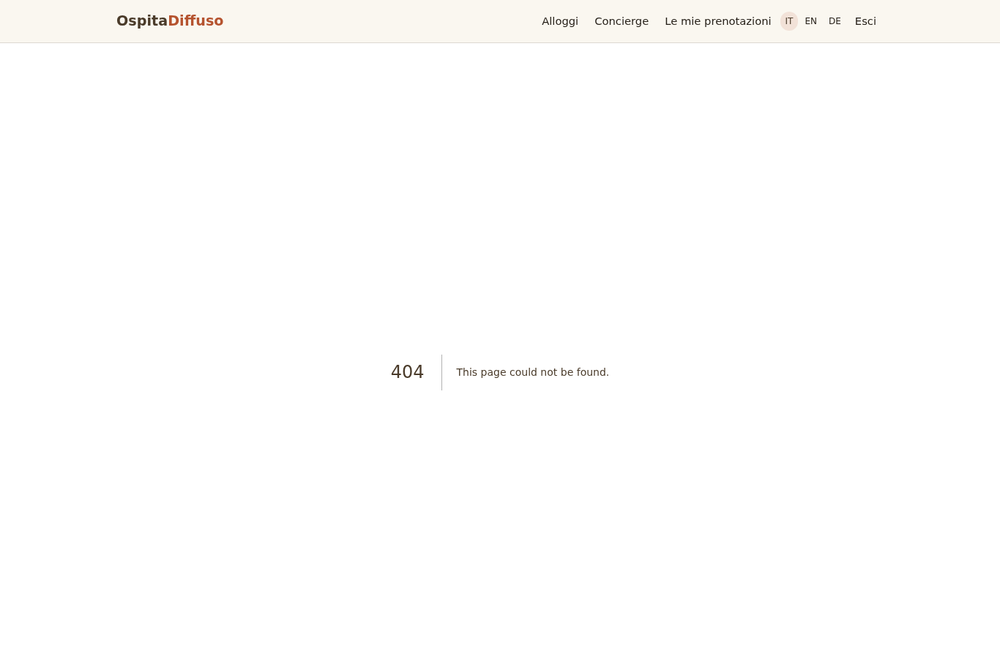

### earnings_kpi

### approvals
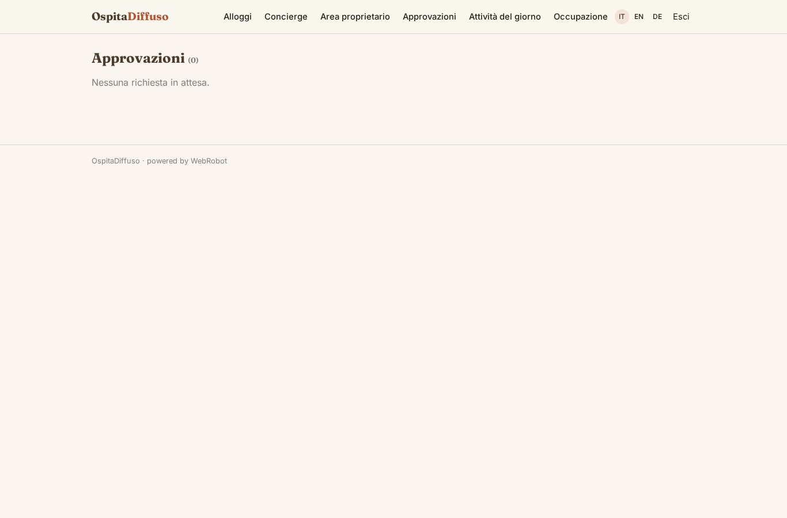

### today

### occupancy
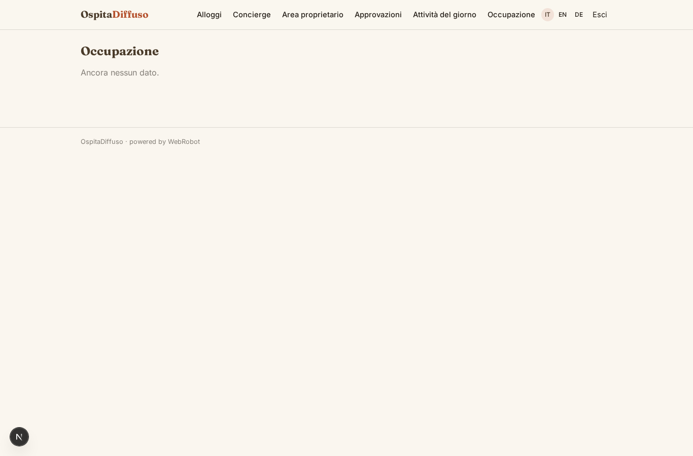

