# OspitaDiffuso

_Una rete di alloggi nei piccoli borghi, gestita come un unico hotel._

**Manifest:** valid (schema + runtime contract) · **Functional test:** passed (30 checks passed)

## Description given to the app builder (Italian)

Per OspitaDiffuso descrivo solo lo strato software: la gestione fisica delle case, le pulizie e l'accoglienza sul posto le fanno i partner locali. È una piattaforma per una rete di alloggi diffusi in piccoli borghi gestiti come un unico hotel. Ruoli: ospite, proprietario dell'alloggio, gestore locale e admin di rete. Il proprietario registra l'immobile con foto, posti letto, servizi, regole e calendario di disponibilità; il gestore locale approva l'inserimento dopo un sopralluogo. L'ospite cerca per borgo e date, vede gli alloggi su mappa, prenota e paga con carta; riceve email con le istruzioni di arrivo e un codice di accesso. Un agente concierge in chat risponde alle domande dell'ospite usando le informazioni dell'alloggio e del territorio (orari, ristoranti, eventi da fonti pubbliche comunali) e propone esperienze locali. Un secondo agente suggerisce al proprietario il prezzo per notte in base a stagionalità ed eventi, ma il prezzo lo conferma sempre il proprietario. Il gestore riceve le attività del giorno (check-in, pulizie, segnalazioni). Il proprietario vede solo i propri immobili e gli incassi, l'admin dashboard di occupazione. Commissione sulle prenotazioni. Italiano, inglese, tedesco.

## Functional test: what did not pass

- **template instance created and run** (template price_watch): reserved to owner/admin _(warning)_
- **page opened by a role allowed to** (view earnings): only role owner may open it, the test cannot hold it _(warning)_
- **saved record shown where its collection is read** (view manager_today): a record was saved in stays (by user) but the page does not show it (as manager) _(warning)_

## Features not expressible today (spec.extensions)

- **stay_payment_confirmation**: Card checkout for a booking and the switch of the stay to status paid (which starts the arrival agent) must be wired to the Stripe Connect payment; the manifest only declares the commission (12%) and the sellers.
- **availability_search**: Search by date range excluding already booked nights and overlapping bookings is not expressible yet; the owner's availability calendar is free text and double-booking checks need custom logic.
- **property_photos_public**: Owner photos are private files of the owner; showing them to guests in the listing needs a public asset copy.
- **local_partner_sms**: SMS/WhatsApp notifications to local partners (cleaning, welcome) are not available yet; the manager receives email.

## Screenshots (interpretive runtime, no data)

### home-anon

### home-mobile

### home

### listings
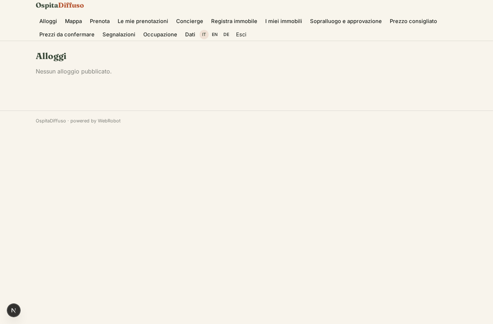

### map
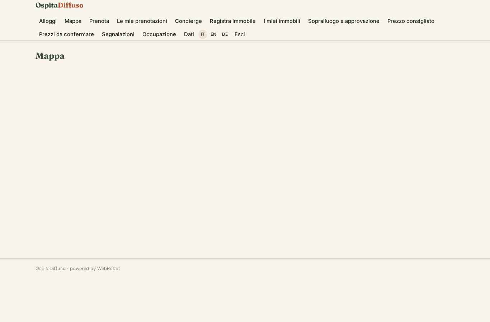

### book
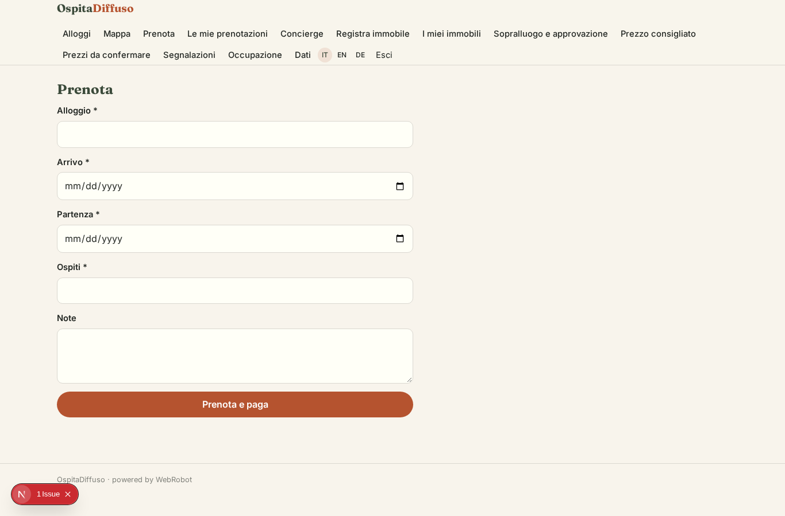

### my_stays
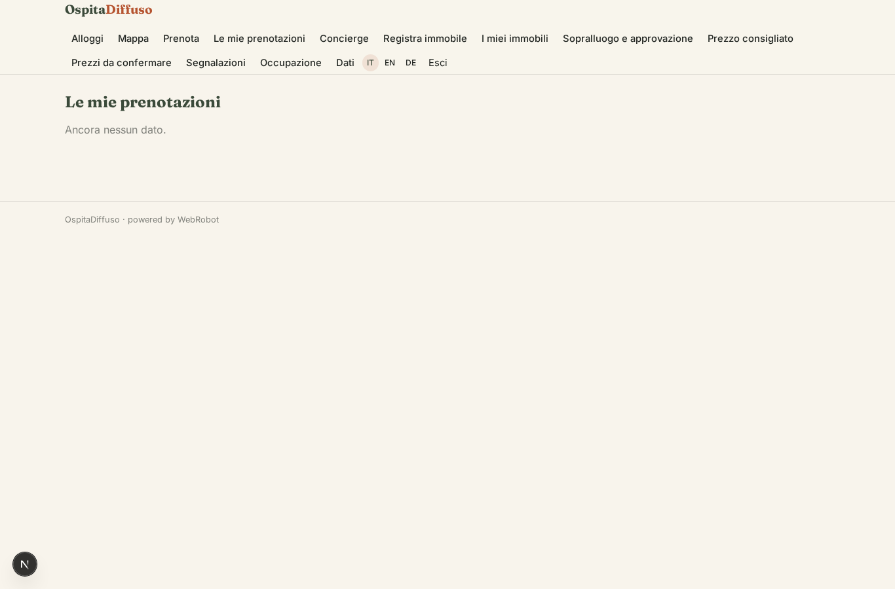

### concierge_chat
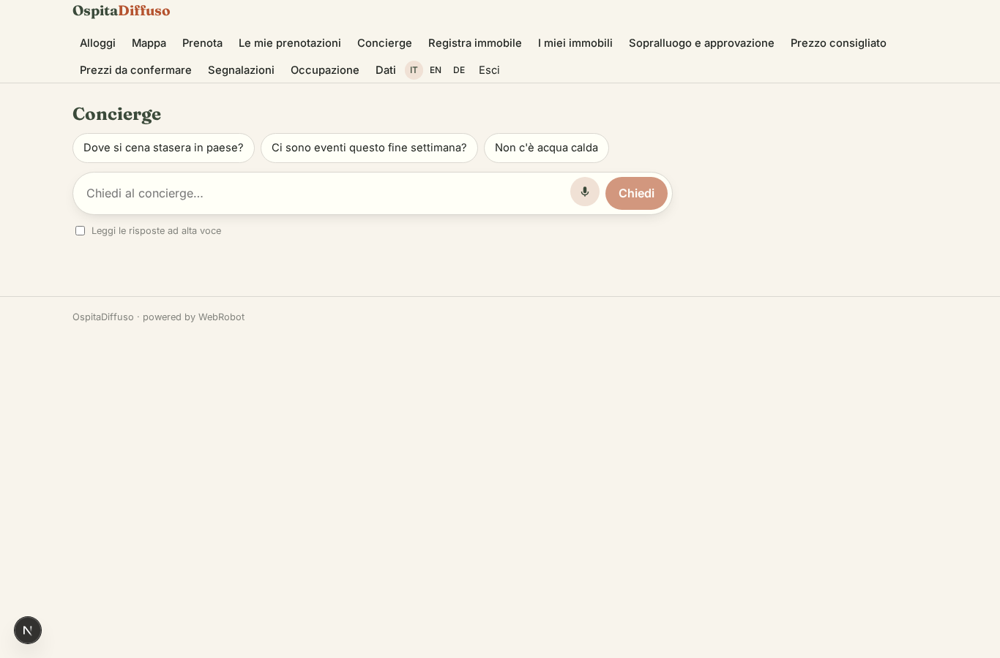

### property_new
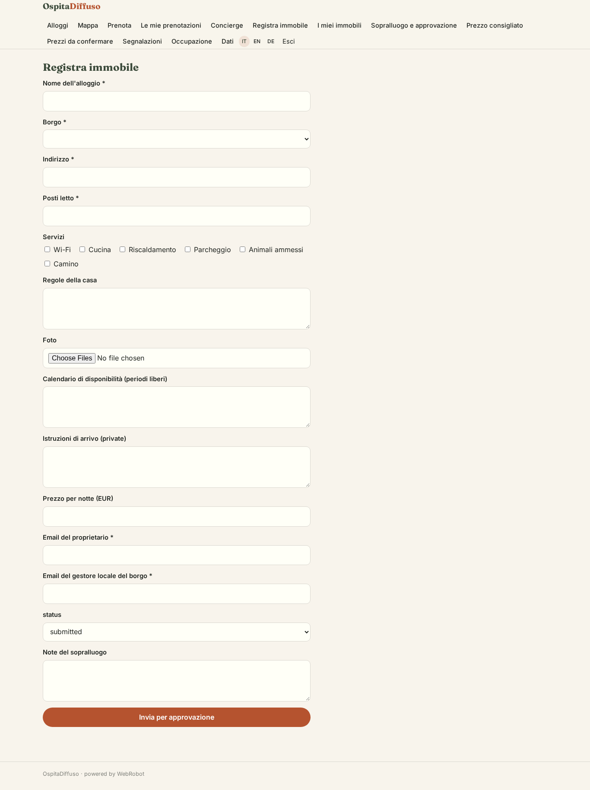

### my_properties
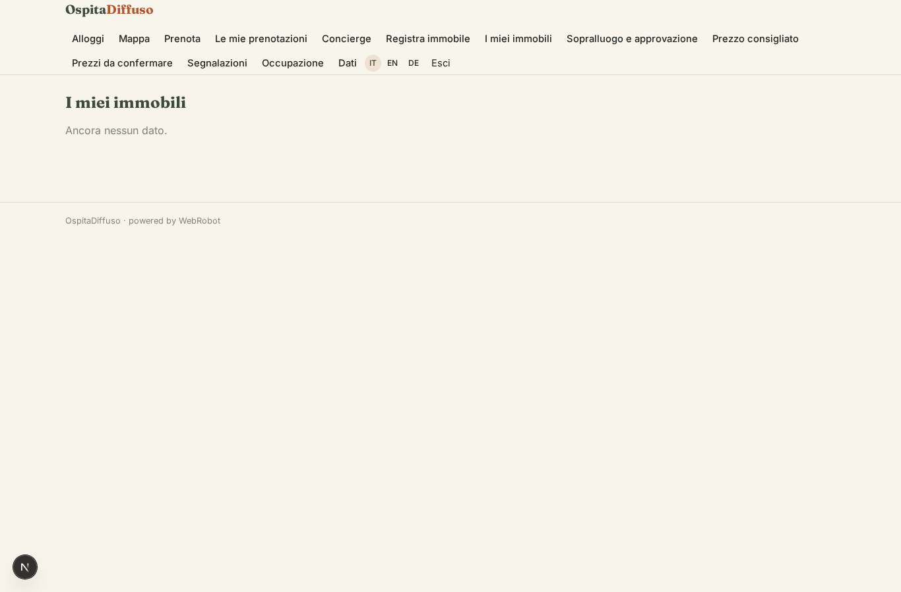

### property_review
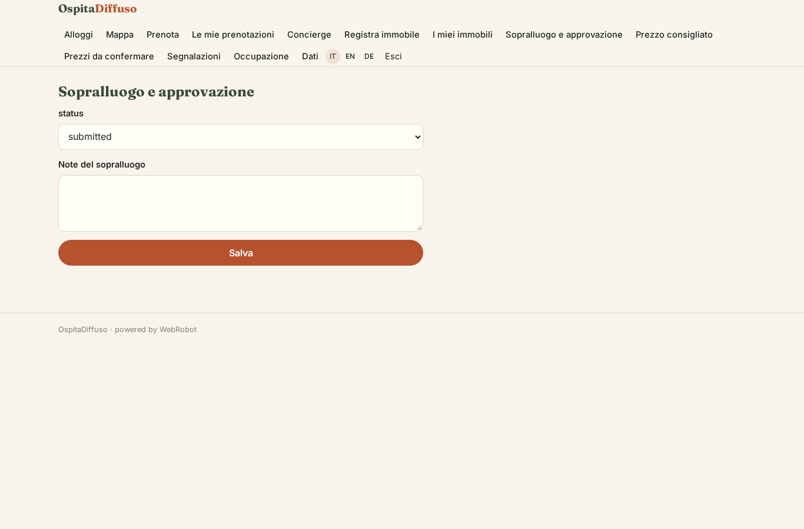

### price_watches
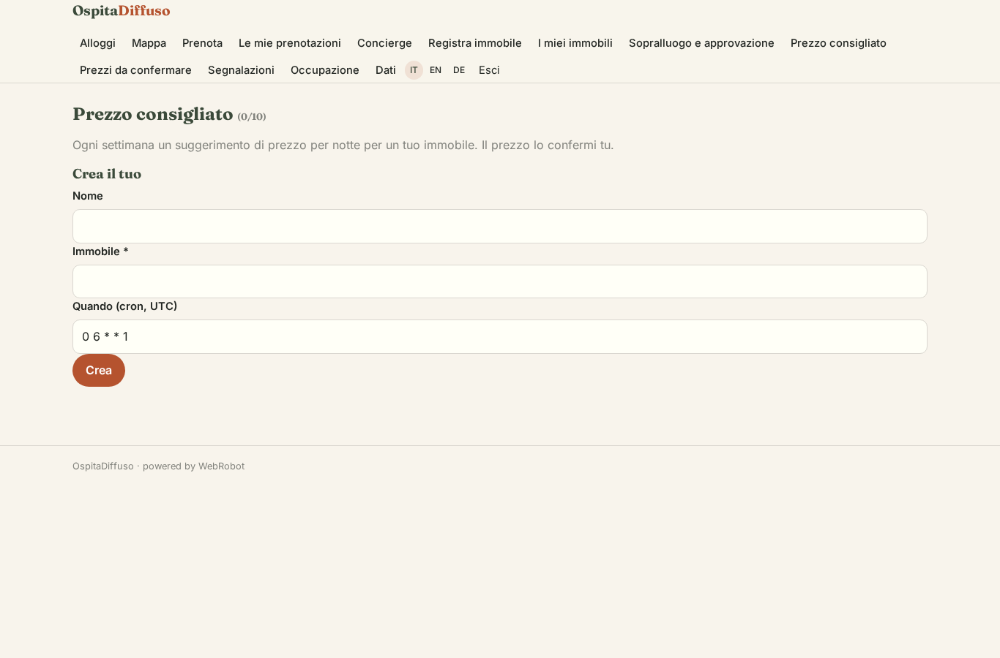

### price_approvals
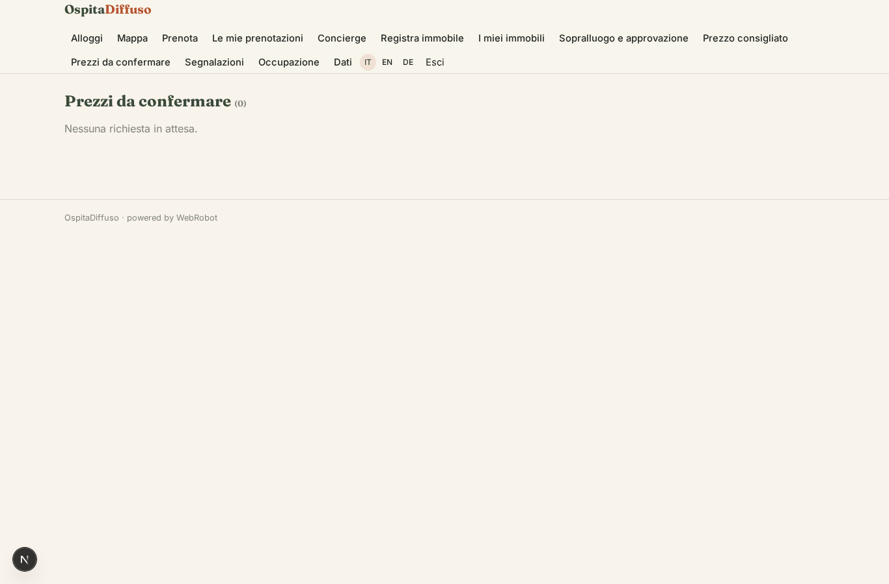

### earnings
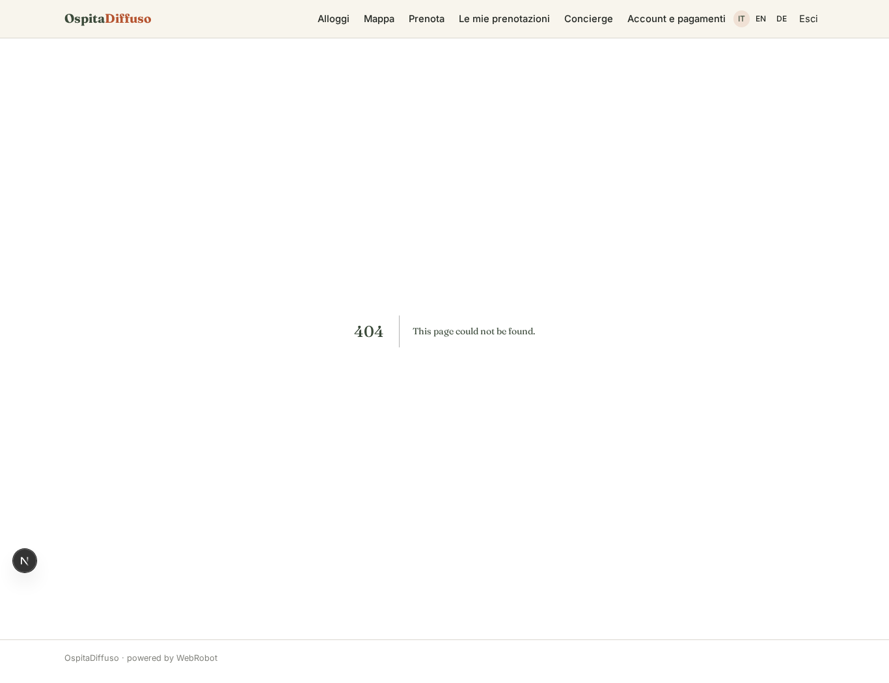

### manager_today

### manager_issues

### admin_dashboard
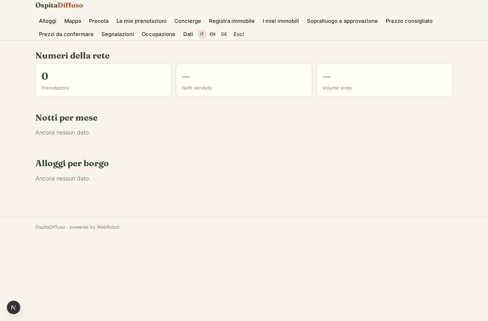

### account
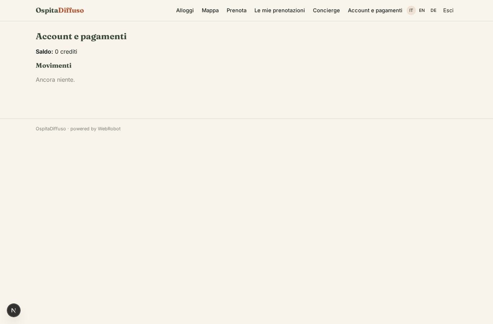
