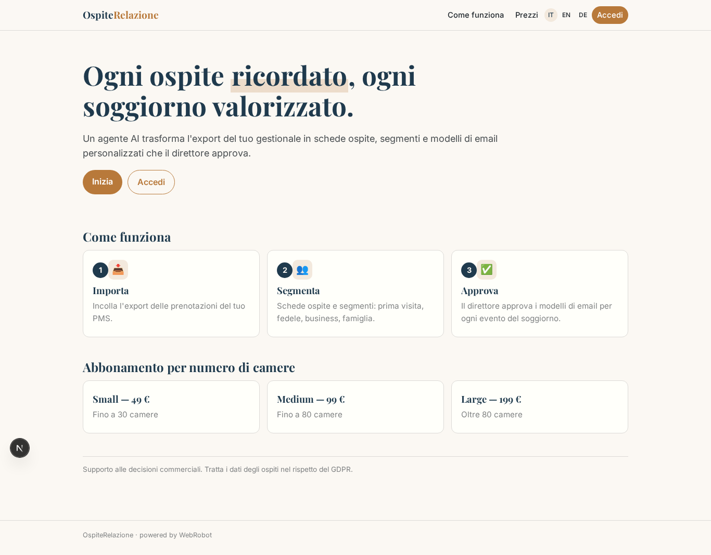
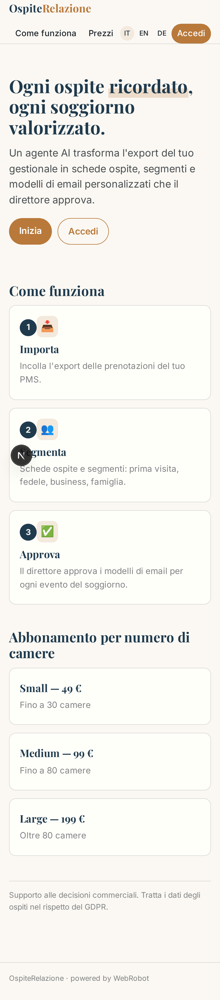
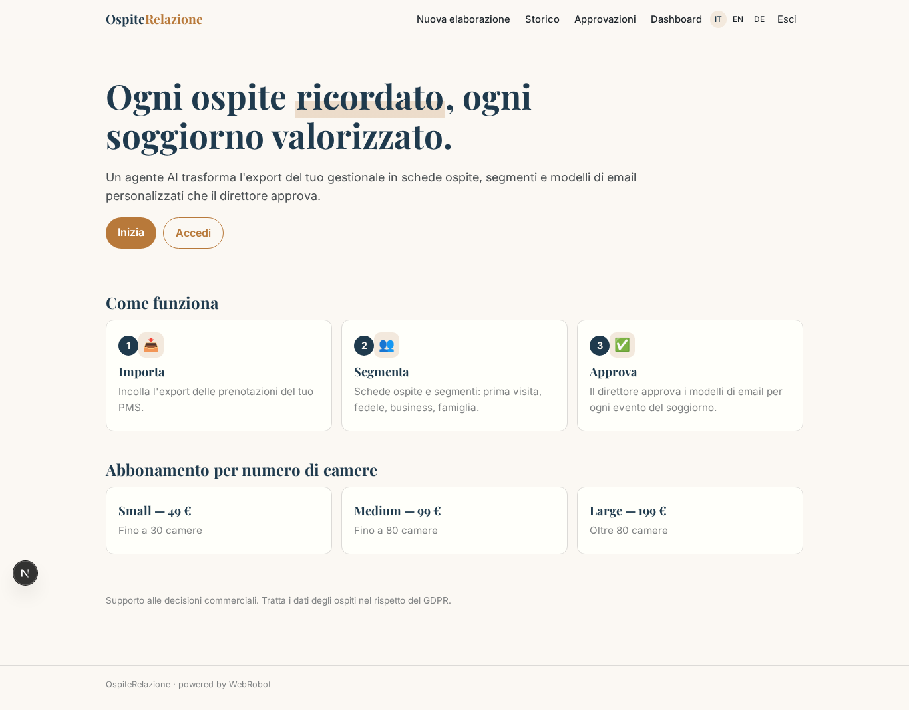
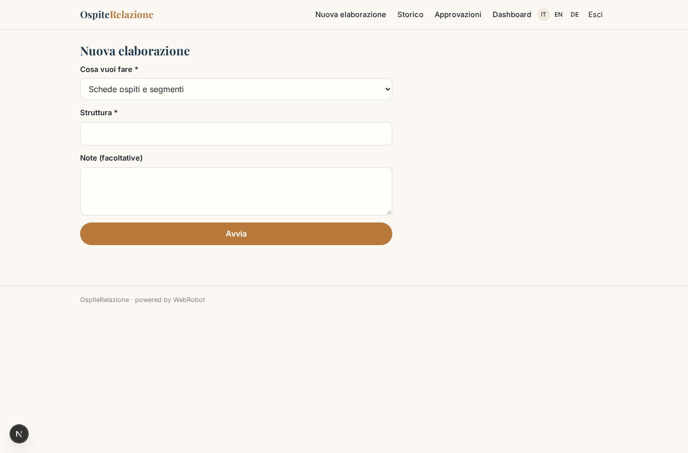
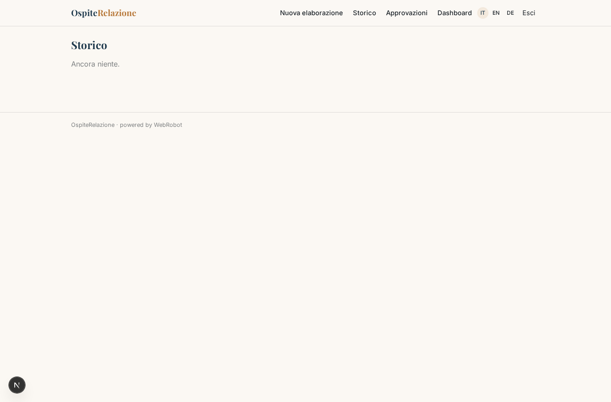
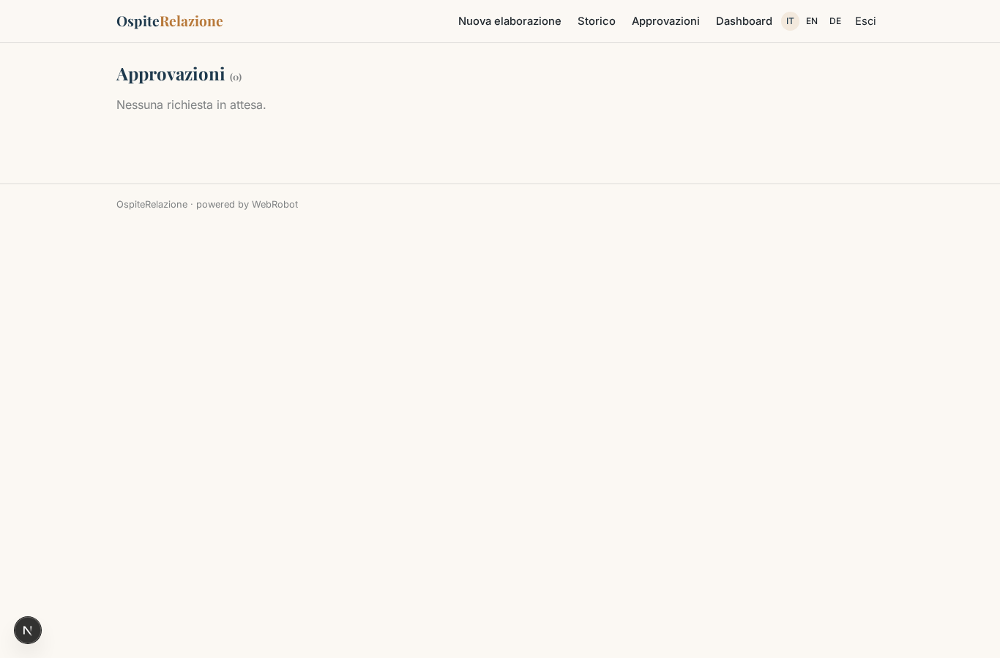
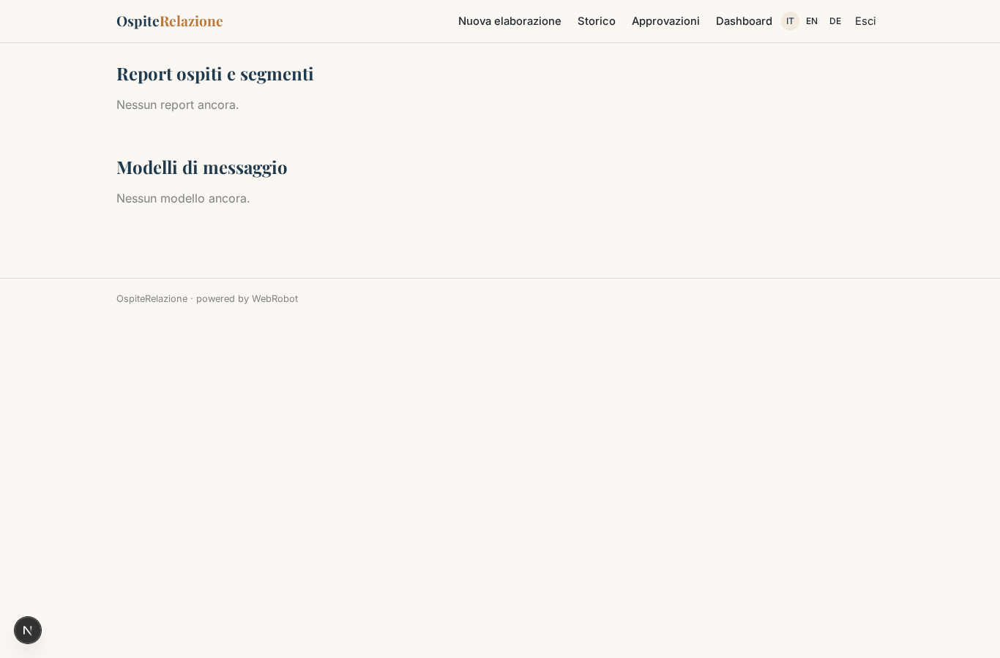
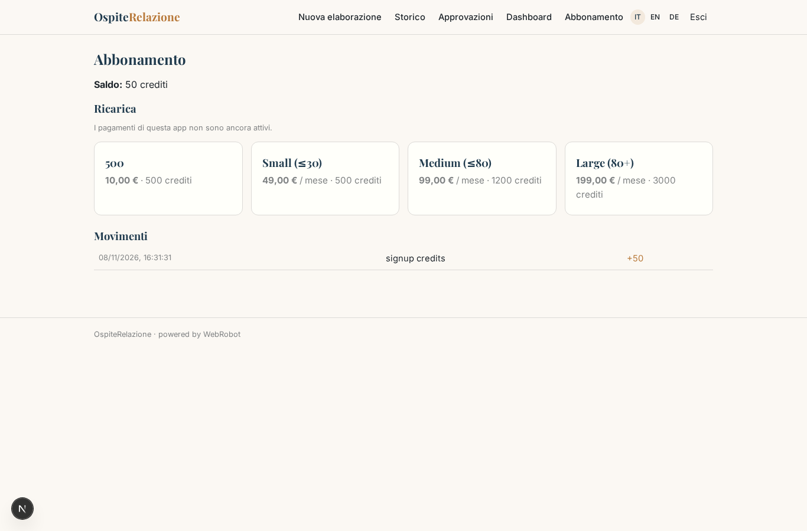

# OspiteRelazione

_Il CRM intelligente per curare il rapporto con i tuoi ospiti._

**Manifest status:** valid (schema validator + runtime contract)

## Description given to the app builder (Italian)

OspiteRelazione e un CRM intelligente per hotel e strutture ricettive che vogliono curare il rapporto con gli ospiti. La struttura collega il proprio gestionale alberghiero (PMS) tramite accesso autorizzato per importare prenotazioni, soggiorni e dati di contatto, oppure carica un export. Un agente costruisce per ogni ospite una scheda con storico dei soggiorni, preferenze e valore, e li raggruppa in segmenti (prima visita, cliente fedele, viaggiatore d'affari, famiglia). In base a eventi (prenotazione confermata, tre giorni prima dell'arrivo, giorno della partenza, anniversario del primo soggiorno) parte in automatico un'email personalizzata: conferma con informazioni utili, proposta di servizi extra, richiesta di recensione dopo il check-out. Il direttore approva i modelli dei messaggi e vede una dashboard con tassi di apertura, prenotazioni dirette generate e segmenti. Il personale vede solo gli ospiti della propria struttura. Abbonamento mensile per numero di camere. In italiano, inglese e tedesco.

## Features not expressible today (spec.extensions)

- **pms_connection**: Connecting the PMS with authorised access and file upload are not available yet: the property pastes an export or a link.
- **email_sending**: Automatic sending of emails on events (confirmation, 3 days before, departure, anniversary) is not available yet, so open rates and direct bookings generated cannot be measured; templates are drafted and approved only.
- **staff_access**: Separate staff accounts sharing one property's guests are not available yet: records belong to the signed-up user.

## Screenshots (interpretive runtime)

### home-anon

### home-mobile

### home

### new

### history

### approve

### dashboard

### account

