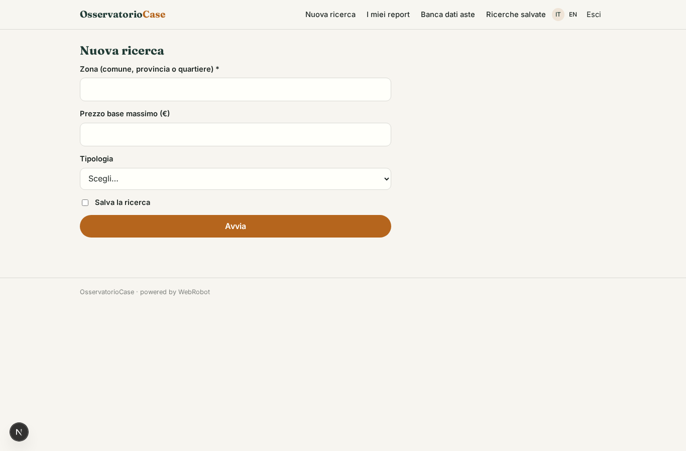
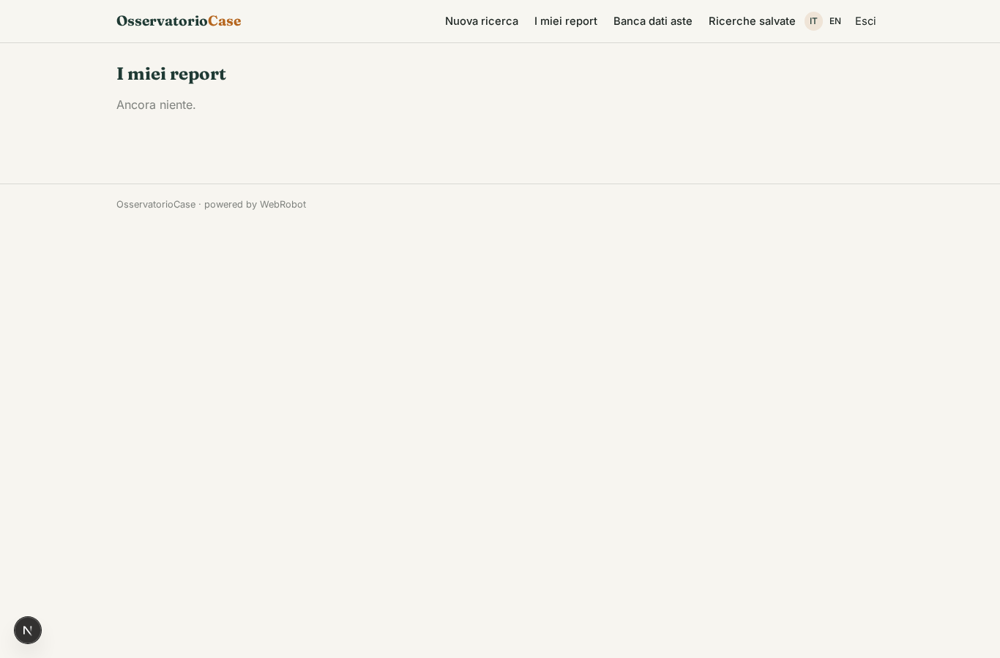
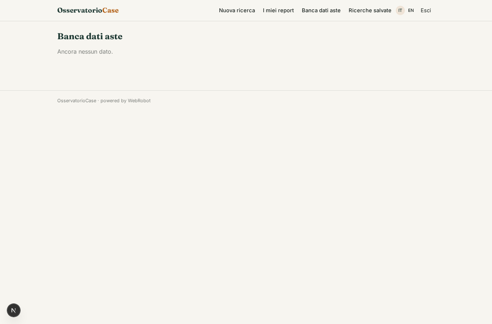
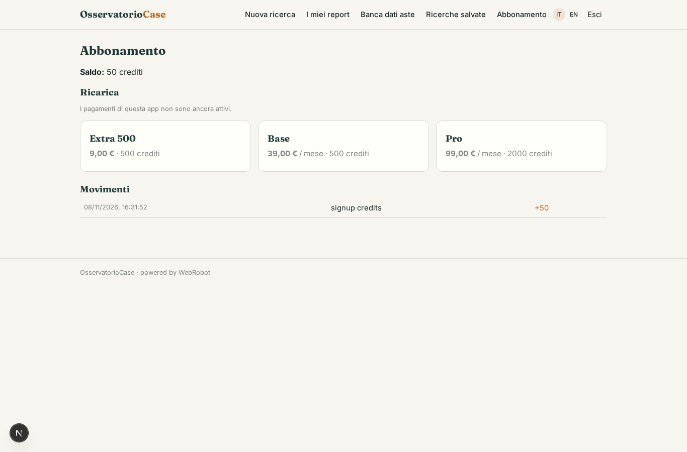

# OsservatorioCase

_Le vendite giudiziarie immobiliari, con stima di mercato e sconto atteso._

**Manifest status:** valid (schema validator + runtime contract)

## Description given to the app builder (Italian)

Vorrei OsservatorioCase, una banca dati immobiliare per investitori, agenzie e banche. Un agente raccoglie ogni notte gli avvisi di vendita giudiziaria pubblicati sul portale pubblico delle vendite e sui siti dei tribunali, estrae indirizzo, tipologia, superficie, prezzo base, data d'asta e stato della procedura, e li indicizza. L'utente cerca per zona, prezzo e tipologia, vede su ogni immobile la stima del valore di mercato calcolata dalle quotazioni pubbliche dell'Osservatorio del mercato immobiliare e lo sconto atteso, e salva ricerche. Quando compare un nuovo immobile che corrisponde a una ricerca salvata riceve un'email. Ogni utente vede solo le proprie ricerche. Abbonamento mensile, con piano superiore che include export e API.

## Features not expressible today (spec.extensions)

- **email_alerts**: Email when a new auction matches a saved search is not available yet (no notifications). For now users re-run or open the saved search; the collector marks new records with is_new.
- **plan_gated_export_api**: Export and API access should be limited to the Pro plan and issued per-user tokens; the manifest declares the export endpoint but plan gating and per-user tokens need runtime support.
- **saved_search_rerun**: Saved searches are stored per user but applying them as filters of the auctions table, and editing or deleting them, needs custom logic.

## Screenshots (interpretive runtime)

### home-anon

### home-mobile

### home

### search

### results

### auctions

### saved

### account

