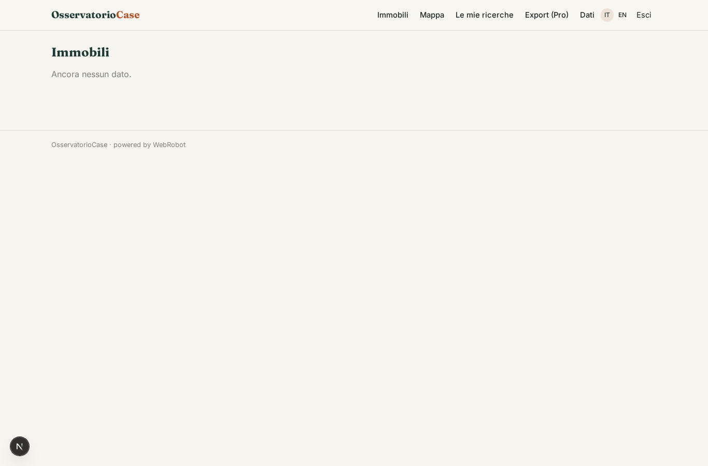
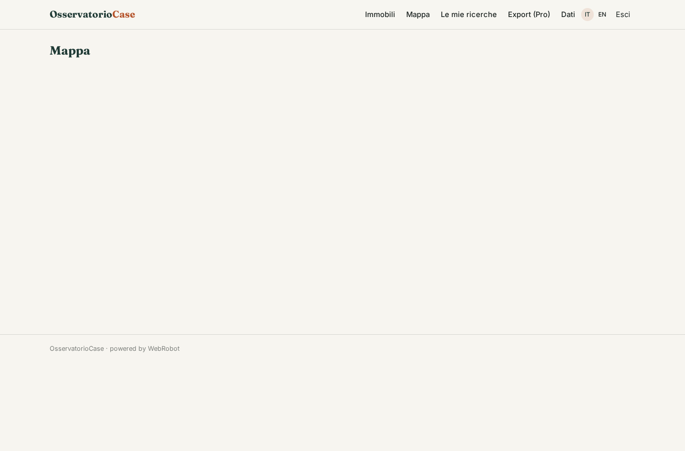
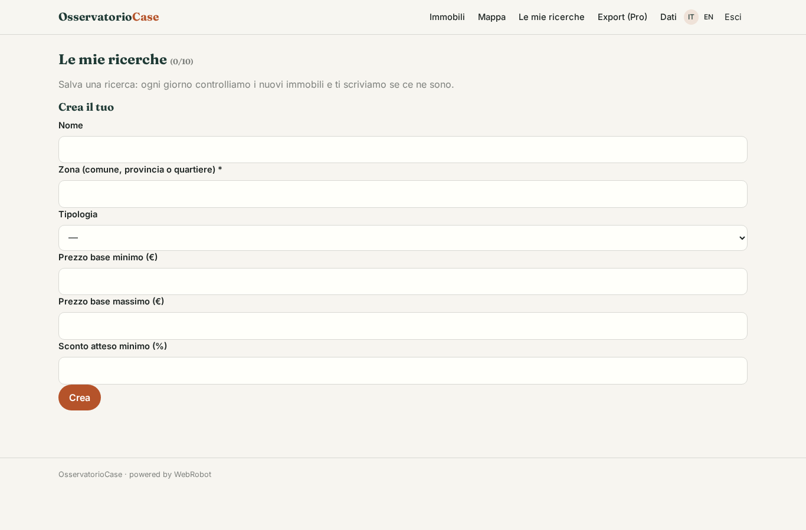

# OsservatorioCase

_La banca dati delle vendite giudiziarie, con stima di mercato e sconto atteso._

**Manifest:** valid (schema + runtime contract) · **Functional test:** passed (9 checks passed)

## Description given to the app builder (Italian)

Vorrei OsservatorioCase, una banca dati immobiliare per investitori, agenzie e banche. Un agente raccoglie ogni notte gli avvisi di vendita giudiziaria pubblicati sul portale pubblico delle vendite e sui siti dei tribunali, estrae indirizzo, tipologia, superficie, prezzo base, data d'asta e stato della procedura, e li indicizza. L'utente cerca per zona, prezzo e tipologia, vede su ogni immobile la stima del valore di mercato calcolata dalle quotazioni pubbliche dell'Osservatorio del mercato immobiliare e lo sconto atteso, e salva ricerche. Quando compare un nuovo immobile che corrisponde a una ricerca salvata riceve un'email. Ogni utente vede solo le proprie ricerche. Abbonamento mensile, con piano superiore che include export e API.

## Functional test: what did not pass

- **CSV export** (view properties_export): export reserved to a plan _(warning)_

## Features not expressible today (spec.extensions)

- **api_plan_gate**: Restricting the API token and CSV export to the Pro plan is only partly expressible: the export view shows a preview to non-Pro users; the token endpoint is issued to Pro subscribers by the owner.

## Screenshots (interpretive runtime, no data)

### home-anon

### home-mobile

### home

### properties

### map

### searches

### properties_export

### account

