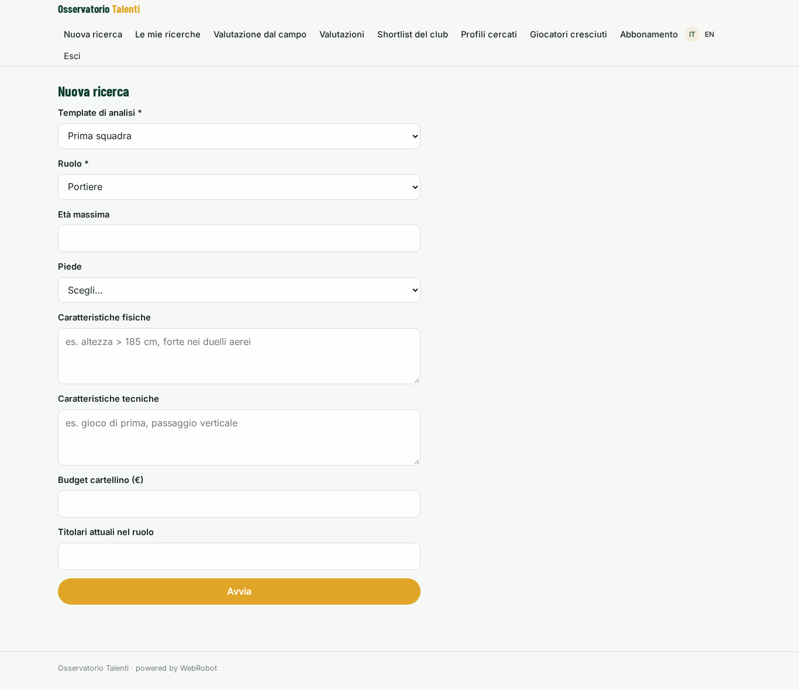
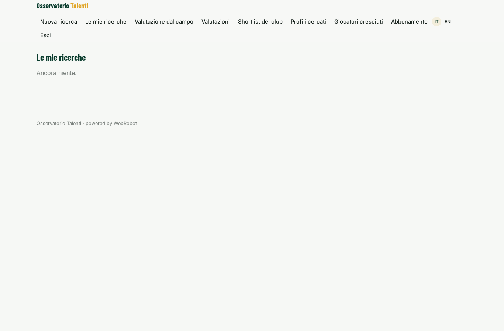
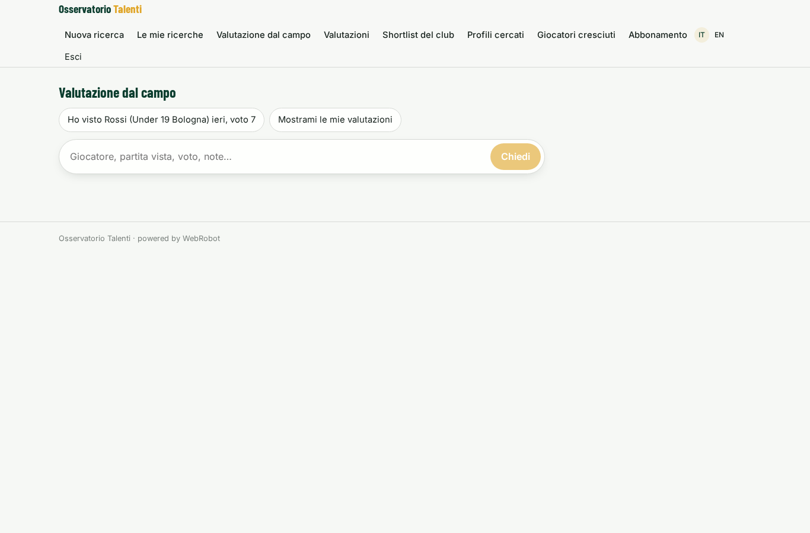
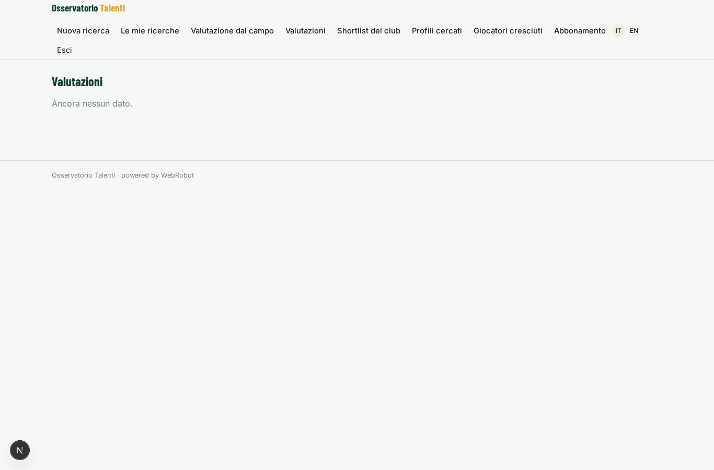
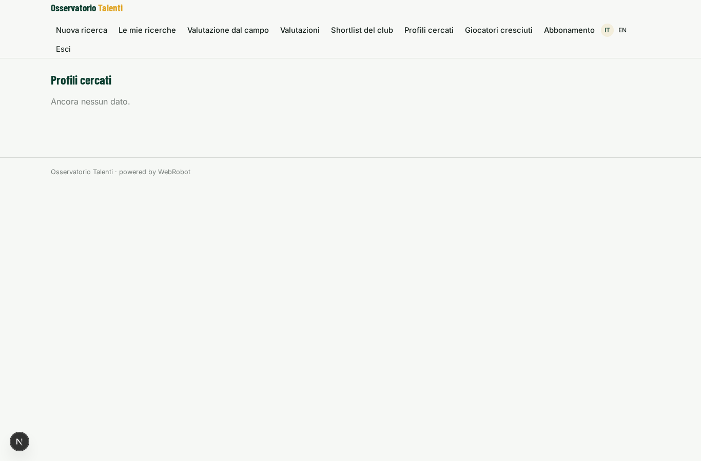
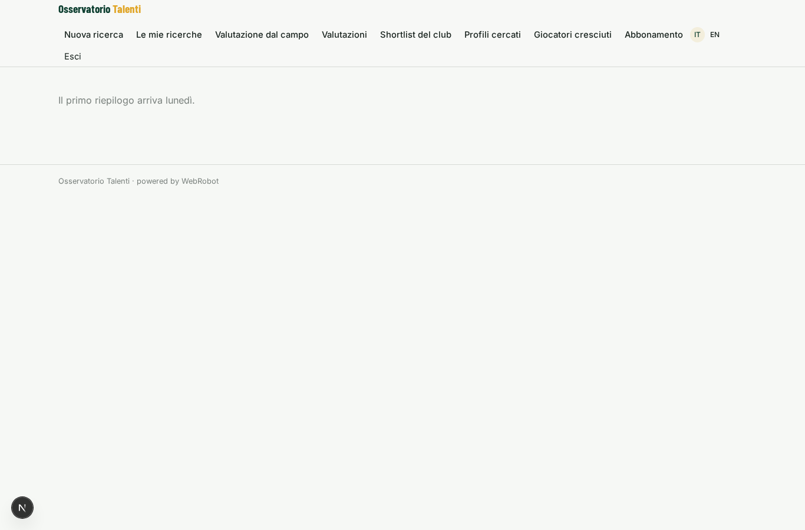
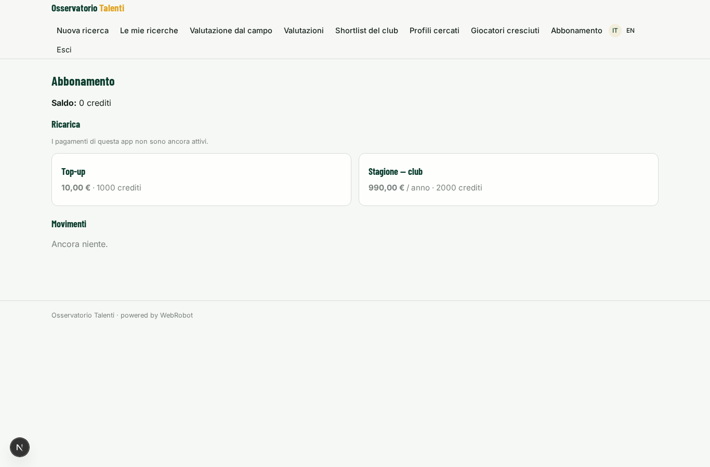

# Osservatorio Talenti

_Scouting guidato dai dati per il tuo club, con le valutazioni dei tuoi osservatori._

**Manifest status:** valid (schema validator + runtime contract)

## Description given to the app builder (Italian)

Ci serve Osservatorio Talenti, un'app di scouting per società di calcio dilettantistiche e professionistiche. Il direttore sportivo del club è admin e invita gli osservatori. Il club definisce il profilo cercato: ruolo, età massima, piede, caratteristiche fisiche e tecniche, budget di cartellino. Un agente analizza i dati delle partite e dei giocatori: risultati storici di football-data e gli eventi open di StatsBomb, che però sono utilizzabili solo per scopi non commerciali, e i dati evento completi dei campionati che il club ottiene da un fornitore a licenza. Calcola indicatori per ruolo, confronta i candidati con il profilo e con i titolari attuali, e produce una shortlist con schede giocatore, grafici radar e note. Gli osservatori aggiungono valutazioni dal campo con un modulo (partita vista, voto, note) e l'agente le integra nel punteggio. Ogni lunedì arriva un'email con i giocatori cresciuti di più. Ogni club vede solo le proprie liste e note; i dati statistici sono condivisi. Abbonamento stagionale per club, con template di analisi diversi per prima squadra e settore giovanile.

## Features not expressible today (spec.extensions)

- **weekly_email**: Monday email with the players who grew most is NOT available yet: the digest appears in the 'Giocatori cresciuti' view instead.
- **licensed_event_data**: Importing the club's licensed provider data needs each club's credentials or file uploads, not available yet. For now the club pastes summary figures in notes or the platform operator loads licensed data it is entitled to redistribute; the licence must allow this.
- **statsbomb_excluded**: StatsBomb open events are non-commercial only, so they are excluded from this paid app. Use them only in a free, non-commercial version.
- **club_tenancy**: A club is several users (director + scouts) but records are per-user, shared by per-record invitations. A true club-level workspace with invites by the director and strict isolation between clubs needs a derived tenancy not expressible yet.
- **radar_chart**: Radar charts are not a supported chart type; player cards use a bar chart comparing candidate and starter.

## Screenshots (interpretive runtime)

### home-anon

### home-mobile

### home

### new_search

### searches

### evaluate

### ratings

### lists

### profiles

### risers

### account

