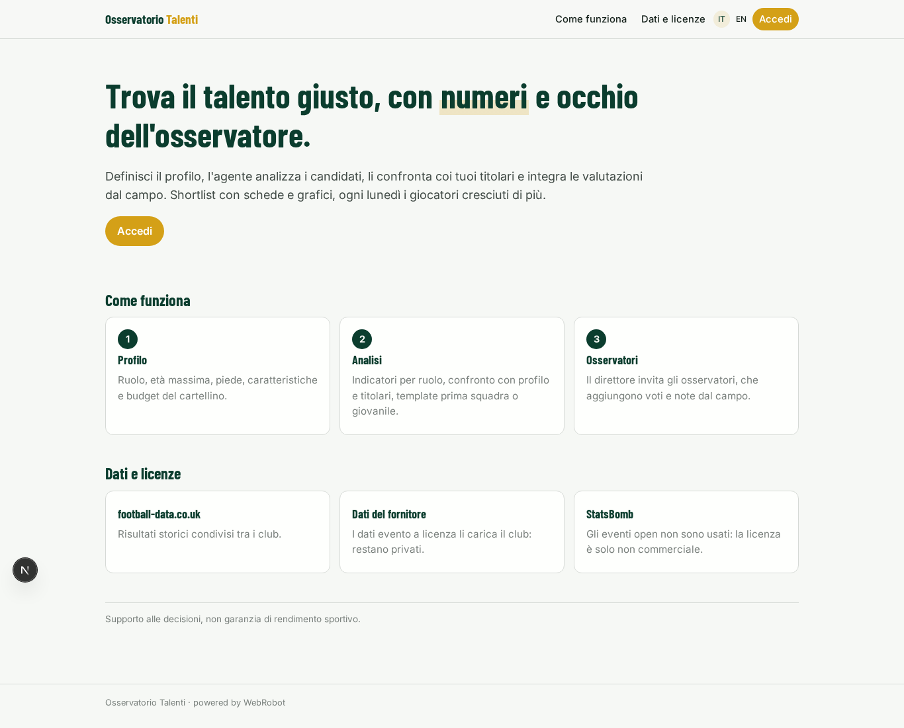
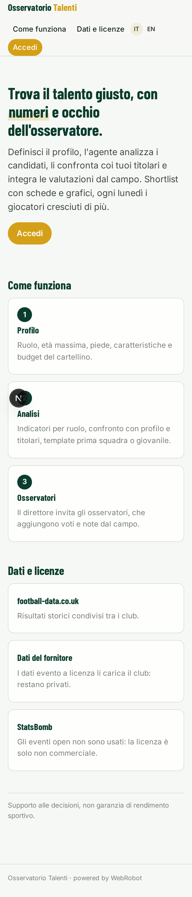
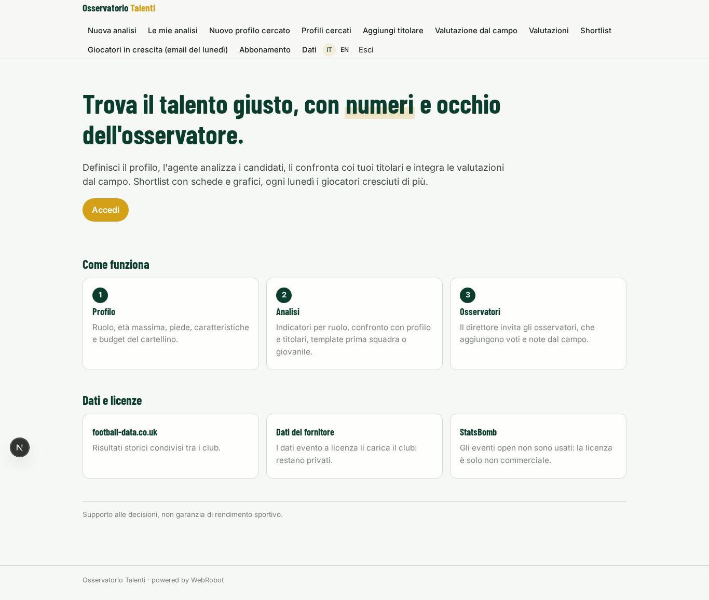
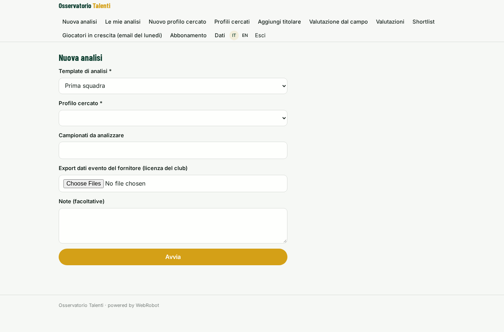
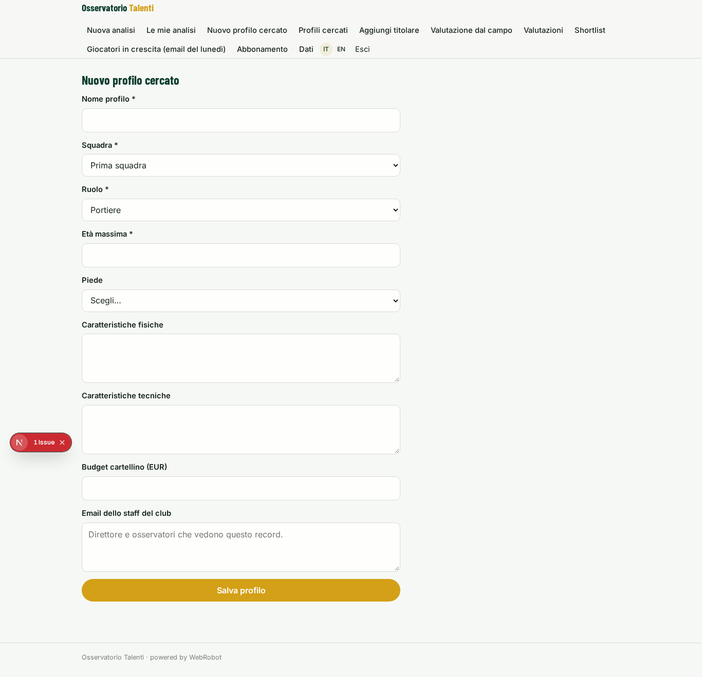
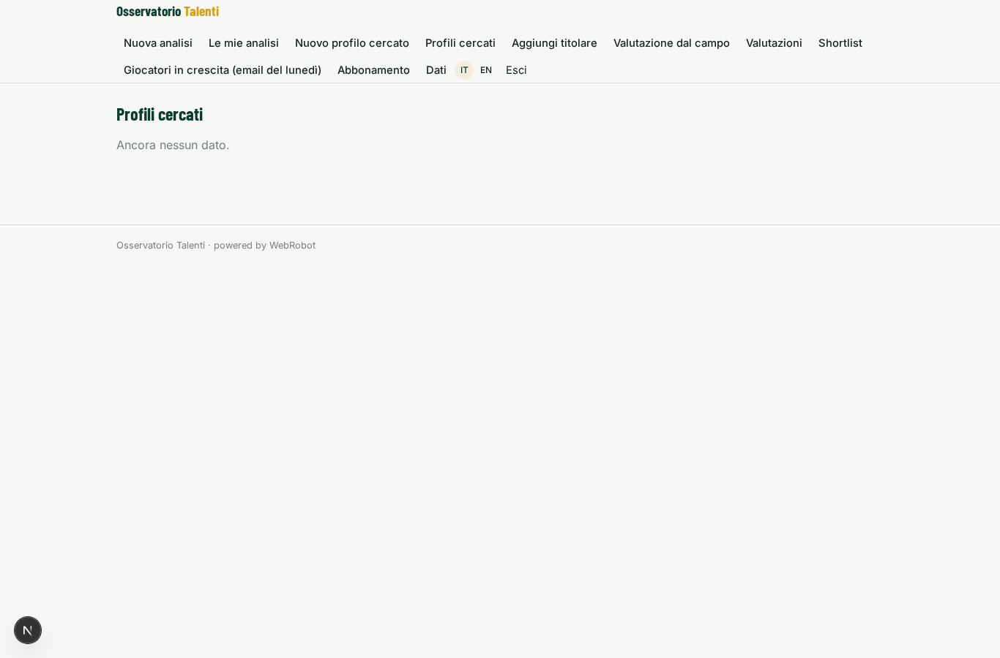
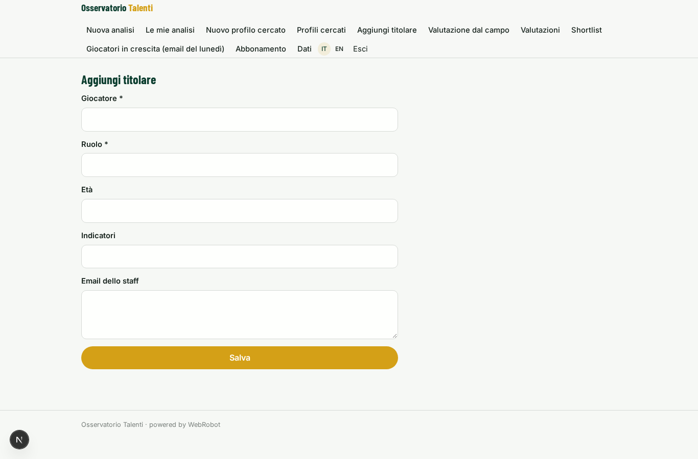
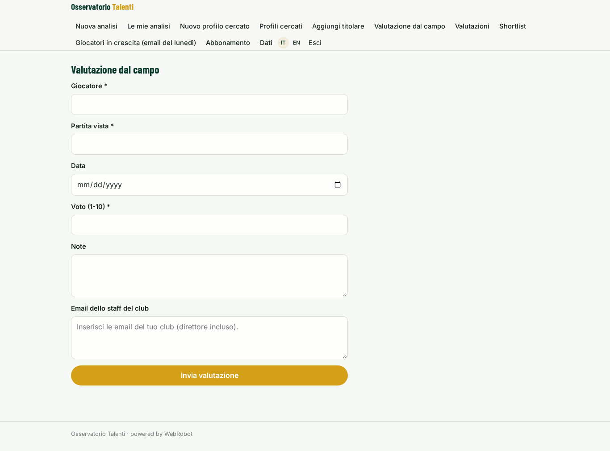
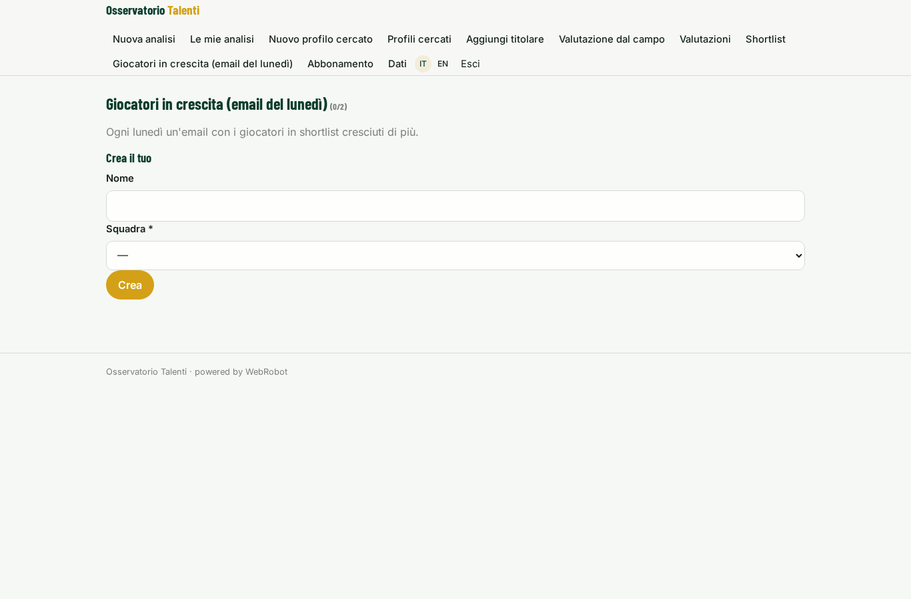
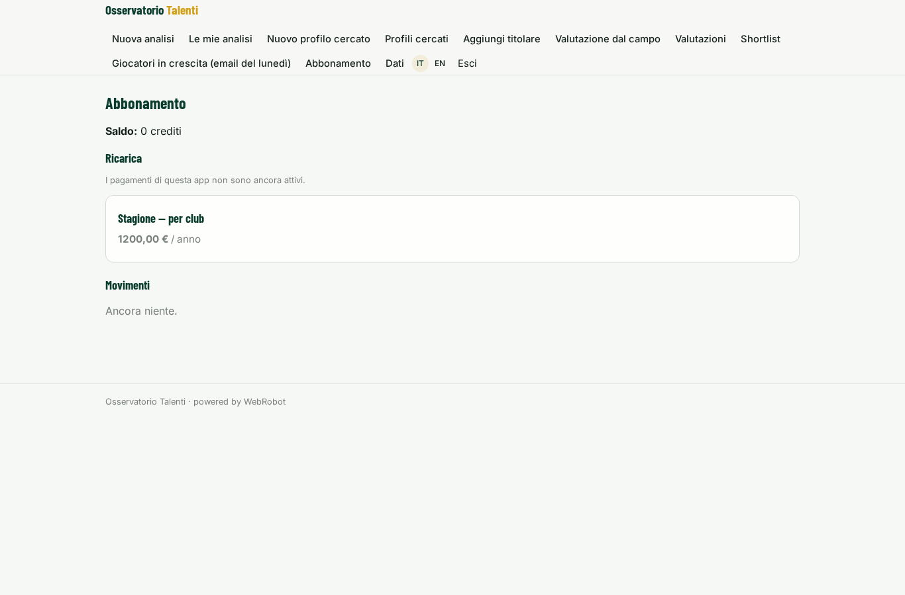

# Osservatorio Talenti

_Scouting calcistico: shortlist, radar e note, sul profilo che cerca il tuo club._

**Manifest:** valid (schema + runtime contract) · **Functional test:** passed (18 checks passed)

## Description given to the app builder (Italian)

Ci serve Osservatorio Talenti, un'app di scouting per società di calcio dilettantistiche e professionistiche. Il direttore sportivo del club è admin e invita gli osservatori. Il club definisce il profilo cercato: ruolo, età massima, piede, caratteristiche fisiche e tecniche, budget di cartellino. Un agente analizza i dati delle partite e dei giocatori: risultati storici di football-data e gli eventi open di StatsBomb, che però sono utilizzabili solo per scopi non commerciali, e i dati evento completi dei campionati che il club ottiene da un fornitore a licenza. Calcola indicatori per ruolo, confronta i candidati con il profilo e con i titolari attuali, e produce una shortlist con schede giocatore, grafici radar e note. Gli osservatori aggiungono valutazioni dal campo con un modulo (partita vista, voto, note) e l'agente le integra nel punteggio. Ogni lunedì arriva un'email con i giocatori cresciuti di più. Ogni club vede solo le proprie liste e note; i dati statistici sono condivisi. Abbonamento stagionale per club, con template di analisi diversi per prima squadra e settore giovanile.

## Features not expressible today (spec.extensions)

- **licensed_provider_api**: Connessione diretta all'API del fornitore a licenza non possibile senza host noto: il club carica l'export nel form. Se il fornitore ha una API con chiave, aggiungere credenziale e tool http.
- **club_workspace**: La condivisione tra staff del club usa la lista email 'members' di ogni record; non esiste ancora un'entità club con inviti automatici.

## Screenshots (interpretive runtime, no data)

### home-anon

### home-mobile

### home

### new_analysis

### analyses

### profile_form

### profiles

### starters_form

### rating_form

### ratings

### shortlist_view

### watches

### account

