# PadelInViaggio

_I viaggi giusti per chi vive di padel._

**Manifest:** valid (schema + runtime contract) · **Functional test:** passed (25 checks passed)

## Description given to the app builder (Italian)

Mi piacerebbe creare PadelInViaggio, un marketplace di viaggi dedicati ai giocatori di padel. Ci sono tre tipi di utenti: viaggiatori, organizzatori (club, tour operator, coach) e l'amministratore della piattaforma. L'organizzatore pubblica un pacchetto con destinazione, date, livello di gioco richiesto, numero di posti, campi e struttura, coach inclusi, voli sì/no, prezzo e politica di cancellazione; l'admin approva ogni pacchetto prima che diventi visibile. Il viaggiatore compila il profilo (livello, città di partenza, budget, periodi liberi) e parla con un assistente in chat che gli propone i viaggi più adatti dal catalogo e risponde a domande su logistica e programma. Un agente incrocia i calendari pubblici dei tornei federali per segnalare viaggi che coincidono con tornei interessanti e avvisa per email gli iscritti quando esce un pacchetto compatibile con le loro preferenze. Il pagamento avviene online: il viaggiatore paga l'intero importo o un acconto, la piattaforma trattiene una commissione e gira il resto all'organizzatore. L'organizzatore vede solo i propri pacchetti, prenotazioni e incassi in una dashboard; il viaggiatore le proprie prenotazioni. Serve anche la versione mobile. Lingue italiano, inglese e spagnolo.

## Functional test: what did not pass

- **form saves a record** (form organizer_profile): only role organizer may fill it, and the test cannot hold that role _(warning)_
- **form saves a record** (form package_new): only role organizer may fill it, and the test cannot hold that role _(warning)_
- **saved record shown where its collection is read** (view my_bookings): a record was saved in bookings (by user) but the page does not show it (as user) _(warning)_
- **saved record shown where its collection is read** (view tournaments): a record was saved in tournament_signals (by admin-data, admin-data) but the page does not show it (as user) _(warning)_
- **page opened by a role allowed to** (view organizer_profile): only role organizer may open it, the test cannot hold it _(warning)_
- **page opened by a role allowed to** (view package_new): only role organizer may open it, the test cannot hold it _(warning)_
- **page opened by a role allowed to** (view my_packages): only role organizer may open it, the test cannot hold it _(warning)_
- **page opened by a role allowed to** (view org_dashboard): only role organizer may open it, the test cannot hold it _(warning)_

## Features not expressible today (spec.extensions)

- **checkout_deposit**: Online checkout of a booking through Stripe Connect with the split to the organizer (fee withheld by the platform) and the choice between deposit and full amount; the balance payment of a deposit booking and the automatic decrement of seats_left after payment are not expressible in the manifest.
- **organizer_email_prefill**: organizer_email on a package is typed by the organizer; automatic prefill from the signed-in user is not available.

## Screenshots (interpretive runtime, no data)

### home-anon
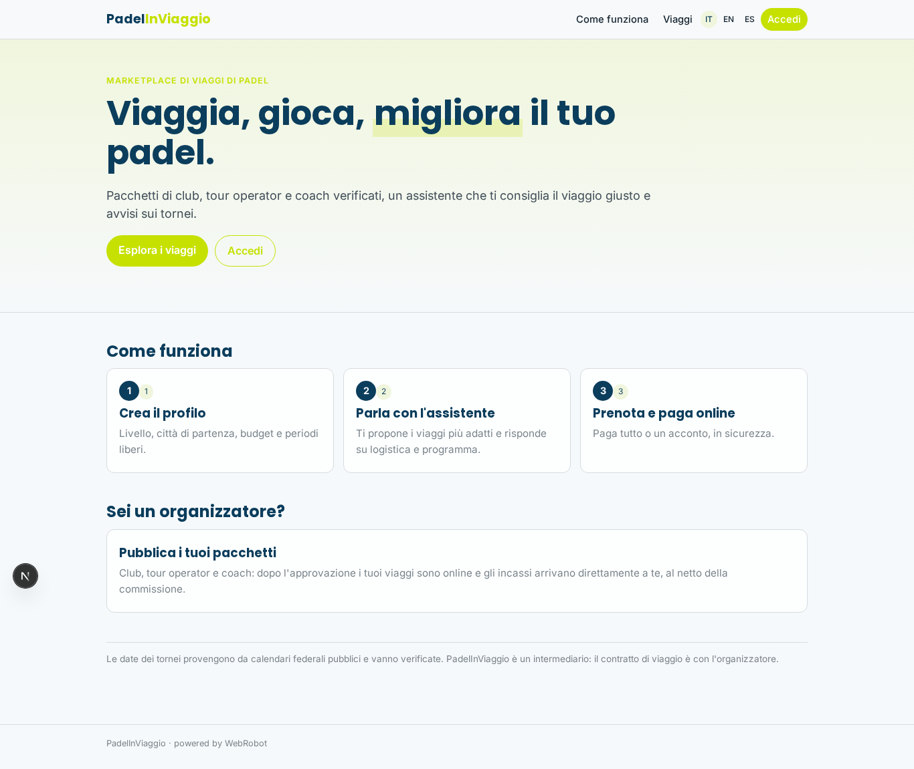

### home-mobile

### home
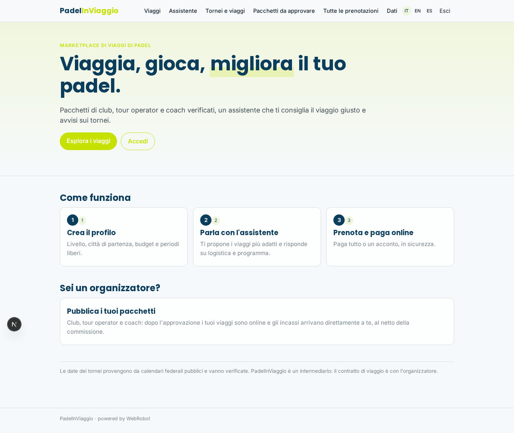

### catalog
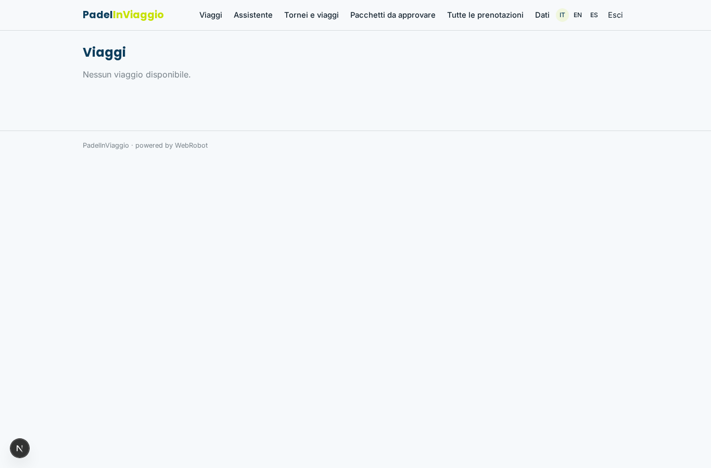

### assistant
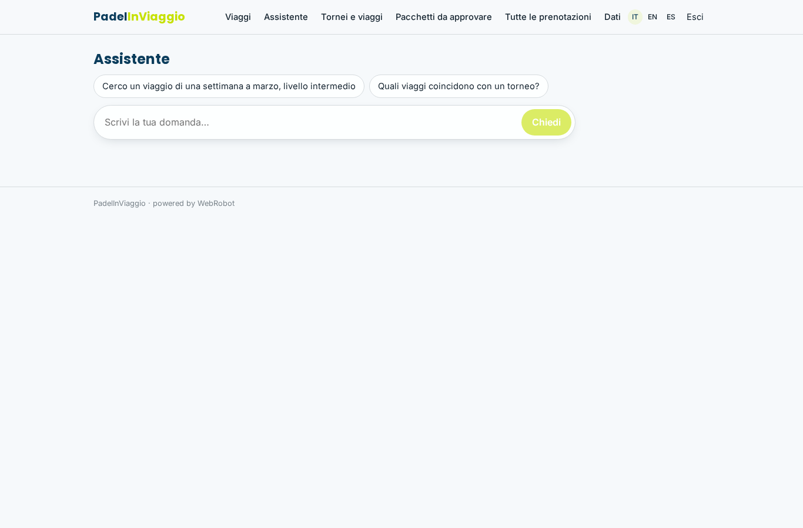

### profile
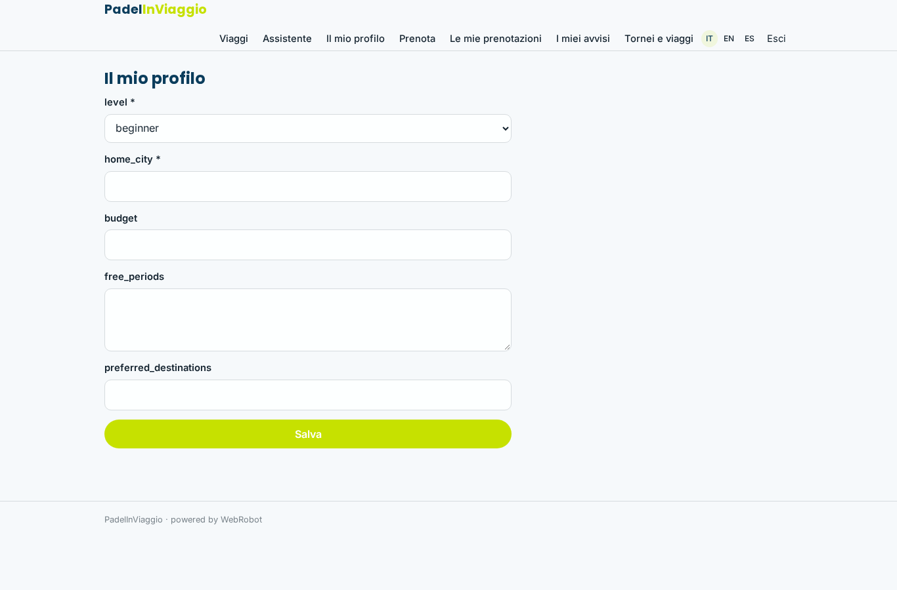

### book
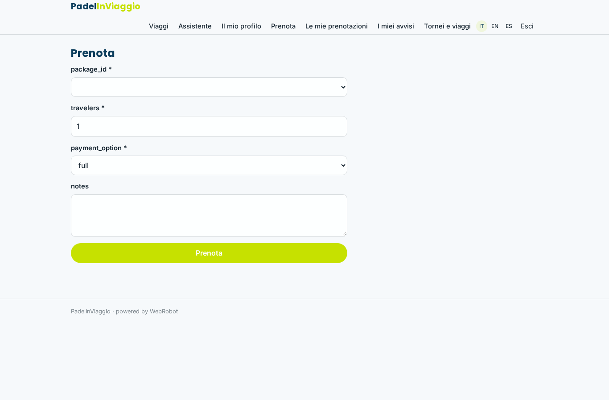

### my_bookings
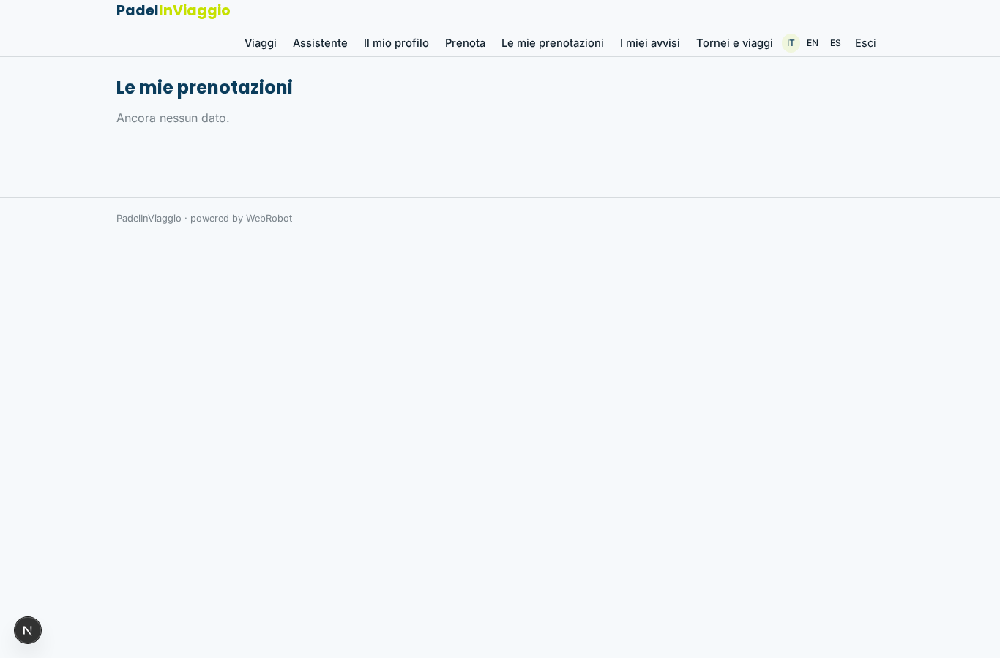

### alerts
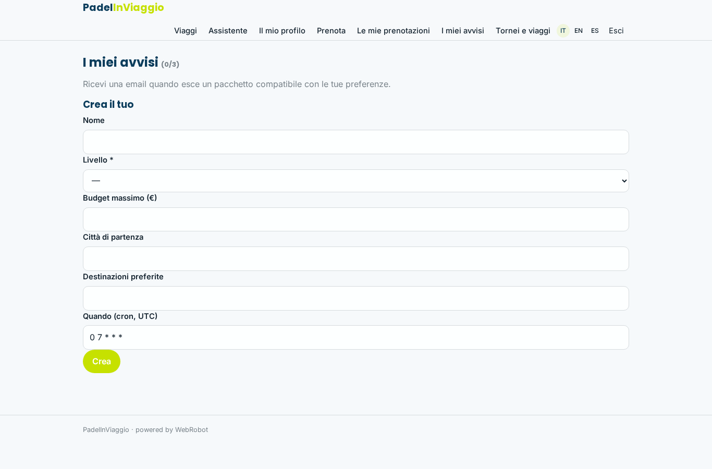

### tournaments

### organizer_profile

### package_new

### my_packages

### org_dashboard
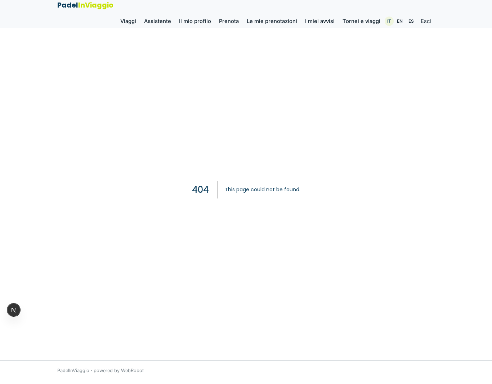

### admin_review
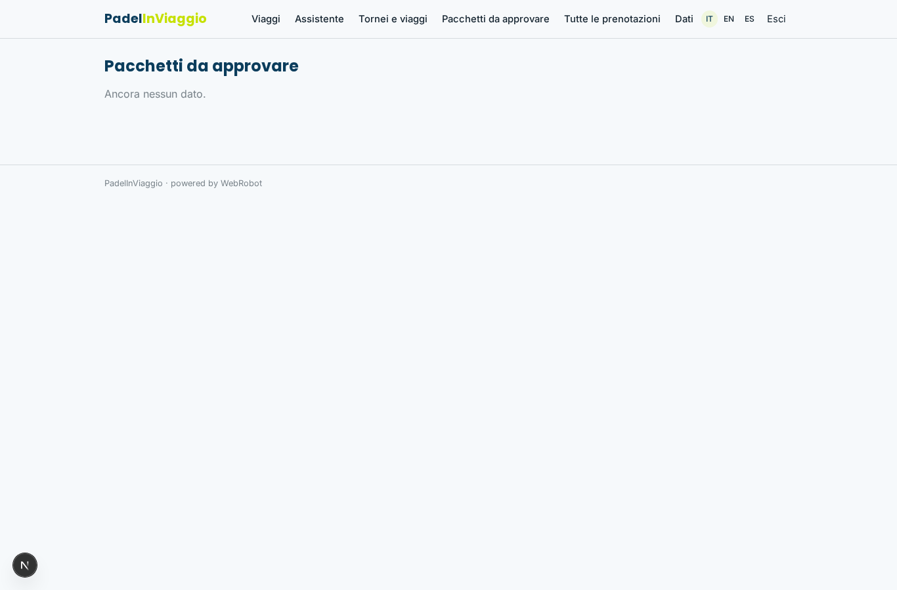

### package_review
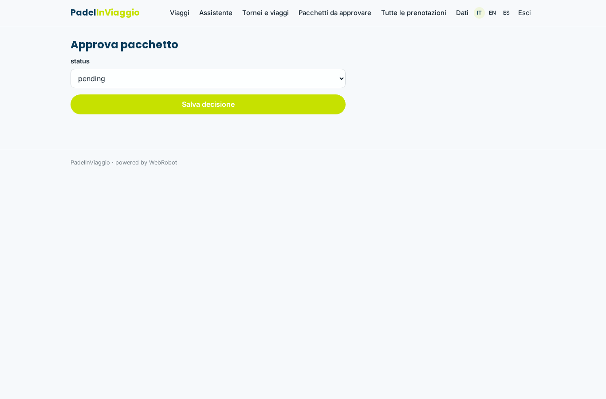

### all_bookings

