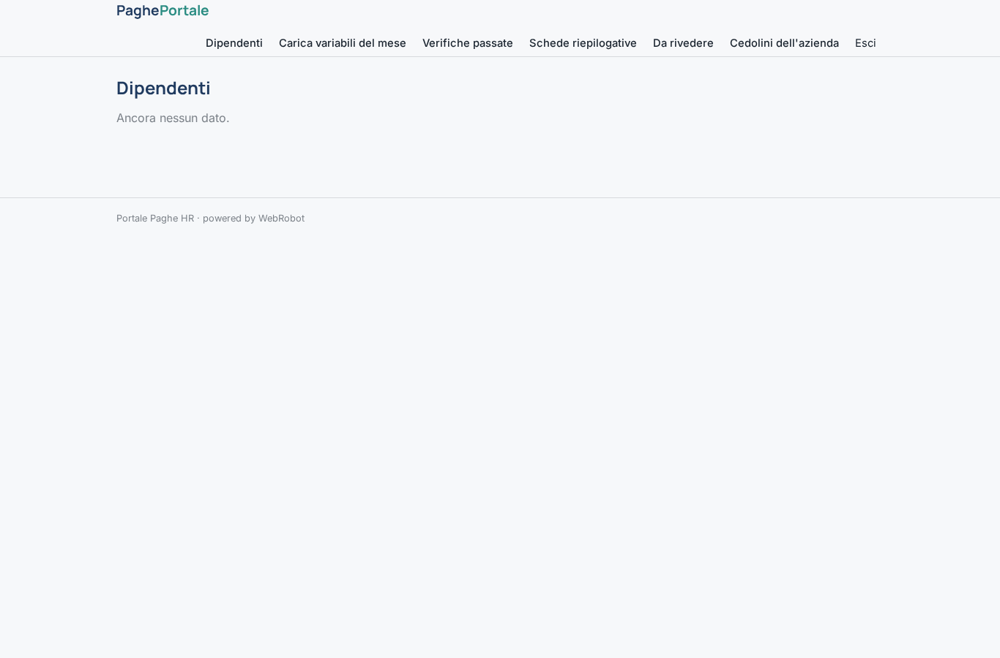
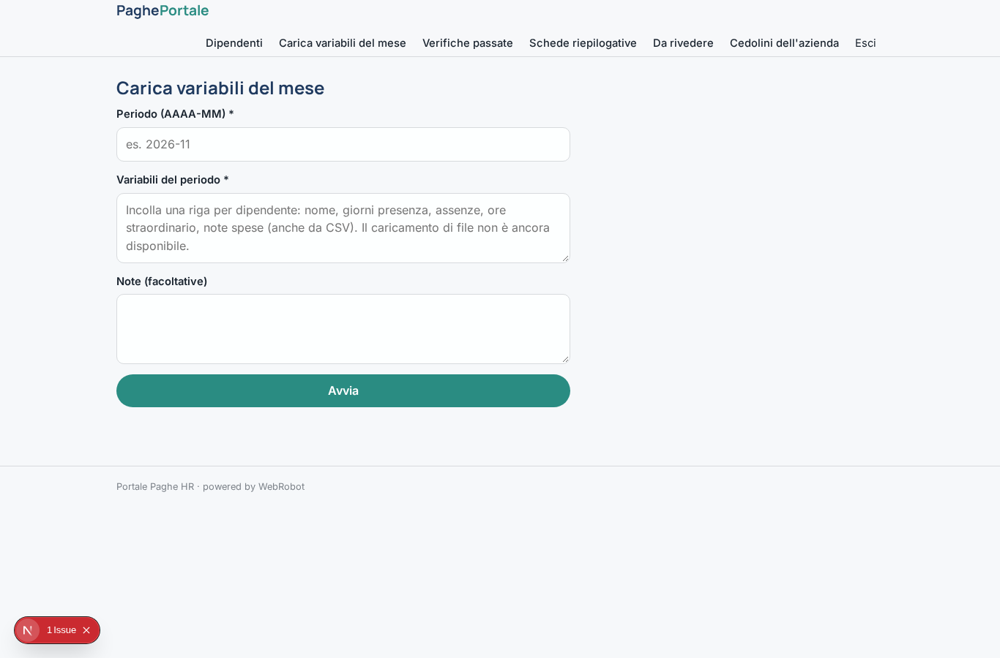
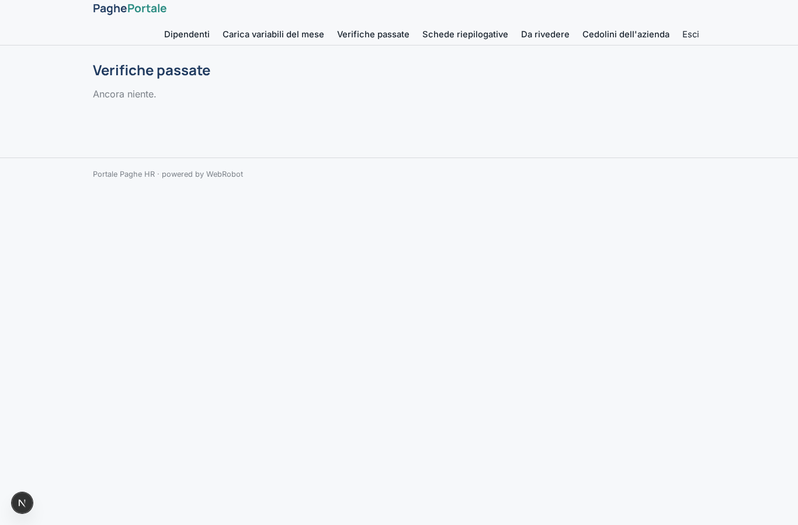
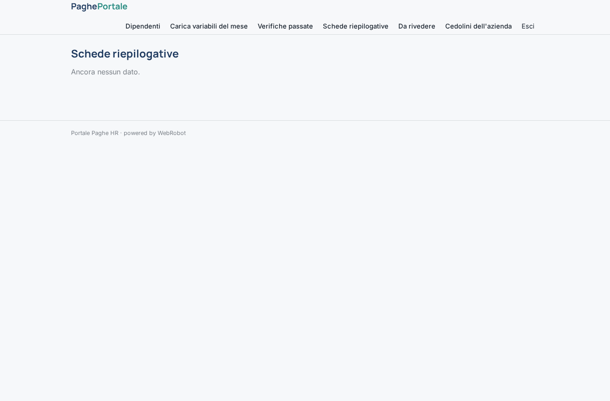
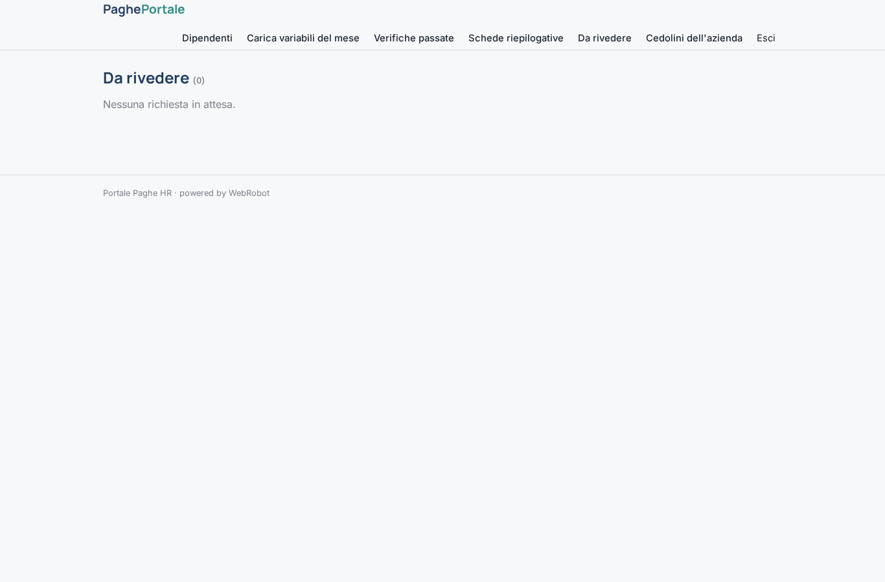
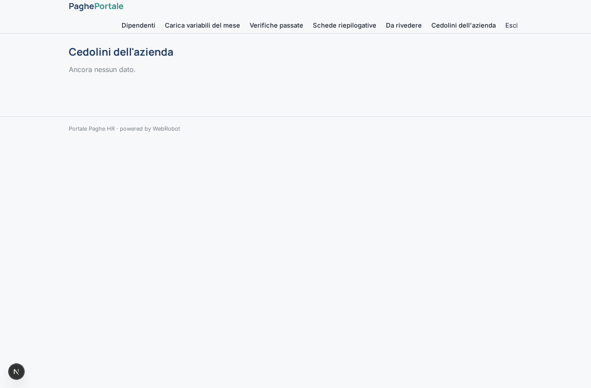
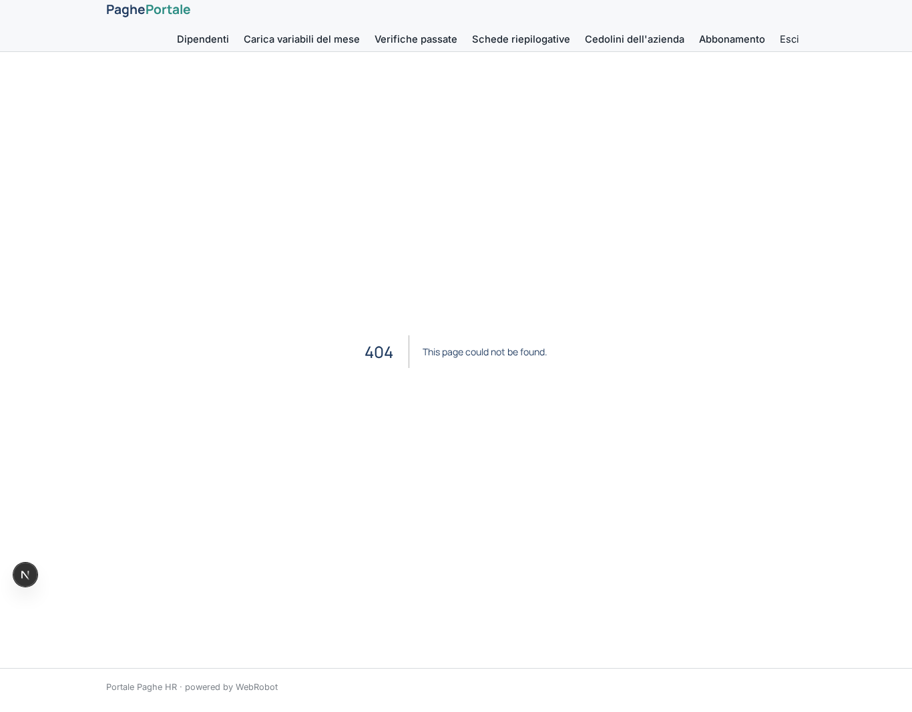
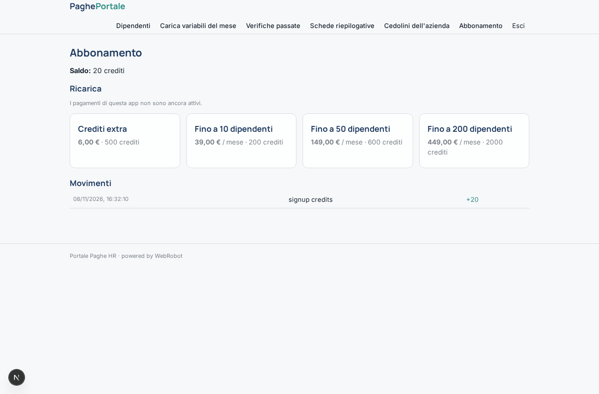

# Portale Paghe HR

_Il portale per variabili paga, verifica dei dati e cedolini, con revisione del consulente del lavoro._

**Manifest status:** valid (schema validator + runtime contract)

## Description given to the app builder (Italian)

Descrivo solo lo strato software di un servizio di gestione paghe e amministrazione del personale: il portale, non la parte di consulenza del lavoro ne gli adempimenti verso gli enti, che restano in capo a professionisti abilitati. L'azienda cliente registra i propri dipendenti con dati anagrafici, inquadramento, retribuzione e orario. Ogni mese il responsabile HR carica le variabili del periodo (presenze, assenze, straordinari, note spese) tramite un modulo o un file. Un agente verifica la coerenza dei dati inseriti, segnala valori mancanti o anomali e prepara una scheda riepilogativa per ciascun dipendente che il consulente del lavoro partner rivede e approva prima dell'elaborazione vera e propria. Una volta pronti, i cedolini vengono messi a disposizione: ogni dipendente accede alla propria area e scarica solo la propria busta paga e i propri documenti, l'HR vede tutta l'azienda, il consulente i clienti assegnati. Promemoria via email alle scadenze mensili. Abbonamento mensile per numero di dipendenti gestiti. Interfaccia in italiano.

## Features not expressible today (spec.extensions)

- **email_reminders**: Promemoria via email alle scadenze mensili (caricamento variabili, revisione del consulente, cedolini pronti): le notifiche email non sono ancora disponibili.
- **file_upload**: Caricamento di file (variabili in Excel/CSV, cedolini PDF, documenti): non disponibile, si usano testo incollato e link.
- **employee_row_access**: L'accesso del dipendente ai soli propri cedolini si basa sulla condivisione per record (viewer) con la sua email; l'assegnazione dei clienti al consulente avviene per invito/condivisione delle schede. Un'assegnazione consulente-cliente dedicata e il conteggio automatico dei dipendenti per il piano richiedono logica personalizzata.

## Screenshots (interpretive runtime)

### home-anon

### home-mobile

### home

### employees

### new_period

### history

### summaries

### review

### payslips_hr

### my_payslips

### my_documents

### account

