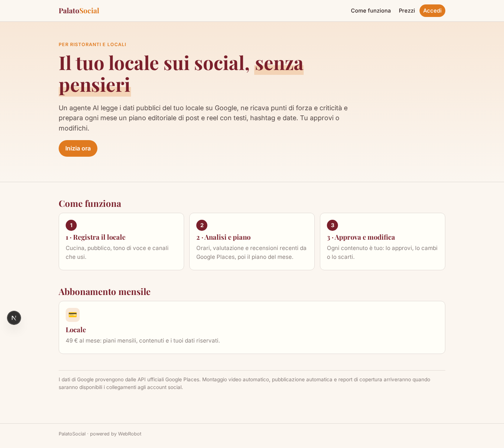
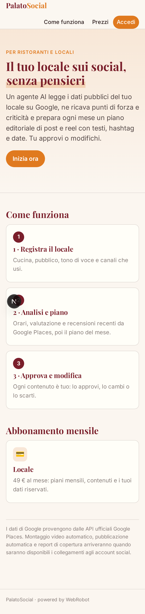
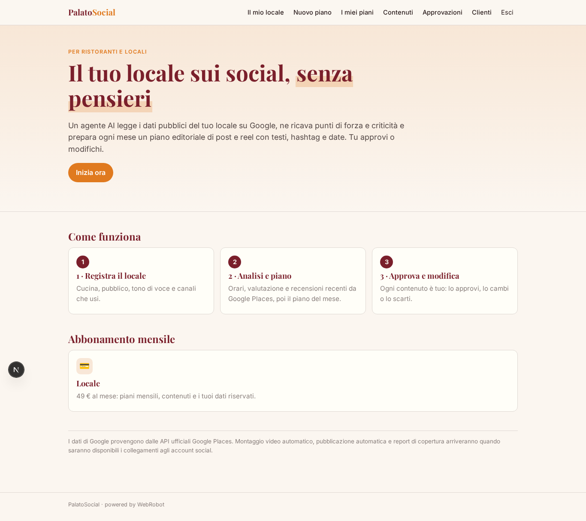
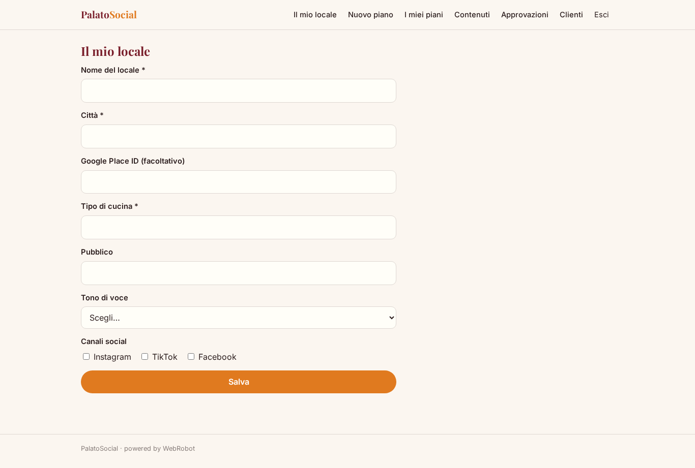
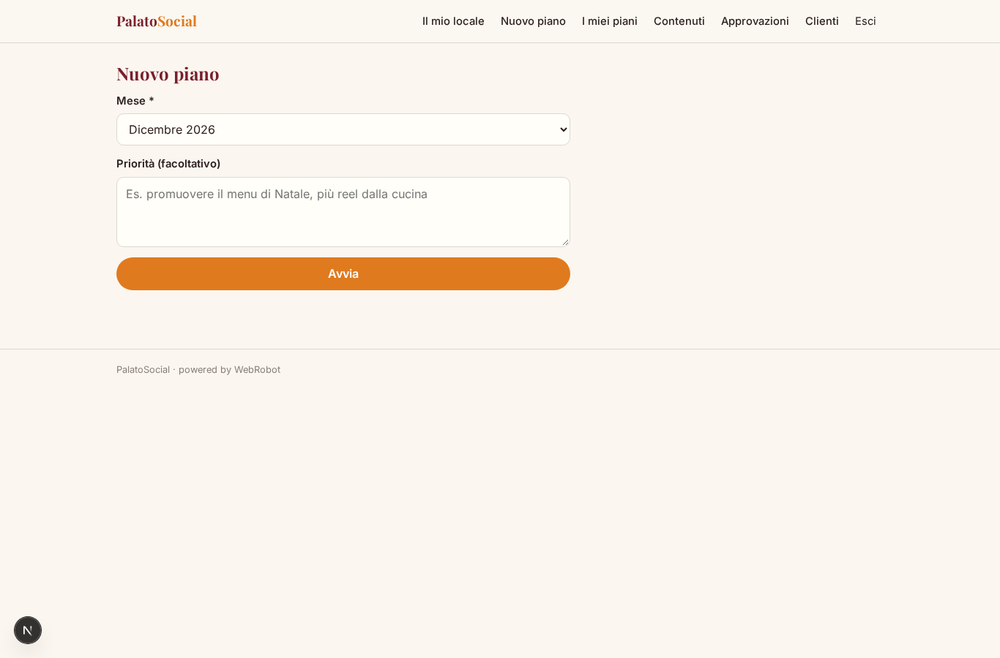
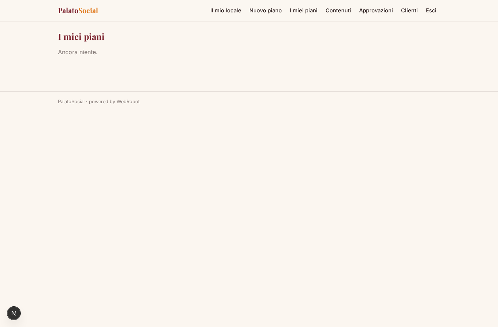
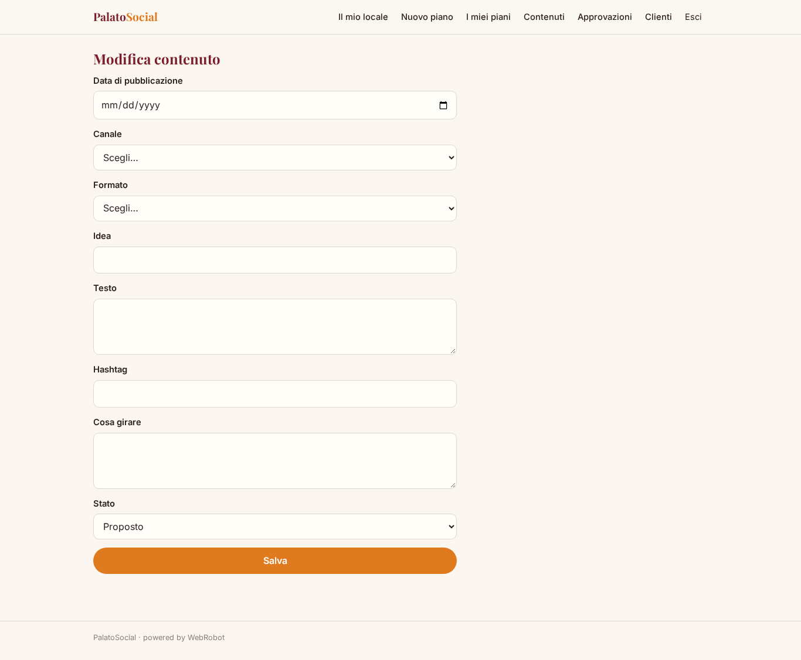
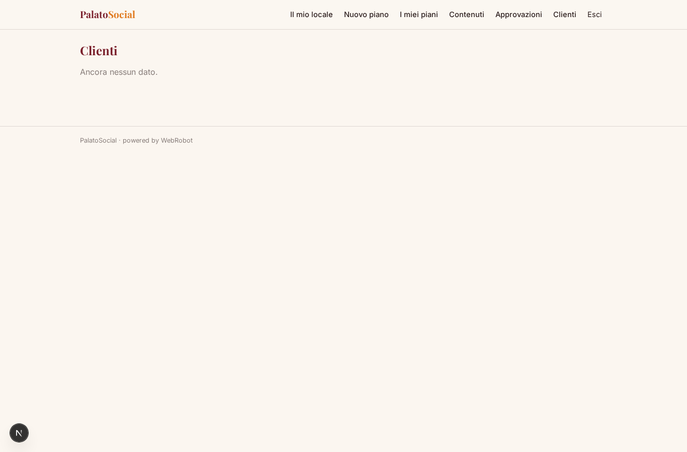
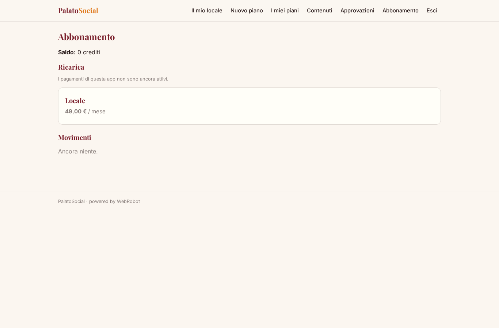

# PalatoSocial

_Il piano editoriale social del tuo locale, pronto ogni mese._

**Manifest:** valid (schema + runtime contract) · **Functional test:** passed (15 checks passed)

## Description given to the app builder (Italian)

PalatoSocial aiuta ristoranti e locali a gestire la propria presenza social con contenuti video e un piano editoriale. Il ristoratore registra il locale e indica tipo di cucina, pubblico, tono di voce e canali social usati. Un agente legge i dati pubblici del locale tramite le API ufficiali di Google Places (con licenza): orari, valutazione media, recensioni recenti, e ne ricava punti di forza e criticità. Poi prepara ogni mese un piano editoriale con idee di post e reel, testi, hashtag e date di pubblicazione, e lo propone al ristoratore, che approva o modifica ogni contenuto. Il ristoratore carica dall'app mobile brevi video girati in sala o in cucina, e vorrei che l'app li montasse automaticamente con sottotitoli e musica. I post approvati vengono pubblicati in automatico su Instagram, TikTok e Facebook collegando gli account. A fine mese arriva un report con copertura e interazioni. Ogni locale vede solo i propri contenuti, l'agenzia partner tutti i suoi clienti. Abbonamento mensile, in italiano.

## Features not expressible today (spec.extensions)

- **video_editing**: Montaggio automatico dei video caricati dall'app mobile con sottotitoli e musica: non disponibile (caricamento video e editing non supportati).
- **social_publishing**: Pubblicazione automatica su Instagram, TikTok e Facebook collegando gli account: non disponibile (richiede OAuth con i servizi Meta e TikTok).
- **monthly_metrics_report**: Report di fine mese con copertura e interazioni: richiede le API social collegate via OAuth, non ancora disponibili.
- **mobile_upload**: App mobile per caricare i video girati in sala o in cucina: non disponibile finché non è supportato il caricamento video.

## Screenshots (interpretive runtime, no data)

### home-anon

### home-mobile

### home

### venue

### new_plan

### plans

### posts_list

### post_edit

### approvals_view

### clients

### account

