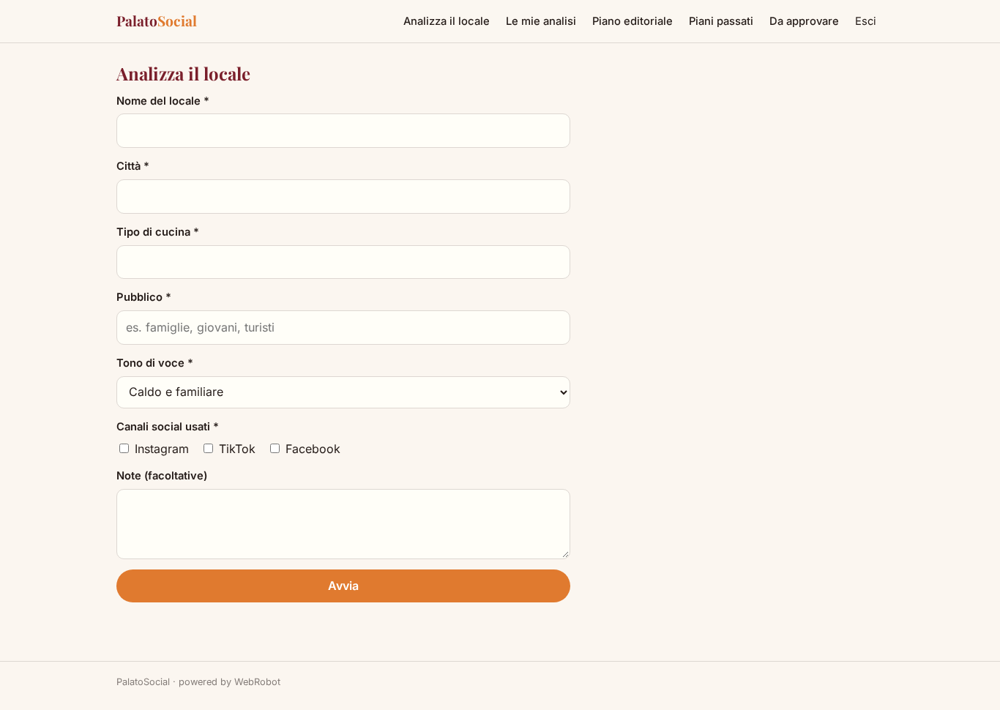
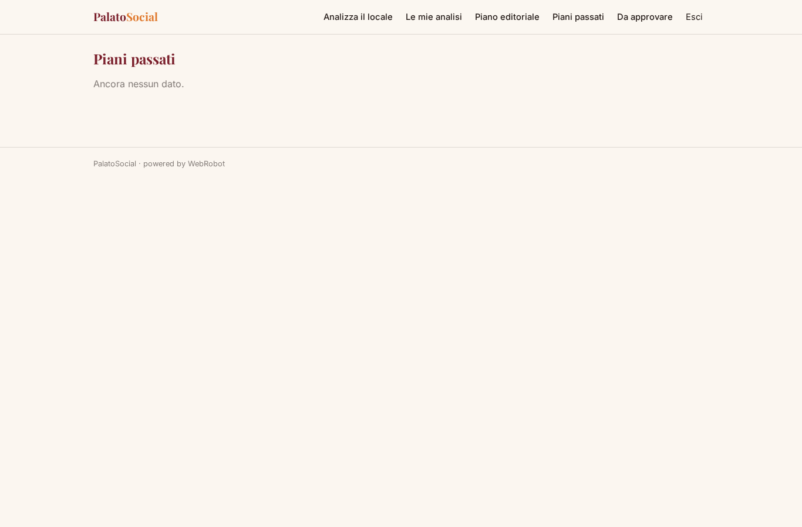
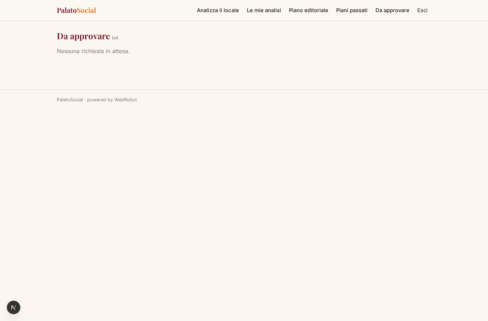
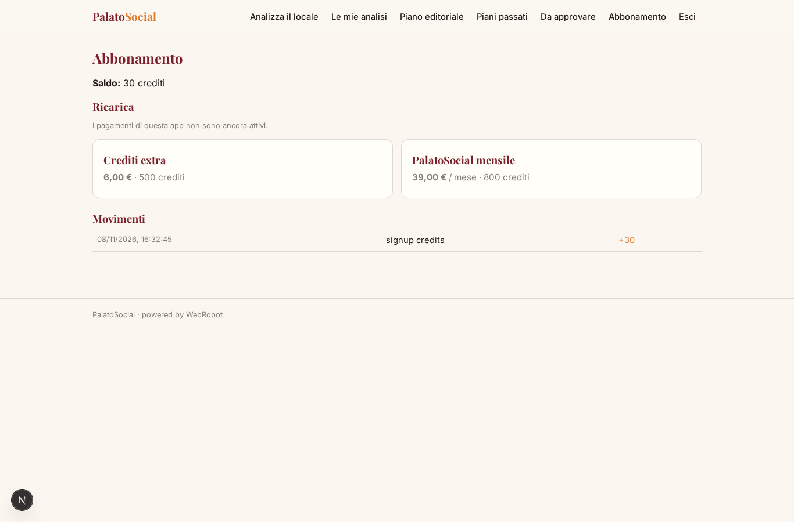

# PalatoSocial

_La presenza social del tuo locale, con un piano editoriale ogni mese._

**Manifest status:** valid (schema validator + runtime contract)

## Description given to the app builder (Italian)

PalatoSocial aiuta ristoranti e locali a gestire la propria presenza social con contenuti video e un piano editoriale. Il ristoratore registra il locale e indica tipo di cucina, pubblico, tono di voce e canali social usati. Un agente legge i dati pubblici del locale tramite le API ufficiali di Google Places (con licenza): orari, valutazione media, recensioni recenti, e ne ricava punti di forza e criticità. Poi prepara ogni mese un piano editoriale con idee di post e reel, testi, hashtag e date di pubblicazione, e lo propone al ristoratore, che approva o modifica ogni contenuto. Il ristoratore carica dall'app mobile brevi video girati in sala o in cucina, e vorrei che l'app li montasse automaticamente con sottotitoli e musica. I post approvati vengono pubblicati in automatico su Instagram, TikTok e Facebook collegando gli account. A fine mese arriva un report con copertura e interazioni. Ogni locale vede solo i propri contenuti, l'agenzia partner tutti i suoi clienti. Abbonamento mensile, in italiano.

## Features not expressible today (spec.extensions)

- **video_upload_edit**: Non disponibili: caricamento video dall'app mobile e montaggio automatico con sottotitoli e musica (nessun campo file). Per ora il piano indica cosa riprendere; i video si gestiscono fuori dall'app.
- **social_publishing**: Non disponibile: pubblicazione automatica su Instagram, TikTok e Facebook, che richiede il collegamento degli account di ogni cliente. Per ora i contenuti approvati si pubblicano a mano.
- **monthly_metrics_report**: Non disponibile: report di fine mese con copertura e interazioni, che richiede le statistiche degli account social collegati; anche la notifica del report via email manca.
- **agency_multi_client**: Il ruolo agenzia partner (su invito) esiste, ma vedere i contenuti di tutti i propri clienti non è esprimibile con le collezioni attuali senza esporre dati tra clienti: serve una funzione dedicata.
- **places_api_key**: Google Places richiede una chiave API, che non può stare nel manifest. Va configurata dal proprietario come credenziale lato piattaforma prima della pubblicazione.
- **edit_plan_items**: L'approvazione è sull'intero piano; la modifica del singolo contenuto non è ancora disponibile (si chiede una nuova versione all'agente).

## Screenshots (interpretive runtime)

### home-anon

### home-mobile

### home

### new_analysis

### analyses

### plans

### plan_archive

### to_approve

### account

