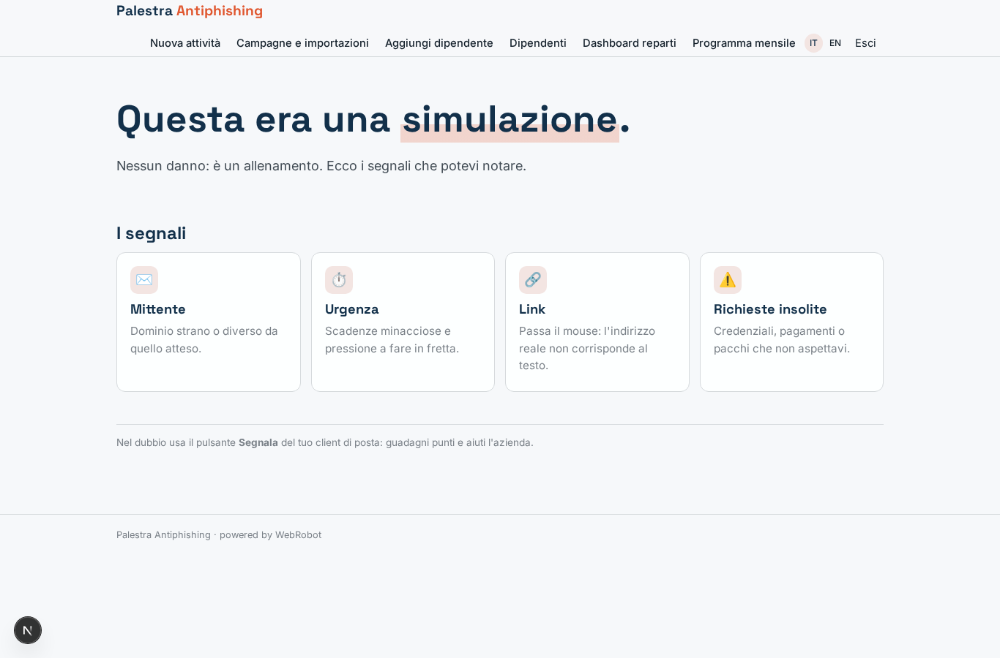
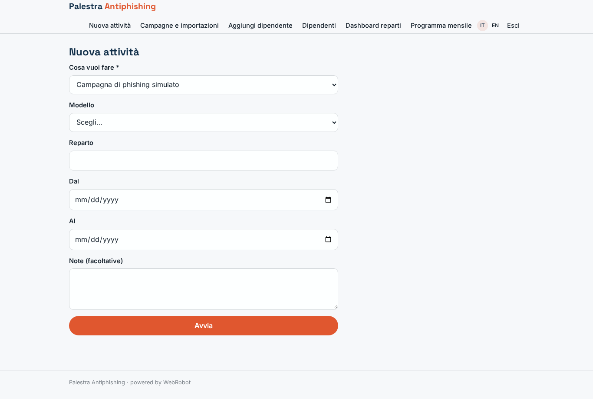
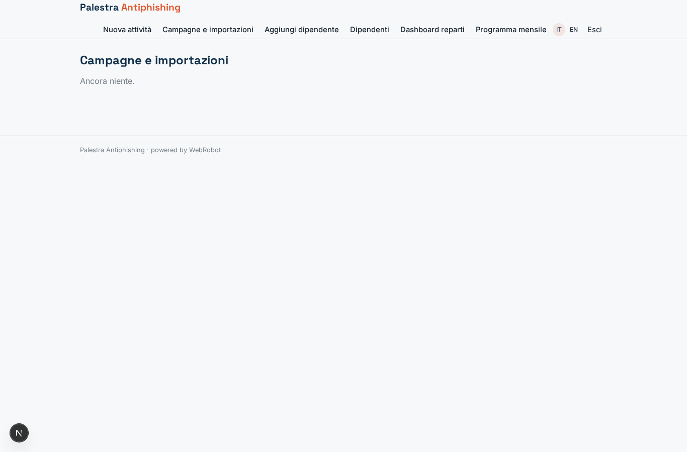
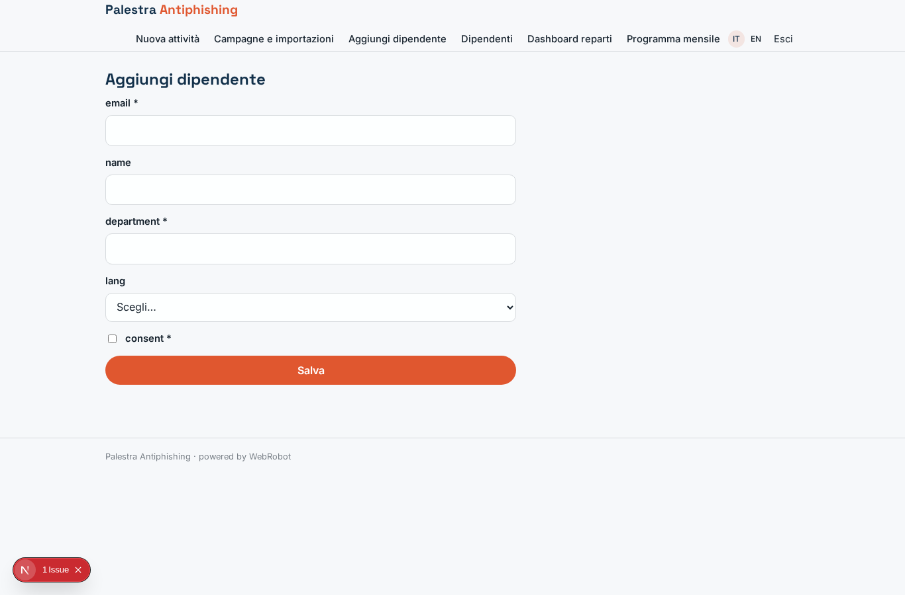
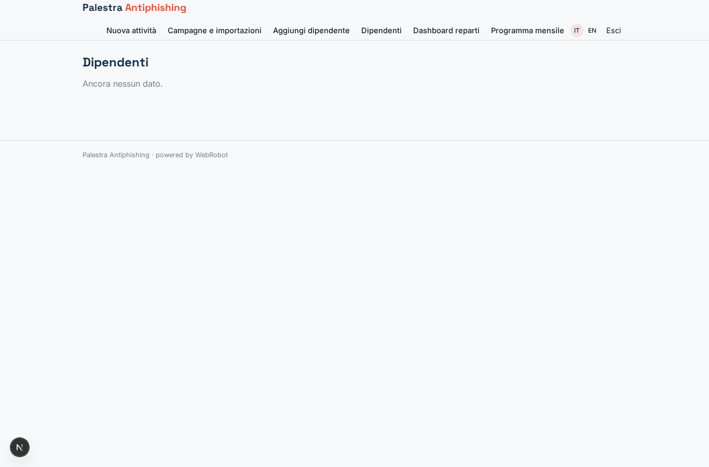
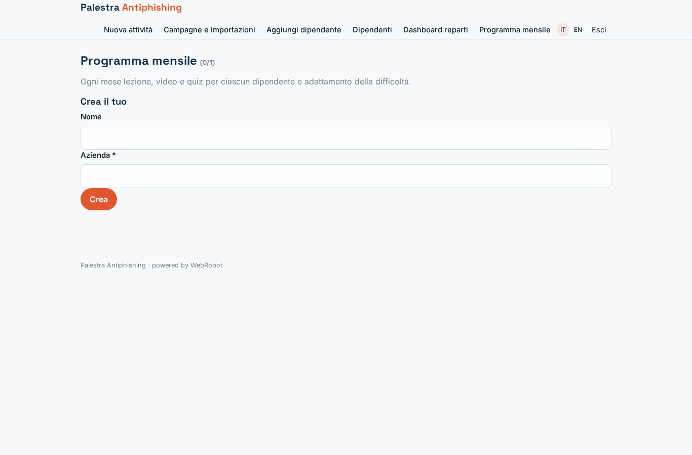
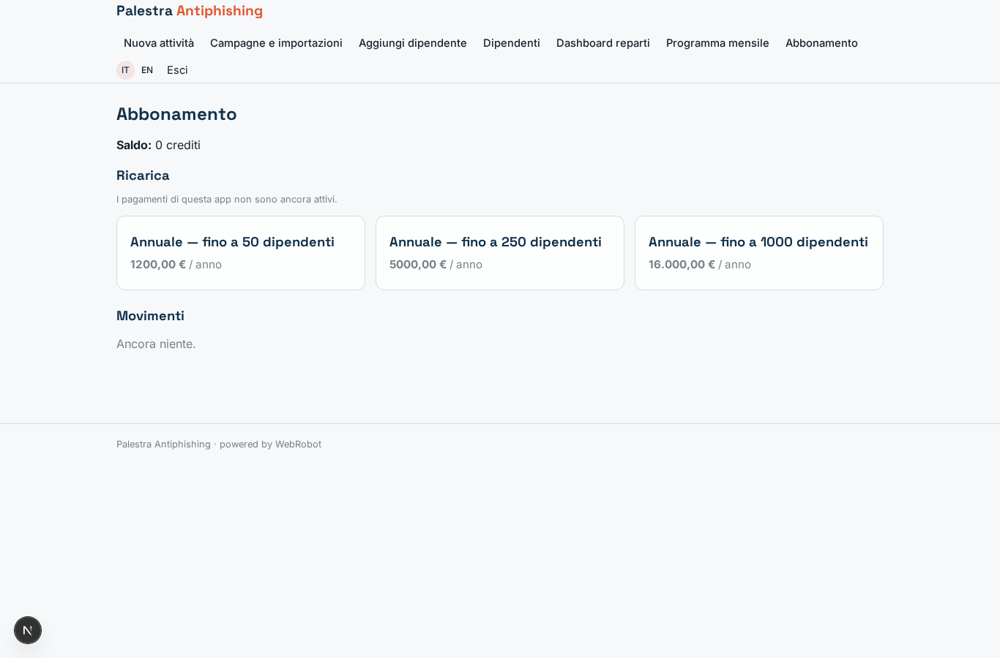

# Palestra Antiphishing

_Allena i dipendenti a riconoscere il phishing, un mese alla volta._

**Manifest:** valid (schema + runtime contract) · **Functional test:** passed (14 checks passed)

## Description given to the app builder (Italian)

Mi serve Palestra Antiphishing, una piattaforma di formazione alla sicurezza per i dipendenti di un'azienda. L'admin IT carica l'elenco dei dipendenti che hanno dato il consenso al programma, con reparto e lingua. Ogni mese ciascun dipendente riceve una breve lezione via email e una pillola video, poi un quiz. L'admin può creare campagne di phishing simulato: sceglie un modello (finta fattura, reset password, pacco in consegna), un reparto e una finestra temporale, e un agente personalizza i messaggi e li invia in orari casuali. L'invio deve partire da un dominio dedicato con la configurazione giusta perché le email arrivino in casella. Quando un dipendente clicca il link, un webhook registra l'evento e lo porta subito a una pagina formativa che spiega quali segnali doveva notare; se invece segnala l'email al pulsante di report, guadagna punti. Un agente adatta la difficoltà delle campagne successive al livello di ognuno. L'admin vede una dashboard con tasso di clic e segnalazioni per reparto, mai classifiche nominative pubbliche. Abbonamento annuale per dipendente.

## Features not expressible today (spec.extensions)

- **dedicated_sending_domain**: Sending simulated phishing from a dedicated domain with SPF, DKIM and DMARC configured so mail reaches the inbox (and allowlisting by the customer's IT) is not available: the platform sends plain-text emails from its own sender.
- **click_redirect_and_report_button**: The webhook records the event but cannot redirect the employee to the 'trained' page, nor generate per-message tracking links ({LINK}) or receive the mail-client Report button; this needs a small external redirector/add-in that POSTs {employee_email, department, campaign, type} to /api/hooks/phish_event. The webhook payload must also identify the company (record owner).
- **random_send_time**: Sends are random per day inside the window; random time of day is not available (fixed hour).
- **employee_quiz**: Employees do not sign in, so the quiz is included in the lesson email text; collecting their answers needs identity without an account (not available).
- **per_employee_pricing**: Annual subscription is tiered by employee count (plans + create:employees quota), not billed per single seat.

## Screenshots (interpretive runtime, no data)

### home-anon

### home-mobile

### home

### trained

### new

### activities

### add_employee

### employees

### dashboard

### program

### account

