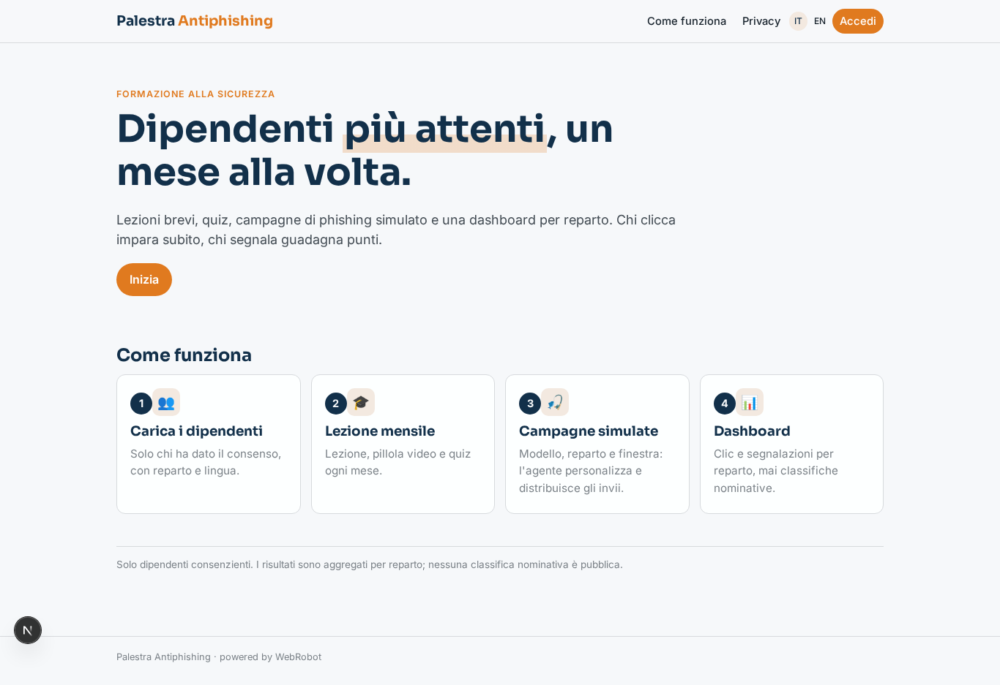
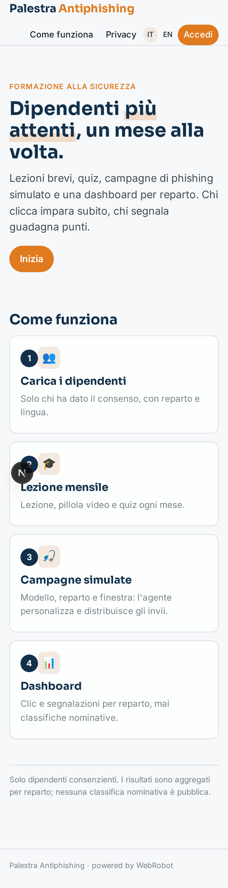
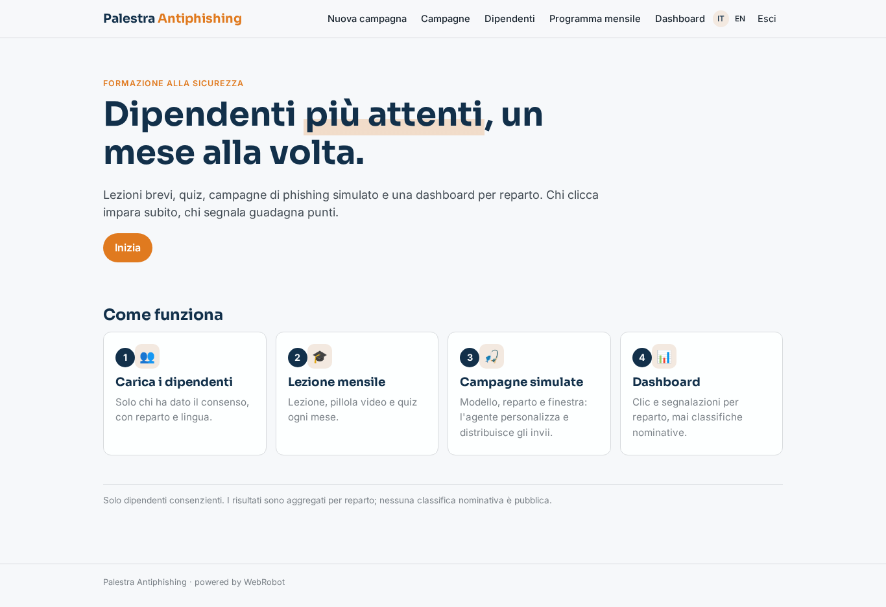
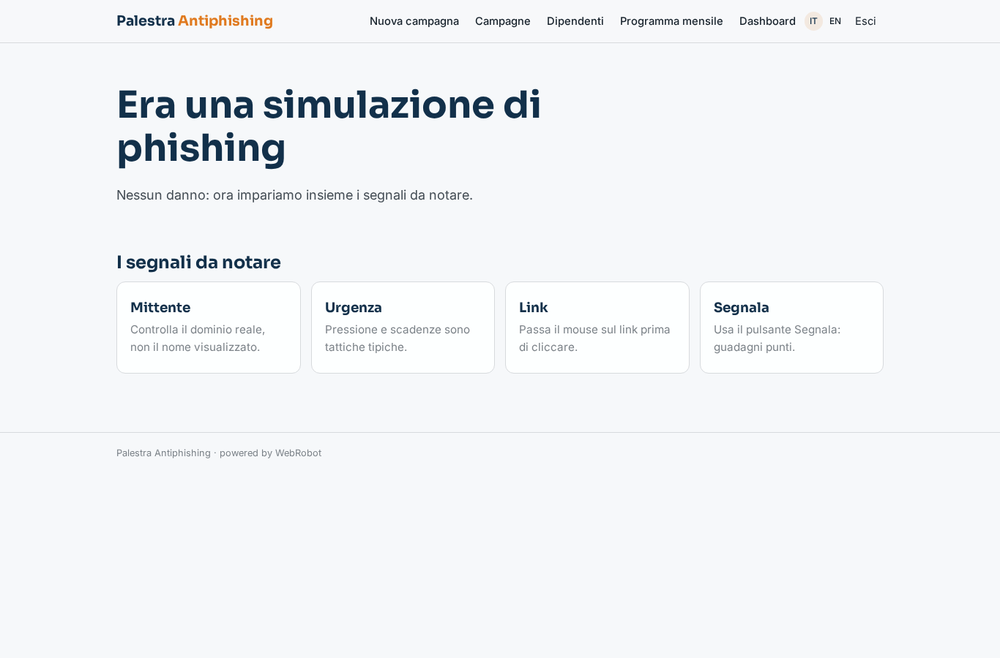
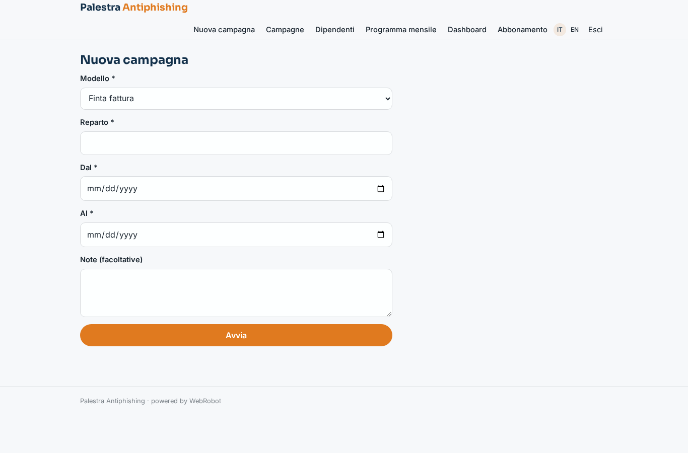
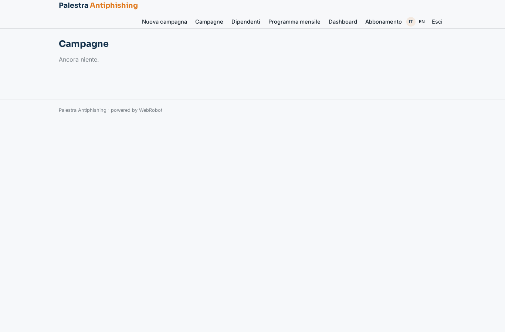
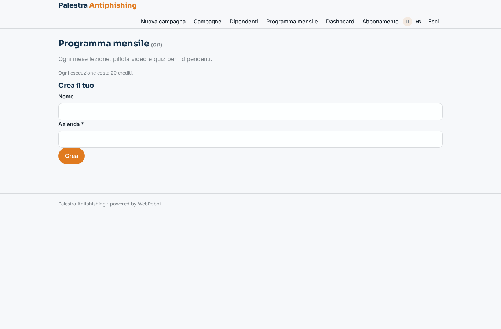
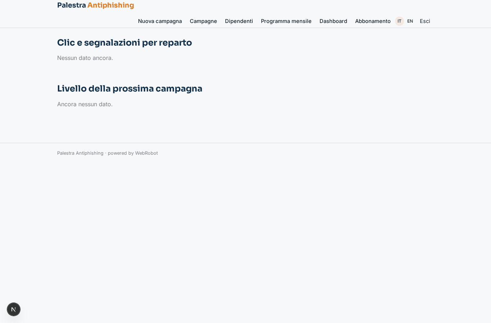
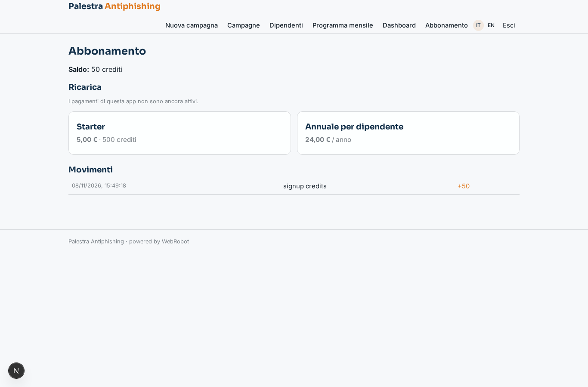

# Palestra Antiphishing

_Allena i dipendenti a riconoscere il phishing, un mese alla volta._

**Stato manifest:** valido (validatore Python + contratto runtime)

## Descrizione data all'app builder

Mi serve Palestra Antiphishing, una piattaforma di formazione alla sicurezza per i dipendenti di un'azienda. L'admin IT carica l'elenco dei dipendenti che hanno dato il consenso al programma, con reparto e lingua. Ogni mese ciascun dipendente riceve una breve lezione via email e una pillola video, poi un quiz. L'admin può creare campagne di phishing simulato: sceglie un modello (finta fattura, reset password, pacco in consegna), un reparto e una finestra temporale, e un agente personalizza i messaggi e li invia in orari casuali. L'invio deve partire da un dominio dedicato con la configurazione giusta perché le email arrivino in casella. Quando un dipendente clicca il link, un webhook registra l'evento e lo porta subito a una pagina formativa che spiega quali segnali doveva notare; se invece segnala l'email al pulsante di report, guadagna punti. Un agente adatta la difficoltà delle campagne successive al livello di ognuno. L'admin vede una dashboard con tasso di clic e segnalazioni per reparto, mai classifiche nominative pubbliche. Abbonamento annuale per dipendente.

## Funzioni non esprimibili oggi (spec.extensions)

- **employee_upload**: File upload is not available yet: the IT admin pastes the consenting employees (email, department, language) as text or adds them one by one; a CSV file import is missing.
- **email_delivery**: Sending emails (monthly lessons, simulated phishing at random times) is not available yet. Missing: outbound email channel from a dedicated domain with SPF, DKIM, DMARC set up and warmed up, so mail reaches the inbox.
- **tracking_and_report_button**: Per-employee tracking links with a webhook (POST /api/hooks/phish_event) and the Report button add-in for the mail client need to be wired by the owner; the webhook then redirects the clicker to the learn page.
- **per_seat_billing**: The yearly plan is priced per employee; quantity-based seats are not yet expressible in the plan.
- **video_pills**: Video pills are delivered as scripts and links; hosting and generating video is not available.

## Screenshot (runtime interpretativo)

### home-anon

### home-mobile

### home

### learn

### new_campaign

### campaigns

### employees_list

### program

### dashboard

### account

