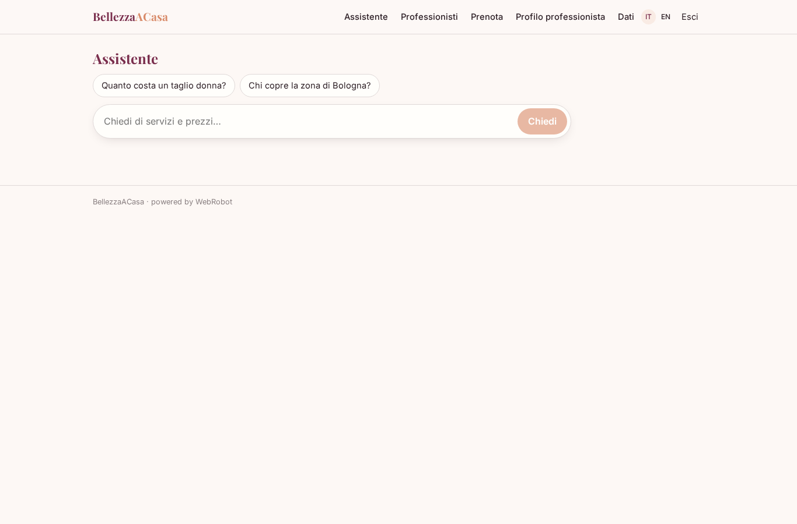
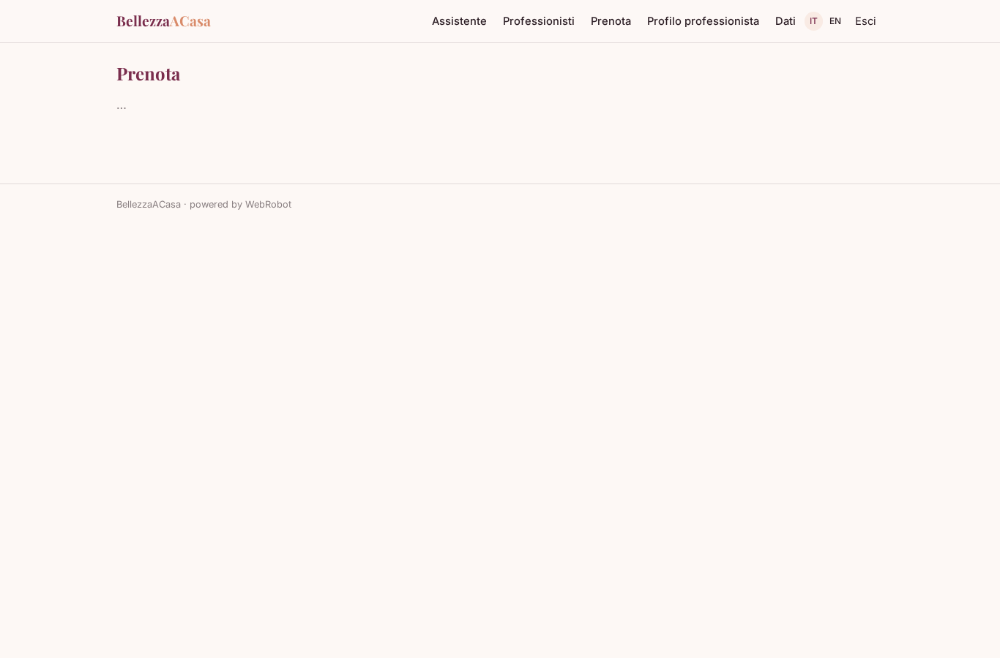
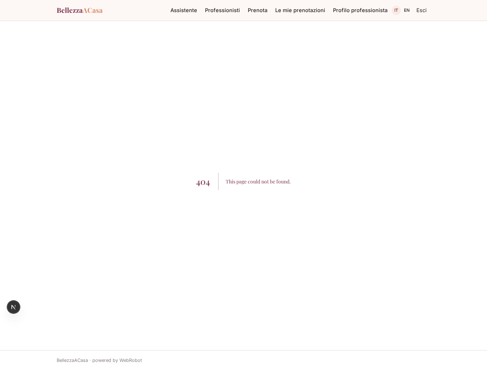
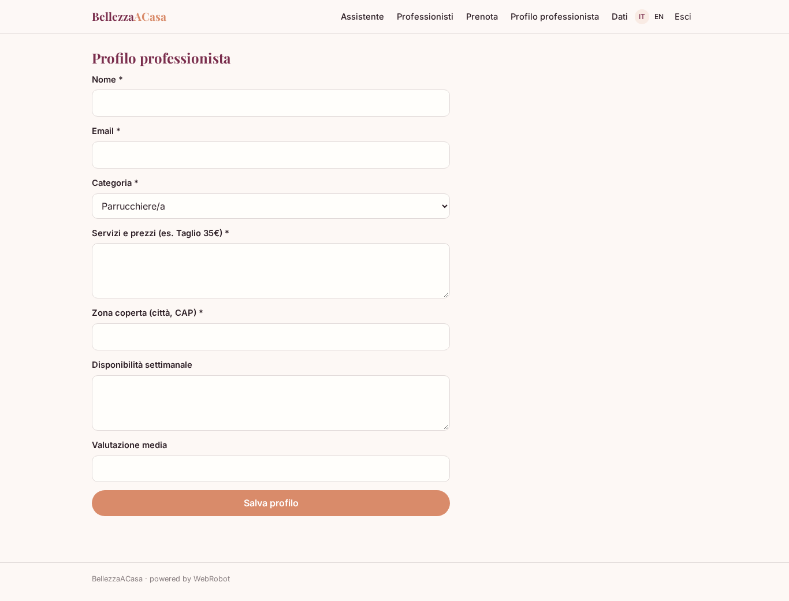
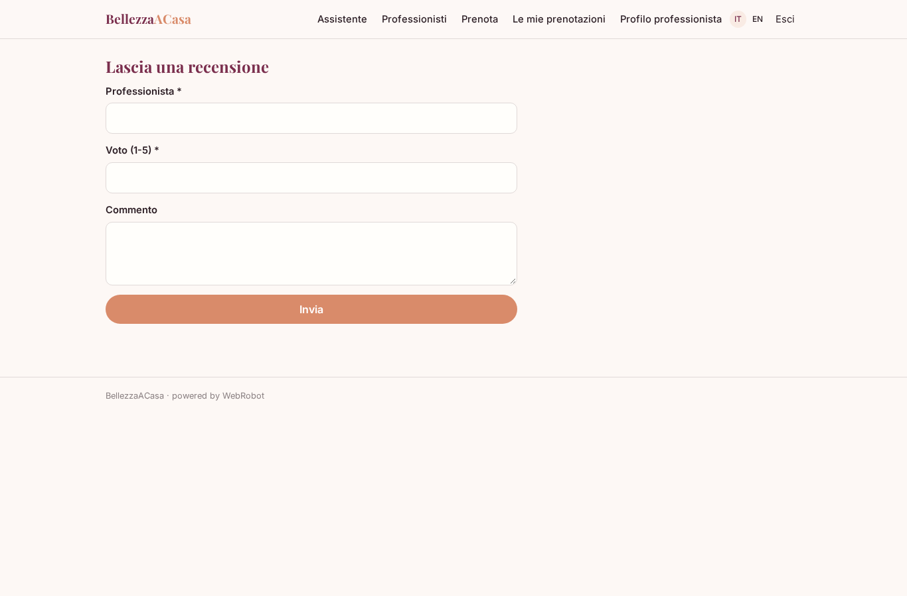

# BellezzaACasa

_Parrucchieri ed estetiste a casa tua, prenotati in un minuto._

**Manifest:** valid (schema + runtime contract) · **Functional test:** 2 failure(s) (9 checks passed)

## Description given to the app builder (Italian)

Vorrei BellezzaACasa, un servizio per prenotare parrucchieri ed estetiste a domicilio. Il professionista si registra, indica servizi, prezzi, zona coperta e disponibilità settimanale. Il cliente sceglie servizio, indirizzo e fascia oraria e vede i professionisti disponibili con valutazioni. Prenota e paga con carta; il professionista riceve la richiesta e la conferma. Dopo l'appuntamento il cliente riceve un'email per lasciare una recensione. Un agente risponde in chat alle domande dei clienti su servizi e prezzi. Il professionista vede solo i propri appuntamenti, il cliente le proprie prenotazioni. Commissione sulla prenotazione.

## Functional test: what did not pass

- **form saves a record** (form pro_profile): 403 only the app's admins add to this collection (as user)
- **form saves a record** (form review): 403 only the app's admins add to this collection (as user)

## Design checks (who fills each collection)

- view pro_profile: a form for everyone cannot add to professionals, a shared collection only the admins fill — set roles: [admin] (or drop the form: admins have the data page), or own the records by user
- view review: roles user cannot add to reviews, a shared collection only the admins fill — keep roles: [admin], or own the records by user

## Features not expressible today (spec.extensions)

- **card_payment_per_booking**: Card payment at booking split to each professional's Stripe Connect account (per_transaction) needs each professional to connect Stripe; the studio owner connects the platform account.
- **pro_confirmation_and_zone_match**: Professional's explicit confirmation of a request, matching the customer's address to the professional's covered area, and the average rating being updated from reviews are not expressible yet; professional email is assumed to be the booking resource id.
- **review_email_only_for_booked**: The review reminder email cannot be filtered by booking status (on.date has no where), so it is also sent for cancelled bookings.

## Screenshots (interpretive runtime, no data)

### home-anon

### home-mobile

### home

### chat

### professionals

### book

### my_bookings

### agenda

### pro_profile

### review

