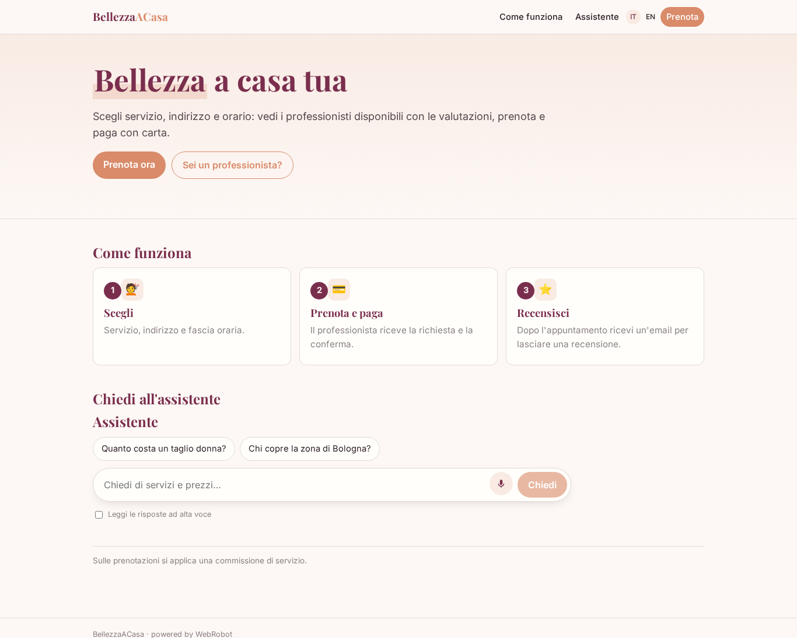
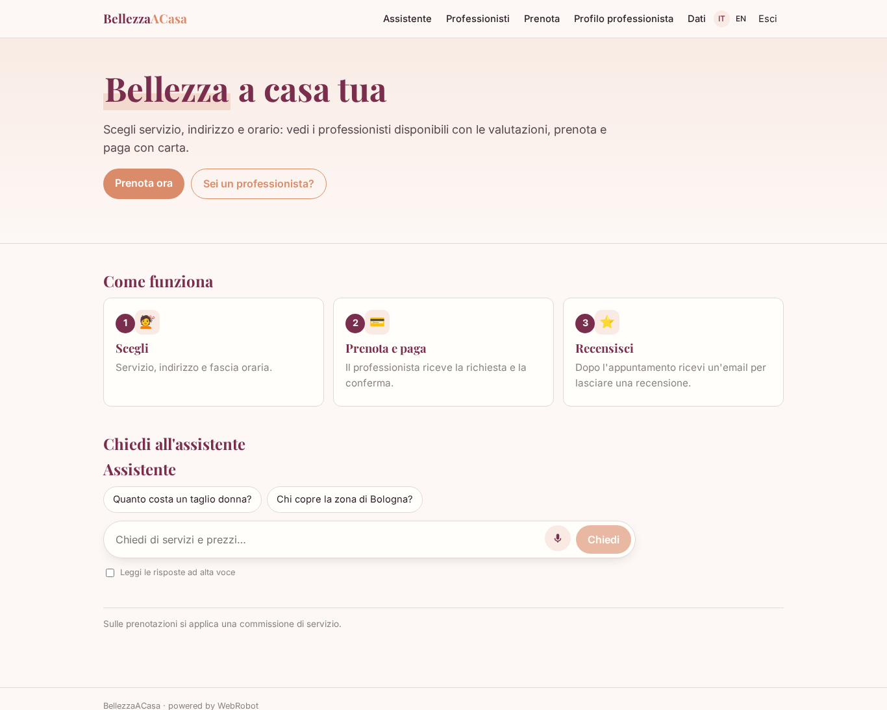
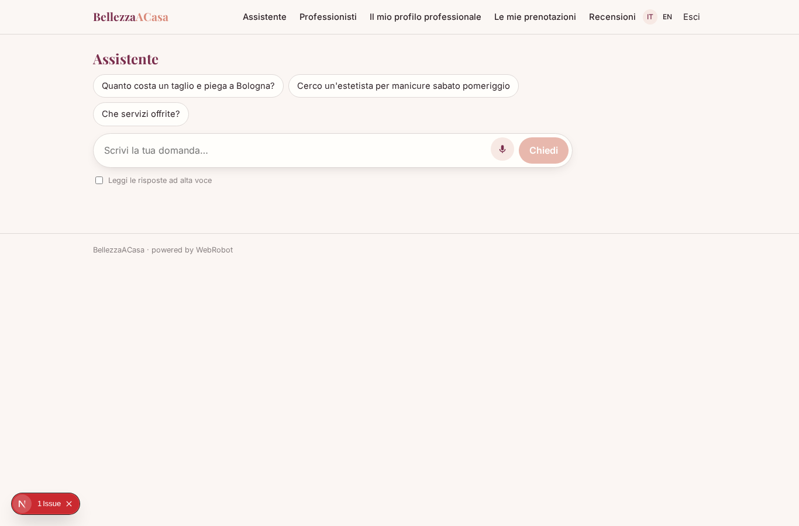
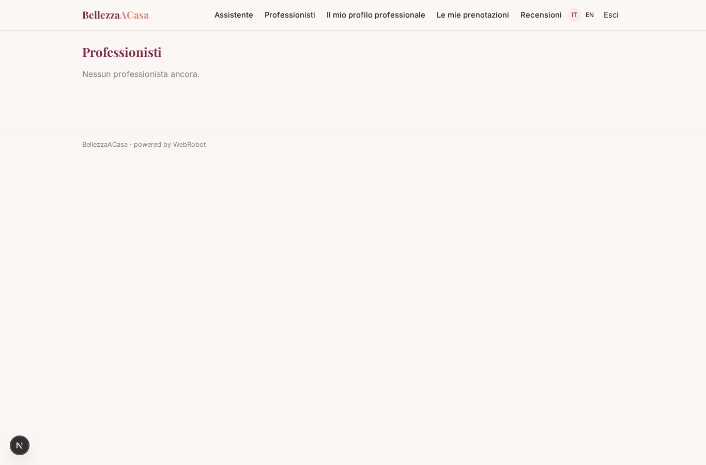
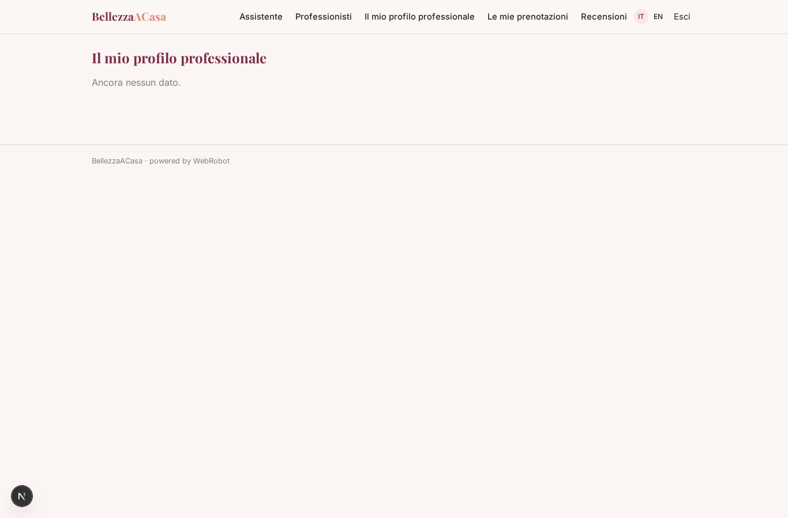
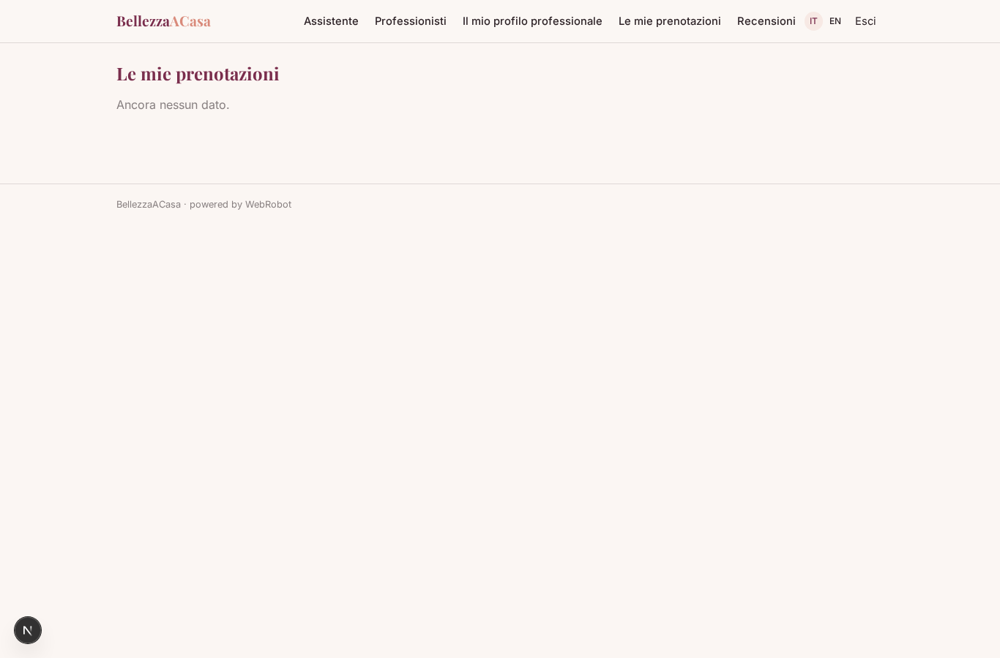
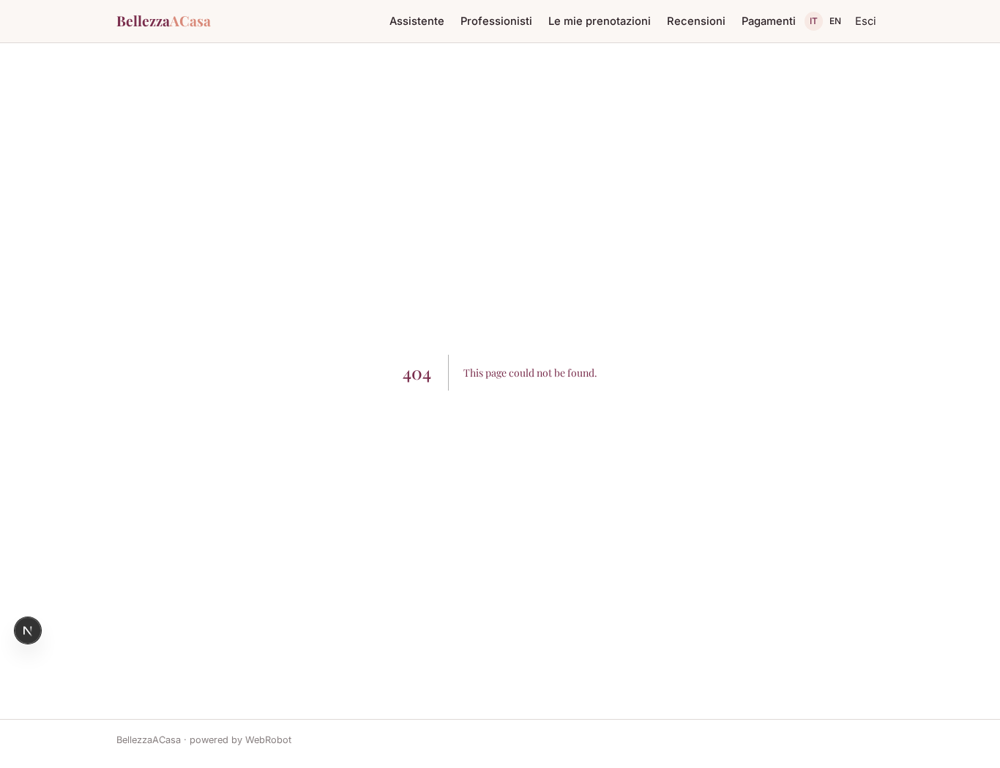
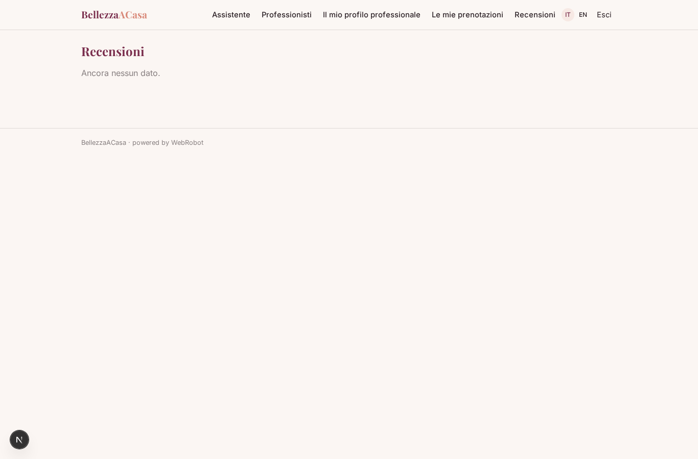
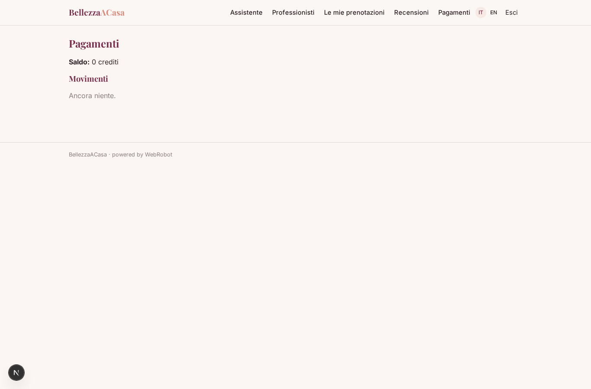

# BellezzaACasa

_Parrucchieri ed estetiste a domicilio, prenotati in un minuto._

**Manifest status:** valid (schema validator + runtime contract)

## Description given to the app builder (Italian)

Vorrei BellezzaACasa, un servizio per prenotare parrucchieri ed estetiste a domicilio. Il professionista si registra, indica servizi, prezzi, zona coperta e disponibilità settimanale. Il cliente sceglie servizio, indirizzo e fascia oraria e vede i professionisti disponibili con valutazioni. Prenota e paga con carta; il professionista riceve la richiesta e la conferma. Dopo l'appuntamento il cliente riceve un'email per lasciare una recensione. Un agente risponde in chat alle domande dei clienti su servizi e prezzi. Il professionista vede solo i propri appuntamenti, il cliente le proprie prenotazioni. Commissione sulla prenotazione.

## Features not expressible today (spec.extensions)

- **pro_self_registration**: Il professionista crea e modifica solo il proprio profilo nel catalogo condiviso 'professionals' (scrittura limitata al proprio record) e vede come invitato solo le prenotazioni a lui assegnate: richiede una regola di scrittura per record non ancora generica nel manifest.
- **booking_payment_flow**: Pagamento con carta della singola prenotazione via Stripe Connect sul conto del professionista, con commissione; richiede che ogni professionista colleghi il proprio Stripe.
- **review_email**: Email al cliente dopo l'appuntamento con il link per la recensione: le notifiche email non sono ancora disponibili. Per ora il cliente trova 'Recensioni' nel menu.
- **availability_matching**: Il match automatico tra fascia oraria richiesta e disponibilità settimanale è fatto dall'agente leggendo il testo della disponibilità; un calendario strutturato è un'estensione futura.

## Screenshots (interpretive runtime)

### home-anon

### home-mobile

### home

### assistant

### professionals

### my_profile

### my_bookings

### requests

### my_reviews

### account

