# Passo Avanti Studio

_Dal piano di studio all'esame: tutor AI, quiz e progressi, passo dopo passo._

**Manifest:** valid (schema + runtime contract) · **Functional test:** passed (27 checks passed)

## Description given to the app builder (Italian)

Voglio creare Passo Avanti Studio, una piattaforma di preparazione per studenti delle superiori, test d'ingresso universitari e concorsi pubblici. Lo studente si registra, sceglie l'obiettivo (recupero di una materia, test di medicina, concorso per insegnanti o per enti pubblici), indica la data dell'esame, le ore disponibili a settimana e il livello di partenza. Un agente costruisce un piano di studio settimanale basato sui programmi ministeriali del MIM e sui bandi del MUR e dei concorsi. Un tutor in chat spiega gli argomenti passo per passo, usando la base di conoscenza dei contenuti didattici caricati dalla redazione. Ogni settimana l'app genera quiz a risposta multipla e simulazioni d'esame cronometrate, corregge, registra i punteggi per argomento e riadatta il piano. Lo studente vede una dashboard dei progressi; i genitori di uno studente minorenne possono avere un accesso di sola lettura; i docenti della redazione possono rivedere le domande segnalate come sbagliate. Le lezioni dal vivo con insegnanti reali fanno parte dell'offerta e vanno prenotate in calendario, anche se per ora sono fuori dall'app. Si paga a crediti per le ore di tutor, con abbonamento mensile.

## Functional test: what did not pass

- **trigger has its effect** (trigger question_reported): email to role:teacher: no such recipient in the test (role nobody holds or empty field) _(warning)_

## Features not expressible today (spec.extensions)

- **live_lessons_booking**: Le lezioni dal vivo con insegnanti reali vanno prenotate in calendario ma per ora restano fuori dall'app; si può aggiungere in seguito una vista di tipo booking con i docenti come risorse.
- **timed_exam_simulation**: Il cronometro delle simulazioni d'esame non è disponibile: il tutor ricorda il tempo massimo e lo studente si cronometra da sé.
- **minor_parent_consent**: Verifica del consenso del genitore per i minorenni (GDPR) da gestire fuori dall'app; l'accesso del genitore è assegnato dall'email indicata nel profilo.

## Screenshots (interpretive runtime, no data)

### home-anon

### home-mobile

### home

### profile
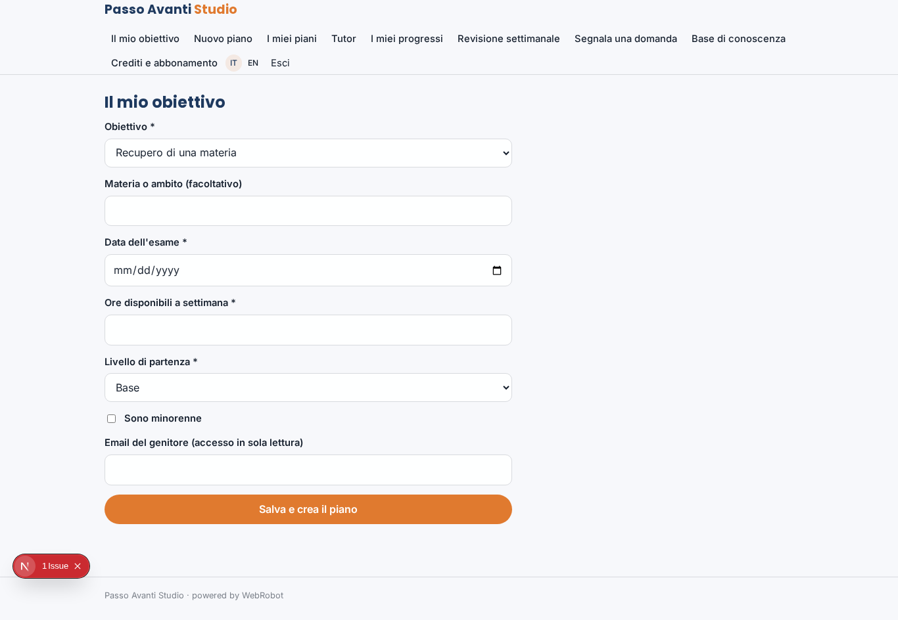

### new_plan
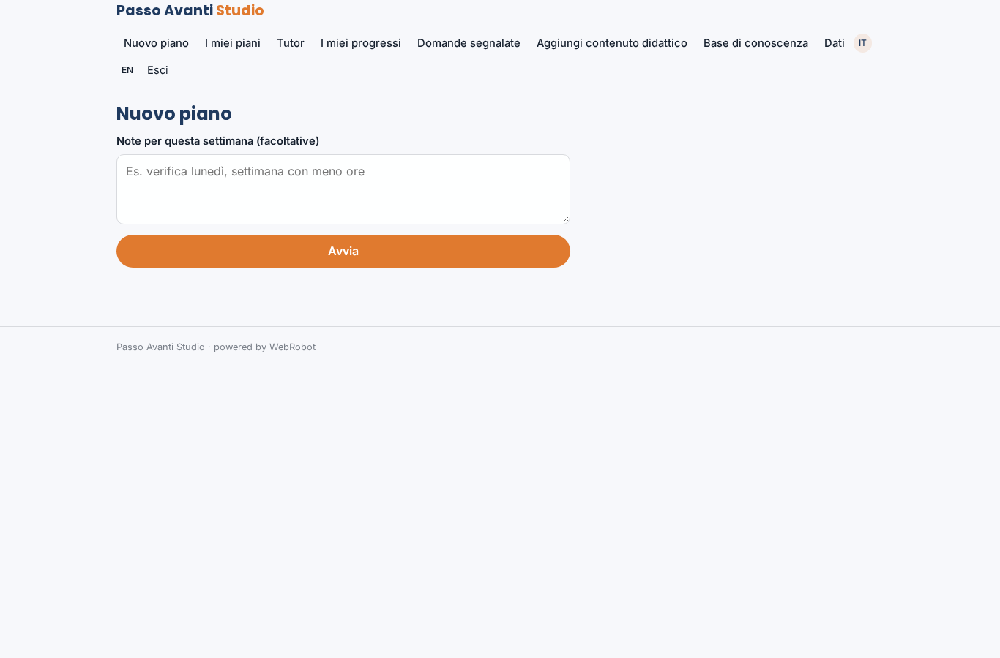

### plans
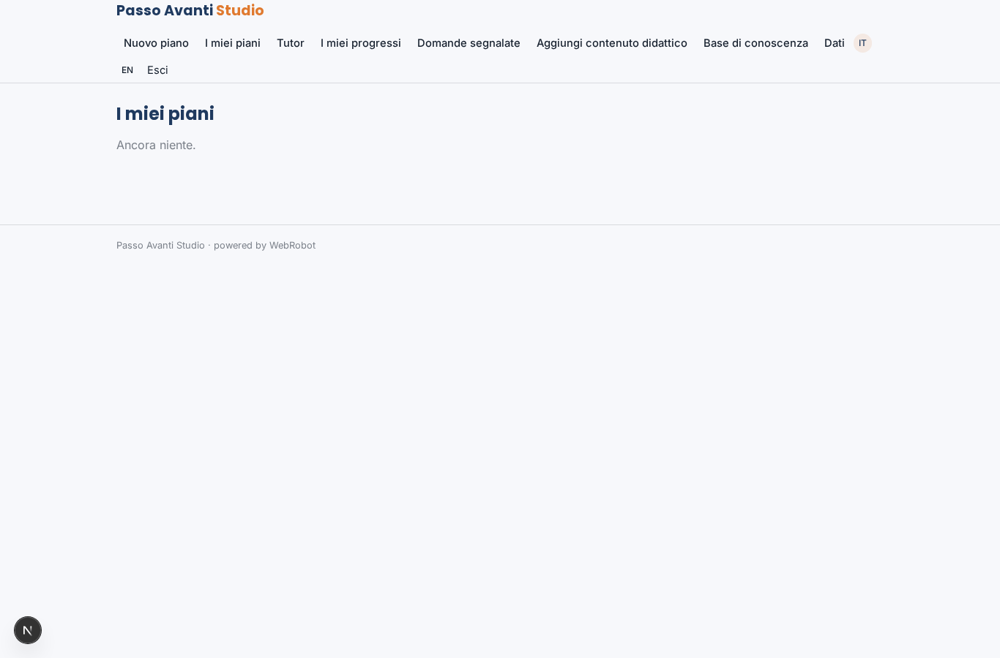

### tutor_chat
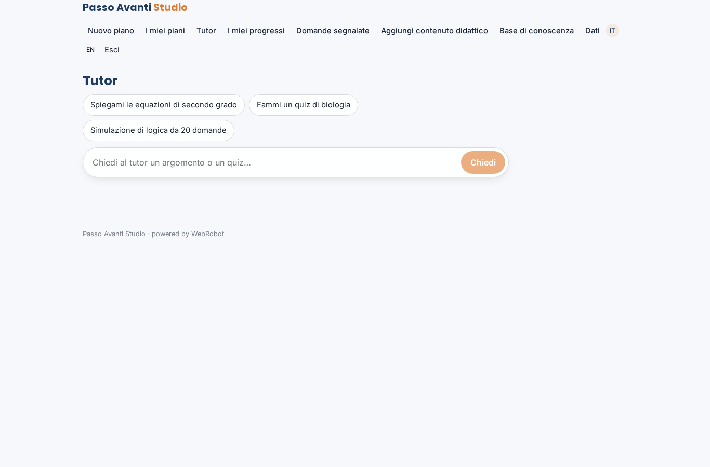

### progress

### weekly
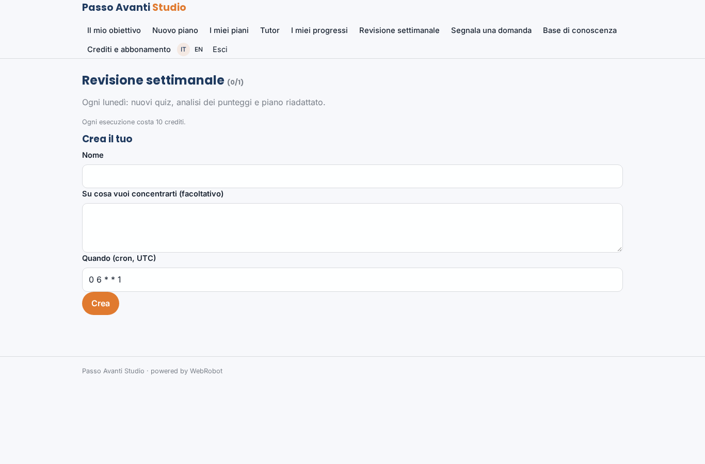

### family
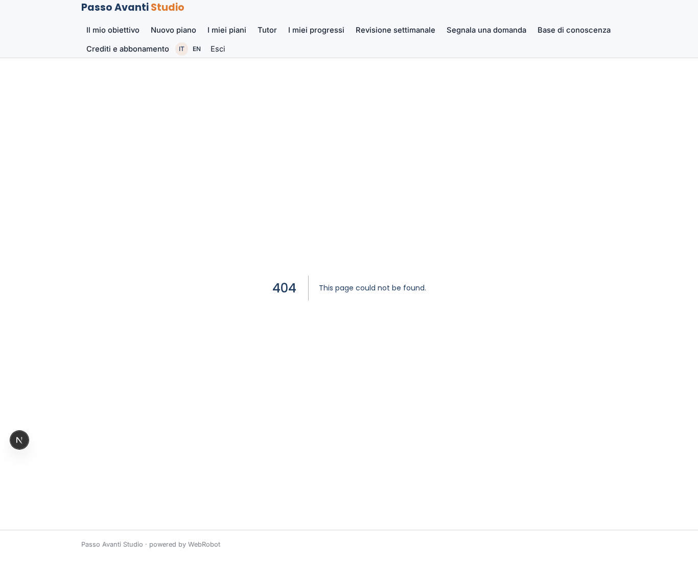

### report_form
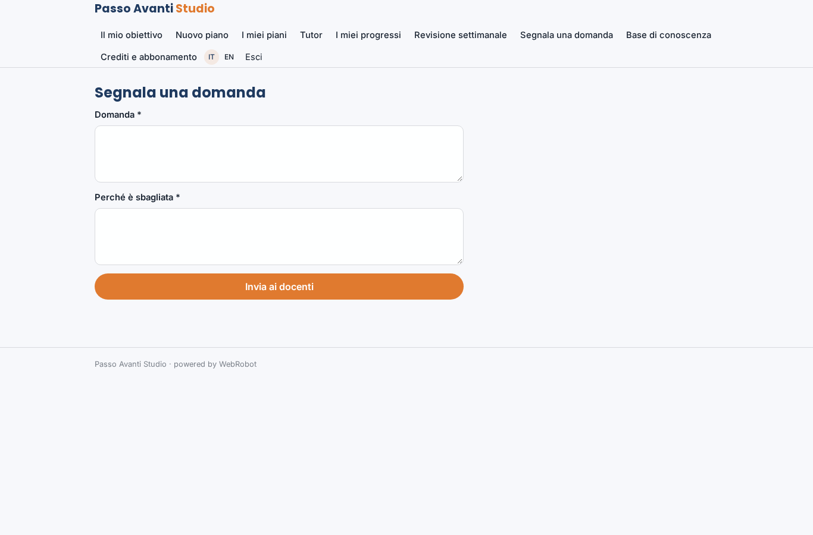

### review
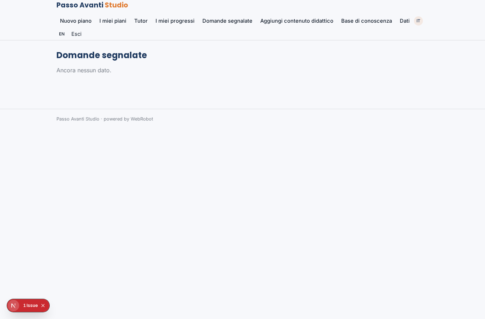

### review_edit
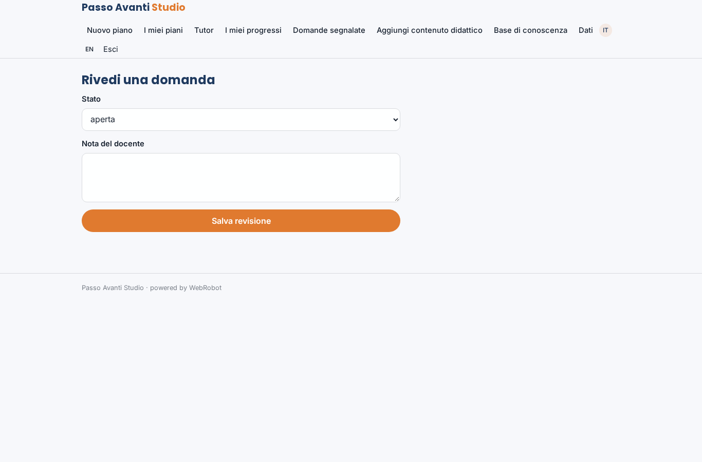

### kb_add
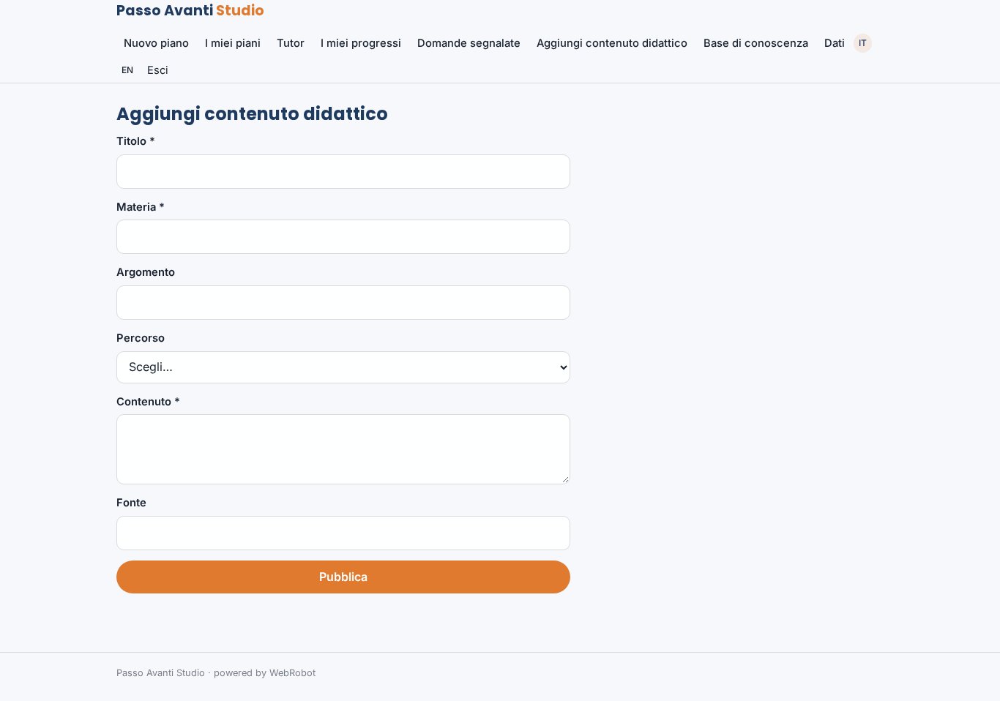

### kb_list
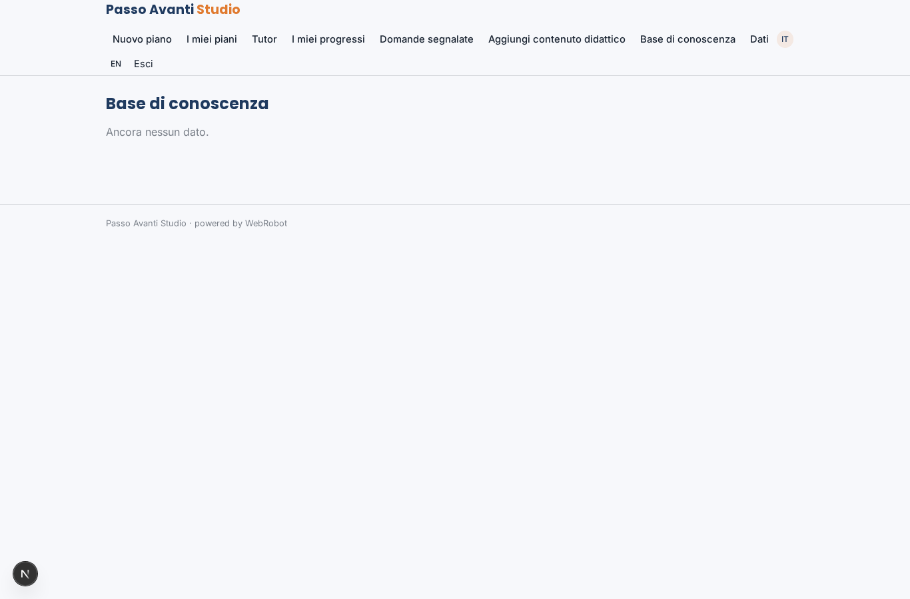

### account
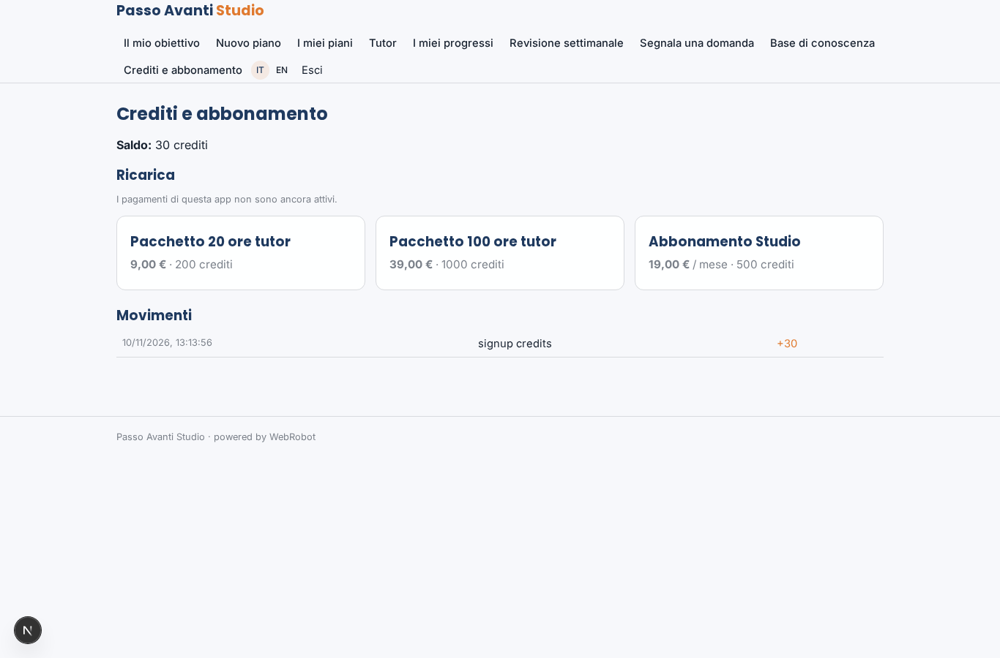
