# Passo Avanti Studio

_Il tuo piano di studio, il tuo tutor, i tuoi progressi._

**Stato manifest:** valido (validatore Python + contratto runtime)

## Descrizione data all'app builder

Voglio creare Passo Avanti Studio, una piattaforma di preparazione per studenti delle superiori, test d'ingresso universitari e concorsi pubblici. Lo studente si registra, sceglie l'obiettivo (recupero di una materia, test di medicina, concorso per insegnanti o per enti pubblici), indica la data dell'esame, le ore disponibili a settimana e il livello di partenza. Un agente costruisce un piano di studio settimanale basato sui programmi ministeriali del MIM e sui bandi del MUR e dei concorsi. Un tutor in chat spiega gli argomenti passo per passo, usando la base di conoscenza dei contenuti didattici caricati dalla redazione. Ogni settimana l'app genera quiz a risposta multipla e simulazioni d'esame cronometrate, corregge, registra i punteggi per argomento e riadatta il piano. Lo studente vede una dashboard dei progressi; i genitori di uno studente minorenne possono avere un accesso di sola lettura; i docenti della redazione possono rivedere le domande segnalate come sbagliate. Le lezioni dal vivo con insegnanti reali fanno parte dell'offerta e vanno prenotate in calendario, anche se per ora sono fuori dall'app. Si paga a crediti per le ore di tutor, con abbonamento mensile.

## Funzioni non esprimibili oggi (spec.extensions)

- **live_lessons**: Live lessons with real teachers and calendar booking are not in the app yet; handled outside it.
- **parent_access**: Read-only parent access relies on per-record viewer sharing and the guardians collection; a dedicated invitation flow and age check for minors are not available yet.
- **timed_mock_exam**: Mock exams state a recommended time but the app has no countdown timer or interactive quiz answering; answers are pasted into the grading form.
- **editorial_upload**: Editors add lessons as text records; uploading files (PDF, slides) is not available yet.
- **notifications**: No email reminders for weekly quizzes or exam dates yet.

## Screenshot (runtime interpretativo)

### home-anon
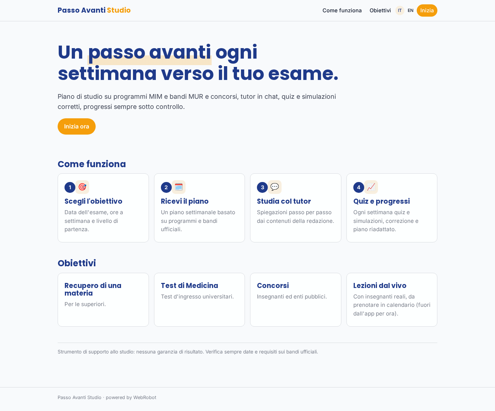

### home-mobile
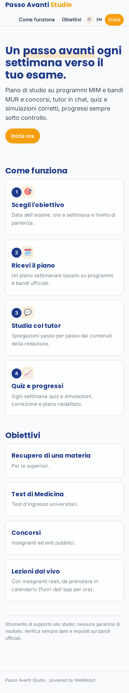

### home
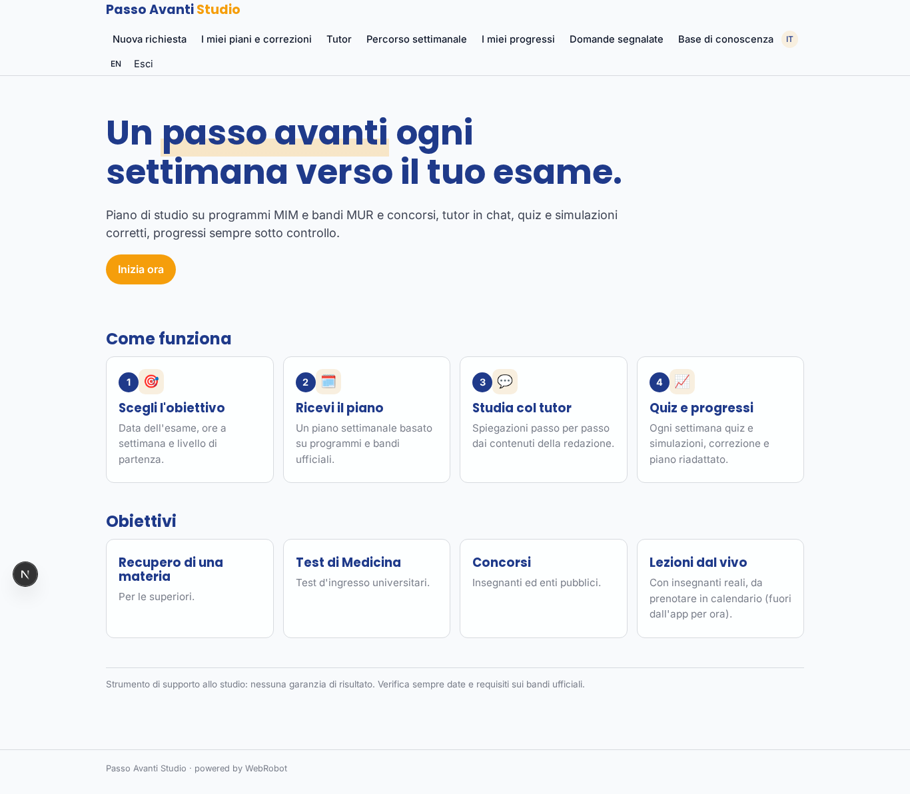

### new
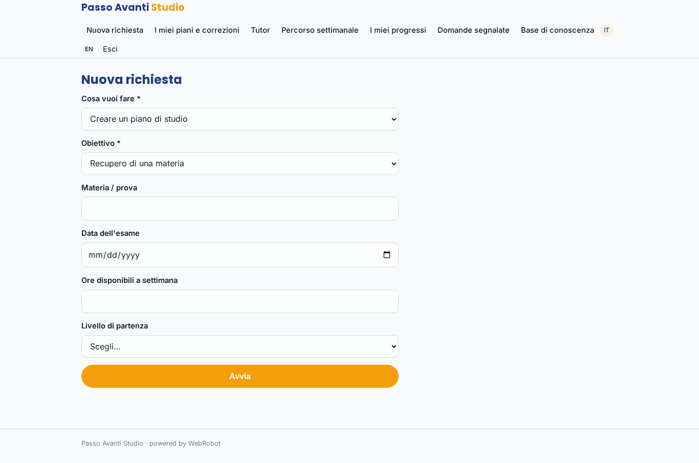

### history
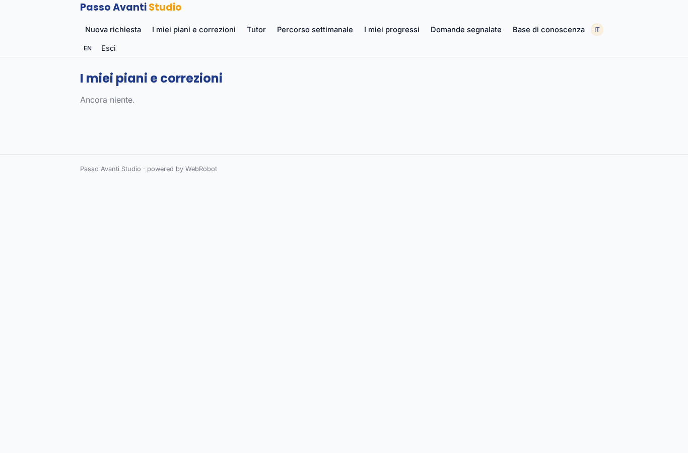

### tutor_chat
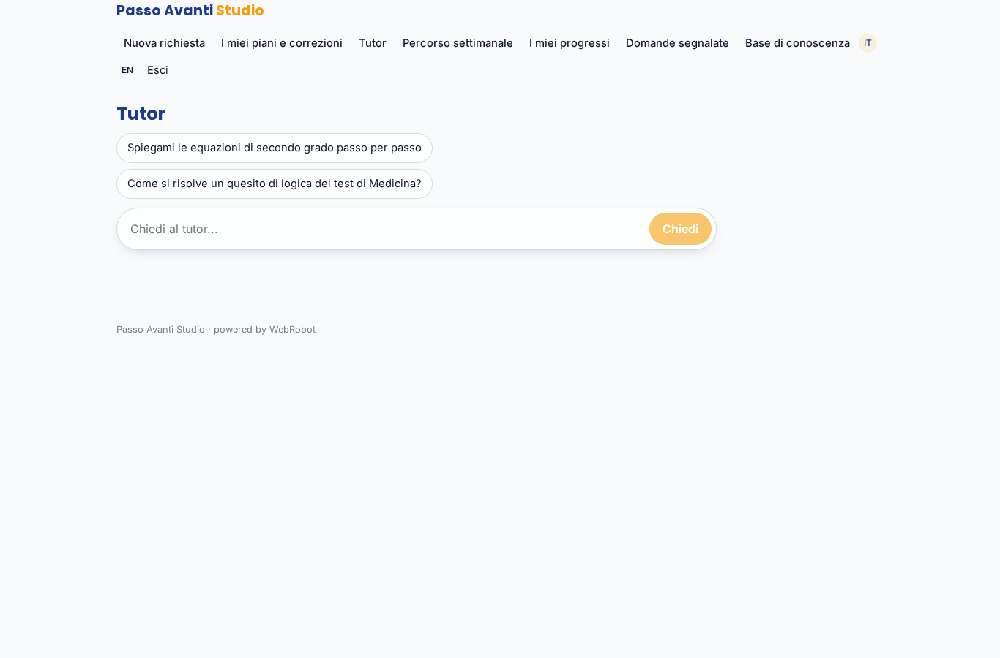

### paths
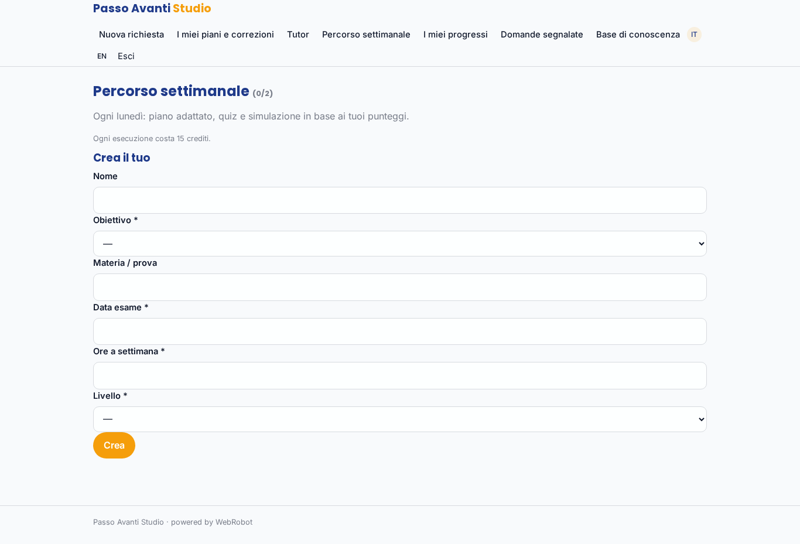

### progress
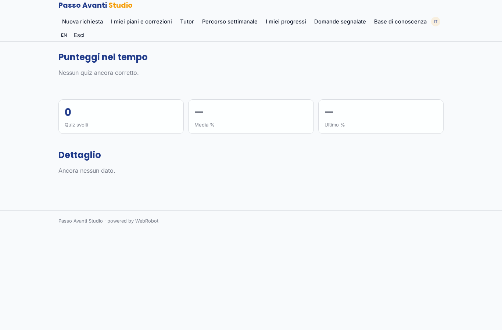

### guardians_view
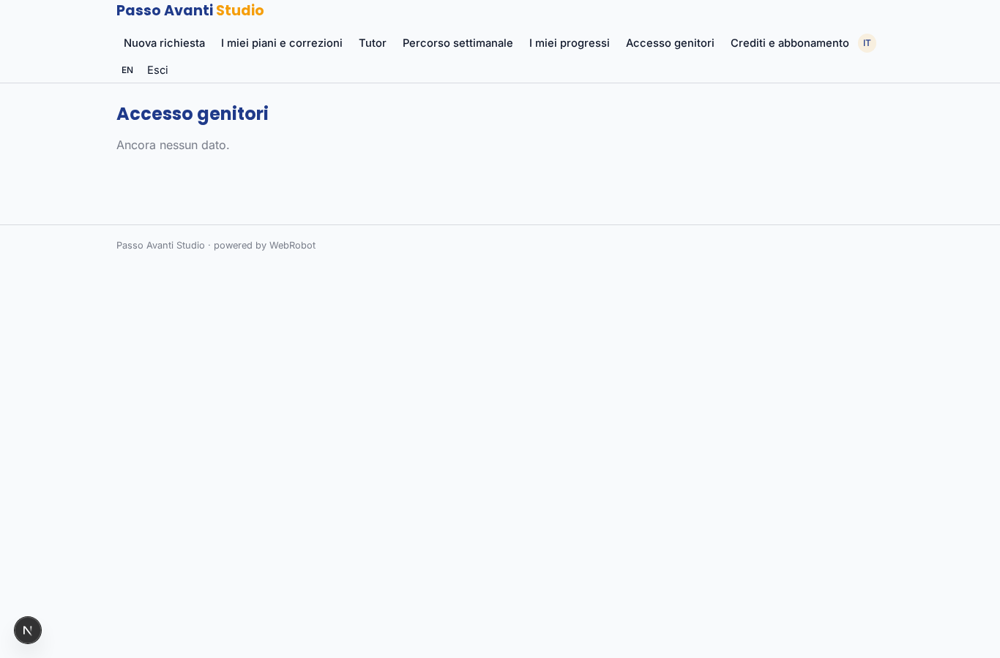

### flagged
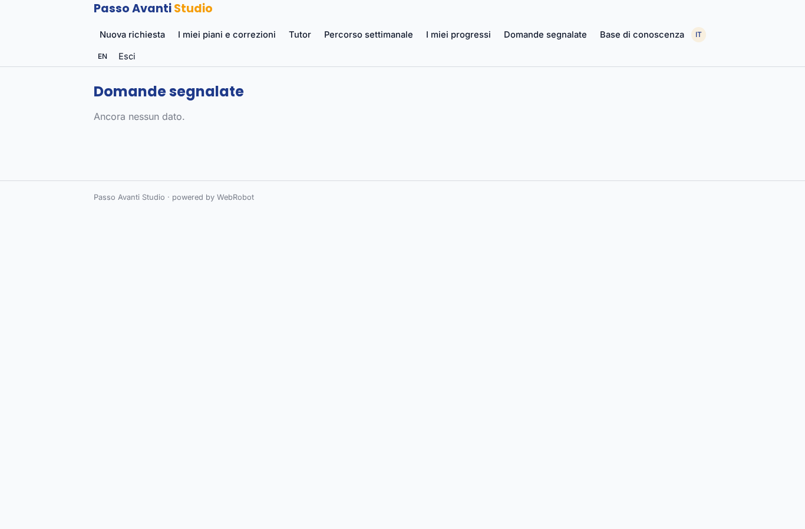

### kb
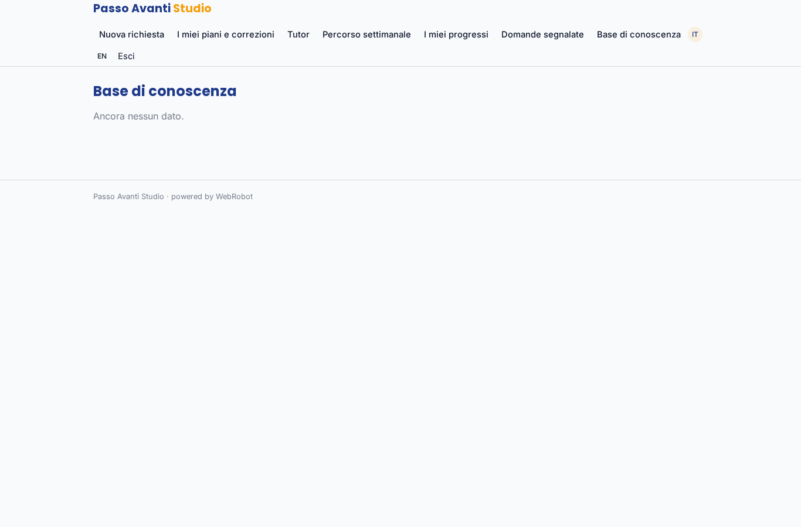

### account
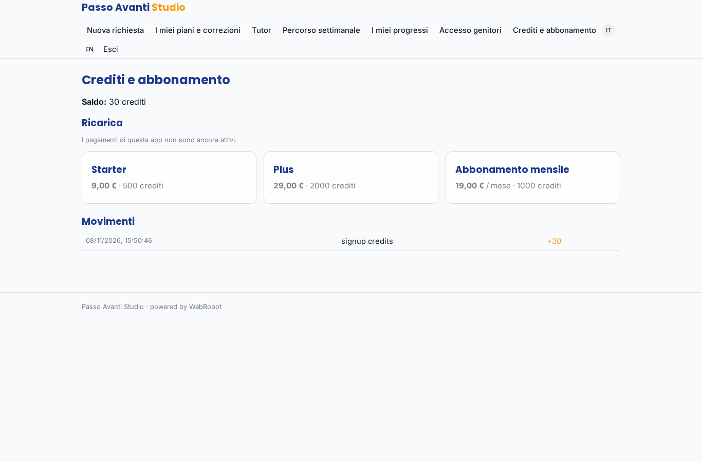

