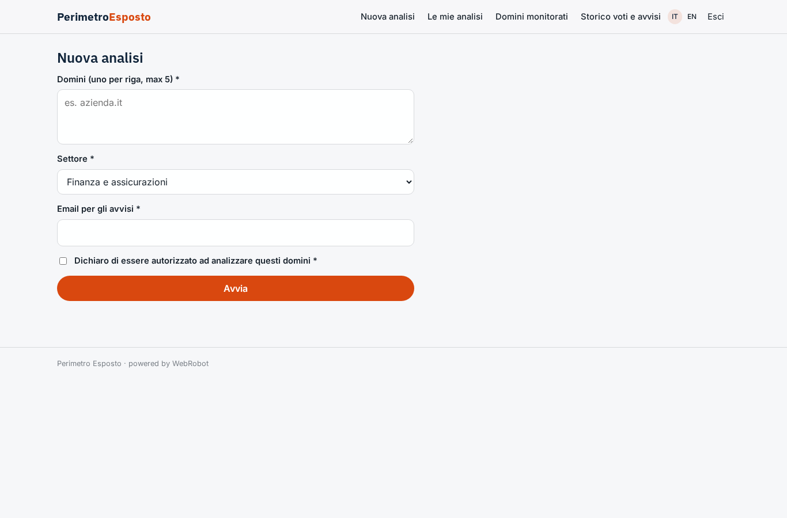
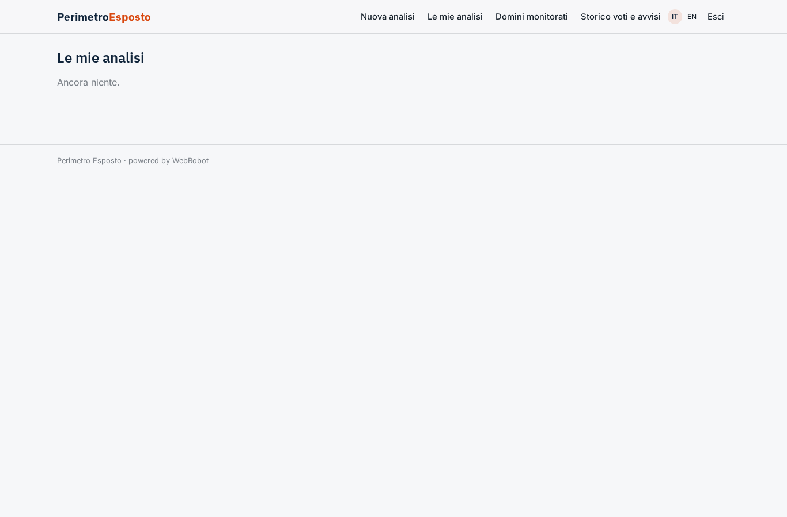
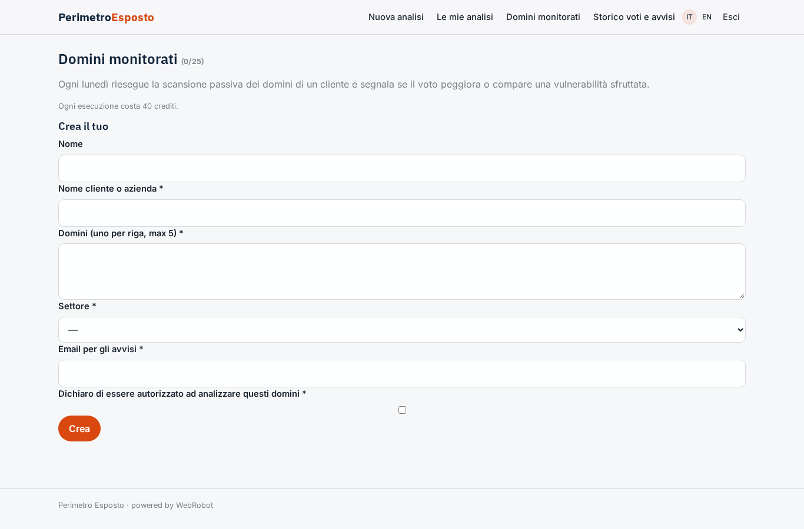
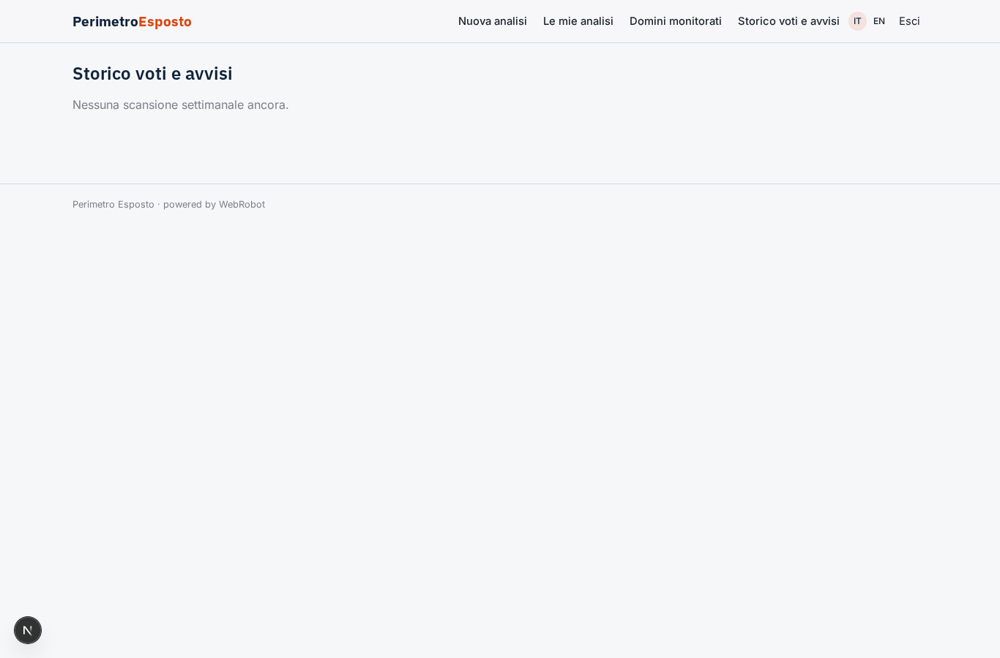

# Perimetro Esposto

_Il rating di sicurezza della superficie internet della tua azienda, da A a F._

**Manifest status:** valid (schema validator + runtime contract)

## Description given to the app builder (Italian)

Voglio realizzare Perimetro Esposto, un servizio che assegna un rating di sicurezza alla superficie internet di un'azienda. Il cliente (responsabile IT o broker assicurativo) inserisce uno o più domini, il settore e un'email per gli avvisi, e deve spuntare una dichiarazione che è autorizzato a farlo. L'analisi è solo passiva: un agente enumera i sottodomini dai log di Certificate Transparency su crt.sh, interroga i record DNS (SPF, DMARC, DNSSEC, MX), controlla i certificati e gli header HTTP delle pagine pubbliche, individua versioni software dichiarate e le incrocia con le vulnerabilità del database NVD e con il catalogo CISA KEV. Se il cliente collega le proprie chiavi API di Shodan e Have I Been Pwned, l'agente aggiunge porte esposte e credenziali comparse in data breach. Alla fine calcola un punteggio da A a F con i pesi per categoria e produce un report con priorità di correzione. La scansione si ripete ogni settimana e se il voto peggiora o compare una vulnerabilità sfruttata parte un alert email. Il broker vede tutti i domini dei suoi clienti, il cliente solo i suoi. Abbonamento mensile per numero di domini.

## Features not expressible today (spec.extensions)

- **email_alerts**: Email alerts when the grade worsens or a KEV vulnerability appears are not available yet: the alert is recorded in scan_results (alert, alert_reason) and shown in the 'Storico voti e avvisi' view. The alert_email is collected for when notifications are supported.
- **shodan_hibp_keys**: Connecting each customer's own Shodan and Have I Been Pwned API keys needs per-customer credentials, not available yet. The agents declare in the report that ports and breached credentials were not assessed and redistribute that 10% weight.
- **broker_client_hierarchy**: A broker sees all the domains of their clients by creating one monitored-domain entry per client under their own account; a client invited into the same records (separate login with read-only access) needs per-record sharing, not modelled here.
- **plan_domain_cap**: The domain cap per plan (5 / 25 / 100) is enforced only through maxPerUser on watches and the monthly credit allowance, not as an exact per-domain counter.
- **authorization_proof**: The authorisation checkbox is required in the form and checked by the agent (it refuses to scan without it); a stored audit log of the declaration is the run's own input.

## Screenshots (interpretive runtime)

### home-anon

### home-mobile

### home

### new_scan

### scans

### watches

### grades

### account

