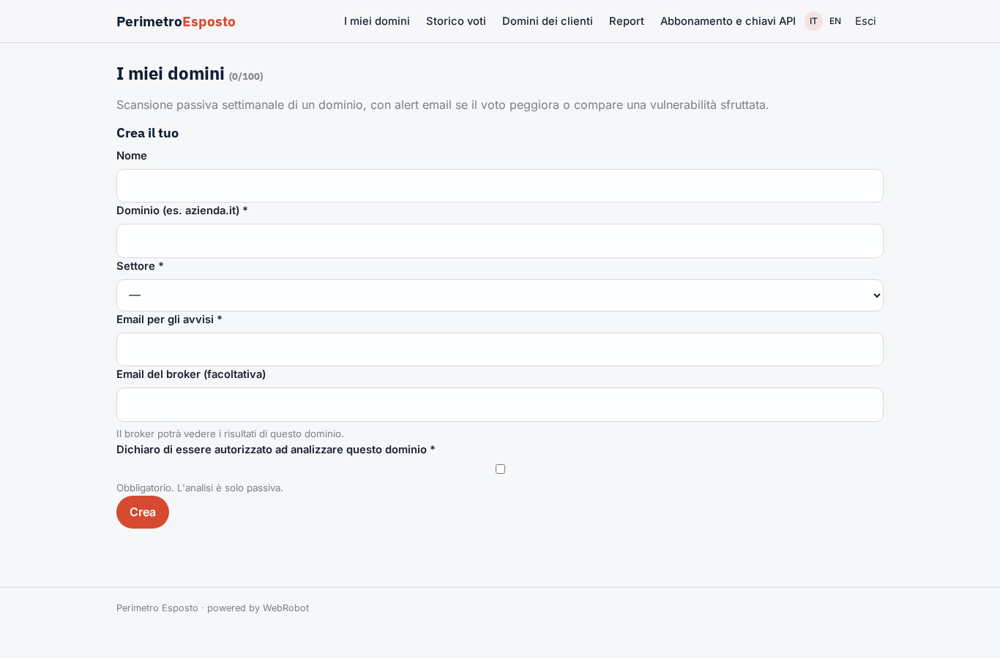
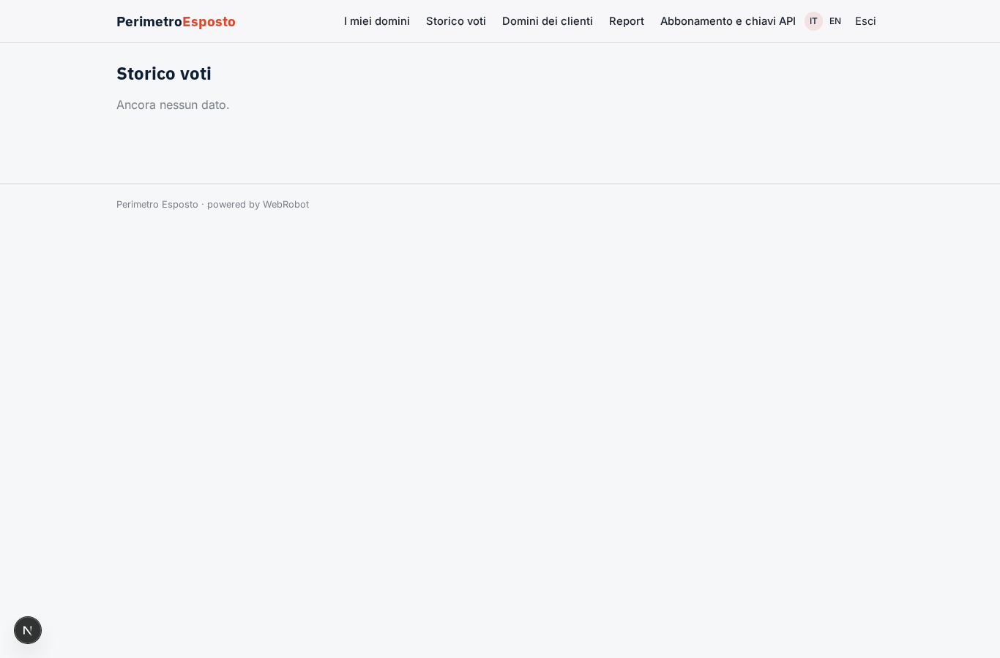
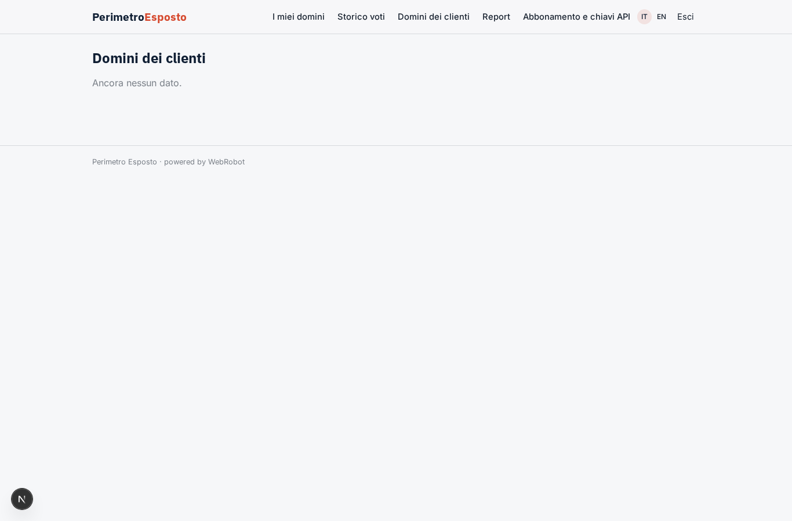
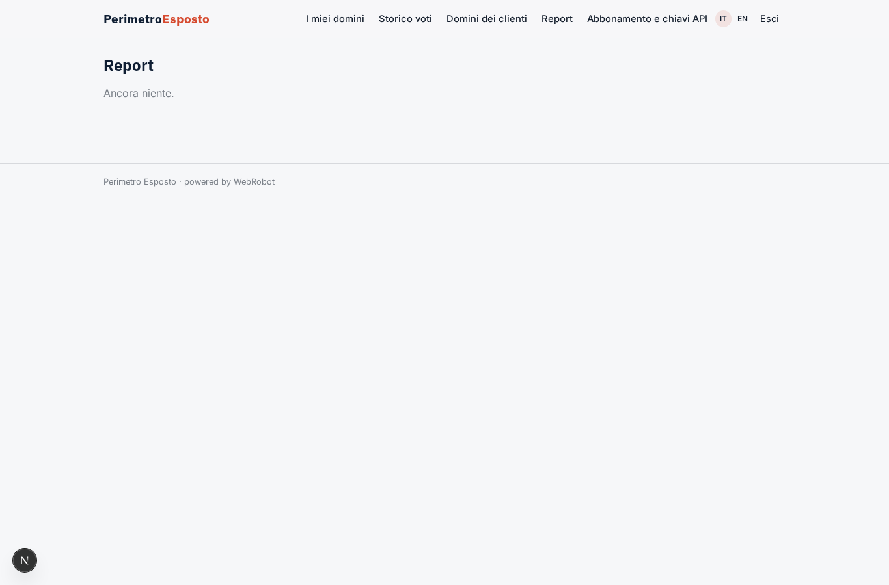
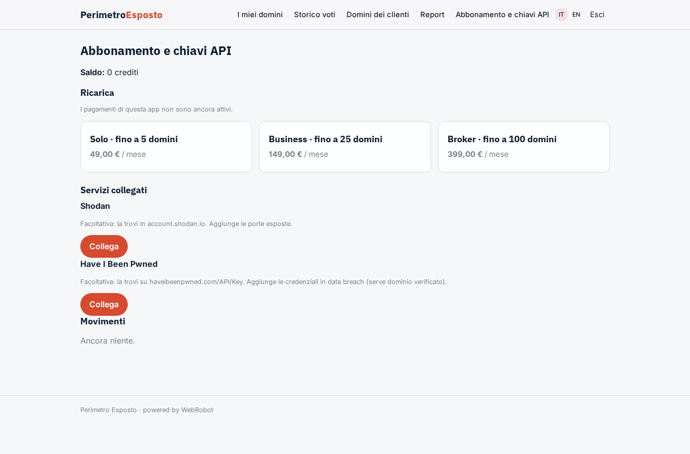

# Perimetro Esposto

_Un rating di sicurezza da A a F per la superficie internet della tua azienda._

**Manifest:** valid (schema + runtime contract) · **Functional test:** passed (8 checks passed)

## Description given to the app builder (Italian)

Voglio realizzare Perimetro Esposto, un servizio che assegna un rating di sicurezza alla superficie internet di un'azienda. Il cliente (responsabile IT o broker assicurativo) inserisce uno o più domini, il settore e un'email per gli avvisi, e deve spuntare una dichiarazione che è autorizzato a farlo. L'analisi è solo passiva: un agente enumera i sottodomini dai log di Certificate Transparency su crt.sh, interroga i record DNS (SPF, DMARC, DNSSEC, MX), controlla i certificati e gli header HTTP delle pagine pubbliche, individua versioni software dichiarate e le incrocia con le vulnerabilità del database NVD e con il catalogo CISA KEV. Se il cliente collega le proprie chiavi API di Shodan e Have I Been Pwned, l'agente aggiunge porte esposte e credenziali comparse in data breach. Alla fine calcola un punteggio da A a F con i pesi per categoria e produce un report con priorità di correzione. La scansione si ripete ogni settimana e se il voto peggiora o compare una vulnerabilità sfruttata parte un alert email. Il broker vede tutti i domini dei suoi clienti, il cliente solo i suoi. Abbonamento mensile per numero di domini.

## Features not expressible today (spec.extensions)

- **domain_ownership_check**: Authorization is a declaration (checkbox) enforced by the agent; verification of domain ownership (DNS TXT challenge) is not available yet.
- **domain_quota**: The per-plan domain count is enforced through a monthly run quota (about 5 runs per domain); a hard cap on instances per plan is not expressible yet.

## Screenshots (interpretive runtime, no data)

### home-anon

### home-mobile

### home

### domains

### my_scans

### broker_clients

### runs

### account

