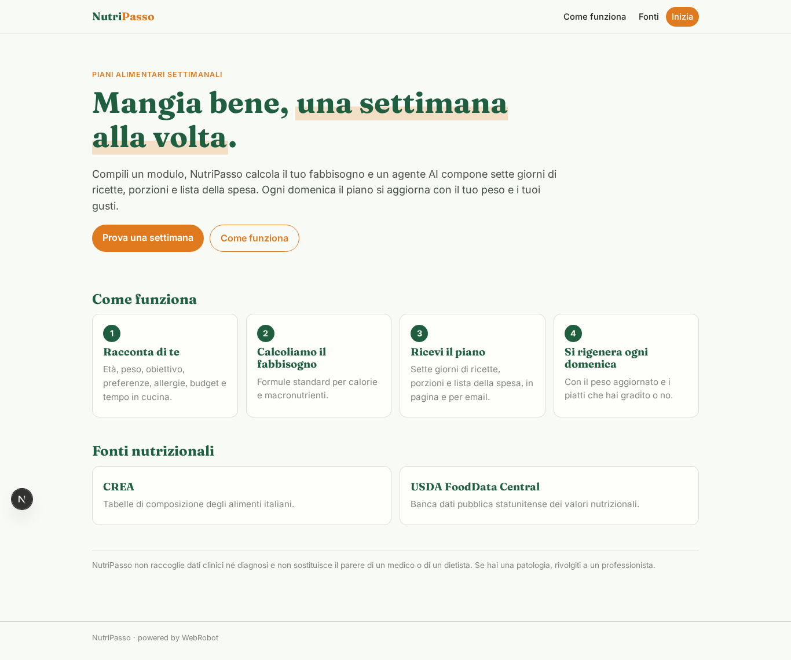
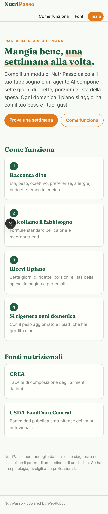
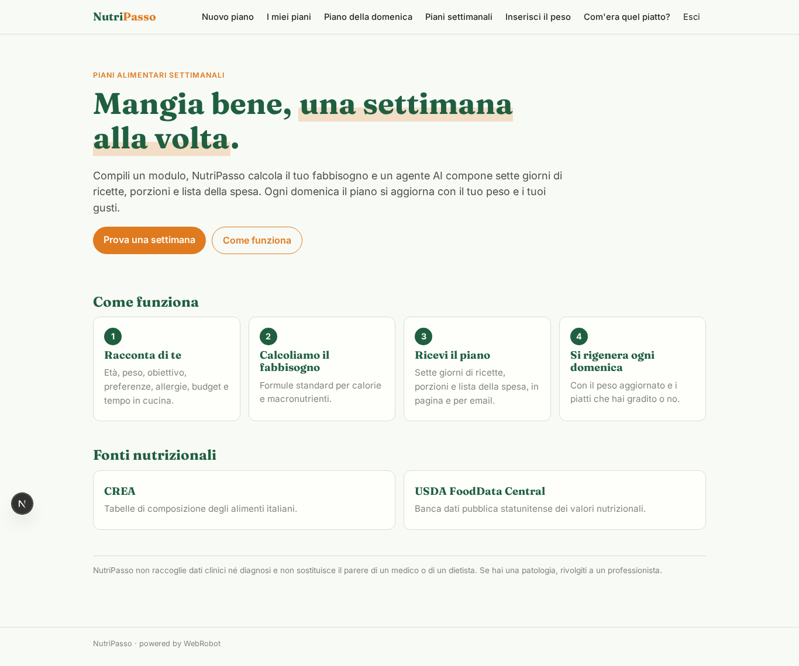
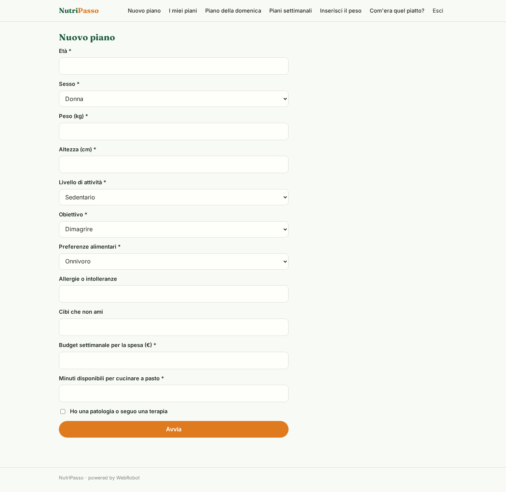
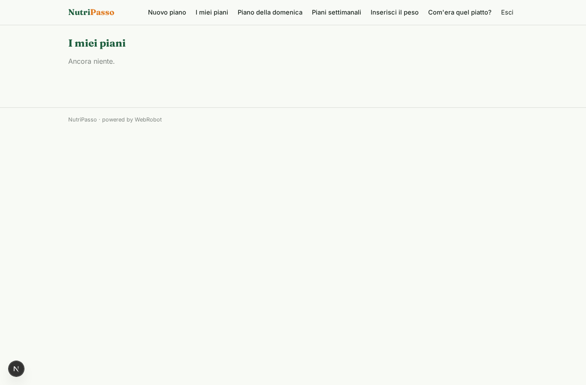
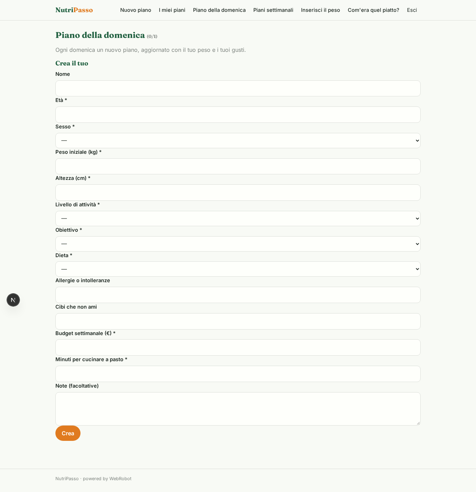
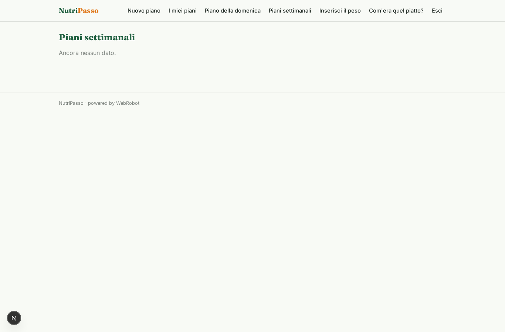
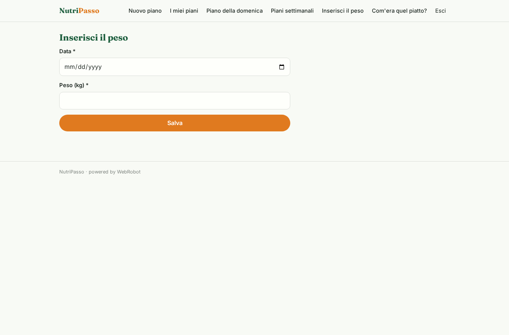
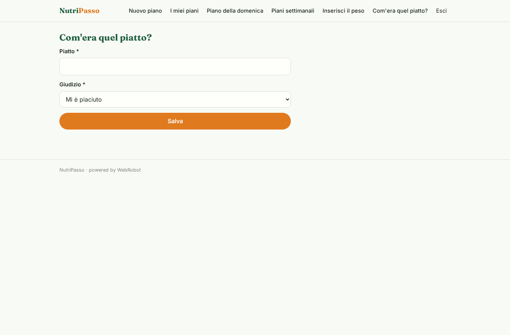
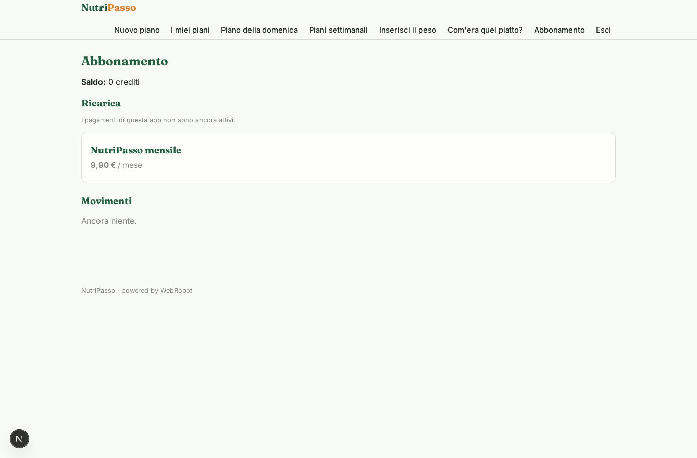

# NutriPasso

_Il tuo piano alimentare settimanale, su misura e sempre aggiornato._

**Manifest:** valid (schema + runtime contract) · **Functional test:** passed (11 checks passed)

## Description given to the app builder (Italian)

Desidero costruire NutriPasso, un'app che crea piani alimentari settimanali personalizzati. L'utente compila un modulo con età, sesso, peso, altezza, livello di attività, obiettivo (dimagrire, mantenere, massa muscolare), preferenze (vegetariano, vegano), allergie e cibi che non ama, budget e tempo disponibile per cucinare. L'app calcola il fabbisogno calorico e la ripartizione dei macronutrienti con formule standard, poi un agente compone il piano di sette giorni con ricette, porzioni e lista della spesa, usando i valori nutrizionali delle tabelle pubbliche CREA e USDA. Ogni domenica il piano si rigenera tenendo conto del peso aggiornato che l'utente inserisce e dei piatti che ha segnato come graditi o no. L'utente vede il piano in una pagina e lo riceve per email. Non raccogliamo dati clinici né diagnosi: se l'utente segnala patologie, l'app lo invita a rivolgersi a un professionista. Abbonamento mensile con una settimana di prova. Italiano.

## Features not expressible today (spec.extensions)

- **free_trial_week**: La settimana di prova gratuita dell'abbonamento non è esprimibile nel manifesto: va configurata come periodo di prova nel piano Stripe del proprietario.
- **crea_tables**: Le tabelle CREA non hanno un'API pubblica: l'agente le usa come conoscenza di riferimento; per dati esatti andrebbe caricato un dataset CREA.

## Screenshots (interpretive runtime, no data)

### home-anon

### home-mobile

### home

### new_plan

### plans

### auto

### weekly_history

### weigh

### feedback

### account

