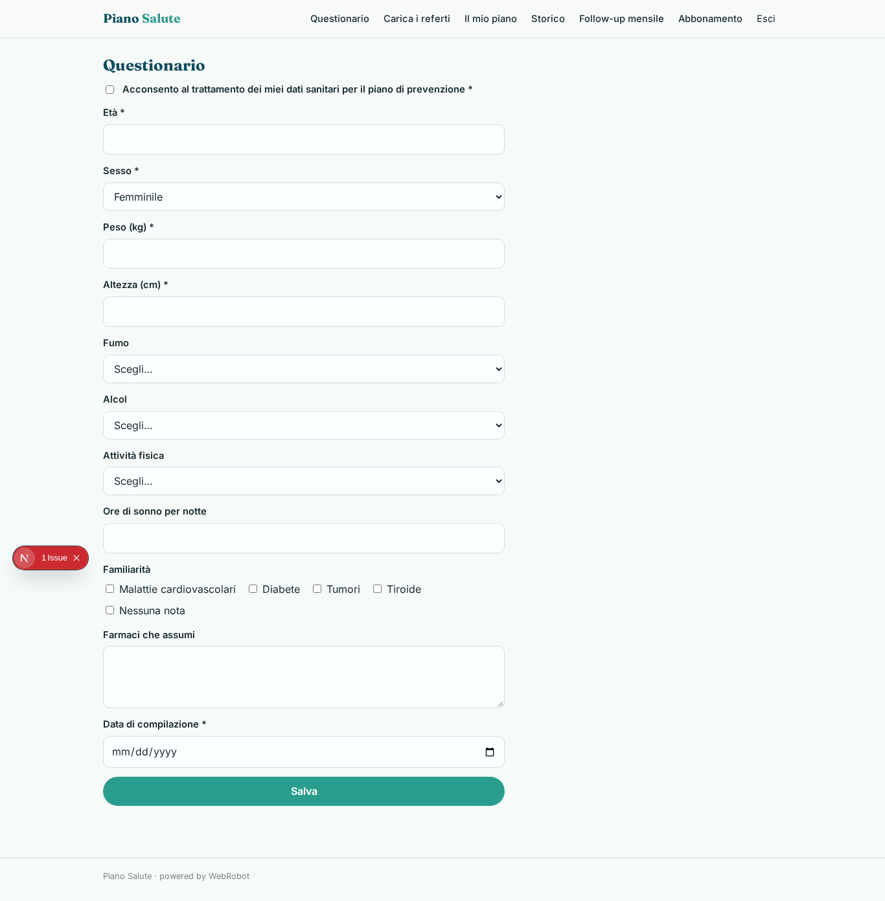
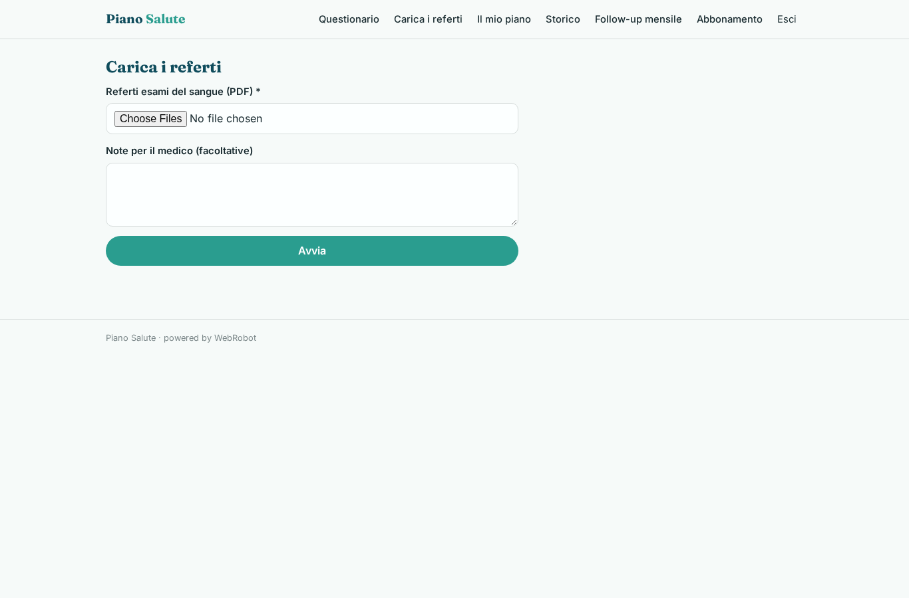
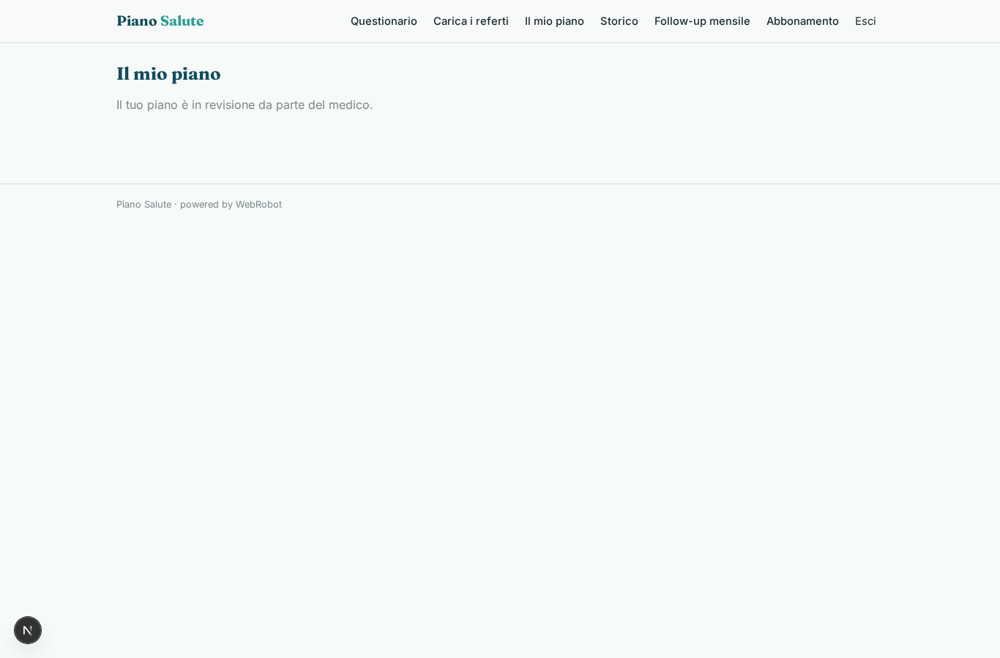
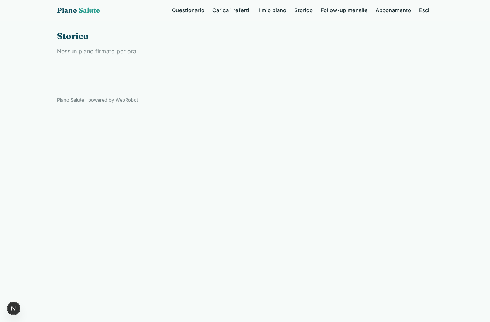
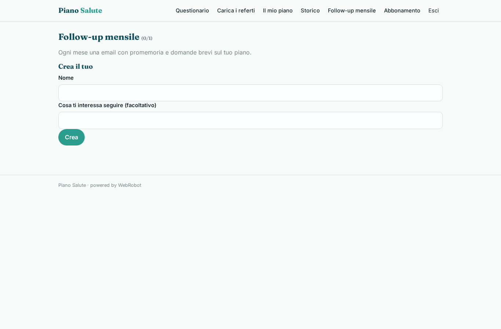
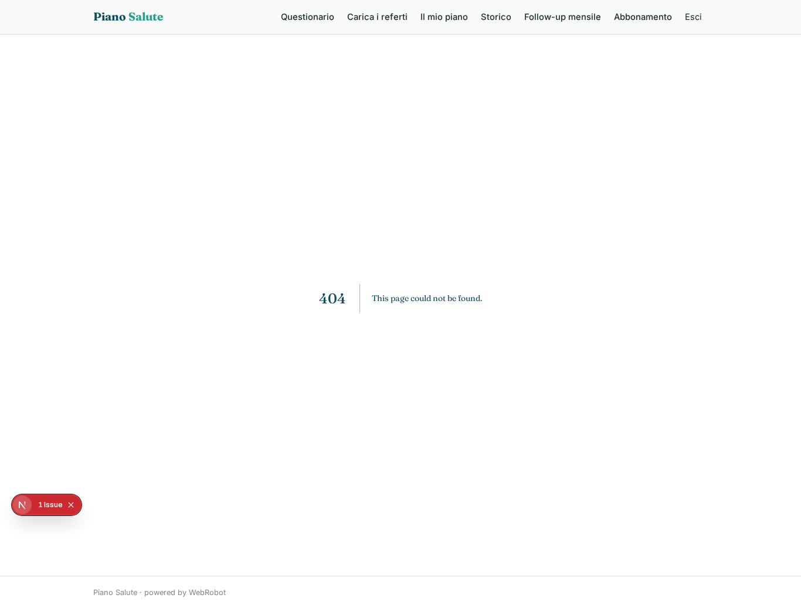
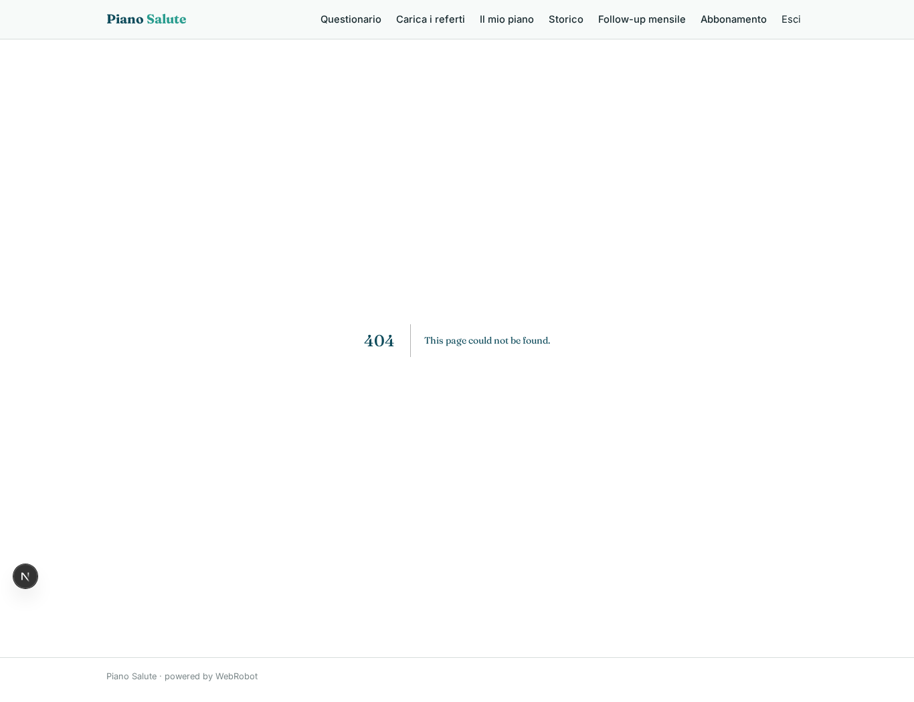
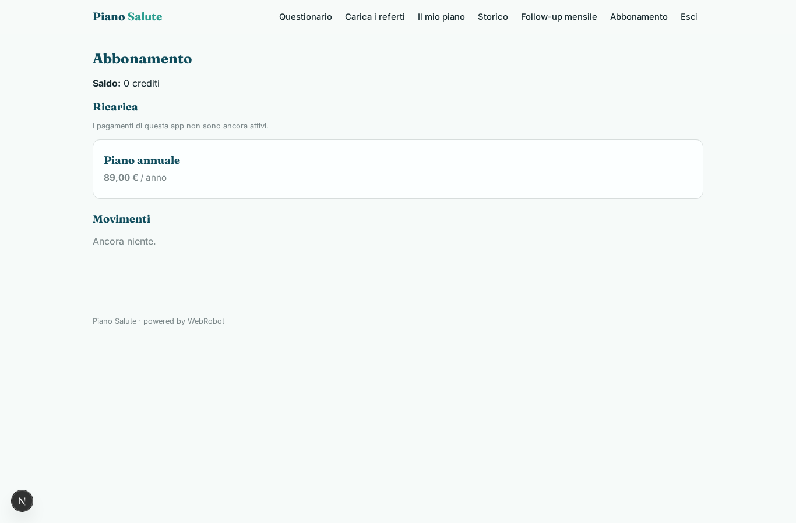

# Piano Salute

_Un anno di prevenzione, a partire dal tuo check-up._

**Manifest:** valid (schema + runtime contract) · **Functional test:** passed (12 checks passed)

## Description given to the app builder (Italian)

Voglio costruire Piano Salute, un'app di prevenzione che parte da un check-up e accompagna la persona per un anno. L'utente si registra, presta il consenso al trattamento dei dati sanitari e compila un questionario: età, sesso, peso, altezza, abitudini (fumo, alcol, attività fisica, sonno), familiarità per malattie, farmaci assunti. Carica anche i referti degli esami del sangue in PDF; in futuro vogliamo ricevere i risultati direttamente dal laboratorio convenzionato. Un agente legge i referti, confronta i valori con le linee guida pubbliche dell'Istituto Superiore di Sanità e del Ministero della Salute e prepara una bozza di piano: esami consigliati, obiettivi su alimentazione e movimento, scadenze. Prima che l'utente lo veda, un medico della rete rivede la bozza, la modifica e la firma. Ogni mese l'app manda un follow-up via email con promemoria e domande brevi, e ogni tre mesi propone di aggiornare i dati. L'utente vede il proprio piano e lo storico, il medico solo i pazienti assegnati, l'admin nessun dato clinico. Abbonamento annuale con check-up incluso, in italiano.

## Functional test: what did not pass

- **form saves a record** (form review_plan): only role doctor may fill it, and the test cannot hold that role _(warning)_

## Features not expressible today (spec.extensions)

- **lab_results_feed**: Ricezione diretta dei risultati dal laboratorio convenzionato (futuro): si potrà usare un trigger webhook che salva i valori in una collezione dedicata.
- **admin_no_clinical_access**: Il runtime concede comunque agli admin la lettura dei record; l'esclusione dei dati clinici per gli admin va garantita con una politica dell'app (nessuna vista admin) e va verificata. L'assegnazione del medico (doctor_email) è fatta dall'admin nello studio.
- **draft_hidden_from_patient**: La bozza è nascosta al paziente tramite filtro status=signed nelle viste; un vero blocco a livello di dati non è disponibile.
- **health_data_compliance**: Dati sanitari (GDPR art. 9): servono informativa, DPIA e nomina dei medici come autorizzati; il consenso è registrato nel questionario.

## Screenshots (interpretive runtime, no data)

### home-anon

### home-mobile

### home

### questionnaire

### new_checkup

### my_plan

### history

### followups_setup

### patients

### to_review

### review_plan

### account

