# Piano Salute

_Un check-up, un piano di prevenzione rivisto da un medico, per un anno._

**Manifest status:** valid (schema validator + runtime contract)

## Description given to the app builder (Italian)

Voglio costruire Piano Salute, un'app di prevenzione che parte da un check-up e accompagna la persona per un anno. L'utente si registra, presta il consenso al trattamento dei dati sanitari e compila un questionario: età, sesso, peso, altezza, abitudini (fumo, alcol, attività fisica, sonno), familiarità per malattie, farmaci assunti. Carica anche i referti degli esami del sangue in PDF; in futuro vogliamo ricevere i risultati direttamente dal laboratorio convenzionato. Un agente legge i referti, confronta i valori con le linee guida pubbliche dell'Istituto Superiore di Sanità e del Ministero della Salute e prepara una bozza di piano: esami consigliati, obiettivi su alimentazione e movimento, scadenze. Prima che l'utente lo veda, un medico della rete rivede la bozza, la modifica e la firma. Ogni mese l'app manda un follow-up via email con promemoria e domande brevi, e ogni tre mesi propone di aggiornare i dati. L'utente vede il proprio piano e lo storico, il medico solo i pazienti assegnati, l'admin nessun dato clinico. Abbonamento annuale con check-up incluso, in italiano.

## Features not expressible today (spec.extensions)

- **pdf_upload**: Il caricamento dei referti in PDF non è disponibile: oggi l'utente incolla i valori o indica un link. Da aggiungere appena esiste il tipo di campo file.
- **lab_connector**: Ricezione diretta dei risultati dal laboratorio convenzionato (da realizzare quando sarà disponibile un connettore).
- **email_notifications**: Il follow-up mensile e la proposta trimestrale non sono inviati via email (notifiche non disponibili): l'utente li trova nell'app, nello storico. L'invio email andrà aggiunto appena disponibile.
- **doctor_assignment**: L'assegnazione medico-paziente avviene condividendo i record (bozze e piani) con il medico invitato; serve un passaggio operativo per assegnare il medico a ogni nuovo paziente. L'admin non ha viste sui dati clinici.
- **draft_visibility**: La bozza è un dato dell'utente ma nessuna vista la mostra al paziente; da verificare che il report della run non sia visibile al paziente prima della firma.
- **health_data_compliance**: Registro del consenso, DPIA, nomina dei medici e conservazione dei dati sanitari (GDPR art. 9) da definire con il titolare del trattamento prima della pubblicazione.

## Screenshots (interpretive runtime)

### home-anon
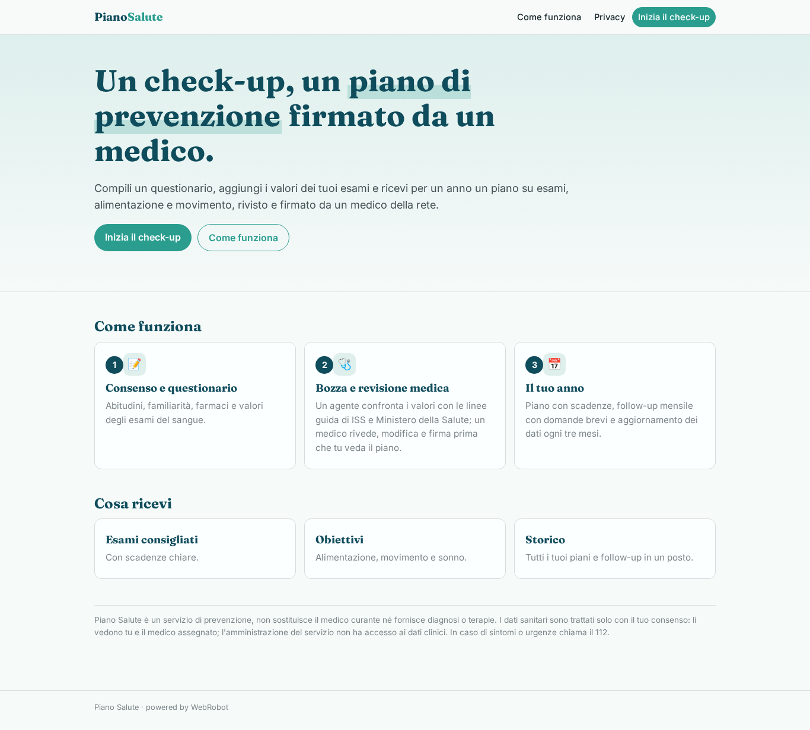

### home-mobile
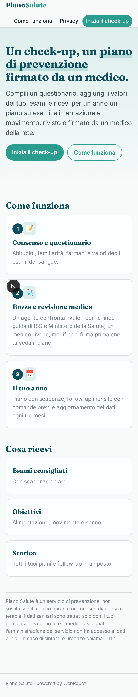

### home
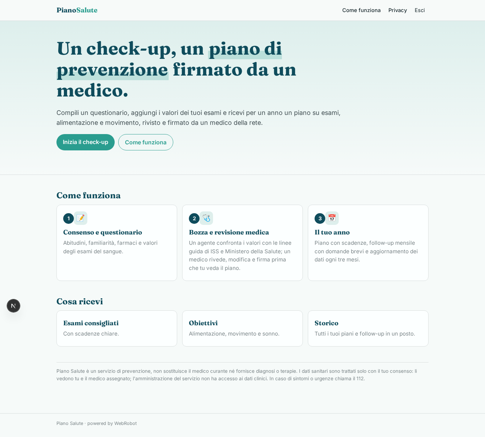

### new_checkup
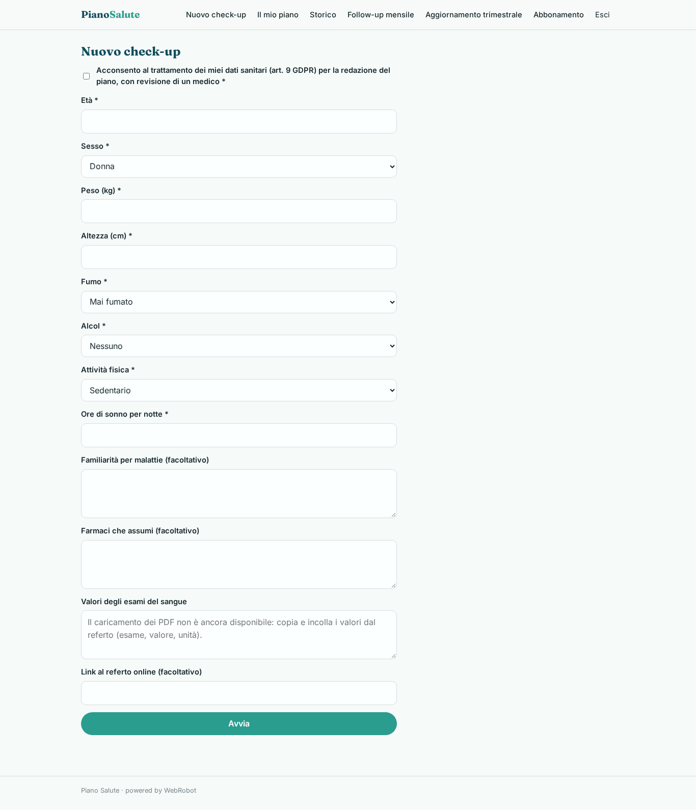

### my_plan
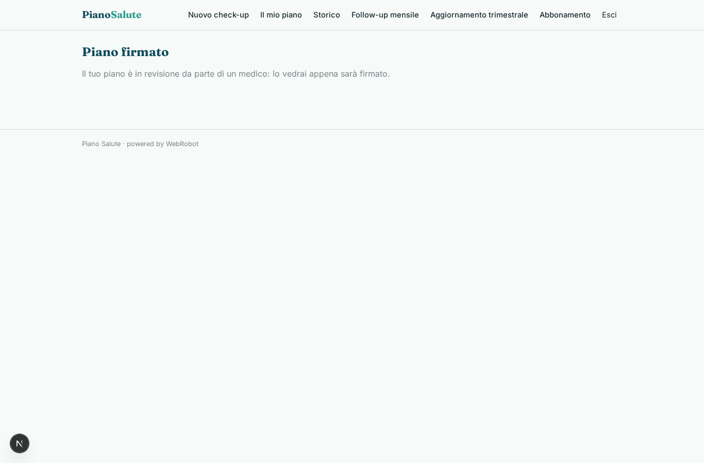

### history
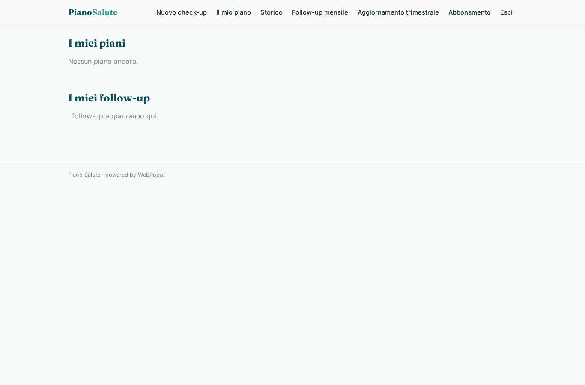

### followups
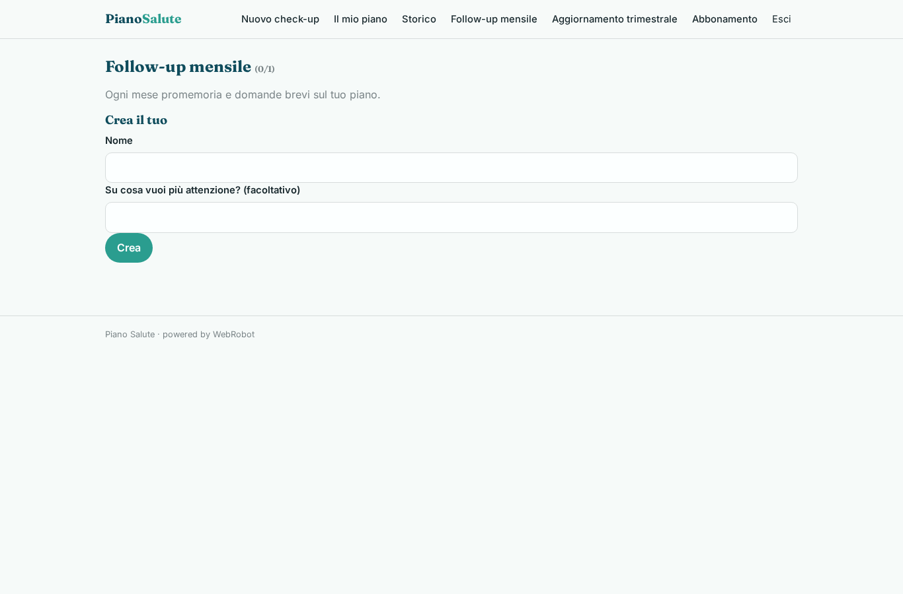

### quarterly
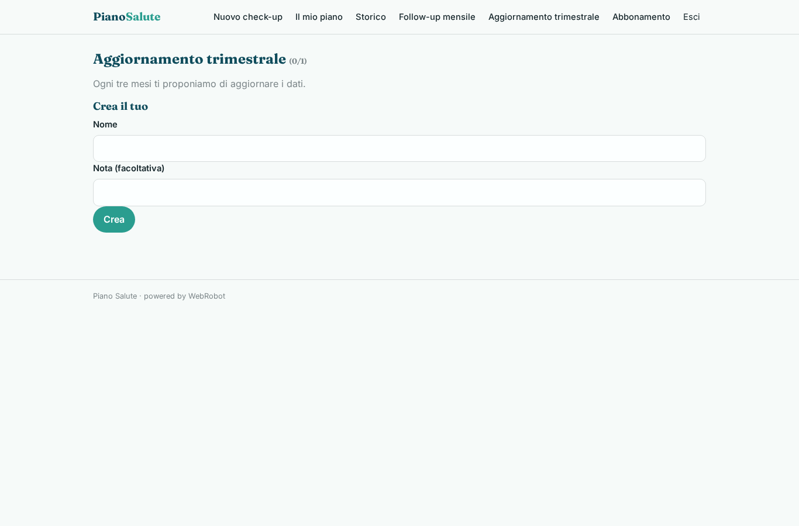

### review
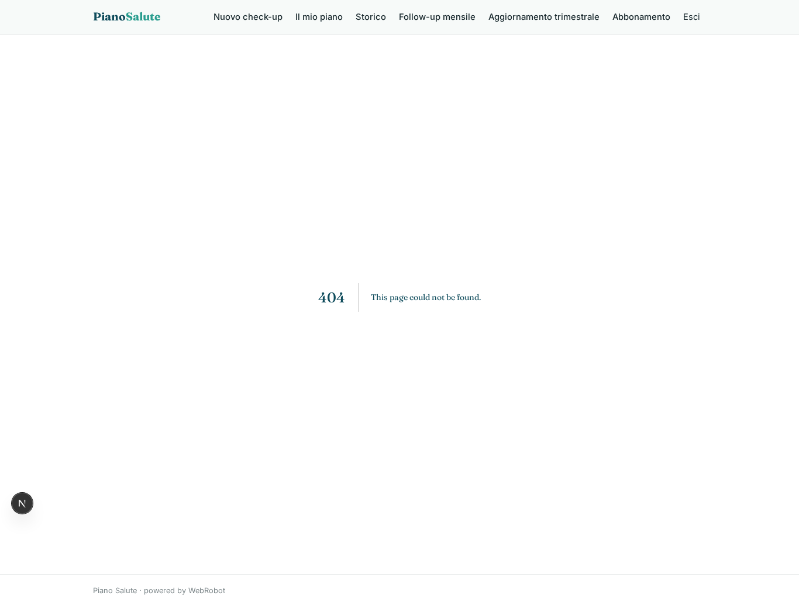

### patients
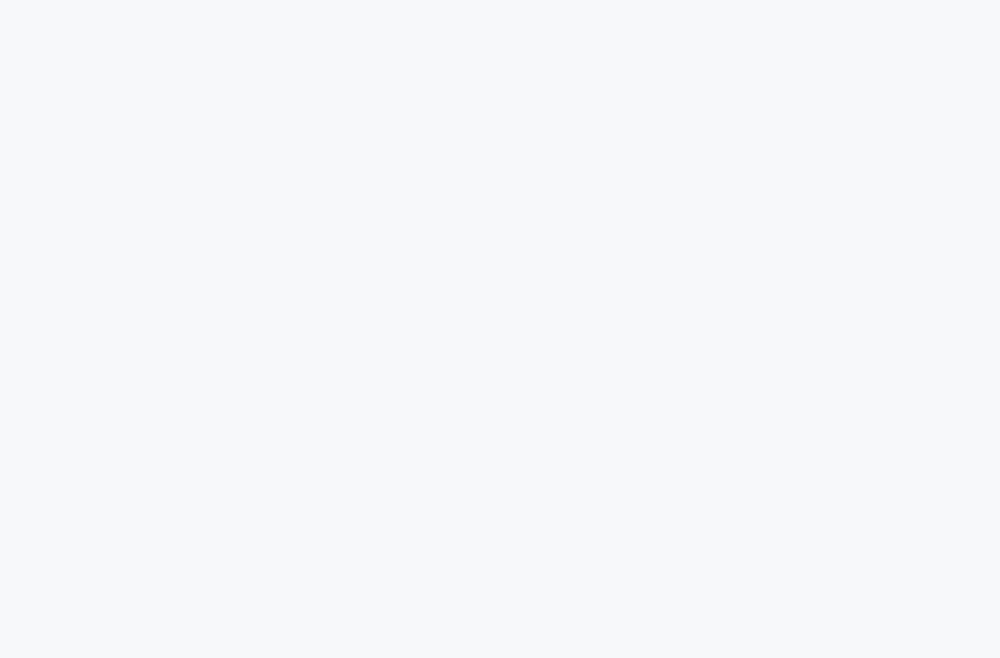

### account
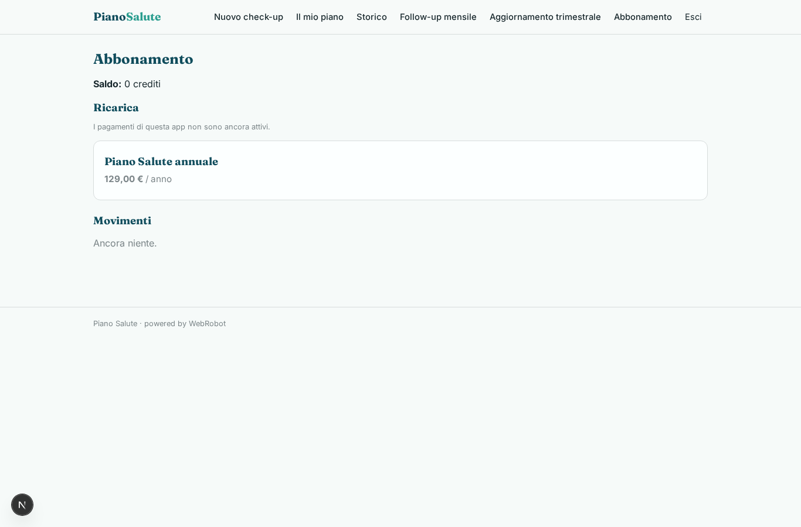

