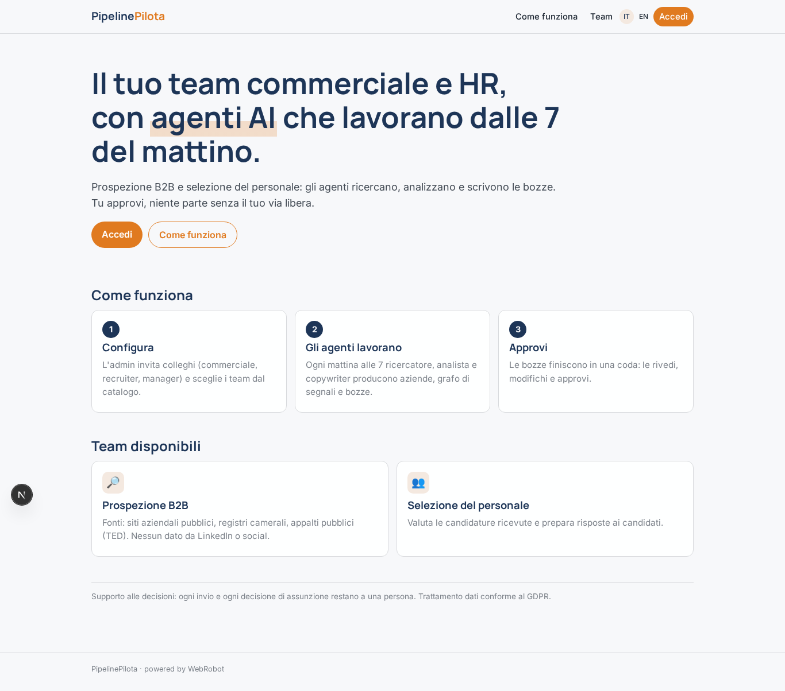
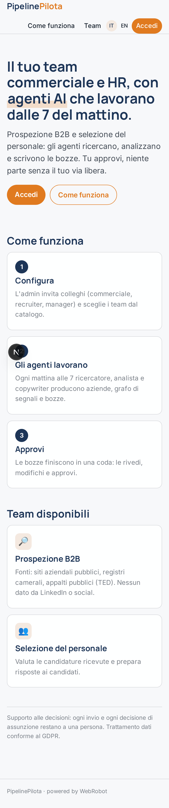
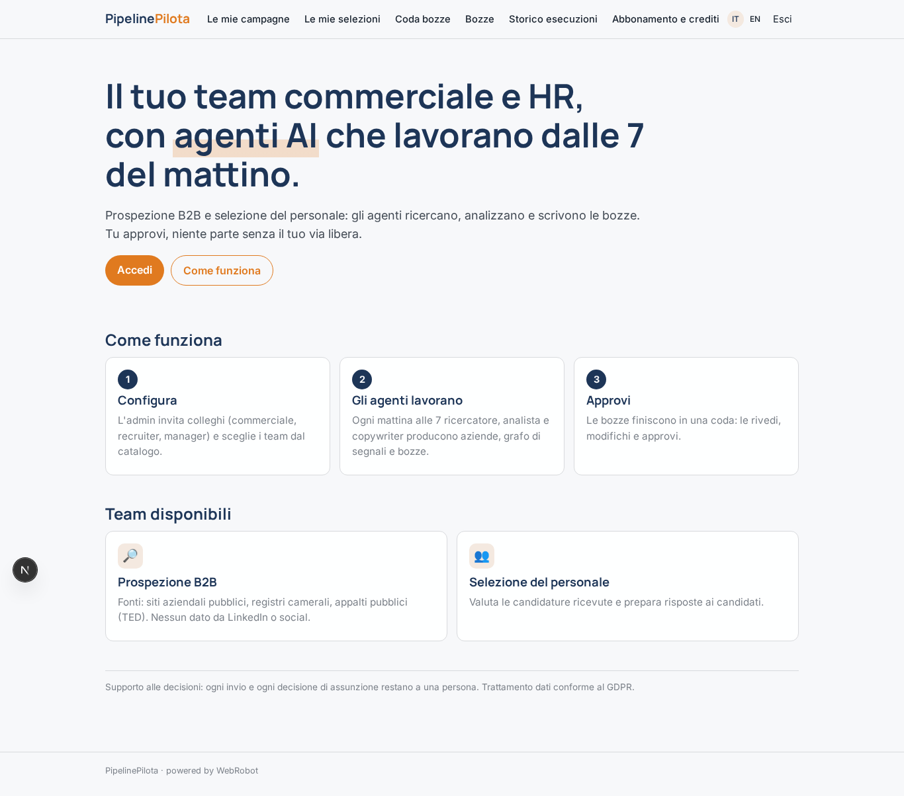
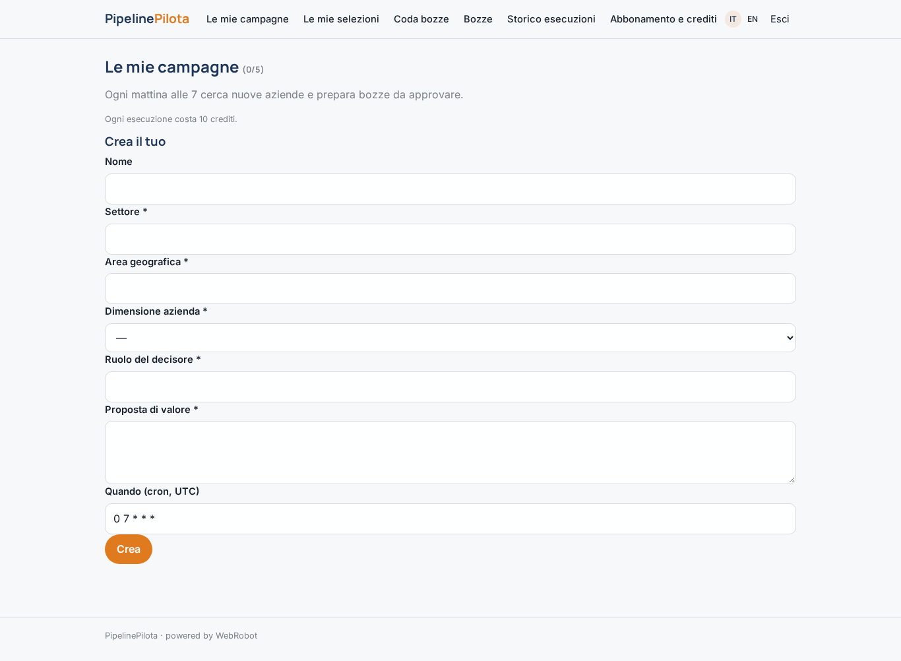
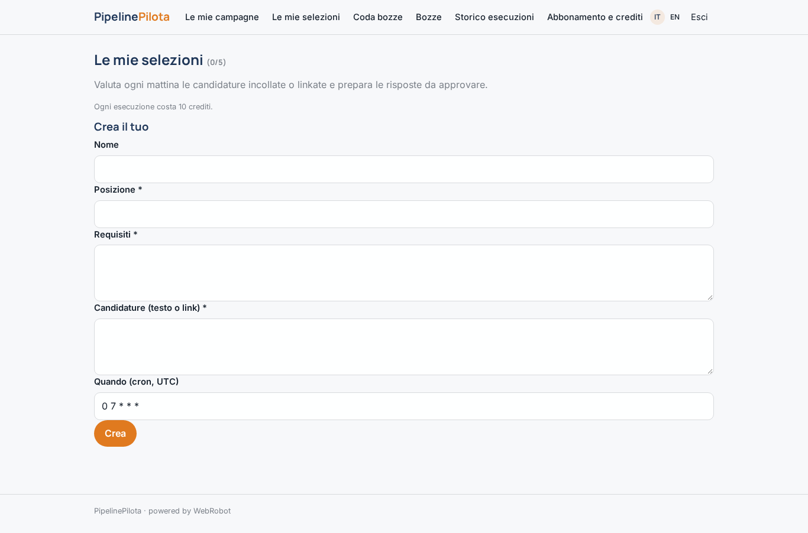
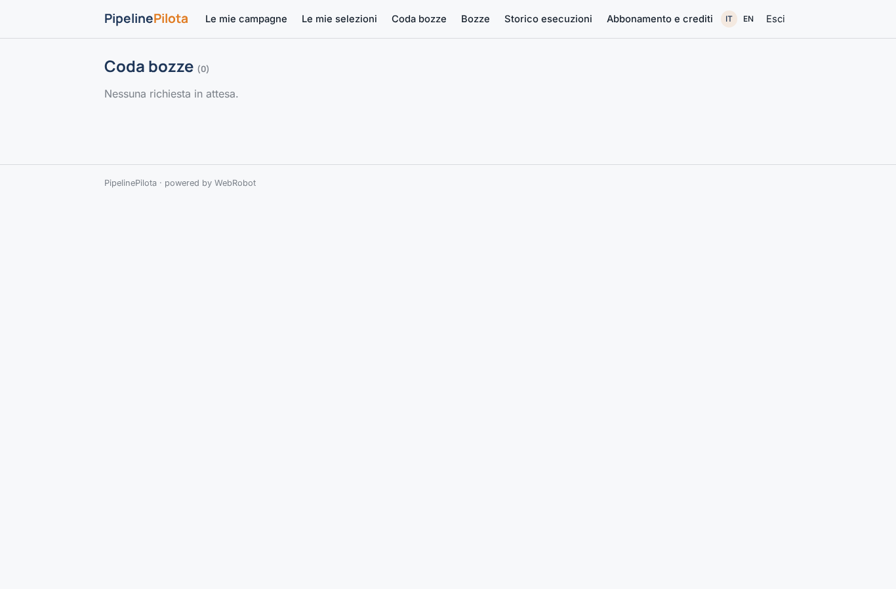
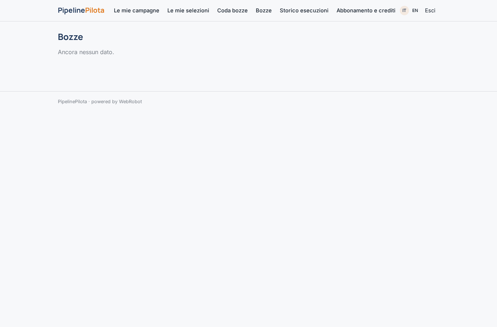
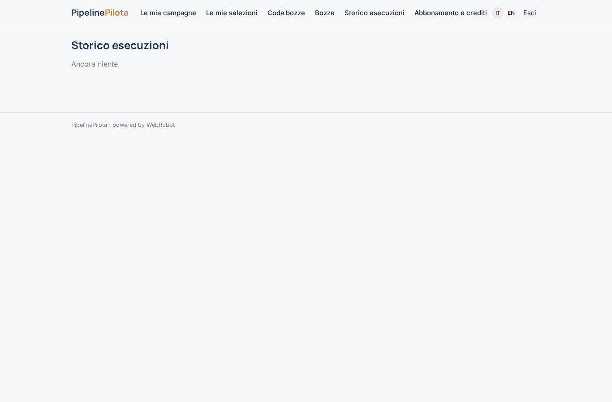
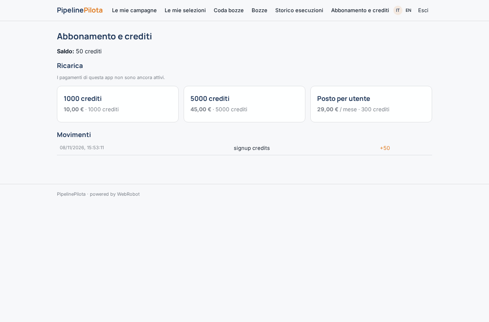

# PipelinePilota

_Team di agenti per prospezione B2B e selezione del personale, con approvazione umana._

**Stato manifest:** valido (validatore Python + contratto runtime)

## Descrizione data all'app builder

Serve PipelinePilota, una piattaforma di agenti per team commerciali e HR di aziende medie. L'admin aziendale crea uno spazio di lavoro, invita i colleghi con ruolo commerciale, recruiter o manager, e configura i team di agenti da un catalogo di template: prospezione B2B e selezione del personale. Per la prospezione il modulo chiede settore, area geografica, dimensione azienda, ruolo del decisore e proposta di valore. Un agente ricercatore raccoglie aziende candidate da siti aziendali pubblici e registri open (camerali, appalti pubblici), un agente analista costruisce un grafo di relazioni tra aziende, settori e segnali (nuove sedi, bandi vinti, assunzioni annunciate sul sito), un agente copywriter prepara email personalizzate. Nessuna email parte senza approvazione del commerciale, che vede le bozze in una coda. Le risposte arrivano nella casella collegata e vengono classificate (interessato, non ora, rifiuto). I contatti si sincronizzano con il CRM aziendale via OAuth. Niente dati da LinkedIn o social. Il team di selezione funziona allo stesso modo su candidature ricevute via email. Esecuzione ogni mattina alle 7, report settimanale ai manager. Ogni utente vede le proprie campagne, il manager quelle del team. Abbonamento per posto più crediti agente. Italiano e inglese.

## Funzioni non esprimibili oggi (spec.extensions)

- **inbox_replies**: Non ancora disponibile: collegare la casella email, ricevere le risposte e classificarle (interessato, non ora, rifiuto), e ricevere le candidature via email. Per ora le candidature si incollano nel modulo e l'invio delle email approvate è manuale.
- **crm_oauth_sync**: Non ancora disponibile: sincronizzazione contatti con il CRM aziendale via OAuth (richiede credenziali per cliente).
- **manager_team_view**: Non ancora disponibile: vista del manager sulle campagne di tutto il team (i dati sono per utente) e report settimanale ai manager via email (notifiche non disponibili).
- **per_seat_billing**: L'abbonamento per posto è modellato come piano mensile per l'admin; il conteggio dei posti per utente invitato richiede logica aggiuntiva.
- **workspace_provisioning**: La creazione di spazi di lavoro separati per azienda è gestita dal deploy: un'app per azienda cliente.

## Screenshot (runtime interpretativo)

### home-anon

### home-mobile

### home

### campaigns

### hiring_views

### queue

### draft_list

### history

### account

