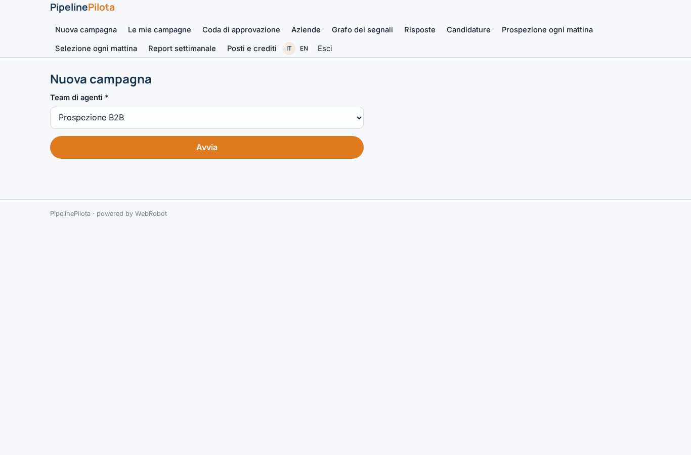
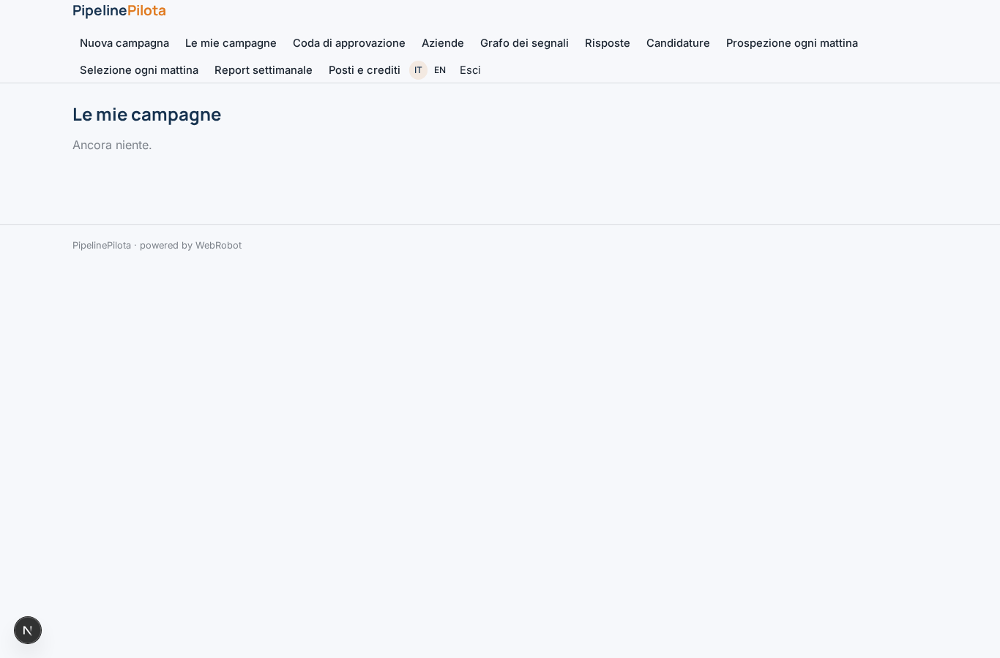
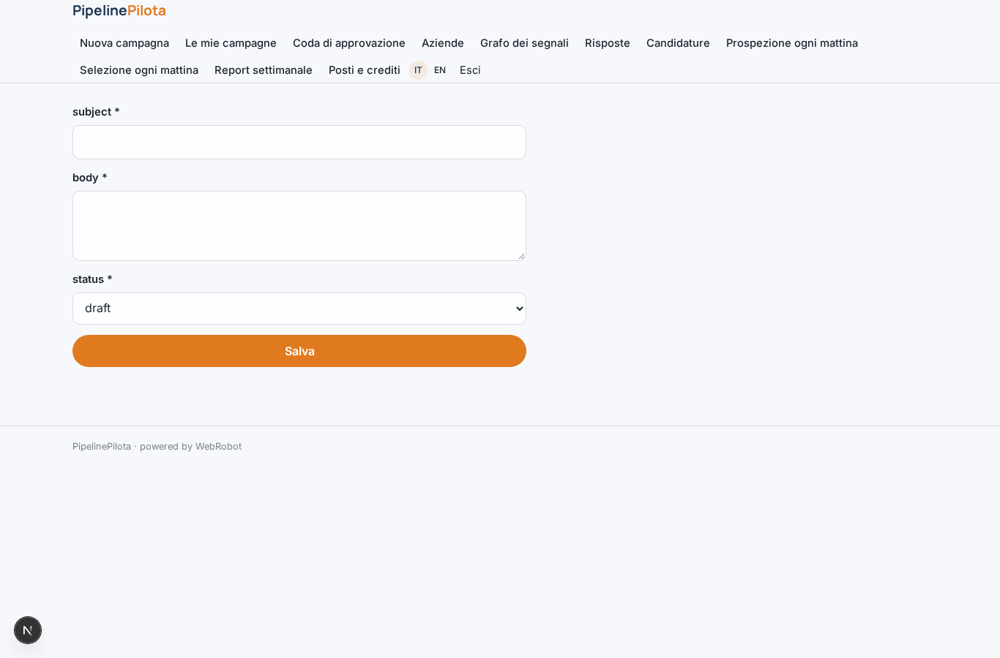
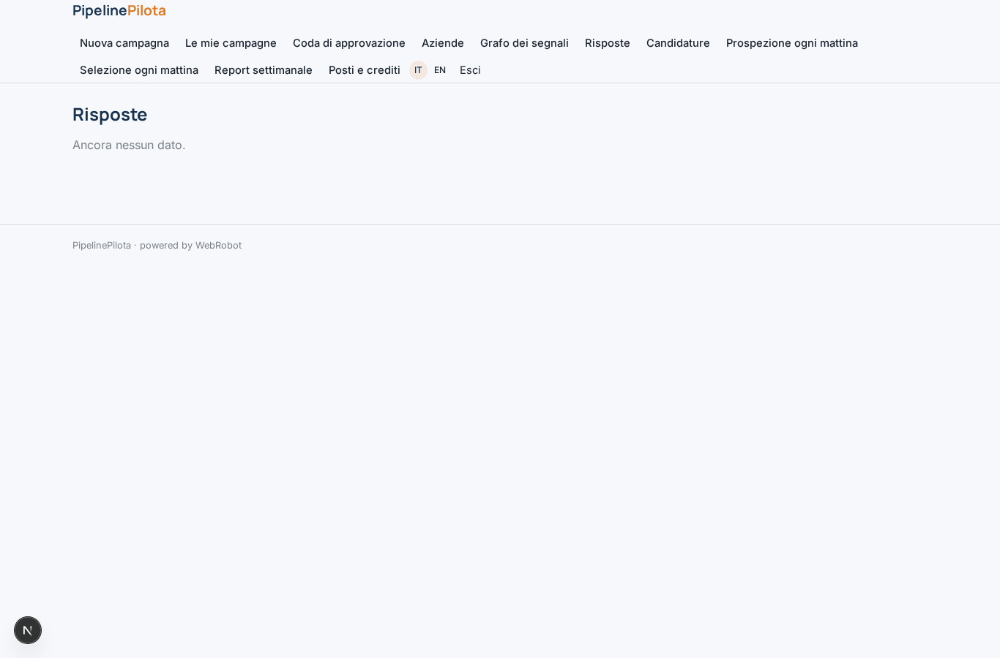
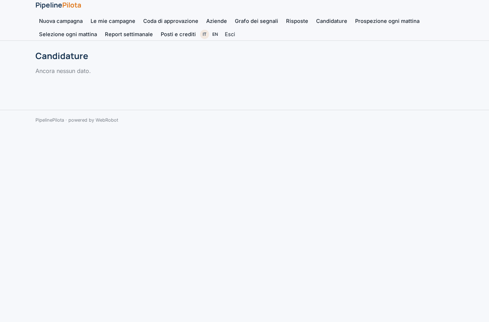
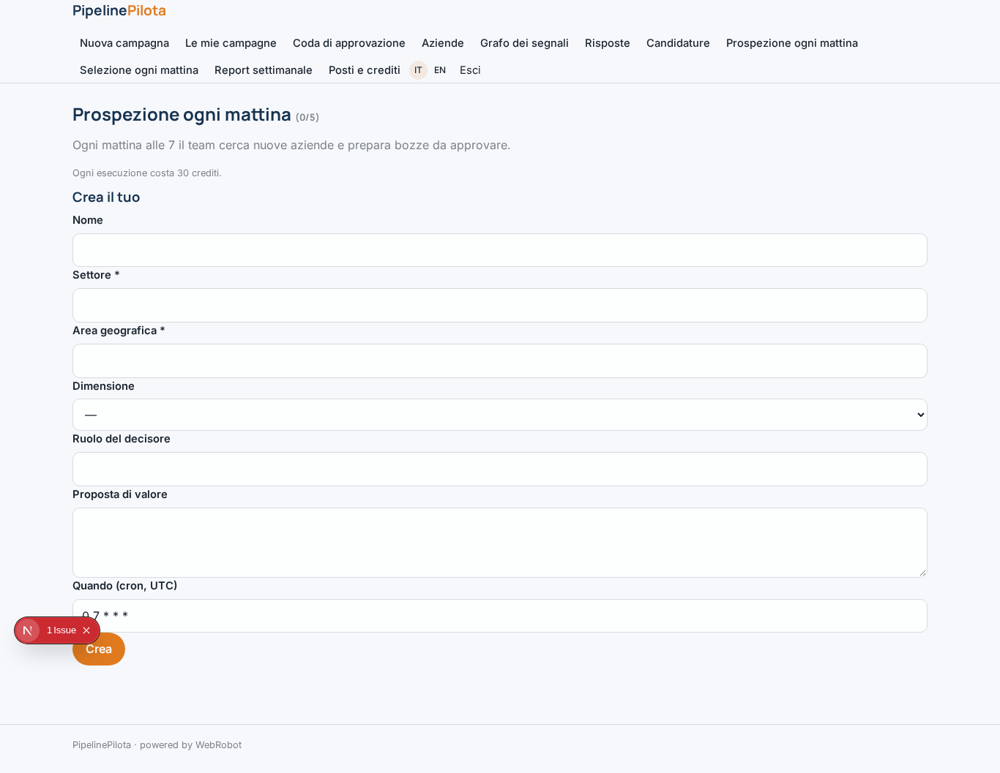
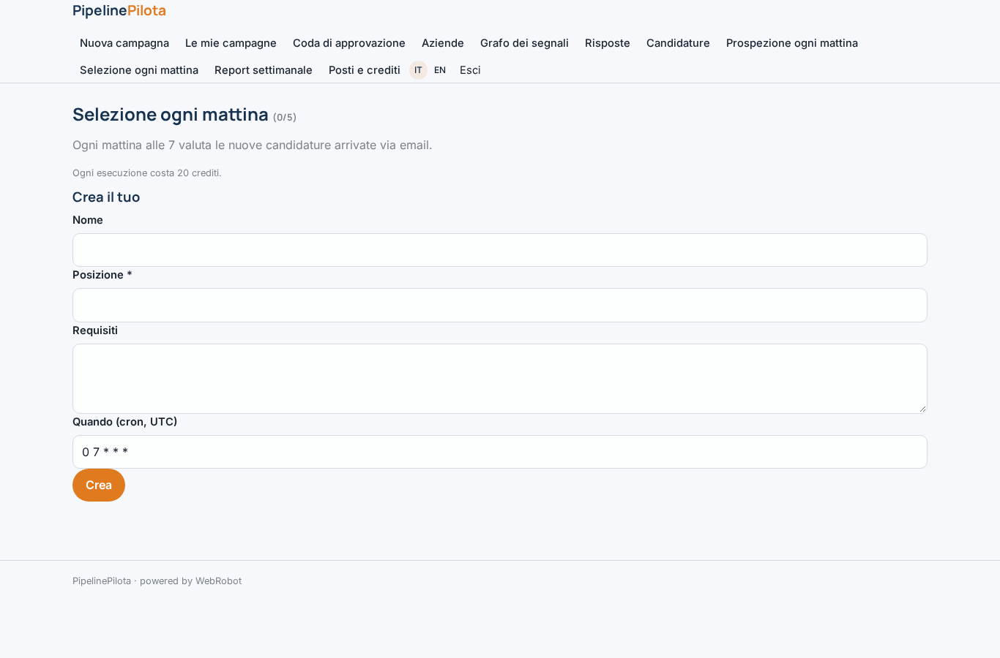
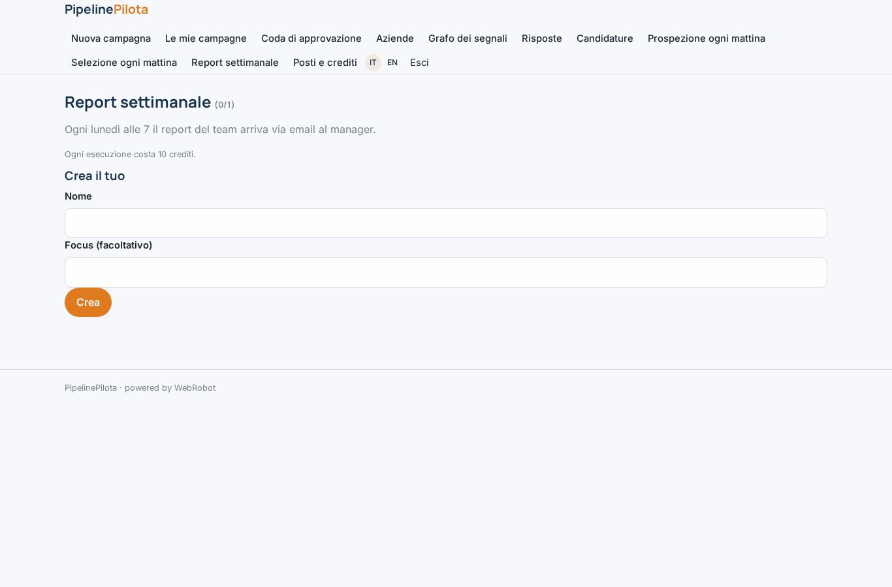
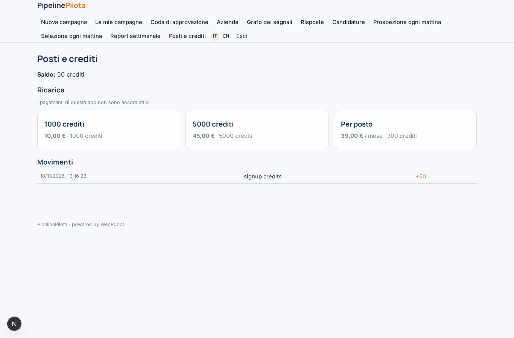

# PipelinePilota

_Agenti per prospezione B2B e selezione del personale, con approvazione umana._

**Manifest:** valid (schema + runtime contract) · **Functional test:** passed (25 checks passed)

## Description given to the app builder (Italian)

Serve PipelinePilota, una piattaforma di agenti per team commerciali e HR di aziende medie. L'admin aziendale crea uno spazio di lavoro, invita i colleghi con ruolo commerciale, recruiter o manager, e configura i team di agenti da un catalogo di template: prospezione B2B e selezione del personale. Per la prospezione il modulo chiede settore, area geografica, dimensione azienda, ruolo del decisore e proposta di valore. Un agente ricercatore raccoglie aziende candidate da siti aziendali pubblici e registri open (camerali, appalti pubblici), un agente analista costruisce un grafo di relazioni tra aziende, settori e segnali (nuove sedi, bandi vinti, assunzioni annunciate sul sito), un agente copywriter prepara email personalizzate. Nessuna email parte senza approvazione del commerciale, che vede le bozze in una coda. Le risposte arrivano nella casella collegata e vengono classificate (interessato, non ora, rifiuto). I contatti si sincronizzano con il CRM aziendale via OAuth. Niente dati da LinkedIn o social. Il team di selezione funziona allo stesso modo su candidature ricevute via email. Esecuzione ogni mattina alle 7, report settimanale ai manager. Ogni utente vede le proprie campagne, il manager quelle del team. Abbonamento per posto più crediti agente. Italiano e inglese.

## Functional test: what did not pass

- **template instance created and run** (template daily_prospecting): reserved to commerciale/admin _(warning)_
- **template instance created and run** (template daily_hiring): reserved to recruiter/admin _(warning)_

## Features not expressible today (spec.extensions)

- **crm_oauth**: CRM sync via OAuth is not available yet. Prospects can be exported to CSV and imported in the CRM meanwhile.
- **seat_billing**: Per-seat subscription is approximated by one plan bought per invited user; automatic seat counting for the workspace is not available.
- **mailbox_send**: Approved emails are sent by the platform as plain text, not from the sales rep's own mailbox. Receiving replies uses the app's email channels (inbox_replies, inbox_jobs), to be forwarded from the company mailbox.

## Screenshots (interpretive runtime, no data)

### home-anon

### home-mobile

### home

### new

### campaigns

### queue

### review_draft

### prospects_list

### graph

### replies_list

### candidates_list

### automations

### hiring_auto

### weekly

### account

