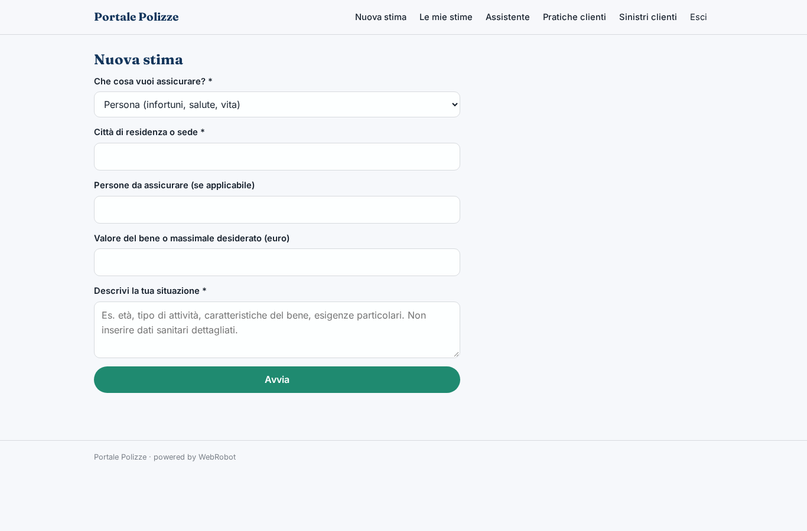
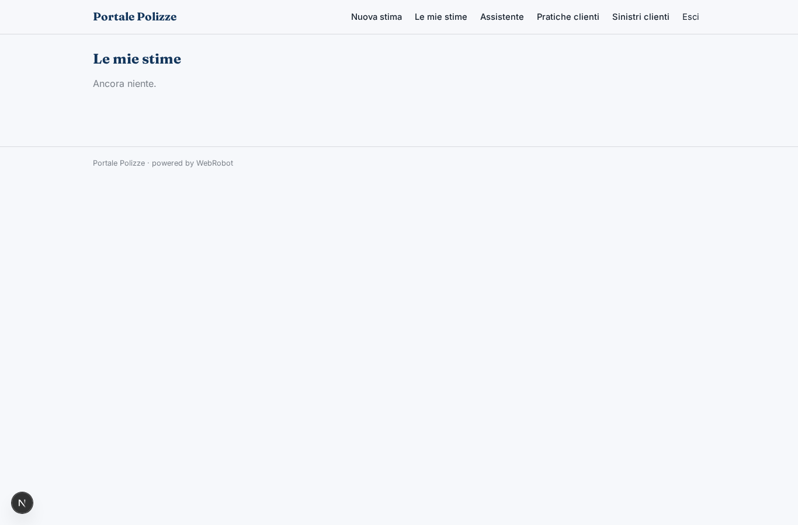
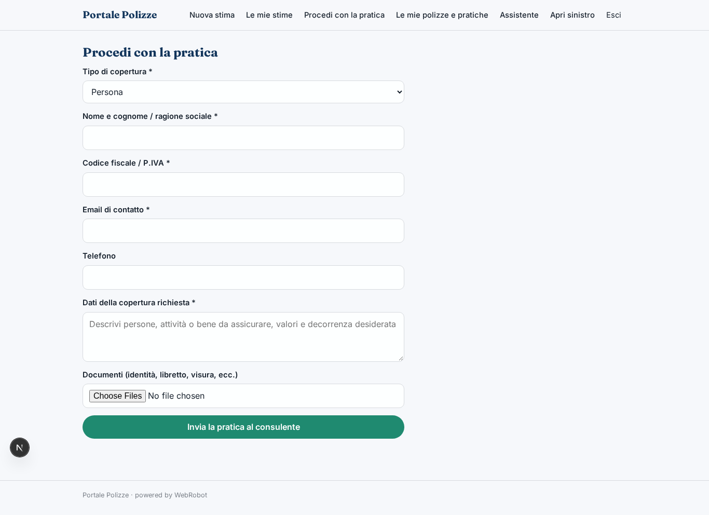
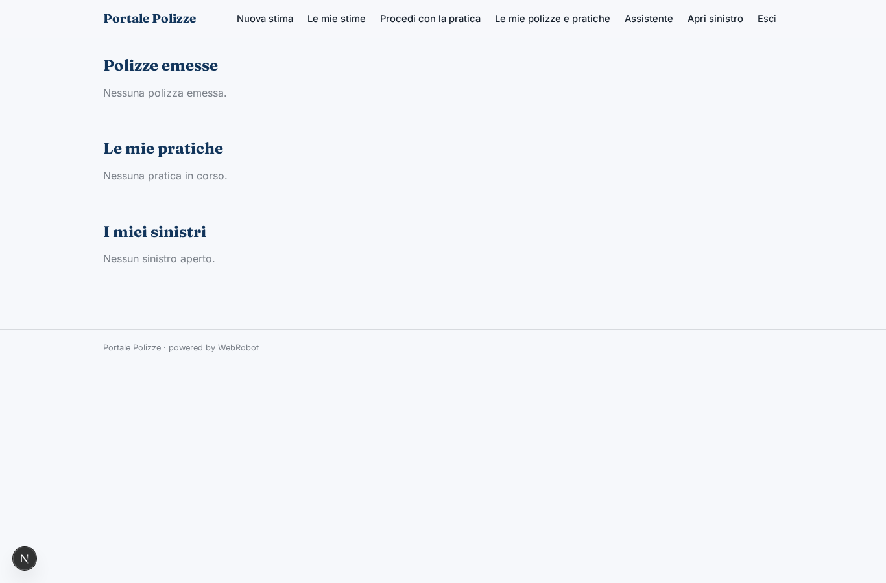
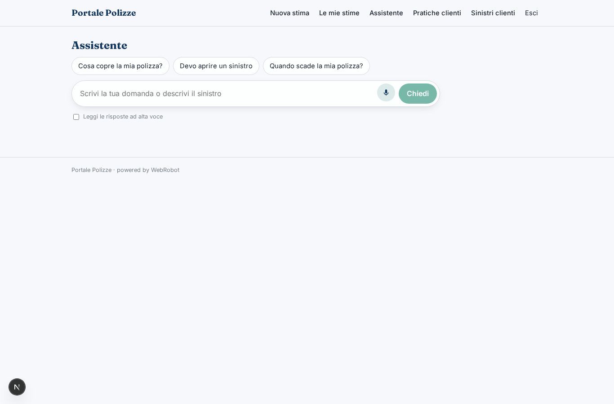
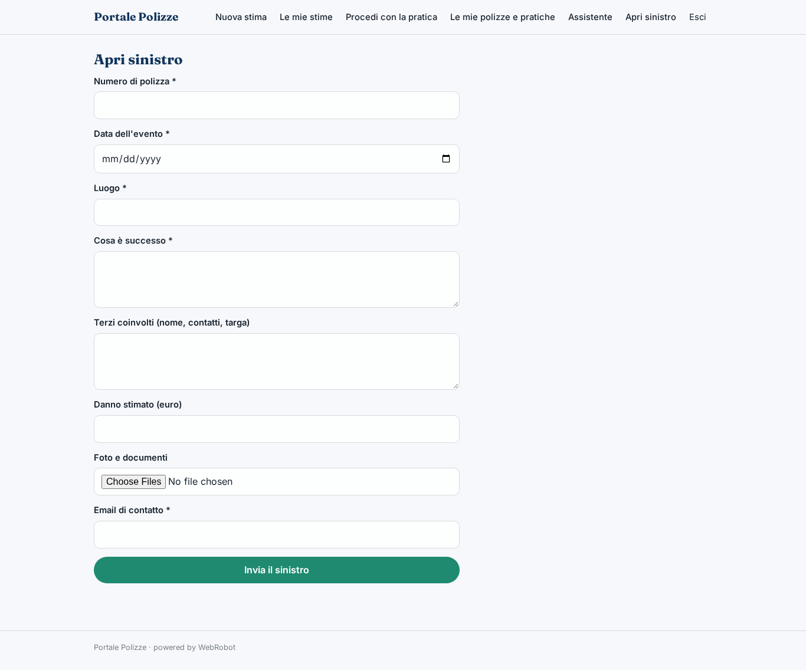
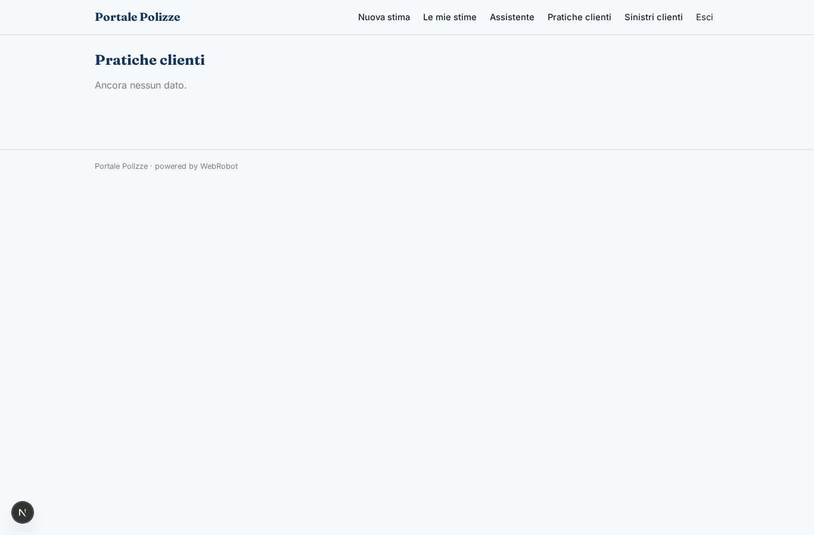
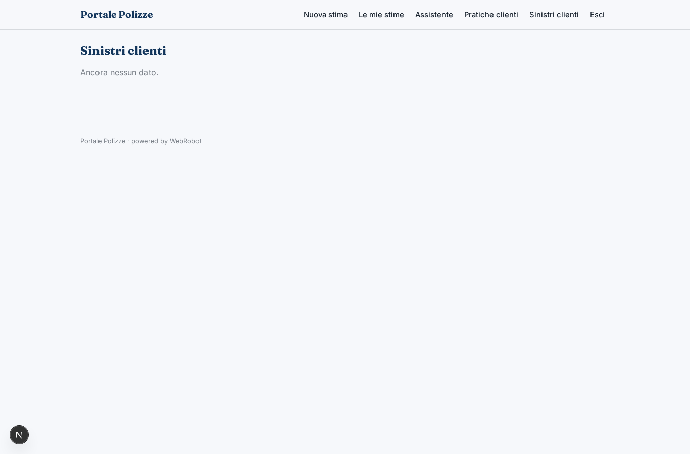

# Portale Polizze

_Preventivo in pochi minuti, polizze e sinistri in un'unica area personale._

**Manifest:** valid (schema + runtime contract) · **Functional test:** passed (18 checks passed)

## Description given to the app builder (Italian)

Descrivo solo lo strato software di un operatore assicurativo, cioe il portale di preventivo e gestione delle polizze; l'attivita assicurativa regolamentata e la sottoscrizione dei rischi restano in capo all'intermediario autorizzato. Il cliente compila un modulo con i dati necessari al tipo di copertura che cerca (persona, famiglia, attivita, bene da assicurare) e un agente mostra subito una stima e le coperture disponibili spiegandone le differenze in parole semplici. Se l'utente procede, l'app raccoglie i dati e i documenti e prepara la pratica, che un consulente umano autorizzato verifica e perfeziona prima dell'emissione; la polizza emessa e i documenti finiscono nell'area personale del cliente. Un agente assiste il cliente in chat per capire la copertura, aprire una richiesta di sinistro compilando il modulo guidato e caricare le foto, passando poi la pratica all'operatore. Promemoria via email per le scadenze e i rinnovi. Il cliente vede solo le proprie polizze, l'agente i clienti seguiti. Lo strato software e incluso nel servizio. In italiano.

## Features not expressible today (spec.extensions)

- **consulente_assegnato**: Assegnazione di ciascun cliente a un consulente specifico: ora i consulenti invitati vedono tutte le pratiche; l'assegnazione per cliente richiede che un amministratore registri l'email del consulente sulla pratica.
- **caricamento_polizza_emessa**: L'emissione resta un atto del consulente autorizzato: il consulente aggiorna la pratica (numero, compagnia, premio, scadenza, PDF). Nessuna integrazione con i sistemi delle compagnie.

## Screenshots (interpretive runtime, no data)

### home-anon

### home-mobile

### home

### new_quote

### quotes

### new_practice

### my_policies

### assistant_chat

### new_claim

### advisor_practices

### advisor_claims

