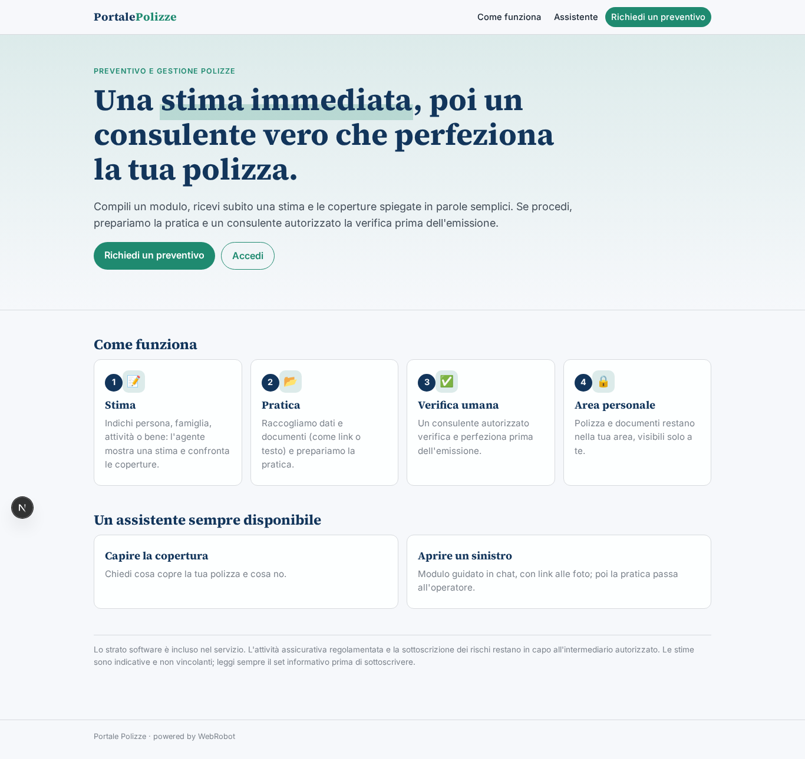
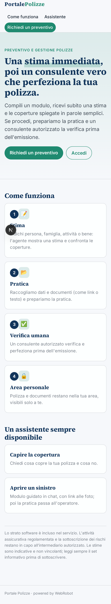
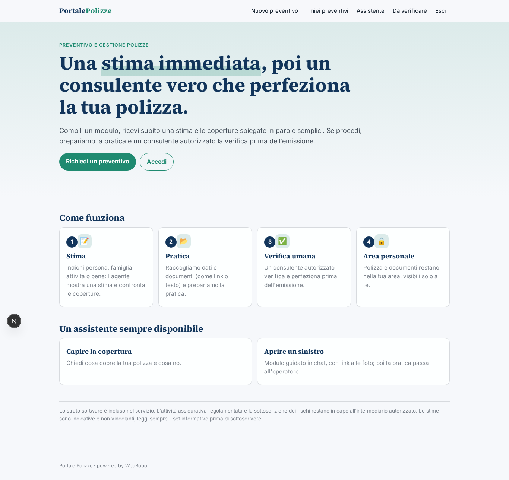
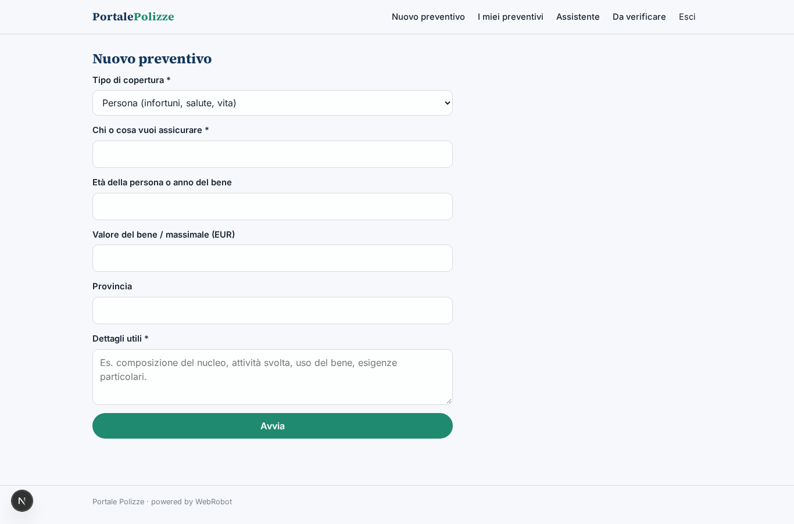
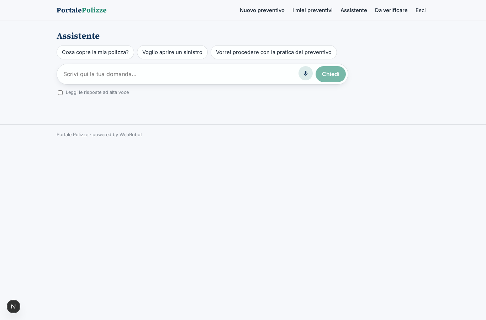
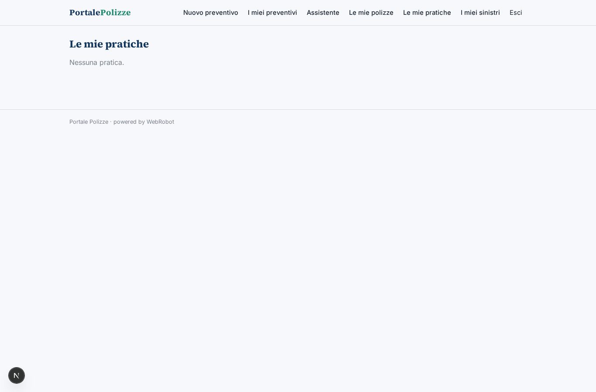
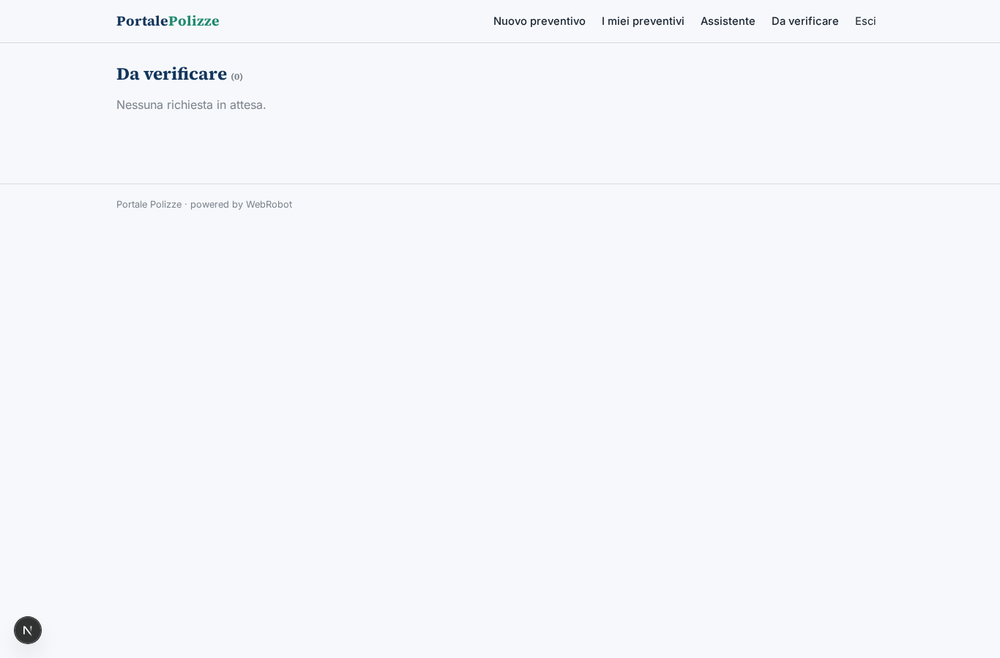

# Portale Polizze

_Preventivo, polizze e sinistri in un unico portale, con un consulente autorizzato accanto a te._

**Manifest status:** valid (schema validator + runtime contract)

## Description given to the app builder (Italian)

Descrivo solo lo strato software di un operatore assicurativo, cioe il portale di preventivo e gestione delle polizze; l'attivita assicurativa regolamentata e la sottoscrizione dei rischi restano in capo all'intermediario autorizzato. Il cliente compila un modulo con i dati necessari al tipo di copertura che cerca (persona, famiglia, attivita, bene da assicurare) e un agente mostra subito una stima e le coperture disponibili spiegandone le differenze in parole semplici. Se l'utente procede, l'app raccoglie i dati e i documenti e prepara la pratica, che un consulente umano autorizzato verifica e perfeziona prima dell'emissione; la polizza emessa e i documenti finiscono nell'area personale del cliente. Un agente assiste il cliente in chat per capire la copertura, aprire una richiesta di sinistro compilando il modulo guidato e caricare le foto, passando poi la pratica all'operatore. Promemoria via email per le scadenze e i rinnovi. Il cliente vede solo le proprie polizze, l'agente i clienti seguiti. Lo strato software e incluso nel servizio. In italiano.

## Features not expressible today (spec.extensions)

- **caricamento_file**: Il caricamento di documenti e foto non è ancora disponibile: il cliente fornisce link o testo incollato.
- **promemoria_email**: Promemoria email per scadenze e rinnovi non disponibili ancora (le notifiche non sono supportate): la scadenza è visibile nell'area personale.
- **clienti_seguiti**: La vista del consulente sui clienti che segue (oltre alle approvazioni) richiede un back office dedicato; ora il consulente decide le pratiche nella vista Da verificare.
- **emissione_polizza**: L'emissione e il caricamento della polizza e dei documenti nell'area del cliente avvengono a cura dell'intermediario autorizzato.

## Screenshots (interpretive runtime)

### home-anon

### home-mobile

### home

### nuovo_preventivo

### preventivi

### assistente_chat

### mie_polizze

### mie_pratiche

### miei_sinistri

### verifiche

