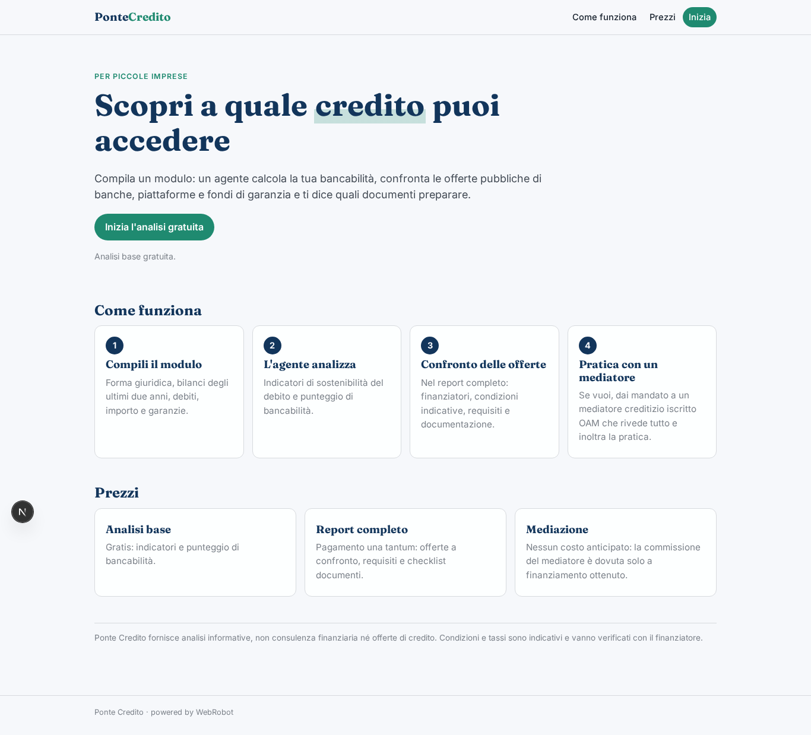
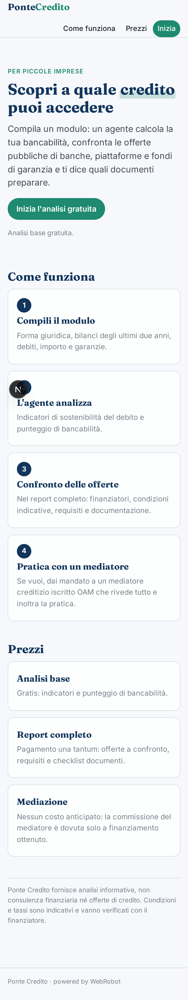
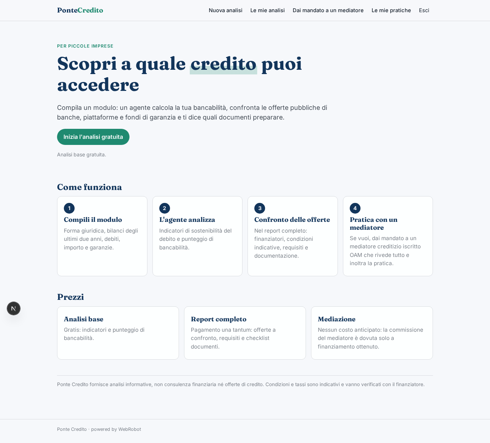
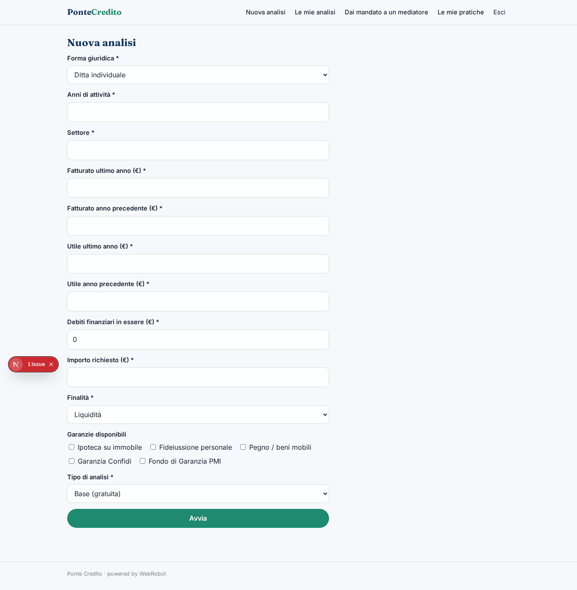
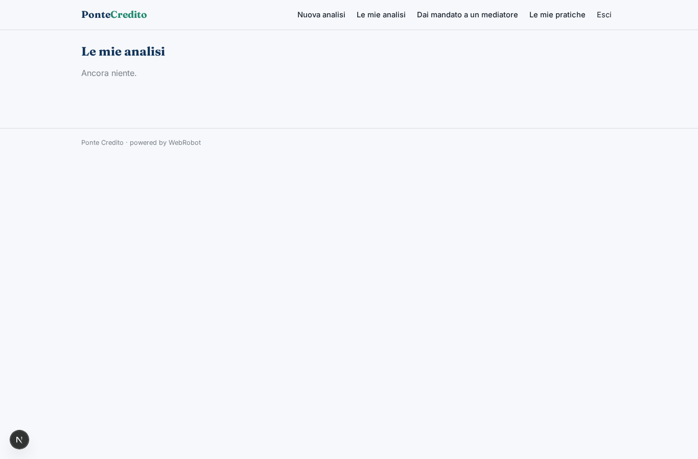
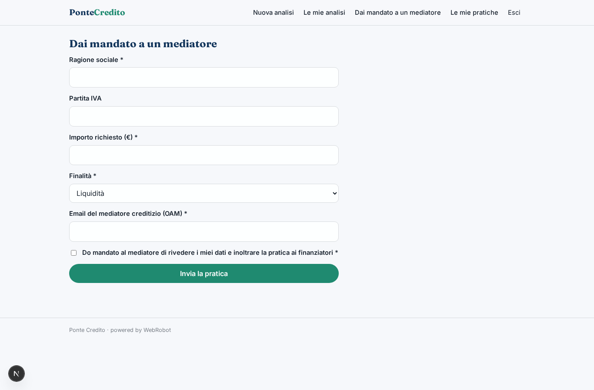
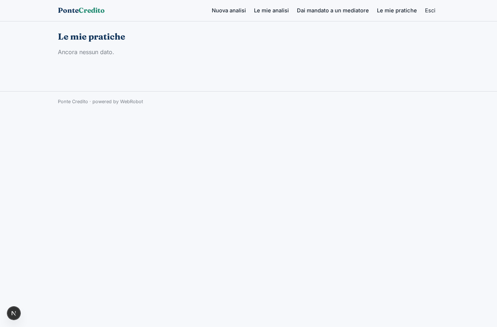
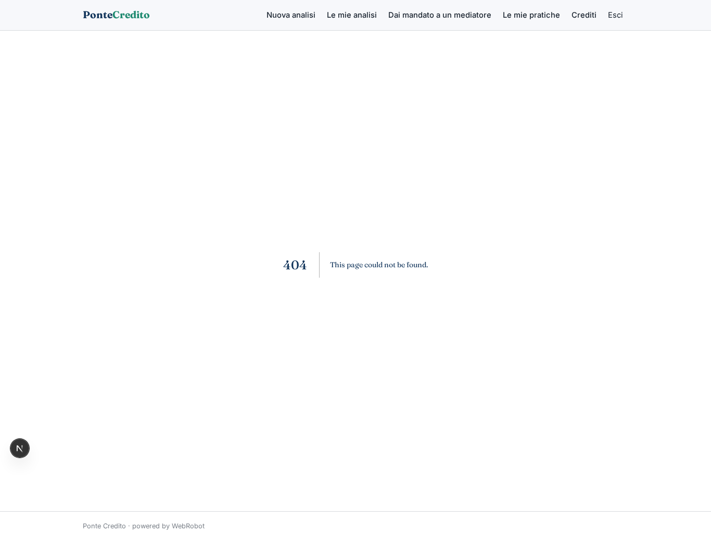
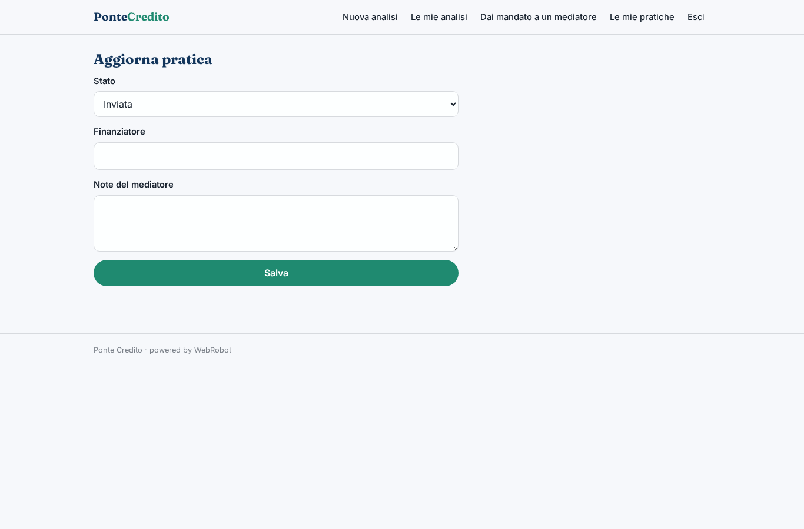
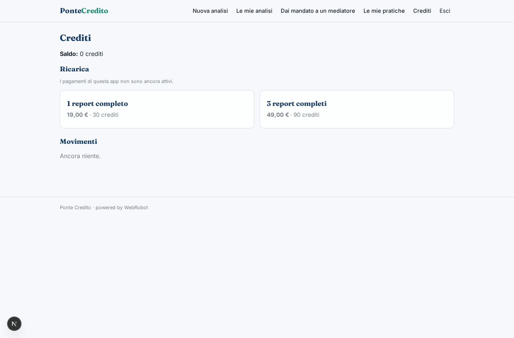

# Ponte Credito

_Scopri a quale credito puoi accedere e preparati a chiederlo._

**Manifest:** valid (schema + runtime contract) · **Functional test:** passed (15 checks passed)

## Description given to the app builder (Italian)

Voglio Ponte Credito, un'app che aiuta le piccole imprese a capire a quale credito possono accedere e a prepararsi. L'imprenditore si registra e compila un modulo: forma giuridica, anni di attività, settore, fatturato e utile degli ultimi due anni, debiti in essere, importo richiesto, finalità (liquidità, investimento, anticipo fatture) e garanzie disponibili. Un agente calcola indicatori di sostenibilità del debito e un punteggio di bancabilità, cerca sul web le offerte pubbliche dei finanziatori (banche, piattaforme di lending, fondo di garanzia, misure regionali) e confronta condizioni, tassi indicativi e requisiti, producendo un report con le opzioni più adatte e la documentazione da preparare. Vorremmo leggere direttamente i movimenti bancari collegando i conti con l'open banking, e inoltrare la pratica ai finanziatori tramite un mediatore creditizio iscritto all'OAM che rivede tutto. L'imprenditore vede il proprio report e lo stato delle pratiche; il mediatore vede le imprese che gli hanno dato mandato. Analisi base gratuita, report completo a pagamento una tantum, commissione del mediatore solo a finanziamento ottenuto.

## Features not expressible today (spec.extensions)

- **open_banking**: Lettura dei movimenti bancari tramite open banking (PSD2): non disponibile ancora, richiede OAuth/consenso con un provider AISP. Per ora l'imprenditore inserisce i dati nel modulo.
- **mediator_commission**: La commissione del mediatore a finanziamento ottenuto si concorda e si incassa fuori dall'app; l'app registra lo stato 'funded' e avvisa l'imprenditore. Un addebito automatico via Stripe Connect non è ancora configurato.
- **oam_check**: Verifica dell'iscrizione OAM del mediatore: gli admin assegnano e controllano manualmente le email dei mediatori.
- **lender_forwarding**: L'inoltro ai finanziatori è svolto dal mediatore fuori dall'app; l'app tiene mandato e stato della pratica.

## Screenshots (interpretive runtime, no data)

### home-anon

### home-mobile

### home

### new_run

### history

### mandate

### practices

### desk

### practice_update

### account

